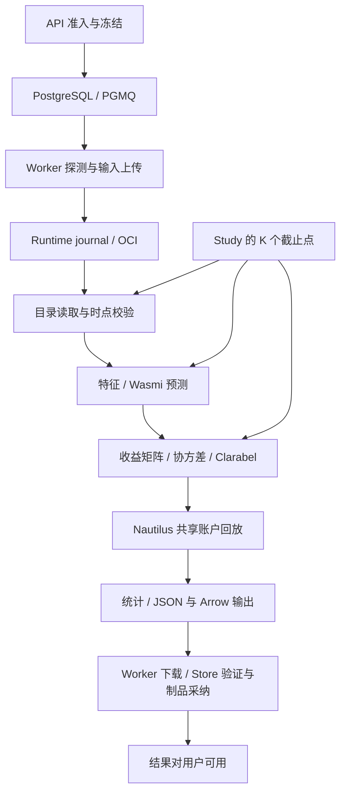

# QuaZonai 核心计算引擎 RT 瓶颈定位与深度优化方案

基线提交：`d7da6bff197bcbf272ba998ae0a15b2c1b25071c`。调研日期：2026-10-29。交付范围：代码审计、局部可复现实验、官方资料调研与实施设计；未修改生产计算逻辑。

**本次修订：将升级 Nautilus Rust 全家桶至 0.67.0、Rust 至 1.99.1 列为必做前置工作。按用户要求直接切换新版，不做旧版兼容、双版本运行或回退机制。** 当前源码仍为0.63.0；本文是待实施方案，不代表依赖已经升级。此前局部测量保留原版本标签，不能充当0.67.0性能结果。

## 1. 结论与优先顺序

当前最值得优先处理的是**外围重复工作和数据物化成本**，其次才是换求解器、并行化或 GPU。已确认的机制包括：JSON 无缓冲小写；逐 BAR 深拷贝完整目标；完整历史预测的生成及反向查找；滚动 Study 重复加载历史；同进程重复协方差与结果验证；频繁轮询中的重复加锁/写状态。这些问题横跨计算前、计算中和结果采纳，单看 Clarabel 求解时间会漏掉大部分候选成本。

建议顺序：

1. 固定最新官方Nautilus Rust 0.67.0及Rust 1.99.1，完成API、费用来源、目录读取、结果版本与镜像适配；新版独立正确性验收通过后建立release性能基线。
2. 优先接入新版原生typed batch与有界目录查询；同时完成输出缓冲、延迟clone、末点收集、同次任务数据与编译模块复用，逐项对比同一个0.67.0基线。
3. 压缩Study历史物化与同进程风险重算，按峰值内存和时间戳边界验证原生流式回放；不把升级本身当成已经获得加速。
4. 优化控制面的重复探测事务、发布锁和配额统计，再按实际热点比较BLAS/faer与Clarabel数据更新。部署一次切换到新版，失败时修复新版后重新发布，不建设旧版本恢复通道。

**证据边界：本次能精确指出代码中的冗余发生位置，并实测其中的局部机制；不能据此声称已经知道生产 p95、各阶段耗时占比或整机提升倍数。** 当前没有生产 trace、冻结真实 workload、目标硬件和队列负载记录。下文将“源码确认”“局部实测”“待验证方案”分别标注。

## 2. 当前计算栈、规模和 RT 定义

项目的核心计算是 Rust，不是 Python/pandas 热循环。版本来自 [job/Cargo.toml](../../../apps/job/Cargo.toml) 与 [Cargo.lock](../../../Cargo.lock)：Nautilus 0.63.0、Clarabel 0.11.1、Wasmi 2.0.0、ndarray 0.17.1、ndarray-stats 0.7.0、nalgebra 0.35.0、linregress 0.5.4；公开 Arrow 历史合同使用 56.2.0，依赖树同时存在 59.3.0。双版本本身只能证明依赖/构建成本，不能直接认定运行时发生跨版本复制。

| 范围 | 当前/核实状态 | 本方案目标 |
| --- | --- | --- |
| 项目直接依赖的12种Nautilus Rust crate | 当前0.63.0；2026-10-29官方registry中最高未撤回、无预发布后缀版本均为0.67.0 | 全部精确固定`=0.67.0`，含optional与dev依赖，统一lockfile |
| Rust | 当前1.98.1；0.67.0各crate声明`rust-version=1.99.1` | 开发、CI、Wasm编译器、原生job与应用镜像统一1.99.1 |
| Python NautilusTrader | 最新已发布为2.0.0rc8；PyPI默认非预发布选择仍为1.231.0 | 当前Rust计算链无此直接依赖，不为升级引入Python侧车；如确有独立Python工具，明确固定RC8和Python3.13/3.14 |

不能将Python的RC版本号写进Rust `native_version`，也不能将0.67.0称为NautilusTrader 2.0最终正式版。此次Rust发布包的VCS来源为`d53849b216e20f2c122ca01b4dd0da377638b186`，与rc8发布标签对应。版本、checksum、MSRV与PyPI记录见 [registry证据](evidence/nautilus-latest.json)；[官方Rust索引](https://index.crates.io/na/ut/nautilus-backtest)、[官方rc8发布](https://github.com/nautechsystems/nautilus_trader/releases/tag/v2.0.0rc8)、[安装说明](https://nautilustrader.io/docs/latest/getting_started/installation/)。实施开始与发布前再查一次官方registry；若更新，先修订精确版本和验收记录，不能在构建时浮动拉取`latest`。

记号：A 为资产数，T 为单资产观察数，N≈A×T 为 BAR 总数，M 为模型数，K 为 Study 截止点数，F 为目录 Parquet 文件数，H 为 Runtime 已保存历史记录量。

现有限制必须进入实验设计：[portfolio.rs](../../../crates/contracts/src/portfolio.rs) L6–9 限制 A≤256、单资产收益观察≤100,000、收益值总数≤1,000,000；[study.rs](../../../apps/job/src/study.rs) L94–97 还限制所有 frame 累计收益值≤1,000,000。不能拿 A=256、T=100,000、K=256 的非法组合宣称该系统会分配数十 GB。N、M、燃料、输出大小还有独立上限，压测应先通过原准入。

RT 至少拆成三种指标：

| 指标 | 起止点 | 用途 |
| --- | --- | --- |
| 提交 RT | 收到请求→冻结输入/队列事务提交并返回 202 | 用户能否快速开始；不等于计算完成 |
| 结果可用 RT | 收到请求→结果校验、制品持久化及 Store 采纳完成 | 用户实际等待时间，主优化指标 |
| 取消 RT | 持久化取消意图→核实原容器停止并完成对账 | 可恢复性和交互响应，不能被吞吐优化牺牲 |

结果可用 RT 的单次关键路径为：`准入 + 排队 + 输入传输/物化 + OCI 启动 + 目录读取/校验 + 特征/模型 + 风险建模/求解 + 回放 + 统计/序列化 + 输出传输 + 发布验证/持久化 + 完成可见延迟`。并行阶段以 trace 的关键路径统计；**各阶段 p95 不能相加当作总 p95**。

## 3. 定位清单

以下行号均针对上述旧源码基线，用于定位待改适配层。原生内部机制已按0.67.0重核，见第5节；新版本集成后重新profile并重排行动顺序，不能原封不动套用0.63.0内部结论。优先级不代表已测得的生产耗时排名。

| 编号 | 定位与机制 | 成本性质/触发条件 | 证据与优先级 |
| --- | --- | --- | --- |
| P01 | [managed.rs](../../../apps/job/src/managed.rs) L80–127：`to_writer`→`LimitedFile::write`→`File.write`，没有缓冲 | 大 JSON 的字段、标点、数字产生大量小写调用 | 源码+局部实测；第一批 |
| P02 | [simulation.rs](../../../apps/job/src/simulation.rs) L203：完整 `NativeTargetPointV1` 在横截面完整和到期检查之前 clone | 下一个目标存在时每 BAR 复制 A 个 targets 及字符串/Decimal；最坏 O(N×A) | 源码+结构微基准；第一批 |
| P03 | [simulation.rs](../../../apps/job/src/simulation.rs) L208–220：每 BAR 扫 `latest.values()`，完整时再求 max | 横截面验证最坏 O(N×A)，短路时更少 | 源码+结构微基准；第二批 |
| P04 | [portfolio.rs](../../../apps/job/src/portfolio.rs) L200–220：生成全部 forecast points 后，对每资产 `rev().find()` | 每模型构造 O(A×T) DTO；资产分块布局下查找约 T×A×(A−1)/2+A 次 | 源码+结构微基准；第一批 |
| P05 | [study.rs](../../../apps/job/src/study.rs) L75–102、[portfolio.rs](../../../apps/job/src/portfolio.rs) L110：每 cutoff 重跑 `prepare`，rolling liquidity 又 load | K 次全前缀读取/验证/预测；rolling 分支每 cutoff 额外一次同选择读取 | 源码确认；第一、二批分拆 |
| P06 | [forecast.rs](../../../apps/job/src/forecast.rs) L67、[signals.rs](../../../apps/job/src/signals.rs) L34–70：每次 `forecast_market` 新建 Engine/编译 Module | Study 中相同模型被编译 K 次；模块字节与校准对象也重复 clone/解析 | 源码确认；第一批；只复用编译代码 |
| P07 | [optimization.rs](../../../apps/job/src/optimization.rs) L128–146、440、451；[domain/portfolio.rs](../../../crates/domain/src/portfolio.rs) L705 | solver 前算协方差，结果校验在有关风险约束下再算；成功路径同结果连校验两次 | 源码确认；第二批，需保留失败结果转换 |
| P08 | [portfolio.rs](../../../apps/job/src/portfolio.rs) L308–328；[study.rs](../../../apps/job/src/study.rs) L126–135 | `Prepared` 中收益/预测 clone 到 input；每 frame 保留历史前缀 | 源码确认；先 move，再考虑有版本的共享存储 |
| P09 | [catalog.rs](../../../apps/job/src/catalog.rs) L244–260、334–337 | 每次 load 扫所有挂载 Parquet footer；每 BAR 生成 bar_type 字符串查索引 | 源码确认；重复 load 放大，小文件目录尤其敏感 |
| P10 | [simulation.rs](../../../apps/job/src/simulation.rs) L766、791、815、864–866 | 旧Vec<Data>接入、分析与JSON往返 | 0.67.0已重核：优先typed batch；保留as_value/run_analysis优化，避免把旧sort=false建议套给新typed接口 |
| P11 | [validation.rs](../../../apps/job/src/validation.rs) L159–184 | 简单双变量 OLS 使用 formula builder/full statistics，再只消费参数/预测 | 源码+官方 API；较低优先，先测校准占比 |
| P12 | [worker.rs](../../../apps/server/src/worker.rs) L660、779；[lifecycle.rs](../../../crates/store/src/lifecycle.rs) L1022 起 | 运行状态探测频繁访问持锁事务，同状态重复 UPDATE | 源码确认；控制面第二批 |
| P13 | [journal.rs](../../../apps/runtime/src/journal.rs) L181–183 | 每次容量检查 SUM 四张历史表，成本随 H 增长 | 原 SQL 局部实测；控制面第二批 |
| P14 | [lifecycle/native.rs](../../../crates/store/src/lifecycle/native.rs) 的结果发布路径 | 持项目相关锁验证结果、读取输入、持久化制品；其他同项目事务受阻 | 源码确认；需现场锁等待与 fsync 分解 |
| P15 | [supervisor.rs](../../../apps/runtime/src/supervisor.rs) L131–177、274–292 | 串行清理和等待整批 drive 完成延迟下一轮；create/bind 后下一轮才 start | 源码确认；短任务/清理高峰尾延迟候选 |
| P16 | [http.rs](../../../apps/runtime/src/http.rs) L176–203、[worker.rs](../../../apps/server/src/worker.rs) L727–757 | 通用4槽HTTP限制耦合上传与控制请求；上传暂时503可能结束当前driver | 源码确认；突发上传/取消竞争候选 |
| P17 | [materialize.rs](../../../apps/runtime/src/materialize.rs) L266–273、374–410，journal 的 BLOB 读写 | 全对象 Vec 驻留、多段复制和跨job重复上传 | 源码确认；先计bytes与Worker/Gateway峰值RSS |

## 4. 数据、预测和 Study：先减少重复工作

### 4.1 一次选择、一份已验证数据

将 `prepare(catalog, selection, …)` 拆成“读取选择”和“从已验证 market 准备输入”，由 Build/Study 单个截止点拥有 `NativeMarketData`。预测、流动性、滑点、收益构造共享借用。同一 cutoff 的 rolling liquidity 不再第二次 `load_catalog`。此改动直接减少一次目录初始化、F 次 footer 检查、解码与逐 BAR 校验，不需要换库。

Study 已在 L16–29 缓存 artifact 原始字节，不能误称每 cutoff 都从磁盘重新读模型；真正冗余是 L90 的字节 clone、校准反序列化和 Wasmi 再编译。将对象读取接口由拥有 `Vec<u8>` 改成 task-local 的借用/`Arc<[u8]>`，并缓存解析后的不可变校准对象。不要改外部 artifact 权限和身份验证。

跨 cutoff 目录缓存分两步：

1. 先对同一任务、同一不可变挂载缓存 footer 验证结果与原始列数据；缓存键必须绑定 snapshot/content identity、分区/授权作用域、bar types、原生版本和选择语义。不要用路径名或 instrument ID 作为唯一键。
2. 为每个 cutoff 创建只读因果 view，仍同时执行 `ts_event` 半开区间与 `ts_init<=cutoff` 过滤、行数上限、instrument 原始版本选择及完整横截面验证。禁止“读到最大 cutoff 后直接把全数组交给早期模型”。迟到 BAR、定义变化和结算可得时间必须纳入等价测试。

初步只在任务生命周期内复用。跨任务全局缓存会引入内存驱逐、数据撤权、Sealed 暴露范围和重启恢复的新问题，收益需要单独证明。现有footer检查针对0.63.0 decoder；升级后按0.67.0实际解码边界重测非法footer，确认原生拒绝能力后决定是否移除这项适配检查。需要的检查可在不可变输入验证一次后复用，不能只为少I/O删除。

### 4.2 末点收集器：少构造结果，不跳过模型调用

当前 `forecast_market` 按资产逐块 push 所有历史点，`portfolio::prepare` 又为每资产从整个向量尾部查找。低风险第一步是在生成结果时返回每资产末点索引，或遍历一次建立索引。直接ordinal索引或HashMap（期望复杂度）将索引构建和查找从O(A²T)降到O(AT+A)；有序BTreeMap为O(AT log A+A log A)。在producer直接记录末点后，消费方取回O(A)，原预测循环仍O(AT)。这不会减少模型预测次数。

第二步提供两个内部输出模式：完整 `ForecastEvidence` 用于需要历史证据的任务；`TerminalForecast` 用于组合末点消费。它们必须共享同一个逐 BAR 特征/预测循环。后者只保留每资产最后的预测、event/available 时间和燃料统计，从 O(AT) 历史 DTO 内存降到 O(A)。模型仍按原顺序消费所有历史观察，仍使用新实例、同样的 per-call/total fuel 与 trap 传播。

特别检查原 `forecast_market` 的标签有限性校验：不能因为不再返回标签，意外让以前因标签溢出失败的请求变成成功。第一版保留相关数值验证；若要定义“不产生标签”的独立语义，应显式版本化并调整调用合同。warmup、无预测、asof 和迟到数据错误同样不能消失。

### 4.3 Wasmi 只共享编译结果

现有 `SignalModule` 已明确支持在同一模块上创建新实例，`CompilationMode::Eager` 避免燃料消耗依赖首次编译。把 task-local `SignalModule` 提升至 Study 外层，按模型字节身份+固定 Engine 配置缓存；每 cutoff/asset/fold 仍 `instantiate` 全新 Store，保持原分配后的 cutoff fuel。

缓存必须惰性编译、限制条目/内存、按原模型消费顺序触发失败。最多256个模型，每个Wasm原始字节可达2 MiB，编译IR/Engine还有额外开销；一次保留所有模块可能反而OOM。为缓存设任务内预算，记录命中/驱逐、IR估计与进程RSS，在实际不可估计IR大小时使用保守条目上限和进程内存余量。只有全部工作集容纳且无驱逐时，编译次数才可由K×M降到M；受限缓存按命中率评估，不承诺这个下界总能达到。

不能把“有状态 Wasm 只跑新增 BAR”当成本版本的透明优化：[forecast.rs](../../../apps/job/src/forecast.rs) L58–59 和 [signals.rs](../../../apps/job/src/signals.rs) L17–18 明确要求隔离执行状态。相同输出并不足以证明相同燃料、失败次序和独立评估语义。[Wasmi 2.0 官方说明](https://wasmi-labs.github.io/blog/posts/wasmi-v2.0/)支持把编译代码和实例状态分开，但这不授权跨 fold 共享 globals/memory。

若未来需要真正 O(K×T)→O(T) 的模型增量执行，另立新的模型 ABI/研究合同：明确纯函数或状态转移、重放检查点、fuel 归属、失败恢复、切换 cutoff 和独立评估规则。当前建议先不走这条高风险路线。

### 4.4 特征、收益与 frame 内存

相同 fast/slow 参数的因果 EMA 可按“资产+参数+前缀身份”计算一次后共享只读值，不共享 Wasm 实例。每资产 view 只暴露该 cutoff 内的观察；复用前验证 warmup 和初始化次序一致。

`allocation_input` 优先改为消费 `Prepared` 或分解字段 move，去掉完整收益矩阵和 forecasts 的临时深拷贝。保留 frame 结果的现有 wire schema，不用更改外部合同来做这个局部优化。

若测得 frame 总存储成为瓶颈，再设计 v2 的单一收益列块+frame 区间引用、manifest digest 和 reader；Arrow 的只读 slice 可服务任务内部。现有 [portfolio_history.rs](../../../crates/contracts/src/portfolio_history.rs) 是固定单 batch 的目标权重合同，不是任意收益历史容器，不能直接改变它的含义。Parquet 压缩解码也不是零拷贝；Arrow 对读入后的列块共享和 mmap 有帮助，但不等于从磁盘到整个引擎零拷贝。[Arrow IPC 官方 reader 文档](https://docs.rs/arrow-ipc/latest/arrow_ipc/reader/struct.FileReader.html)

## 5. 回测热循环与结果分析

### 5.1 延后目标 clone，再优化横截面检查

`apply_bar` 先用借用读取 next point 的 asof/expiry；仅在横截面齐全、目标已到期且将执行时 clone/取走目标。缺 target、未齐全、未到期的 BAR 不再构造整份 targets。这个变更保持后续 Study 对 point 的可变处理。

横截面检查可以用紧凑资产 ordinal 和时间计数索引替代全表扫描：更新某资产时减去其旧 `ts_event` 计数，加入新值；仅当覆盖所有资产且当前 event 计数为 A 时通过。保留最新 BAR、实际 `ts_init` 和过期逻辑。**不要简单按全局 event 时间切换并清零计数**：按 available time 回放时，不同资产的迟到数据会让全局 event time 回退。必须覆盖此反例。总成本可由最坏 O(N×A) 降为 O(N log A) 的索引维护，或在经过证明的紧凑结构中接近 O(N)。

保持共享资金、减仓确认后增仓、partial fill、target coalescing 拒绝、latency、fee 和 settlement 时序。优化只减少查询和复制，不允许跳 BAR、批量净额替代真实撮合、平行拆开同一账户或以目标权重公式重算权益。

### 5.2 必选升级：统一依赖、工具链和结果身份

直接从0.63.0切到0.67.0，不维护中间版本支持。升级清单：

| 改动面 | 必须修改的位置/动作 |
| --- | --- |
| Rust依赖 | [apps/job/Cargo.toml](../../../apps/job/Cargo.toml) 的backtest、analysis、common、core、execution、portfolio、persistence、indicators、polymarket、data、model、trading全部`=0.67.0`，含dev model；[apps/runtime/Cargo.toml](../../../apps/runtime/Cargo.toml)的生产model和dev persistence一并更新；重建Cargo.lock，检查整条依赖链无残留0.63/0.66混用 |
| 工具链 | [rust-toolchain.toml](../../../rust-toolchain.toml)、[workspace rust-version](../../../Cargo.toml)、CI的RUSTUP_TOOLCHAIN、[容器action](../../../.github/actions/container/action.yml)、[应用Dockerfile](../../../deploy/docker/Dockerfile)统一1.99.1；安装同版wasm32 target；更新实际官方基础镜像digest |
| 镜像assembler | [build-native-image.mjs](../../../runtimes/native/build-native-image.mjs) L66–69/92/136的编译器、sysroot、目标和报告固定值；[native-job.Dockerfile](../../../runtimes/native/native-job.Dockerfile)的native-stack与[Runtime engine.rs](../../../apps/runtime/src/engine.rs)的NATIVE_STACK/engine_versions必须一致，否则新镜像被拒绝 |
| 编译结果核验 | [managed.rs](../../../apps/job/src/managed.rs) L227、[domain output.rs](../../../crates/domain/src/execution/output.rs) L129和[部署smoke](../../../deploy/docker/smoke.py)中的rustc要求同步更新；否则新Wasm编译会被旧版本检查拒绝 |
| 引擎/指标身份 | [contracts/portfolio.rs](../../../crates/contracts/src/portfolio.rs) 的NAUTILUS_EXECUTION_VERSION，job的catalog/forecast/validation/forward/simulation输出，以及domain对应验证器、fixtures统一0.67.0；不能只改报告字符串而继续跑旧库 |
| 发布材料 | 更新native目录文档、架构中的能力边界、构建receipt、SBOM/许可证与镜像登记；如wire schema变化，从contracts重新生成，不手改生成文件 |

旧artifact和源数据只保留为历史文件，不重标版本、不作为新版任务输入兼容。新版只接受新版登记的目录、费用来源、MODEL编译产物和质量报告；需要的数据由新官方工具从授权原始来源重新准备，不实现旧catalog reader或旧报告转换层。

### 5.3 目录API迁移：避免升级后先全量加载再限流

0.67.0的 `nautilus_persistence::backend::catalog` 已移至 `backend::parquet::catalog`，`CatalogPathPrefix`等类型按新公开路径导入。修改范围不止 [catalog.rs](../../../apps/job/src/catalog.rs)，还包括prediction、catalog-prepare、polymarket-history、history适配及测试。

**性能关键变化：普通 `ParquetDataCatalog::query<T>` 现在返回 `Result<Vec<T>>`。** 旧代码的`query.take(maximum_rows+1)`不能机械改成`query.into_iter().take(...)`，因为这时全量解码已经发生；`query_record_batches`同样返回Vec，不是自动有界流。

BAR/InstrumentClose热路径改为原生 `CatalogReader::query_batch_session(&CatalogQuery, chunk_size)`，逐次`next_batch()`消费。Parquet实现对这些类型使用惰性typed pages及DataFusion `execute_stream`；Instrument/Custom的某些分支仍会先物化，须单独测量。[官方persistence 0.67.0发布包](https://static.crates.io/crates/nautilus-persistence/nautilus-persistence-0.67.0.crate)

适配层负责：用受信selection构造identifier、`ts_init`起止和`ts_event >= start AND ts_event < end`谓词；按batch累积行数/字节并拒绝超限；逐记录保留完整时间、价格/精度、身份与非修订校验；不向调用者开放任意where SQL。`CatalogAsOf::Latest`不替代PIT，事件区间和可得截止点仍必须显式限制。

时间戳对齐会使batch超过名义chunk_size；原生merge可能同时保留各源一页，DataFusion排序也可能缓存。不能宣称内存严格等于一个chunk。必须覆盖同timestamp大批量、跨文件相同timestamp、超限行和排序spill；配置可用的原生资源预算并保留job cgroup限制。超限应失败，不截断后伪造完整回测。

### 5.4 Typed DataBatch：替代当前逐项 Data Vec 接入

建议的新通道：`原生typed查询session → QZ时点/数量校验 → DataBatch / BatchView → BacktestEngine::add_data_batch → 同一原生engine回放`。让BAR尽量保持typed storage，减少`Vec<Bar>→Vec<Data>`包装与中间复制。可先完成有界读取和typed整批接入，再按5.5验证完整streaming。

已从精确0.67.0源码确认：legacy `add_data(Vec<Data>, sort=true)`仍有两处排序；typed `add_data_batch`不走engine预排序，在迭代器中检查顺序，已排序BatchView可共享，乱序时才按需要取得可变存储排序。**因此新typed路径保留`sort=true`作为run readiness，不沿用上一稿笼统的`sort=false`建议。** [官方backtest 0.67.0发布包](https://static.crates.io/crates/nautilus-backtest/nautilus-backtest-0.67.0.crate)

同timestamp BAR与InstrumentClose的多流优先次序需显式约定和测试；typed不是允许任意重排的理由。BatchView基于Arc和range，slice/clone共享底层内存，但保留backing allocation，且公开底层访问能力意味着它不是PIT/Sealed隔离边界；传给模型/跨隔离范围前仍做真实数据选择。[官方model 0.67.0发布包](https://static.crates.io/crates/nautilus-model/nautilus-model-0.67.0.crate)

### 5.5 新streaming/replay能力的采用边界

首版优先公开低层 `add_data_batch` 与 `run(streaming=true)`、`clear_data`、最终一次`end`，让共享账户、订单、定时器和策略状态一直属于同一个engine。跨来源汇合时必须保证某个回放timestamp的全部记录均已就绪，再推进该timestamp；不能仅凭各自session内部对齐就认定跨源边界安全。

分块调用还必须将上一块的`end`继承为下一块的`start`，保持时间推进连续并执行两块之间的定时器；最后一块遵守请求的终止时间。加载中途失败时结束已启动的engine并保留原失败，shutdown后不再继续加载。此处以原生Node的公开调用顺序为依据编写QZ适配，不复制其实现。

0.67.0引入fallible `ReplaySource` 和 `ReplayPoll::{Ready, Pending, Complete}`。直接使用这些公开组件的适配必须区分“暂未到数据”和“已耗尽”，传播读取错误、尊重pending frontier；不能把Pending当结束或忙轮询。`DataIterator`/`BacktestDataIterator`不再Send/Sync，应在同一线程构造和运行。不要从Tokio任务或Rayon线程任意移动，也不通过访问engine私有字段注入自制source。[官方data 0.67.0发布包](https://static.crates.io/crates/nautilus-data/nautilus-data-0.67.0.crate)

BacktestNode的高层streaming可比较易用性和有界内存，但已核对其0.67.0实现仍有merge为Data、再`Vec<Data>→add_data`的路径，不能声称高层入口自动全程typed/零复制。低层typed方案与高层Node方案按真实RSS、首批延迟和总墙钟择一，不维护旧引擎兼容分支。

chunk扫描建议2k/10k/50k作为实验点，不是上线固定最佳值；同时记录跨源缓冲、单timestamp最大行数、订单/快照增长和结果内存。只有在新版本原生撮合语义下正确且资源/RT有收益，才启用相应优化配置。

### 5.6 费用、Money、结算：必须随升级重做的语义适配

0.67已移除instrument的maker/taker费率字段。现有 [simulation.rs](../../../apps/job/src/simulation.rs) L487–491、[domain/catalogs.rs](../../../crates/domain/src/catalogs.rs) L150–220和测试对这些字段的依赖必须删除并改为**独立冻结费用来源→venue FeeModel**验证。

普通资产使用新版公开 `MakerTakerFeeModel::new(maker_rate, taker_rate)` 和 `set_override(instrument_id, MakerTakerFeeRates)`表达资产特定费率。保留当前QZ费用来源、币种、资产映射和冻结版本校验；不能只删instrument比较后接受请求中的任意费率。Polymarket原生价格相关费用及结算免交易佣金仍分开，不能被普通maker/taker表替代。按新API重建schema/fixture和费用来源登记，旧fee schema不继续支持。[官方execution 0.67.0发布包](https://static.crates.io/crates/nautilus-execution/nautilus-execution-0.67.0.crate)

新Money保留更细小数、佣金可累加到币种精度以下；因此新结果不要求和0.63旧舍入值逐字节一致。用独立十进制现金/费用oracle验收0.67语义，明确交付显示何时按币种取整，核对JSON/Arrow/DecimalValue边界。不能靠提前舍入让新引擎看起来与旧报告相同。

需要保持原生精度的适配使用`Money::from_decimal_exact`等精确入口并处理超范围/不可表示错误；`Money::new`和`Money::from_decimal`仍按币种精度舍入，不能作为精确值往返的通用入口。计算精度和展示精度分别验收。

同时按新公开API核查到期排队成交、费用和redeem顺序、`LatencyModel`参数/Result、订阅字段列表化、枚举和Params构造变化；不增加旧签名shim。**动态instrument原位定义更新仍不是已获得能力**：0.67对同ID冲突定义仍拒绝。因此保留QZ动态定义窗口的明确不支持行为，不能为了升级验收删除历史定义变化或重建撮合器拼接净值。

### 5.7 新版仍可做的结果分析消冗余

0.67的`CanonicalBacktestResult::as_value()`仍公开，用直接Value克隆消除现有JSON encode/decode往返。`run_analysis=false`仍可避免结束日志用途分析，正式结果与QZ日收益指标仍需完整计算并验证；不能以关闭正式统计换速度。`get_canonical_result()`仍内部调用`get_result()`，暂时接受这部分公开API边界内的重复工作，不复制上游算法。

以上均需在0.67上重新计时；上一稿0.63的局部收益不外推。本次只检查官方发布包及接口，尚未编译完整升级后的QuaZonai或运行新版OCI。

### 5.8 一次切换的发布与失败处理

1. 在隔离构建目录完成0.67新代码、1.99.1工具链、原生镜像和新目录/费用来源准备；所有发布引用使用固定digest。
2. 发布窗口停止新任务准入，等待当前执行结束；需要终止时按原身份取消并确认实际停止。确认没有旧job/未对账远端执行后，切换API、Worker、Runtime和job登记到唯一新栈。
3. 只运行新版健康检查、真实科学任务、输出采纳、取消/重启恢复和资源验收；恢复新任务准入。新任务只使用新引擎，不存在自动降级选择。
4. 发布失败或验收不通过时保持准入停止，修复新版并重新构建/发布；不切回0.63、不部署双reader、不把旧任务换成新身份重跑。保留旧文件仅为历史事实，不承诺旧数据在新版可用，也不删除用户原始数据。

本节的进程重启恢复指**同一新版、同一任务身份的故障恢复**，不是旧版本回退。测试重点是新批处理/费用/模型合同本身的正确性，不建设新旧兼容测试矩阵。

### 5.9 升级完成的验收条件

| 检查 | 必须满足的结果 |
| --- | --- |
| 版本闭合 | `cargo tree`显示Nautilus家族全为0.67.0；Rust/Wasm工具链均1.99.1；Runtime声明、实际镜像label与digest一致；没有旧签名shim/旧reader/多版本选择 |
| 全构建面 | job默认科学路径、`catalog-prepare`、`polymarket-history`、Runtime及其原生catalog fixtures均使用新公开API；生成合同无漂移；相关Clippy和测试通过 |
| 目录边界 | 新目录读取支持正确的ts_init截止和ts_event半开区间；max/max+1行、跨文件同时间、单timestamp超大组、损坏footer、迟到BAR均验证；不能先全量解码后才截断 |
| Typed与streaming | 在同0.67上比较整批/分块通道，订单与成交时序、完整权益、费用、settlement一致；Pending/Error不能产生成功结果；同timestamp不跨越未就绪来源 |
| 费用与精度 | 独立decimal oracle核对maker/taker默认及资产override、Polymarket价格相关佣金/赎回、微小费用累计；允许原生新版精度变化，但不允许重复扣费或来源脱绑定 |
| 版本真实性 | 真实执行产生0.67版本结果；伪造版本、错误image、错误fee source被拒绝；不通过改旧fixture字符串冒充新版运行 |
| 原生运行 | 重建镜像后执行真实job输入→执行→输出→Store采纳；执行取消、相同新版重启恢复、超限失败；以实际receipt确认结果可用 |
| 性能 | 记录0.67初始基线B0，再与0.67优化B1比较CPU、端到端RT、峰值RSS、write/alloc/load计数；0.63历史数据只作背景，不作为新版性能承诺 |

无旧兼容测试要求，不强制新旧canonical字节相同。独立科学、资金和时点oracle是正确性依据；同一0.67版本内的无损优化仍需等价对比。

## 6. 科学计算与求解器

### 6.1 先消除相同风险输入的重算

`sample_covariance` 当前把 `Vec<Vec<f64>>` flatten 成新 Array2，经 `ndarray-stats` 计算，再拆回 `Vec<Vec<f64>>`；solver 又建 nalgebra 矩阵进行 Cholesky。复杂度 O(A²T) 的协方差可能在带风险约束的结果验证中重复执行。[covariance.rs](../../../crates/domain/src/portfolio/covariance.rs) L36–47。

在单次可信计算内使用不可变 `PreparedRisk`：输入指纹、资产顺序、观察区间、ddof、连续收益数组、协方差及按需 Cholesky。solver 和本地后置验证共享同一已经验证的估计结果。避免把“结果自称已经验证”从不可信 wire 上传入 domain。Gateway/Store 对新输入与正式结果的独立验证必须保留；跨信任边界的验证不是冗余。

成功路径 L440 与 L451 的双验证可以合并，但要保留现有行为：首次校验拒绝时转为 `Failed / POST_SOLVE_CONSTRAINT_REJECTED`、清空权重及 witness，然后验证失败结果的结构。不能删除最后一次调用而让失败路径失去校验。

收益矩阵先统一内部连续布局/视图，减少 flatten、transpose 与临时矩阵。是否启用 BLAS/faer 要测 A=8/32/128/256、T 按合法总值选取、单线程与受限多线程；把矩阵布局转换时间计入结果。

### 6.2 增量协方差是数值方案，不是简单缓存

这是一项**独立注册估计器的研究方案**：当前 [domain/portfolio.rs](../../../crates/domain/src/portfolio.rs) L496–519 会核对冻结的upstream class/version和ddof，原模型身份指向 `ndarray-stats::CorrelationExt::cov`。自行在线计算不能继续冒用这个身份，即使数学公式相同；须提供新模型身份/合同与独立验证，不重标历史试验。单纯在既有官方估计器内部合法启用等价后端也需记录构建身份与数值差异。

新方案可对前缀共同窗口采用稳定的在线/分块合并均值与中心二阶矩，避免每 cutoff 重扫全部历史。每次按登记的ddof归一化；迟到数据、修订、窗口成员改变则重建。不得用相减两个巨大累计平方和的方式处理小方差序列，以免严重消减误差。

归约次序变化可能改变舍入、Cholesky 成功与边界权重；因此应单独评估，不能混入声称 bitwise 等价的第一批。保持禁止自动 jitter、未登记 shrinkage、补零和任意放宽 solver tolerance。目标函数、风险贡献和最终可交付阈值仍按冻结政策检查。若浮点差异跨过业务门槛，不采纳该实验算法，继续修正方案；不建立运行时旧算法回退分支。

### 6.3 Clarabel：数据更新优先于换求解器

本项目已直接构造稀疏 CSC/锥规划，不存在必须先摆脱 Python 建模层的问题。优化顺序：

1. 记录矩阵构建、symbolic/setup、factorization、迭代和后验验证的独立耗时；记录变量数、约束数、P/A 非零数、锥类型、迭代数、残差与最终状态。
2. 对**相同维度、相同稀疏模式、相同 cones** 的连续问题，评估 Clarabel 0.11.1 的 `update_data` 系列公开接口。结构变化则新建 solver。方差型固定资产组合可能符合；expanding CVaR 随场景数增大，通常不符合。
3. 数据更新受 presolve/chordal decomposition/移除结构零影响；依据实际 `is_data_update_allowed` 和配置验证。关闭这些优化来换更新能力可能反而更慢，必须比较“重建+presolve”与“结构复用+更新”的总时间。不要把数据更新称作自动 warm start，更不要声称数值分解全部可以复用。
4. 仅当 factorization 占主导，比较默认 QDLDL 与官方 `faer-sparse` 后端（核验当前 crate feature/构建可用性）。两阶段风险预算的预算、失败状态、CVaR 对偶 witness 和数值验收保持一致。

[Clarabel 数据更新条件](https://clarabel.org/stable/user_guide_data_updating/)、[DefaultSolver 更新 API](https://docs.rs/clarabel/latest/clarabel/solver/implementations/default/type.DefaultSolver.html)、[官方 Rust 安装及后端特性](https://clarabel.org/stable/rust/installation_rs/)。

### 6.4 校准、验证和并行的实际边界

OLS 只需要系数/预测时，先评估同一个 linregress 官方库的 builder `fit_without_statistics`，再考虑 `fit_low_level_regression_model_without_statistics`，逐步省掉不消费的统计量、formula 和命名数据映射。无统计量 API 在自由度不足时可能接受原 API 拒绝的数据，需保留原样本/rank/资格判据；验证常量 score、病态输入、截距和失败语义，不能用手写公式悄悄改变原生估计器。[linregress builder API](https://docs.rs/linregress/latest/linregress/struct.FormulaRegressionBuilder.html#method.fit_without_statistics)、[低层 API](https://docs.rs/linregress/latest/linregress/fn.fit_low_level_regression_model_without_statistics.html)

并行应先放在独立任务/独立合法 fold/不可变矩阵块；不直接并行同一资金账户的时间线。当前总 fuel 在资产之间顺序传递，随意 Rayon 并行会改变谁先耗尽预算；需预先确定预算分配及错误顺序才可并行模型执行。Study 的权重依赖回放得到的当前持仓，不能把全部 cutoff 的 solve 无条件并行。

## 7. 控制面、输出和持久化

### 7.1 JSON 缓冲是第一批最小改动

给输出流添加有界 `BufWriter`（PoC 起点 64 KiB，后续扫描 8/64/256 KiB），保持 `LimitedFile` 的总配额和实际写入计数。成功顺序必须是：序列化完成→显式 flush/取回底层流且检查错误→检查非空/字节数→原文件权限冻结与 `sync_all`→记入 output index。错误路径不能发布 index；不依赖 Drop 隐式 flush，因为它无法报告 flush 错误。

也检查 [report.rs](../../../apps/job/src/report.rs) 的 pretty JSON File writer。不要把 `stdout().lock()` 与无缓冲 File 混为同一种问题。缓冲不能通过整份大 JSON `to_vec` 换取失控峰值内存，也不能取消 fsync。

[Rust BufWriter 官方文档](https://doc.rust-lang.org/std/io/struct.BufWriter.html)明确其适用于频繁小写，并要求显式处理 flush 错误。本次实测见第 9 节。

### 7.2 轮询事务与状态写放大

Worker 运行中每轮涉及 `settle_unsubmitted`、`prepare_runtime_probe`、`native_job`、`observe_run_running` 等独立事务；它们经过 `lock_run` 的项目→周期→Run→Attempt 锁链。sleep 为 500 ms，实际周期还要加数据库和 HTTP 时间，因此“每任务每秒约 8 个此类事务”只是忽略其他耗时的上界级估算，不是测得 QPS。

先做同状态 no-op：已为 RUNNING 且绑定未改变时不再写 Attempt。再用一个 bounded snapshot/probe 操作读取需要的当前事实，合并可合并的数据库工作；对取消、fence、授权更新和期限仍以事务最新状态裁决。纯读取是否可降锁需要证明，不可一律删项目锁。

短任务可用事件唤醒+低频兜底轮询降低完成可见延迟；PGMQ 继续是持久工作事实。`LISTEN/NOTIFY` 只用于“去读新状态”的提示，不替代消息持久化、lease 和至少一次投递对账。通知在事务提交后发送，断线重连须重新读状态。[PostgreSQL 18 NOTIFY](https://www.postgresql.org/docs/18/sql-notify.html)

### 7.3 发布锁外预处理，锁内采纳

Worker 的输出下载与初步 `output_shape` 校验目前已经在锁外（[worker.rs](../../../apps/server/src/worker.rs) L845–857），不把它们再次“移到锁外”计作收益。真正需要缩短的是 Store [native.rs](../../../crates/store/src/lifecycle/native.rs) L469–731 内的锁持有区间，包括 L586 的原参数读取、L629 的 `output_bindings` 和 L656 的 publish/fsync。

先读出冻结输入引用和 fence，在锁外完成这些可与不可变输入绑定的预检查和制品暂存。最后进入短事务，重新校验 active attempt、epoch、取消/期限、输入身份及政策仍有效，原子采纳结果/账本/回执。锁外通过不构成发布授权。

I/O 或计算若位于 Tokio async worker 线程，要移至有界 blocking pool 或受控执行器。`spawn_blocking` 的默认大并发不适合 CPU 负载，已开始的 blocking 任务也不能靠 abort 停止；不要把任务取消误报为完成。[Tokio 官方说明](https://docs.rs/tokio/latest/tokio/task/fn.spawn_blocking.html)

保留 staging 崩溃恢复和未引用制品回收规则，不能通过取消持久化保证来缩短锁时间。实施前后要测锁持有时长与等待分位数，而非只测一次 HTTP 快慢。

### 7.4 Runtime journal 的历史规模问题

容量检查对 `input_objects`、`job_outputs`、`runtime_jobs`、`materialization_reservations` 分别 SUM。即使当前任务很小，历史增加也会拖慢准入，而且 SQLite 写事务串行化放大影响。

建议增加由同一事务维护的配额汇总，分别记录输入、输出、预约和物化字节；每个插入/预约/释放/终态转换只更新相应 delta。迁移时从原表重建并比对；重放、失败、取消、恢复和重复释放必须保持守恒。保留定期/诊断性全量对账，历史审计记录不删除；给 SUM 列加普通索引不能从根本上把求和变成 O(1)。

输入上传、输出下载的串行链路另行测量 bytes、RTT、对象数、重复上传率。先消除相同不可变对象的重复传输，再做有限并发；不在缺少网络 trace 时假定网络是最大瓶颈。

### 7.5 调度队头阻塞与控制请求容量

Runtime 已有 submit/cancel notify，不能把250 ms兜底轮询直接解释成所有提交都固定等待。仍需处理 supervisor 的其他串行成本：`poll_once` 先清理终态物化目录，再以最多8个并发 drive 等待整批完成；清理最多128个任务，单个 Docker stats 可等待2秒。因此清理/慢inspect可能延迟下一轮期限检查、启动和取消。

把派生文件清理移为有时间/字节预算的低优先任务；文件删除与同步未完成前不提前释放配额。create/bind 持久化后调度同一 container ID 的下一步，避免无意义等下一轮；保留原 start intent 和每ID互斥。Docker events/wait可作唤醒提示，最终以inspect/journal对账，不能把事件丢失或404当成停止证明。

HTTP 通用4槽 admission 会使大型上传与 status/cancel 竞争。建议为控制请求保留小容量通道，数据通道按请求数和bytes双重限流。当前503上传错误可能终止本次driver，后续处理受原消息可见性/lease期限影响，形成远大于一次网络RTT的等待；具体不是固定60秒。对不可变对象PUT实施带deadline的短暂退避，并在每次重试前核查fence与授权。未知状态的job POST/START仍按原身份对账，不能套用盲重试。

### 7.6 输入/输出的复制与传输预算

当前输入已限制每job总量256 MiB、输出64 MiB，但Gateway/Worker的整批Vec不在科学job的cgroup内。测峰值内存应覆盖三个进程，不能只看job RSS。Dataset目录已只读bind mount，不存在需要修复的“每job复制完整catalog”问题。

优先为不可变 artifact 的上传添加Runtime实例绑定的receipt（ID/version/size/digest）；相同内容命中仍检查本次许可与Sealed暴露预约，减少重复read→HTTP→已有BLOB比较。传输并发先限制2–4，再按字节预算调优。大结果可分批下载/验证/暂存，避免所有输出同时驻留。

SQLite只存metadata、payload移至不可变文件属于后续迁移方案，必须保留内容身份、原子采纳和恢复；不能当作小补丁。现有WAL/FULL和4连接池已经存在，增加连接不能让SQLite同时有多个writer，也不建议关闭FULL换速度。

## 8. 库与方法选择矩阵

| 候选 | 本项目用途 | 决策与验证条件 |
| --- | --- | --- |
| `std::io::BufWriter` | JSON 小写合并 | 直接进入第一批；无需新依赖；逐字节等价和故障传播验证 |
| 现有 Wasmi `SignalModule` | task-local 复用编译代码 | 第一批；新 Store、原 eager/fuel/limits 配置；不换解释器 |
| Nautilus 0.67.0公开API | typed batch、timestamp-aligned查询、fallible replay、canonical Value | 升级必做；typed/streaming分项验证；新栈无需旧兼容，不复制上游实现、不fork |
| ndarray / ndarray-stats | 连续矩阵、现有协方差原生计算 | 先复用结果/视图；当前无 BLAS 时已有 matrixmultiply 后端，不是纯 Rust 标量三重循环。[官方说明](https://github.com/rust-ndarray/ndarray) |
| ndarray + BLAS / matrixmultiply threading | A²T 协方差内核 | 条件 PoC；计入转换、链接体积、线程过量和不同机器浮点差异；不能仅开启 Rayon 就假定 cov 多线程 |
| faer / Clarabel `faer-sparse` | 密集分解或稀疏线性系统 | 条件 PoC；比较实际小/中矩阵和 KKT 稀疏性，不采用宣传 benchmark 作为本项目收益。[faer 官方项目](https://github.com/sarah-quinones/faer-rs) |
| Clarabel `update_data` | 固定结构连续求解 | 现有求解器优先；不适用于变化的场景数/锥结构 |
| linregress 无统计量 API | 只需系数的校准 | 低优先；必须等价秩处理与系数顺序 |
| Arrow/Parquet 原生列块 | 内部共享、批处理、按需输出 | 优先沿现有原生边界；Parquet→Arrow 仍有解压/解码成本 |
| Polars / DuckDB / DataFusion 新入口 | 大型预处理、研究分析 | 不建议为当前热路径整体重写；Nautilus persistence 依赖中已含 DataFusion。先查原查询计划和 projection/predicate pushdown；新增引擎须能取代实际瓶颈并保留 native catalog 语义 |
| Rayon | 独立 CPU 工作、有界并行 | profile 支持才引入；统一线程预算，避免 job并发×BLAS×Rayon 过量 |
| Numba / JAX / CuPy / GPU | 新的大批量数值模型 | 当前无直接适配理由；引入 Python/设备搬运会增加边界，且事件回放和小型求解通常不能据此获益。若将来批量同形大矩阵占绝对主导再测 |
| Wasmtime/JIT | 长时间重模型推理 | 研究项；编译启动成本、fuel 定义、确定性和 sandbox 行为均改变，不能直接替换 Wasmi |
| Criterion + perf/火焰图 + 分配/系统调用分析 | 回归检测与归因 | 测阶段和真实调用栈；Criterion 的 profiling 模式可避免把统计分析本身采进 profile。[官方 profiling 方法](https://bheisler.github.io/criterion.rs/book/user_guide/profiling.html) |

不将“更换语言”“所有函数并行”“所有数据缓存”“升级最新版”列为独立收益。每项引入必须对应表中一个具体热点，并在同工作量、同合同下验证。

## 9. 已完成的局部实验与解释边界

完整源码、原始结果与复现方式见 [evidence](evidence/README.md)。所有输入均为合成/结构实验，未作为科学策略收益或生产端到端 RT 验收。

**版本说明：9.1–9.4均为升级前取得的历史实验。** Rust编译器、源码hash与原始样本保持原记录；不将它们重标为Rust1.99.1/Nautilus0.67.0。新版需要重跑，其中独立Wasmi结果也可能受编译器变化影响。

### 9.1 JSON 输出：写调用数量直接证实

同一个 serde_json 输出、10,000 行、1,309,098 字节，原 `LimitedFile` 写限额逻辑与缓冲方案比较：

| 项目 | 无缓冲 | 64 KiB 缓冲 |
| --- | ---: | ---: |
| 底层文件 write 调用 | 360,001 | 20 |
| 输出字节数 | 1,309,098 | 1,309,098 |
| 字节 SHA-256 | 两者一致 | 两者一致 |
| 5 组交替，无 strace，序列化+写+sync 中位数 | 81.085 ms | 13.503 ms |

时间是优化编译的探针链接 debug 依赖，在共享主机上得到的局部观测；样本数少，不作为可靠 p95 或生产 6 倍提速结论。strace 跟踪下时间被显著放大，故不采用。可确定的是本负载文件写调用减少约 99.994%，且没有改变字节。

### 9.2 Runtime 配额 SQL：确认历史规模相关扫描

复用原 SQLite migrations 和原 SUM SQL，Python sqlite 3.53.1 内存库，只有 input_objects 放入 1 字节合成记录，其余表空；每档 31 次：

| input_objects 行数 | 查询中位数 | 执行计划 |
| --- | ---: | --- |
| 1,000 | 0.0287 ms | 四个子查询 SCAN |
| 10,000 | 0.2744 ms | 四个子查询 SCAN |
| 100,000 | 4.7350 ms | 四个子查询 SCAN |

这证明该查询不会因单个新任务很小而保持恒定成本。它不是 SQLite/SQLx 的生产 benchmark，不含真实磁盘、并发和四张表的真实体量；共享编译负载也影响时间，不外推 100 万行的精确 RT。

### 9.3 回测循环与末点查找

标准库结构微基准，Rust 1.98.1、`opt-level=3`、CPU0、5轮预热+30组交替。它不链接Nautilus；生产Decimal/Bar投影为String/u64，并用`black_box`保留待测工作。

| 合成负载/比较 | 原结构中位数 | 候选中位数 | 可核验工作量 |
| --- | ---: | ---: | --- |
| A=128、256时点、4目标；clone后移 | 310.647 ms | 3.338 ms | 逻辑clone 32,768→4，目标元素复制4,194,304→512 |
| 同上；在后移基础上增加event频次索引 | 3.338 ms | 0.534 ms | 消除2,137,793次一致性扫描元素访问 |
| A=128、T=4,096；reverse find→一次建末点map | 123.509 ms | 26.683 ms | 原路径33,292,416次instrument比较；map构建计入候选时间 |

这些时间和比值**不是生产目标类型、完整撮合或整任务加速**。clone计数是独立计数pass的逻辑调用，不是allocator拦截。所有timed call比较触发时间序列/目标摘要或逐资产预测IEEE位模式/时间戳；另用4096条乱序event trace核对横截面索引。它们不覆盖全部订单/现金语义。

反例同样保留：A=8的末点map中位0.103 ms，比原reverse find的0.078 ms慢；A=8的event索引也慢于单纯clone后移。因此优先在producer直接记录末点，且把复杂索引作为单独的规模相关候选。整个探针峰值RSS37,956 KiB并非每种算法的内存比较。

### 9.4 当前生产 Wasmi 模块的 release 微基准

独立小crate通过路径直接编译本基线的`apps/job/src/signals.rs`，Wasmi/anyhow/wat版本与项目锁文件一致，Wasmi features相同，所有依赖均release。CPU0、5对预热、30对交替；模型为简单`close/previous−1`，checksum和fuel逐对一致。

| 负载 | 每实例新编译中位数 | 任务内复用Module中位数 | 解释 |
| --- | ---: | ---: | --- |
| 256实例×16预测 | 1.997 ms | 0.663 ms | 编译占比较高，局部中位数之比约3.01 |
| 32实例×4,096预测 | 16.064 ms | 15.748 ms | 约2%差异，两组范围重叠，不能认定稳定提速 |

这比结构投影更贴近实际模块，但仍不包含目录、组合、Study、OCI和采纳。不能将短序列3倍外推Study。原始60对样本、source SHA-256、lockfile与环境记录均随报告交付。

## 10. 从定位到可靠生产结论的测量设计

本节的新执行基线统一为Nautilus0.67.0+Rust1.99.1；A/B两臂使用相同新版本、同一冻结输入与相同编译profile，只改变待验证优化。升级必选，不因某项优化未获收益而选择旧引擎。

### 10.1 最小可观测性

以 `run_id / attempt_id / job_kind / input_digest / image_digest / engine_version` 关联日志和 trace；生产指标标签只保留有界 job_kind/阶段，不把每个 run ID 做成指标标签。记录 monotonic duration，跨进程用各段本地持续时间和可关联事件，避免把墙钟偏差当耗时。

阶段与计数：

- Worker：队列等待、数据库池等待、每轮事务/锁等待、输入对象数与 bytes、上传/下载、完成观察延迟。
- Runtime：journal admission、输入物化、OCI create/start、首次业务执行、输出验证/落盘、实际 CPU time、peak RSS、memory.current/peak、cgroup throttling 和 I/O。
- Job：catalog open/footer/decode/validate、feature、module compile/instantiate/predict、return matrix/covariance/Cholesky/CSC build/solver、replay、native analysis、JSON/Arrow 输出。
- 计数：load 次数、footer opens、BAR 数、预测次数/fuel、目标 clone 数、forecast DTO 数、矩阵构建次数、write/fsync 数、solver iter/nnz、输出 bytes、DB 状态更新数。

先用计数定位重复工作，再用 CPU flamegraph、allocation profile、系统调用和 off-CPU/锁等待互相验证。CPU 火焰图看不到全部等待；debug profile 不能代替 release 的结论。

### 10.2 工作负载矩阵

| 组 | 规模与变量 | 主要问题 |
| --- | --- | --- |
| W1 单预测 | A=1/8/32，逐档 N，M=1，便宜/较重/有状态模型 | 特征、编译/调用、DTO/JSON |
| W2 单回放 | A=8/32/128/256，BAR 数固定与随 A 增长两种；目标稀疏/频繁 | clone、横截面检查、排序、analysis |
| W3 方差组合 | A=8/32/128/256；T≤floor(1,000,000/A) 且满足其他限制 | covariance vs solver vs验证 |
| W4 CVaR/风险预算 | 合法 T 阶梯、锥结构/稀疏度、可解/不可解/接近约束 | 建模与 factorization，禁止只测容易问题 |
| W5 Study | K=8/32/128，选择 T 使所有 frame 累计收益值≤1,000,000；M=2/8/32且燃料合法 | 前缀重读、编译复用、frame 内存 |
| W6 长期 Runtime | 10³/10⁴/10⁵历史记录；单任务和受限并发 | quota scan、锁、输出采纳 |
| W7 容器端到端 | 已准备镜像、冷/暖文件缓存分开；单任务和饱和前/中/后负载 | 短任务固定开销、尾延迟、背压 |

每个 workload 固定 native catalog、请求、输入内容和镜像 digest，并同时保留成功、失败与取消样本。真实数据只用有授权的冻结集；合成数据必须明确身份。

### 10.3 采样和判据

内核：release，先 warmup 5 次，再至少 30 对 A/B 交替；输出等价检查在每对执行，记录原始样本、中位数、p95 和离群点，30 样本 p95 只能作粗观察。对噪声较大的差异增加样本，不把统计噪声排序为优化收益。

端到端：小场景先做 30 次探索；稳定 p95 建议至少 200 次，p99 需要足够尾部样本（例如≥1,000次，并给区间/样本数）。采用开放到达率测试记录所有请求和排队，避免仅完成一个再发下一个掩盖排队延迟。分别报告冷启动、暖运行、失败比例、吞吐和峰值资源，不只报平均数。

目标应在0.67 baseline后冻结。建议工程验收门槛（**不是本次测得收益，也不是跨版本兼容标准**）：第一批优化在对应热路径的计数达到设计削减，目标workload端到端中位数或p95至少降低20%；其他代表workload无显著性能退化（初始观察阈值5%，结合置信区间判断）；峰值RSS不增加超过5%；结果与失败合同通过。若该阶段仅占总时间5%，局部大幅提速也不必达到20%，应按瓶颈占比重新选工作，不降低正确性要求。

用 Amdahl 约束收益预测：假设待优化阶段占比 p、局部加速 s，则顺序部分的理论总加速 `1 / ((1-p)+p/s)`。例如 p=0.1、s=10，只有约 1.10 倍；这是示例计算，不是 QuaZonai 测量。

PostgreSQL 侧结合 [pg_stat_statements](https://www.postgresql.org/docs/18/pgstatstatements.html)、wait_event/locks 与 `EXPLAIN (ANALYZE, BUFFERS)`。需要扩展/重启的采集先在可控验收环境完成；`EXPLAIN ANALYZE` 会真实执行 SQL，不拿生产写语句直接试。不会仅依据 SQL 文本武断添加索引。

## 11. 分批落地与验收

下列为单个熟悉项目工程师的粗略净工作量，含相关验证，不含排队和新增CI基础设施；**U系列是必做升级，S系列在新版上优化**。没有旧版本兼容、双部署或回退工程量。需在U1完成后按实际编译错误与新费用合同范围重新估算，不作为交付日期承诺。

| 工作包 | 范围与依赖 | 粗估 | 交付和验收 |
| --- | --- | --- | --- |
| U0 | 确认最新版、锁定12种crate/MSRV/上游SHA、梳理所有版本断言 | 0.5–1天 | 本次registry证据可复核；实施前确认目标未变 |
| U1 | job+Runtime整组依赖、Rust/Wasm/OCI/CI升级；persistence路径、订阅/fee API及新版本合同 | 3–6天 | 所有目标/optional构建通过；无旧引擎支持分支；实际版本真实 |
| U2 | 新typed查询session和DataBatch接入、新目录/fee来源、Money与结算独立oracle | 3–6天 | 行数/内存边界、PIT、资金对账及完整任务路径通过；不机械继承旧golden |
| S0 | U1/U2后记录0.67阶段tracing、合法workload、release基线B0 | 2–3天 | 新版端到端墙钟/CPU/RSS与关键计数可复跑；不重标旧数据 |
| S1a | JSON 缓冲、clone 后移、末点索引、canonical Value | 2–4天 | 文件字节或正式 canonical 内容一致；写失败/超限/flush失败无采纳；稀疏目标计数削减 |
| S1b | 同 cutoff market 复用、task-local Module/校准复用、Prepared move | 3–5天 | load/compile/clone 计数降低；stateful model/fuel/trap、PIT结果一致 |
| S2a | TerminalForecast、feature缓存、PreparedRisk/重复校验合并 | 4–7天 | 历史证据路径不变；关键数值/错误语义一致；观察真实 RSS/RT收益 |
| S2b | 同状态 no-op、探测事务合并、quota 汇总、锁外暂存 | 5–8天 | 并发取消/fence/重放/崩溃恢复正确；锁等待、更新量和历史准入曲线改善 |
| S3 | 新typed管线完整流式、BLAS/faer、Clarabel更新、注册增量统计PoC | 每方向2–5天 | 比较同0.67基线；无正确性/资源/整体收益证据不采用实验优化 |
| U3 | 最终镜像/合同/真实OCI验收，暂停准入后一次切换全部服务 | 1–2天 | 只运行新栈；真实结果可用；失败保持停止并向前修复 |

依赖顺序为U0→U1→U2→S0；U3至少需要这四步与其独立正确性验收完成，不依赖所有S3研究项成功。S1a的JSON/回测适配与S1b的数据/模型准备可分文件并行，S2b可独立推进；选定本轮要交付的优化后，在同一最终revision重新运行相关测试与Native OCI验收，再执行U3。

实现按小PR拆分，版本升级所必需的API/合同变化在U1/U2闭环；非必要数学算法与控制面优化分开。保存测量证据，不保留可切回的旧执行路径。发布前完成旧在途任务的停止/终态确认，切换后只接新版本任务；原artifact/run记录不重写、不自动重算。

## 12. 不能被优化掉的正确性与交付验收

| 边界 | 必须覆盖的比较/反例 |
| --- | --- |
| PIT | available晚于event、刚好cutoff、半开区间、迟到BAR、原始定义更新、真实结算可得时间 |
| 科学与 Wasm | warmup、stateful globals/memory、fresh fold/instrument、每调用和总fuel、trap/非有限值、无预测、标签溢出 |
| 优化器 | 目标值、primal/dual residual、status、权重/现金、约束、CVaR witness、病态协方差、无解、不准确解政策、两阶段预算 |
| 回测 | 订单/成交数量与顺序、时间、费用、现金/持仓轨迹、部分成交、先减后增、到期/settlement、open/inflight必须归零 |
| 内存/格式 | 精确 Decimal128(38,18)、纳秒整数、null、不增删证据、bounded output、单batch现有Arrow合同 |
| 控制面 | 同key重放、late result、取消/启动竞态、lease/fence变化、输出写失败、进程重启、物化配额恢复 |

在同一个0.67版本内，只消除复制/索引/缓冲的改动要求逐字节、逐值或严格canonical等价。跨0.63→0.67升级按5.9的新原生语义和独立oracle验收，不做旧兼容。涉及浮点归约/线性代数后端的改动按登记政策设容差，同时检查业务通过/失败，不只看平均误差。结果一致也不代表策略样本外效果通过。

可复用的现有入口包括 [simulation tests](../../../apps/job/tests/simulation.rs)、[signals benchmark](../../../apps/job/examples/benchmark_signals.rs)、[job tests](../../../apps/job/tests)、[runtime tests](../../../apps/runtime/tests)、[Store native worker tests](../../../crates/store/tests/native_worker.rs)、[Native Runtime CI](../../../.github/workflows/native-runtime.yml)。该 benchmark 现有仅5轮，不能原样充当稳定生产基线。科学核心变更需要重新构建实际镜像，执行真实输入/执行/取消/恢复，不能用旧二进制或编译成功代替验收。

本轮交付终点是经过复核的新版升级与优化方案及研究证据。尚未修改生产依赖，也未宣称完成升级、合并、部署或生产RT达标。下一项实施为U0/U1：将全项目工具链与原生依赖切到已核实的最新版本，再按U2完成新数据/费用/回放适配，建立新版性能基线并逐项优化。
