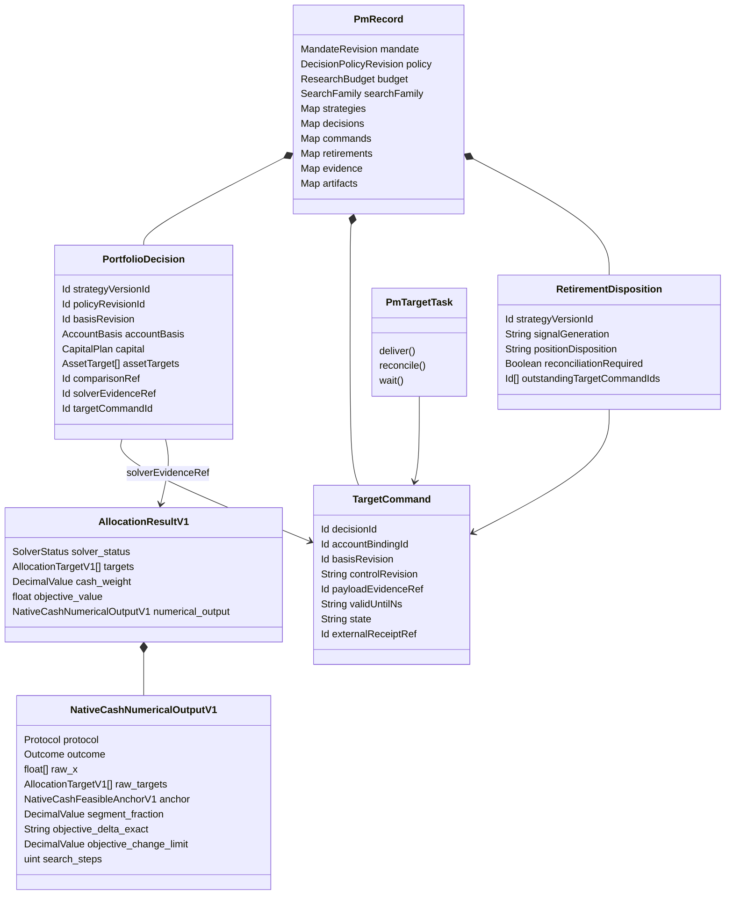

# 当前配置、资金费用与账户责任

本文补充原[完整业务技术方案](../quant-pipeline-integrity/design/README.md)，定义本轮实现的当前运营边界。测试数据上的求解、纸面目标接收、实际成交和投资资格是不同事实；各自实际验证状态见[验收映射](acceptance-coverage.md)。

## PM 的业务输入和自动计算

Owner 提供经济目标、资金来源、业务偏好、研究资源上限及运营授权。因子成员和系数来自训练期研究；资金候选由原生交易单位与可用资本规划，各点重新求资产配置并回放同一账户。比较包含原仓 HOLD，双方从同一账户、窗口、费用和原可得信息出发。并列或缺证据时保留 NEEDS_EVIDENCE。

通过已注册独立检查的方法才能成为当前推断种子。当前推断复用冻结因子、校准、系数、资金占比、风险和成本模型；使用实际账户数量及本次可得价格，重新计算 NAV、当前权重和资产目标。改变方法参数仍属于研究，须进入原预算和暴露账本。固定方法的当前求解记录原生资源消耗，不伪装为新的独立样本。

每个 ACCOUNT campaign 在创建时冻结自己的历史起点，内部 marker 为
`campaign-account-start:<campaignId>`，包含 `schemaVersion`、`campaignId`、
`datasetRevisionIds`、原 `AccountBasis` 和 `evidenceRef`。原账户证据与内容仍在
既有 ledger。后续研究和独立评价使用该起点；当前源读失败会使当前保留资金未知，
不能改写已冻结历史，也不能使用新能力接收钟倒填历史。旧 marker 仅能从该
campaign 自己的原始非 forward cycle 和相同数据版本恢复；有歧义或缺证据时拒绝。

经济容量必须能识别规模、成本、冲击和退出。当前来源的入场和退出限额仅是本次目标交付边界，不是历史资金曲线、最优基金规模或经济容量。缺少容量识别时维持 UNAVAILABLE。

## 单次原生优化中的费用资金

完整方法身份为 `qz.pm.owner-nav-constrained-mean-variance/3`，通过 `jointAllocationMethod` 在研究前冻结，并原样保存在 forward seed。连续配置沿用原 Clarabel QP，不增加第二个求解器或任意现金缓冲。

令 `w_i` 为原 NAV 下的目标资产权重，`w0_i` 为原持仓同价估值权重，`r_i` 为原线性交易成本率，`c` 为原 NAV 下的扣费前现金残余，`m` 为原最小现金权重。原生已有的辅助变量满足 `t_i >= abs(w_i - w0_i)`。新约束为：

```text
sum(w_i) + c = 1
sum(r_i * t_i) - c <= -m
```

因此，同一可部署预算须同时覆盖配置和线性换仓费用。`cash_funding=PRESERVE_MIN_CASH_AFTER_LINEAR_TURNOVER_V1` 仅适用于明确的现仓 CASH、long-only、MAX_UTILITY、VARIANCE 域。缺省字段保留旧方法语义，不把旧独立结果升级为新方法资格。研究、独立评估和当前推断使用同一冻结约束。

原生结果再用实际 `abs(delta)` 验证费用约束。令 `C = sum(r_i * abs(w_i - w0_i))`，实际可用的费用后现金为 `min(c, 1 - sum(w_i)) - C`，必须严格非负。原 `exposure_tolerance` 只用于正的最小现金底线；资本等式的容差不能创造现金，也不能被重复用于放宽该底线。新 CASH 方法的资产目标也必须严格非负，不能把小于容差的空头视作无借款现货。按原交易单位取整之后，再精确检查买卖资金、模型费用和现金余额。连续解有数学改善，但交易单位导致无交易、费用无法支付或原边界未获证明时，不能交付。原风险与成本目标的数值比较容差不替代资金守恒，也不允许借款。

`risk_aversion` 属于事前登记的方法参数；它不是自动推断的 owner 效用，也不保证未来回撤。当前期限的预期收益、线性成本、方差和目标值保留其原始量纲，不标作日收益或已实现收益。

### 精确资金可行性的数值输出协议

原生依赖已核对为官方 Clarabel 0.11.1，tag 指向 `25540f559592068d0c8a80e46ded1b21760212a1`。其 [停止参数](https://github.com/oxfordcontrol/Clarabel.rs/blob/25540f559592068d0c8a80e46ded1b21760212a1/src/solver/implementations/default/settings.rs) 分别定义绝对目标间隙、相对目标间隙与可行性容差；[收敛判断和相对残差](https://github.com/oxfordcontrol/Clarabel.rs/blob/25540f559592068d0c8a80e46ded1b21760212a1/src/solver/implementations/default/info.rs) 允许在该数值标准内返回 `Solved`。因此 `Solved` 本身不能证明十进制费用后现金严格非负。本项目另外登记下述输出适配协议；它不是上游求解器提供的严格资金保证，也不把所加的目标误差预算称为整体最优误差或统计置信度。

方法第 3 版在 `numericalOutput` 事前注册 `VALIDATED_FEASIBLE_SEGMENT_V1`，当前运营规则同样升为 `qz.pm.frozen-current-spot-operating/3`。只有上述已注册 CASH 资金域的原生请求才设置 `optimizer.parameters.cash_numerical_output`；其他账户域保持原参数和严格输出校验。缺省该字段的旧请求继续原严格行为，不能由当前消费者补成新协议。

每次资产配置只求解原 QP 一次，先保留原状态、浮点解、目标和残差。只有转为合同十进制后不能通过原约束验证时，才按固定规则从原始点沿已证明可行的 current 或 all-cash anchor 线段进行有界数值可行化；anchor 自身必须通过完整原约束且有资金余量。最终十进制结果重新验证全部原约束，费用后现金必须严格非负；相对原 `raw_targets` 合同点，校正引入的额外目标函数绝对变化不得超过原 `solver_tolerance`，其预算参考点事前登记为 `ORIGINAL_18_DECIMAL_RAW_TARGETS`。这不包括原浮点解转换为 18 位合同点的既有表示误差。没有合格 anchor、修正超过原目标误差预算或无法同时证明则 FAILED。此过程不改变费率、NAV、资本比例、TTL、风险厌恶、`solver_tolerance` 或经济目标，不另求 QP，也不是重新选择投资方案。原 `numerical_output` 诊断分别保留 raw 解与目标、最终表示与重新计算的目标、约束错误、anchor、线段比例和目标变化，服务不将其改写为经济收益。有限线段检查属于该次已注册求解的数值表示协议，不新增策略试验或扩大研究预算；没有 opt-in 的旧方法继续保持原严格输出，不进行这类修正。

研究资金比较、独立评价和当前应用使用同一注册参数。当前应用逐项核对 seed 中的原 native optimizer，不会为旧 seed 添加协议。原 method/rule 第 2 版不能继承新资格；旧记录保留历史，Monitor 将其视为无当前合格 seed。原 native 二进制 SHA 与 checkpoint 指纹防护继续生效；独立任务在读取 FINAL 之前核对冻结方法，不能把升级后的数值输出归属旧方法。

## 字段及表示

| 字段 | 类型与来源 | 业务含义 |
| --- | --- | --- |
| `PortfolioConstraintsV1.cash_funding` | 可选 `NativeCashFundingPolicyV1` | 事前冻结的现金费用约束；缺省不追溯升级 |
| `AllocatorSettingsV1.cash_numerical_output` | 可选原生 enum；当前注册 `VALIDATED_FEASIBLE_SEGMENT_V1` | 仅注册 CASH 域的有界数值可行化；缺省不采用该协议 |
| `AllocationResultV1.numerical_output` | 可选原生诊断 trace | 原求解与数值输出的完整依据；不冒充额外试验、收益或成交 |
| `AccountBasis.equity` | `Money \| null`，原账户报告 | 原源未报告共同币种净值时保持 null |
| `AccountBasis.valuation` | 独立派生估值与 `timeBasis` | `DECISION_CUTOFF` 使用本次可得价格；不改原源时钟 |
| `NativeForwardSpotTradeEstimateV1.target_notional` | `NativeForwardExactNotionalV1` | 原 NAV × 连续权重，完整精确乘积 |
| `NativeForwardSpotTradeEstimateV1.net_trade_notional` | 同上 | 连续配置与原持仓的名义差额 |
| `AssetTarget.executionEstimate.resultingQuantity` | `Decimal` | 原交易单位规则下预计最终数量 |
| `AssetTarget.executionEstimate.resultingNotional` | `Money` | 同次价格下预计取整后资产金额 |
| `AssetTarget.executionEstimate.netTradeQuantity` | `Decimal` | 预计买卖数量；不表示成交 |
| `AssetTarget.executionEstimate.netTradeNotional` | `Money` | 预计买卖金额，与原持仓和预计结果精确守恒 |
| `AssetTarget.executionEstimate.evidenceRef` | `Id` | 原生取整、费用及预计效果证据 |
| `OperatingComparison.modeledComparison` | 原生模型比较 | HOLD 与同次取整后配置的同期限估计 |
| `capitalCapabilities` | 原 GET 文档与首次本地接收钟 | 能力事实；不替代原账户和执行来源 |
| `AccountControl.capabilitiesByBinding` | `Record<string, TransportCapability>` | key 为原 base URL、mode、clientId、accountId 元组；value 为原 `document` 与 `receivedAtNs` |
| `AccountControl.refreshFailuresByBinding` | `Record<string, {code, receivedAtNs}>` | 仅本连接的读取失败；不将另一连接的权限当成自己的权限 |
| `CapitalCommand.permissionBasis` | 可选内部 `CapitalCommandPermission` | 原 `bindingKey`、原 `TransportCapability` 与原 `CapitalExitStatus`；准入和首次 POST 前逐项重核 |
| `automaticTargets.snapshotBound` | 显式布尔能力 | 接收端承诺在同一原子操作中核对原账户快照组 |
| `target-receipt-clock:<commandId>` | 内部原回执接收事实 | 不同真实回执的首次接收钟；重读不续期 |
| `target-receipt-observation:<commandId>:<digest>` | 不可变原回执、`commandId` 与 `availableAtNs` | 同一账户快照上的回执结算也有独立身份；重复读取不新增结果 |

连续乘积最多保留 40 位整数、36 位小数。原 NAV、实际余额、原生权重、交易数量及取整后估算保留其原有原生 decimal 约束；不静默舍入资金事实。所有派生目标金额都不是实际成交金额。

数值诊断的正式 DTO 位于 `crates/contracts/src/portfolio.rs`，纯校验位于 `crates/domain/src/portfolio/numerical.rs`。`AllocationResultV1` 的 `targets`、`cash_weight` 和 `objective_value` 表示最终输出点；原求解器回执分别保留如下，不能混为同一组数值。

| `NativeCashNumericalOutputV1` 字段 | 类型 | 口径 |
| --- | --- | --- |
| `protocol` | `NativeCashNumericalOutputProtocolV1` | 当前唯一值 `VALIDATED_FEASIBLE_SEGMENT_V1`，须与原请求一致 |
| `outcome` | `NativeCashNumericalOutcomeV1` | `UNCHANGED`、`CORRECTED` 或 `REJECTED` |
| `raw_x` | `Vec<f64>` | 原 Clarabel 坐标，依次为资产、现金、gross 辅助量和 turnover 辅助量；本域维度为 `3*n+1` |
| `raw_native_status` | `String` | 原上游状态；不能把已拒绝的不精确求解伪装为成功 |
| `raw_objective_value` | `f64` | 原上游目标值，真实性来自原 native artifact，不宣称独立逐位复现 |
| `raw_point_objective_value` | `f64` | 按原 18 位 `raw_targets` 与真实绝对换仓量重算的目标显示值 |
| `raw_primal_residual`、`raw_dual_residual` | `f64` | 原上游相对残差；不冒称最终十进制点的新残差 |
| `raw_targets` | `Vec<AllocationTargetV1>` | 原唯一 18 位转换；每项保留 instrument、currency 与 weight |
| `raw_cash_weight` | `DecimalValue` | 原转换现金，不被后续可行化覆盖 |
| `raw_constraint_error` | `Option<String>` | 原合同点的具体校验拒绝；未拒绝时为 null |
| `anchor` | `Option<NativeCashFeasibleAnchorV1>` | `kind` 为 `CURRENT_WEIGHTS` 或 `ALL_CASH`；另含 `targets` 与 `cash_weight`，须独立通过原完整校验及资金余量条件 |
| `segment_fraction` | `Option<DecimalValue>` | 朝该 anchor 的比例，使用 `10^-18` 网格；非投资资金比例 |
| `objective_delta_exact` | `Option<String>` | 精确 `final-minus-raw_targets` 目标差，规范 plain decimal、最多 2048 字符；原 `P/2` 与 forecast 的 IEEE-754 系数精确转 decimal，费用使用原 decimal rate 和实际绝对换仓量 |
| `objective_delta` | `Option<f64>` | 上述精确差的近似显示，不能充当预算证明 |
| `objective_change_limit` | `DecimalValue` | 原 `solver_tolerance`；精确比较 `abs(objective_delta_exact)`，单位为原目标值，非资金或收益 |
| `search_steps` | `u32` | 实际有界候选检查计数，不伪装成新试验或另一次 QP |
| `reason_code` | `Option<String>` | 本次数值输出的实际理由；失败仍没有可交付目标 |

原 QP 最小化风险惩罚减预测收益再加线性换仓成本，因此正的目标差表示该目标增加，不能展示为正收益。报告用浮点目标值可能丢失极小差；预算证明使用精确点差，不能用两个大浮点目标相减代替。`REJECTED` 的诊断只保留失败证据，不授予决策、独立资格或交付权限。

## 对象和执行关系



这些业务事实位于原官方 Durable 文档；运行检查点和恢复仍由官方 Task 持有。图中 Map 是原 Id 到实体的索引，不是新增数据库或调度器。

## 一个账户的一份配置权

同一物理账户的策略先在同一 mandate 内组合。创建 AUTHORIZED_TARGETS mandate、旧入口启用自动配置、手动新目标和实际 POST 前，都在同一官方事务读取原 PM/Application 文档，按原 `accountKey` 解析别名。多个独立授权控制方不能分别把同一 NAV 当作自己的完整资金。

RESEARCH_ONLY/SHADOW 可并存。暂停保留账户责任。退役只有在最新策略已退役且原剩余责任全部收束后才释放配置权。旧 PENDING/UNCERTAIN 继续原 ID 对账，不能因另一入口、重启或本地停止创建替代 POST。

旧入口的 ACK 目标仅到期不能建立交接。新 PM 使用自己所选账户绑定的原生余额、仓位和零挂单证明；producer 与首次账户 receiver 时钟都须晚于该原目标到期。其最初 campaign 的不可变起点可保留已经完成的交接证明，使同一 PM 后来持有新仓位时仍能运营。每份旧回执都重新核对自己的 source identity 和到期边界；该证明不能豁免在它之后到期的另一目标，也不能用后续研究 campaign 的起点替代最初交接。

## 当前来源和目标接收

PAPER 必须使用独立 `PAPER` assessment、真实纸面执行来源及 owner 授权。LIVE 还须原独立协议授权 TARGET_OPERATION、合格历史可得性及真实当前执行来源；本轮研究协议最高 SHADOW，不能凭求解成功升级 LIVE。

在 `POST targets` 前，QZ 复验原 native target、basis、源期限、账户能力与分配 envelope。接收器的显式 `snapshotBound:true` 须原子核对 `accountSourceId`、`observationId`、`snapshotSequence`、`nativeClockNs`、`controlRevision` 和 reserved。只核资金控制版本不能证明持仓未变。原 envelope 在 POST/GET 回执中完整回显；不一致保留不确定性。

目标保持原 native cutoff 和权重，有效期只能缩短。UNCERTAIN 检查点先于 POST 持久化，随后只 GET 原身份。没有首次发送的准备失败标为 NOT_OFFERED；可能已发生的远端效果不因本地退出被取消。

当前刷新实际 GET 账户、能力和资本控制，保留原 producer/receiver 时钟。同一
连接重读相同能力不更新首次接收钟。物理 reservation、revision、exit 和真实
BLOCKED 事实在别名间共享；读取及资本命令权限按本连接投影。无读取权限的 B
不能借 A 的权限发命令，也不能清空 A 的已知物理事实。临时别名合并只迁移没有
资本命令的记录；未完成命令保留原身份并要求对账。

已建立 `capabilitiesByBinding` 后，缺少某个精确 URL/binding 的条目就没有该连接的权限，不能回退到共享账户最后一次全局能力文档。资本命令保存原权限基准，在正式准入事务及首次 POST 前按最新原文档重核；相同物理 control revision 不能掩盖连接撤权或读取失败。能够确定尚未发送时才本地拒绝并释放该命令的预留；已发送而未知的命令仍只按原身份 GET。

独立评估准入时冻结 `independent-input:<decisionId>.policy`。恢复后的原生计算、指标 `methodRef`、资格协议和完整性检查全部使用该原政策，并核对原 decision/cycle/policy 身份。所有者后来创建的新政策不会获得旧计算的归属；原 current-basis 防护继续阻止旧结果覆盖新决策。

## ACK、退役和维护

ACK 只说明已接收。未来仍有效的目标可能在当前空仓快照之后执行，所以不能用一次空仓直接交接。退役对已接收目标使用一个原 ID 的官方 GET-only task，持续观察至撤销、到期或明确拒绝；重复 monitor 不另建查询任务。

原 TTL 已过，仍须取得该边界之后的新权威空仓及零挂单证据。原回执明确 REVOKED/EXPIRED/REJECTED 时，撤销前的旧空仓即使晚收到也不构成新证据；须在原终态回执接收之后再确认。原回执、首次接收钟和历史空仓事实分别保留。

账户源不变而原回执结算时，`ObservedOutcome` 身份包含 decision、原 account source revision、receipt state 和不可变 receipt observation ref。结果可得钟取原账户与原回执首次接收钟的最大值；原账户指标和现金流证据保持原身份与时钟，ACK 或 REJECTED 不创造一次成交、收益或资金流。

维护只在原责任收束且正式任务已停泊后 QUIESCED。心跳仅更新 bounded latest；原成熟观测、实际账户事件、变化的回执和必要退役事实保留。UI 曲线是最多 1024 个最近观测的显示缓存，不承担科学收益或交易账本职责。

## 数据源故障与同源恢复

[来源恢复消费者](../../../apps/service/src/pm-source-recovery.ts)将读取失败与科学结论分开。一次不可读期间的重复轮询只属于一个故障轮次；同一来源恢复后再次失败是下一轮。原官方 Monitor 在原 Durable 事务写入以下事实，不新增调度器或研究试验：

| 事实 | 内容与身份 |
| --- | --- |
| `artifacts['source-health']` | 单个最新状态，包含 `state`、`episode`、`failureEventId`、故障前的 `originalDecisionId`、policy／strategy／dataset 身份；重启继续原轮次 |
| `EVIDENCE_INVALIDATED` | 身份由 mandate 与故障轮次形成；源不可读时撤销当前可用指针，保留原历史结果 |
| `SOURCE_RECOVERED` | 每个故障轮次一次；`supersedesEventId` 指原故障，`sourceRevisionRef` 指恢复审计证据，不虚构新数据修订 |
| `qz.pm.source-recovery/1` | OWNER_ONLY 的 DERIVED／CONTROL 证据，保留原 dataset ID、contentRef、源证据与原源可得钟；新 `verifiedAtNs` 只表示本次复核时间 |

RESEARCH_SCENARIO 只有完整的原 `CONCLUDED` 历史结果可重新展示。policy、strategy、campaign、dataset/contentRef、原资金情景与起始状态必须相同，原 FIT 前缀由原生 `catalog-prefix-digest` 再核验；owner 暂停、退役或意图修订不能借来源恢复重获旧资格。恢复仍引用原 decision、comparison、指标、证据和有效期，不计算新的收益、不再次读取 FINAL，也不续期历史目标。缺完整原结果时保留 `NEEDS_EVIDENCE` 和 `source_recovery_evidence` 缺口。

ACCOUNT 在同一数据修订恢复后使用既有合格方法及原运营 slot。没有合格 seed 时明确等待证据；该 slot 已计算过时，恢复事件照常入账，并记录 `source_recovered_waiting_for_next_registered_operating_slot`，等待下一原 slot，不能换身份重复求解或续 TTL。该缺口在后续实际运营周期准入时引用其触发证据收束。故障期间出现新 dataset revision 时，恢复审计记录 `NEW_DATA_REVISION_REQUIRES_OWN_CAMPAIGN`，由原 DATA_REVISION 路径处理，不先占用旧数据的运营 slot。

两轮真实不可读／原 manifest 字节恢复及重启的 HTTP／SQLite 回归已验证事件去重和账本不变。完整原生历史报告重显、P2 意图修订拒绝旧结果复活，以及账户同 slot 恢复的集成断言接入最终 core；其最终 head 的运行结果才作为交付证据。

## 适用限制

当前现仓域是一项 Hyperliquid spot instrument、同 venue 的无借款 USDC CASH 账户，可组合多个因子。缺失债务、挂单、规则、费用、来源或其他域的原生能力时显式缺证据。当前执行限额不推导经济容量。任一新账户序列会使不匹配的在途准备失效；一个冻结运营 slot 内不反复求解，长期吞吐和可交付时效仍须真实工作量测量。

可执行来源协议见 [account-transport](../../../apps/service/account-transport.md)，运行维护见[运维手册](operations.md)。真实模型认证、真实市场方法资格及用户安装部署各有自己的验证边界，不由本地 fixture 或合并代替。
