# QuaZonai：自主研究与动态投资决策 — 完整业务技术方案

本文是设计分册的单文件阅读版。**状态：设计，尚未实施。** 规范字段与接口以“规范字段合同”章节为准，现有回归不代表新方案已实现。

- [QuaZonai：个人量化 PM 的自主研究与动态投资决策系统](#chapter-README)
- [QuaZonai：个人量化 PM 的自动投资决策设计](#chapter-business)
- [QuaZonai 总架构业务章：通用量化研究、策略、组合与持续运营](#chapter-platform-pipeline)
- [规范字段合同：业务实体、状态、数据语义与 API](#chapter-contracts)
- [自动科学评价、候选比较与权重学习设计草稿](#chapter-research-decision)
- [自动组合、资产配置与动态容量：个人量化 PM 业务及技术设计](#chapter-portfolio-capacity)
- [个人量化 PM：研究、组合与持续更新闭环设计](#chapter-continuous-workflow)
- [PM 自营研究与决策系统：技术边界、持久化和业务验收设计](#chapter-architecture-api)
- [QuaZonai 动态量化 PM：独立业务反例与验收设计](#chapter-acceptance)
- [独立 PM 与架构语义审阅记录](#chapter-review)
- [设计文档的独立验证记录](#chapter-verification)

<a id="chapter-README"></a>

<a id="README--quazonai个人量化-pm-的自主研究与动态投资决策系统"></a>

# QuaZonai：个人量化 PM 的自主研究与动态投资决策系统

> 状态：业务与技术设计，尚未实施。用户已明确要求先完成方案、暂停开发及合并。本方案不代表任何策略已盈利、任何经济容量已测得或任何实盘交易已获授权。
>
> 依据：本次对话的全部目标与两次业务纠偏；仓库远程 `dev` 的 `a233b966ca0f6210f3c9bf5db1872eb5c982bfdf`，并结合当前草稿分支 `19803c47aeb1d22775d594780b8417d7cf63c3ed` 的只读核查。已有 [PR #230](https://github.com/zhengui666/QuaZonai/pull/230) 保持草稿。后续重新获得开发指令时，应重新同步当时最新远程 `dev`；本轮不执行该开发流程。

<a id="README--阅读方式与规范优先级"></a>

## 阅读方式与规范优先级

这是一份设计包。本文定义业务目标、总架构、关键决策和实施顺序；[字段与接口合同](#chapter-contracts)统一实体、单位、状态及引用规则。专题文件展开依据与算法。专题中的探索性类型是说明，不得覆盖字段合同；任何语义冲突必须先修订方案，不能由开发者自行猜测。

| 文件 | 回答的问题 |
| --- | --- |
| [业务设计](#chapter-business) | 个人 PM 到底把什么判断交给系统，为什么做，如何衡量价值 |
| [通用策略平台与专业 pipeline](#chapter-platform-pipeline) | 整个项目如何通用化、策略化、规范化，覆盖哪些策略与生命周期 |
| [字段与接口合同](#chapter-contracts) | 每个对象的字段、类型、状态、来源、时钟、版本及空值 |
| [研究与决策](#chapter-research-decision) | 研究什么、如何比较、如何停止、如何避免优化出虚假赢家 |
| [组合与容量](#chapter-portfolio-capacity) | 因子如何组合、权重如何求、钱投多少、容量如何持续计算 |
| [持续业务流程](#chapter-continuous-workflow) | 新数据与账户结果如何触发下一轮决策 |
| [技术架构与 API](#chapter-architecture-api) | 官方运行时、数据与接口如何承载业务 |
| [业务验收](#chapter-acceptance) | 怎样证明真的改善投资判断，而不是增加指标或按钮 |
| [独立设计审阅](#chapter-review) | 设计中发现的问题、已修正项和仍未验证的前提 |
| [文档验证记录](#chapter-verification) | 链接、20张图、规范类型、字段一致性与离线阅读产物的实际检查 |

<a id="README--1-任务理解与交付边界"></a>

## 1. 任务理解与交付边界

<a id="README--10-本次全部需求的追踪矩阵"></a>

### 1.0 本次全部需求的追踪矩阵

这些要求同属本次任务，任何一项都不能被“智能指标已完成”替代。当前交付阶段统一为**方案设计**，不是收缩业务范围。

| ID | 用户原始要求 | 本方案必须给出的实物 | 后续实现的业务验收 |
| --- | --- | --- | --- |
| R01 | 项目更加通用化 | 市场/数据/策略能力矩阵、版本化接入合同、能力协商与不支持路径 | 新策略或市场按合同接入，复用核心流程；不复制一套 PM 主流程 |
| R02 | 项目更加策略化 | 经济假设→信号/决策规则→可交易策略→组合→运行的实体与状态 | 能解释策略赚钱机制、失效条件、交易/持仓/退出语义和迭代依据 |
| R03 | 项目更加规范化 | 统一字段、单位、时点、版本、研究记录、阶段输入输出和证据 | 任意选择/资金变动可追溯并重放，旧结果不被新规则篡改 |
| R04 | 核心流程严谨 | PIT、独立性、预算、共同账户、成本、退出、缺失值及回执合同 | 不允许偷看未来、重复使用资金或流动性、虚假晋级和伪造结果 |
| R05 | 核心流程智能 | 自主研究资源分配、候选生成/比较、学习/保留/淘汰、失效归因 | 系统随新证据自行选择下一项有价值的动作，含不行动 |
| R06 | 专业量化小自营基金 pipeline | 端到端业务阶段、轻量治理、资金/风险/执行/研究反馈责任 | 从原始数据到后续账户结果闭环；足以服务单人 PM 而非只跑回测 |
| R07 | 容量、组合、比例等指标尽量自动推导 | 方法、数据、字段、求解与不确定性合同 | 用户无需手配权重/容量；结果随证据变化，有真实计算依据 |
| R08 | 动态、实时、持续计算更新 | 数据修订、事件触发、更新分层、时效与依赖失效机制 | 新证据形成新判断；旧数据不续期；变化不值得换仓时能保持 |
| R09 | 多 agent、多调研、多验证、少猜测 | 分工稿、一手来源、当前代码证据、独立设计审阅和验收矩阵 | 每项重要能力区分事实/拟议/未知；后续实现需对应业务验证 |
| R10 | 最新远程 dev、新分支、最终合入 dev | 当前基线及未来开发/评审/合并路线 | 恢复开发后从届时最新 dev 开始，最终 Head 完整检查与 review |
| R11 | 先写极详尽业务+技术方案，不开始开发 | 完整方案、字段、类图、状态机、时序图、接口和分期 | 本轮仅新增设计文档，生产代码与合并暂停 |

<a id="README--101-通用化的边界"></a>

### 1.0.1 通用化的边界

核心流程围绕 `StrategyVersion` 和其 `CapabilityDescriptor` 运作，不能只围绕某个 Wasm 因子或某个预测市场。最少要明确预测型 alpha、相对价值/套利、事件驱动、微观结构/执行敏感策略、独立因子研究和多策略组合的表达方式。当前能执行哪些由能力表如实声明，未实现类型只在方案中定义扩展合同。

市场适配器提供交易日历、合约/事件结构、价格与结算语义、费用、保证金、最小交易单位、可见流动性和可用时点。策略适配器提供状态、信号或目标生成、训练与更新方法、交易/持有/退出规则、所需数据与评价协议。核心 PM 流程负责研究预算、证据、选择、配置与反馈；三者分离，避免把某一个市场的规则硬编码成平台定义。

策略化并非把工程参数改名为 policy。完整策略要表达经济机制、可交易收益来源、假设失效条件、因子作用、组合/执行约束和运营方式；同一个预测模型可以服务多个策略，不能把模型文件等同于可运行策略。

<a id="README--11-用户要解决的业务问题"></a>

### 1.1 用户要解决的业务问题

系统要成为个人量化 PM 的研究与配置助手：自动寻找有经济含义的机会，把候选变成可复核证据，决定哪些因子值得保留、怎样组合、配多少、能容纳多少资金、什么时候保持不动、什么时候减少风险，以及什么时候应该停止继续投入研究资源。

“更加通用化、策略化、规范化”的含义是：业务对象与投资决策有清晰合同，不依赖某一个市场、某一个策略故事、单一 IC 或 Sharpe；不同策略通过明确的数据能力和科学模型接入。不能把跨市场支持理解成忽略市场微观结构，也不能把规范化理解成增加审批表单。

“专业量化小自营基金 pipeline”的设计目标是研究、风险、资金、执行反馈的一致性与可追溯性。没有一个统一阈值列表能证明所有小型自营基金都合规或专业。本方案采用可验证的量化研究实践，不承诺收益、不声称取得机构认证。

<a id="README--12-本方案对之前偏差的修正"></a>

### 1.2 本方案对之前偏差的修正

此前工程候选处理了恢复竞态、指标取值和数值求解边界；这些是基础可靠性，无法单独回答“什么值得买、买多少、为什么”。本方案把业务决策作为中心：每项新增能力必须改变或支持一个具体的 PM 判断，并能用新证据说明该判断为何更新。

本次明确暂停开发。本文中的类、字段、任务、API、算法适配和界面均为拟议设计，除标为“现有”的能力外，不得在产品说明中写成已实现。既有代码与测试结果仅证明其原范围，不是本方案验收证据。

<a id="README--13-用户输入与系统推导的分工"></a>

### 1.3 用户输入与系统推导的分工

| 决策内容 | 归属 | 说明 |
| --- | --- | --- |
| 可动用资金、币种、提现安排、允许市场/杠杆/卖空、研究与运行授权 | 业主意愿或权威账户事实 | 系统无法从收益序列推断业主能承受多少亏损；有账户则读取事实，无账户才需提供资金意图 |
| 收益与稳定性偏好、不可接受的经济损失、资金可锁定期限 | 业主意愿 | 可自然语言表达并生成结构化解释；歧义只针对关键偏好澄清一次，不要求填写技术参数 |
| 因子数量、成员、组合比例、风险贡献、市场仓位、可用资金与现金 | 系统计算 | 依据可用数据、已验证方法及当前持仓自动计算，保留原始证据与更新原因 |
| 协方差、预测校准、衰减/训练窗口、相关性聚类、冲击与成交模型参数 | 系统估计与模型选择 | 在允许的训练数据内选择，登记版本、误差、适用范围；无证据时返回未知或条件结论 |
| 容量、最小经济规模、成本后收益、退出能力 | 系统估计 | 不要求业主填写容量上限、参与率、资本试验网格；数据不足不能自动补出一个“经验数” |
| 安全的停止条件、算法支持范围、预算上限与求解精度 | 业务合同/工程边界 | 有限计算与数值误差规范必须存在；它们不伪装成学习得到的市场结论 |

用户无需维护因子权重表、相关性阈值、固定调仓频率、手工资本档位或“神奇”参与率。专业模式可展示系统选出的值和理由；手工覆盖如将来支持，必须形成独立带来源的决策版本，不能覆盖历史自动结果。

<a id="README--14-三种权重必须分开"></a>

### 1.4 三种权重必须分开

1. **因子/预测权重 `a`**：多个模型如何组合为一个统一口径的预测；归属 `EnsembleRevision`。
2. **资产权重 `w`**：在当前约束与持仓下，各市场资产承担多少风险或资金；归属 `PortfolioDecision.assetTargets`。
3. **可投入资本 `K`**：账户净值扣除预留、提现需求与现金安排后，实际承诺给策略多少；归属 `PortfolioDecision.capital`。

多策略平台还需要资本层中的**策略预算分配** `StrategyAllocation`：不同 `StrategyVersion` 各使用多少资本/风险预算。它不与因子预测系数混用。复合策略通过 `PORTFOLIO_OVERLAY` 版本引用原策略成员，最终共享资产净额化；套利、事件与状态型策略可以没有 `EnsembleRevision`，不被强行改写成预测因子模型。

成员的 IC 不是预期收益；因子权重不是市场仓位；资产权重乘总净值也不必等于可交易金额。仅按账户净值同比缩放旧权重，不等于完成动态组合优化。

<a id="README--2-当前系统的事实与缺口"></a>

## 2. 当前系统的事实与缺口

| 领域 | 现有能力，源码已核查 | 当前业务缺口 | 方案要求 |
| --- | --- | --- | --- |
| 研究合同 | 单因子 IC 或组合 Sharpe；冻结输入和试验账本 | 单标量难以表达账户收益路径及资金适用性 | 多维账户事实、比较边界、原目标与选择理由 |
| 账户统计 | 完整 UTC 日收益、最差日、负收益日、覆盖率、回撤、费用等原生统计 | 数据存在但未贯穿正式选择与持续决策 | 自动生成账户级 scorecard，不再造收益引擎 |
| 候选比较 | `validation_compare` 仅实现 legacy validation IC | 组合研究可能没有对应比较；无组合边际贡献判定 | 原目标一致的比较、前沿、基准与增量价值 |
| 终审 | 冻结原 COMPUTED trial，再执行一次所有者可见 HELDOUT | “计算完成”缺少对应的业务选择证据 | 冻结选择依据、方法版本和证据范围 |
| 因子组合 | Agent 提议正权重，原生账户验证完整 ensemble | 无确定的自动权重学习与更新服务 | 类型明确的训练/校准/组合学习与联合回放 |
| 资产优化 | Clarabel 原生风险、成本、现仓约束求解；离线滚动 study | TS 业务入口未接通完整自动流程；同步 BAR 限制 | 支持场景优先复用，异步市场单独适配 |
| 全目录策略 | 因果扫描、多市场共享一个账户 | 固定成员混合，不等于因子权重动态学习 | 统一时点可见信息与自动选择/组合 |
| 容量 | 条件历史 BAR 估计、独立退出约束、账户 size | 目录组合不可用；经济容量缺证据；依赖配置假设 | 分层容量、真实资本曲线、市场冲击/退出证据 |
| 自动账户调整 | 每轮刷新账户并用既有 target、weights、capacity 缩放 | 不是重新选因子、重求权重或刷新容量 | 事件→依赖失效→重估→再决策→目标及反馈 |
| 数据更新 | 注册静态配置与离线 forward 准备 | 新数据尚无完整自动注册与业务消费闭环 | 不可变数据修订、可用时点、质量审查与因果重算 |

关键源码：[研究合同](../../../packages/contracts/src/research.ts)、[比较插件](../../../apps/research/plugins/validation-compare.ts)、[组合终审](../../../apps/research/plugins/strategy-portfolio.ts)、[日收益统计](../../../apps/job/src/simulation/calendar_returns.rs)、[原生优化](../../../apps/job/src/optimization.rs)、[滚动组合](../../../apps/job/src/study.rs)、[容量](../../../apps/job/src/capacity.rs)、[账户自动调整](../../../apps/service/src/automatic.ts)、[服务路由](../../../apps/service/src/service.ts)。Calendar 日统计当前并非所有 spot 路径都已接通，各路径必须单独核验支持状态。

<a id="README--3-业务流程总图"></a>

## 3. 业务流程总图

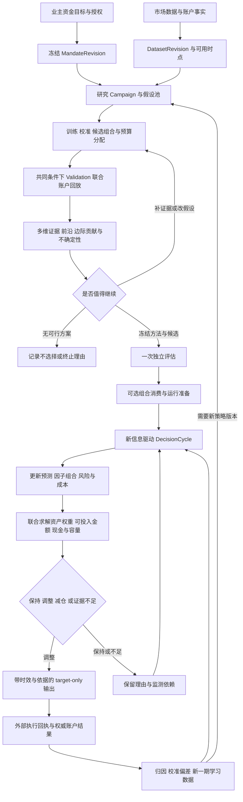

因子研究本身仍可独立完成。组合、账户观察、外部 target 消费是可选下游，不强制所有研究都创建账户或组合。当前 QZ 不持有券商账户、不发送真实订单；方案延续这个边界。

<a id="README--4-一次-pm-决策应该回答什么"></a>

## 4. 一次 PM 决策应该回答什么

每个 `PortfolioDecision` 至少回答：当前有哪些可用机会；哪些因子重复、互补或退化；推荐使用哪一版组合；资产配置与可投入资金是多少；相对继续持有的增益是否值得换仓成本；哪里是容量瓶颈；关键未知是什么；何时和因何需要重算。

决策不只允许“买”。合法结果包括保持旧仓、减少风险、保留现金、暂时不配置、采集缺失证据、结束无价值假设、继续等待标签成熟。收益更高但成本/退出/证据条件不成立，不能自动视为优胜。

<a id="README--41-多目标选择不能偷偷替业主定义效用"></a>

### 4.1 多目标选择不能偷偷替业主定义效用

系统先计算真实指标、可行范围和收益—风险前沿；选择规则由冻结的业务目标决定。若业主强调日净收益且声明不可接受损失，则在其真实限制内优化成本后目标；若只说“好一点”且多个前沿点彼此权衡，系统应输出明确歧义并保留现状，而不是发明收益/回撤/亏损日各占 40/30/30 的综合分。

默认研究可以继续生成证据；允许自主 target 更新的运行配置则必须具备足够明确的选择规则。缺少不可推断的业主偏好属于意愿缺口，缺少行情/成交属于证据缺口，两者不能混成同一种“用户配置错误”。

<a id="README--42-与原组合现金和简单基准一起比较"></a>

### 4.2 与原组合、现金和简单基准一起比较

比较集必须保留当前已运行组合、现金/不交易、简单可解释基准以及候选组合。所有比较使用一致资金、可见时点、成本口径和共同覆盖区间。不同日历、币种、窗口或费用模型不能直接放入一个排序。

高独立收益因子未必值得新增；其对已有组合的边际收益、风险、换手、流动性消耗和退出负担才是配置依据。组合效果必须经过原生联合账户验证，不能把各因子净值简单相加后宣称是共享资金账户表现。

<a id="README--5-自动研究与资源分配"></a>

## 5. 自动研究与资源分配

研究从可证伪的经济假设出发，登记可观测变量、预测目标、可用数据、机制预期、失败解释及与已有因子的差异。Agent 负责提出假设、设计实验、解释失败和调用工具；数值权重、容量与绩效来自可复现计算。

候选按“便宜的可行性/因果检查→训练与校准→有限成本账户回放→完整对比→独立评估”逐层投入资源。资源分配依据已观察改进、不确定性、与现有候选的差异及计算成本，不写死每类策略相同配额。初期采用可解释的分层调度和保守证据规则；复杂 bandit/贝叶斯优化必须作为待验证的方法版本，不能直接拿累计最高 Sharpe 当 reward。

预算包含 native 计算量、模型成本、数据读取量、候选数量和最终结项资源。失败、无效科学假设与已执行的资本/权重搜索都计入真实账本；重复请求复用原试验，不能靠改名字重置搜索次数。预算耗尽停止新实验，但保留比较、形成结论、选择或不选择的收尾机会；不得自动丢掉最后一次产生的可行候选。

停止理由区分无经济优势、证据不足、数据不适用、预算耗尽、被同族更优候选替代、用户停止和基础设施失败。基础设施异常不等于经济假设被证伪；补齐数据后重开必须创建关联的后续研究版本。

<a id="README--6-自动指标与证据体系"></a>

## 6. 自动指标与证据体系

<a id="README--61-指标分层"></a>

### 6.1 指标分层

| 层 | 自动计算内容 | 关键口径 |
| --- | --- | --- |
| 数据 | 完整日覆盖、事件/可用延迟、缺失、修订、标签成熟率、可交易覆盖 | 不把无数据当零收益或不交易 |
| 预测 | 校准误差、IC/排序能力、分布与漂移、预测误差协方差 | 相同目标、horizon、单位及因果样本 |
| 因子 | 条件表现、冗余、边际贡献、稳定性、贡献集中 | 单因子表现与账户贡献分别报告 |
| 组合 | 净收益、最差日、亏损日、回撤、尾部风险、风险贡献 | 单一共享资金账户；真实费用只扣一次 |
| 容量 | 最小可行资金、流动性边界、经济规模曲线、退出能力 | 可观测/条件/经济分开；不能重复分配共享流动性 |
| 运行 | 预测与实现差异、成本偏差、成交率、滑点、可用/预留资金 | 使用权威账户与原目标身份，不以 target 回执当成交 |
| 研究质量 | 试验总数、方法版本、选择偏差、估计不确定性、样本外连续表现 | DSR/PBO 等需满足定义与数据要求；不可贴标签代替计算 |

指标状态、覆盖率和置信区间与数值一起传递。新指标只有在有业务用途、来源定义和验证方法时加入注册表；展示全部指标不是目的。模型不能依据字段名臆造收益、容量或实时性。

<a id="README--62-日收益与现金盈亏"></a>

### 6.2 日收益与现金盈亏

净账户收益来自原生账户权益和现金流调整。完整 UTC 日统计可直接复用已有原生实现。交易日历必须随市场明确，365 与 252 的年化不可混排；原生 `MaxDrawdown` 的负数表达如转换为正损失幅度，转换版本必须保留。

每日现金盈亏不能用日收益率乘当前本金回填整个历史。必须绑定当日资金、外部现金流与计价币种。缺净值、缺估值或资金流未对账时，相应现金/收益指标不可用；原始数值保留，不能删掉缺失日期缩小亏损日分母。

<a id="README--7-因子组合资产配置与资金求解"></a>

## 7. 因子组合、资产配置与资金求解

<a id="README--71-因子成员与比例自动求解"></a>

### 7.1 因子成员与比例自动求解

先将各因子输出校准到相同 horizon 的可比较预测单位，或声明只支持同口径排序策略。评分/IC 不能冒充预期收益。候选成员根据因果数据上的增量预测与组合价值选择；重复模型/相同经济暴露形成同族，避免复制一个因子获得额外权重。

拟议的初始可审计方法是：训练期内部按时间前推产生 out-of-fold 预测，校准器只用对应训练前缀；利用预测误差结构拟合非负组合，并对成员增删进行有预算的验证；通过原生同账户回放选择方法/成员及其参数。非负且和为1时L1范数恒为1，不能声称加入普通L1惩罚就会自动学出稀疏成员。已有 Clarabel 可复用作新的 typed convex adapter，但该接口必须叫预测组合拟合，不能伪造 instrument ID 把因子冒充资产。

对于不可校准的非线性策略或异构执行机制，采用有限、留痕的候选组合搜索与原生账户评估。其结果是“在实际测试候选中优选”，不能宣传为全局最优。验证用于方法/候选选择，最终独立样本不参与反向调权。

<a id="README--72-资产仓位自动求解"></a>

### 7.2 资产仓位自动求解

在统一的预测、风险估计、当前持仓、成本、资金及市场约束下，由原生优化器求解资产权重。现有 Clarabel adapter 处理支持的凸风险/成本模型；已支持场景先复用。持仓与现金使用权威事实，目标应考虑净交易量而非毛信号之和。

若资金规模、最小订单、冲击和离散成交使问题非凸，采用有限候选规模/离散修复与原生回放验证，并标注近似和最优性边界。求解器返回最优也只意味着所建模型内最优，不意味着未来收益最优。

<a id="README--73-资金与容量共同求解"></a>

### 7.3 资金与容量共同求解

可用预算从净值、预留、提现安排及已授权现金意图得出。系统自动以真实资金和最小交易单位构造资本试验点，并根据收益/成交/约束变化自适应细化，而非让用户手填 1 万、10 万、100 万的网格。外推范围必须明确。

规模变化后，成本占比、可交易市场、最小订单、机会分配与退出可能改变，因此需重新求解组合并回放，不应仅线性放大旧净值。找不到满足约束的资本规模时，建议可为零；“没有证据投入”与“最优现金 100%”必须分开描述。

<a id="README--8-容量的三层含义"></a>

## 8. 容量的三层含义

1. **观测层**：当前/历史可见 BAR、订单簿、成交、交易规则和实际执行数据。记录时间、来源、覆盖和代理假设。
2. **条件可执行层**：在明确成交窗口、可见流动性、净交易需求、最小单位和退出假设下，可容纳的资金范围。BAR 量不能自动当成可成交盘口；未来退出深度不能视为已知。
3. **经济容量层**：改变资金规模后，成本与冲击作用下的净经济价值和风险是否仍值得配置。需要匹配的资本规模回放、成交/冲击校准、成本与退出证据。当前目录数据路径不具备完整证据，必须明确待建设。

容量必须按共享市场—时间—执行窗口聚合净需求，同时覆盖加仓、再平衡和退出。不能把每个因子的独立容量相加，也不能把所有因子各占同一 BAR 的固定参与率而重复使用流动性。

历史回放曲线在固定 fill model 下变化，不能独立识别真实市场冲击。没有观测或可识别模型时只报告条件曲线；系统可自动提出补采盘口/成交的需求，但不能自主扩大数据授权或把未知容量当无限。

<a id="README--9-持续更新以信息变化驱动业务重算"></a>

## 9. 持续更新：以信息变化驱动业务重算

<a id="README--91-触发源与最小重算范围"></a>

### 9.1 触发源与最小重算范围

| 触发 | 必须重算 | 通常无需重跑 |
| --- | --- | --- |
| 新行情且达到可用 watermark | 新预测、机会集、流动性与仓位决策 | 已冻结历史独立评估 |
| 标签成熟/新的实现收益 | 误差、校准、漂移；到方法更新条件再拟合 | 所有历史 trial |
| 账户资金/预留/现仓变化 | 净需求、可用资本、最小订单和 target | 因子训练，除非规模改变策略有效域 |
| 费用/交易规则/可见盘口变化 | 成本、容量、净收益和 no-trade 判断 | 不受影响的数据特征 |
| 新因子证据 | 同族/冗余、增量价值、组合拟合及联合验证 | 全部无关假设 |
| 源修订/错误发现 | 依赖其结果的证据失效并重新评估 | 无依赖的版本 |
| 用户资金目标/授权改变 | 新 MandateRevision 与受影响决策 | 旧决策的历史事实 |

刷新频率由数据到达、策略 horizon、计算成本和证据时效共同决定。快路径更新状态、流动性和净交易需求；中路径更新风险、成本、预测与权重；慢路径启动新假设研究。完整全市场回测不放到每个 tick 的同步路径。

“实时”的承诺必须分别报告源事件到可用、可用到计算完成、计算到目标输出、目标到外部确认的延迟。没有实时源时只能持续处理新到达的批次，不把五秒轮询历史数据宣传为实时策略学习。

<a id="README--92-保持原仓也是计算结果"></a>

### 9.2 保持原仓也是计算结果

每次比较拟议调整与继续持有的成本后差异及不确定性。如果改善不足以覆盖换仓成本或证据误差，应保持；若风险或退出条件恶化，则可减仓或停止新增。触发计算不等于必须交易，权重更新也不等于每次必须发送新 target。

no-trade 区域来自成本、估计误差、业务风险限制和当前持仓，记录推导过程；不能写死“变化小于 5% 就不调仓”。证据过期时，旧结果不获自动续期；既有持仓的处置也需新的风险/退出依据，不能把 stale 简化成无条件清仓。

<a id="README--10-研究独立验证和线上学习的隔离"></a>

## 10. 研究、独立验证和线上学习的隔离

每一版方法与候选必须记录训练、选择、独立评估和后续观测的角色。选择完成后才允许消费独立样本，最终结果不反馈本轮搜索。已暴露的历史数据之后可以用于新版本训练，但永远不能再被称为该新版本的独立样本。

持续学习不是永久固定某一块历史 HELDOUT。新时间段按预登记协议先产生前瞻预测与决策，待标签成熟后形成 prequential 证据，再进入后续训练。整条自适应过程必须连同重拟合频率、窗口选择、暂停与资金调整一起做前推验证，不能只验证某一静态权重。

嵌套时间验证与重叠标签清除、必要 embargo、多个研究尝试的统计影响、样本量不足和非平稳性均需登记。PBO、DSR、置信区间只是有定义和前提的诊断；不满足输入条件时不输出虚假概率，也不把高置信分数变成盈利保证。

<a id="README--11-总体技术架构"></a>

## 11. 总体技术架构

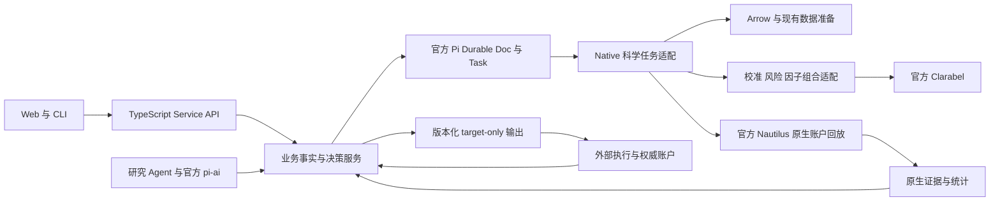

保持当前 TypeScript 负责业务事实、HTTP 与编排，Rust 负责必要科学计算和纯校验。复用官方 Pi Durable 的任务生命周期、事务、恢复与等待；不新增第二个调度器、任务数据库或自研撮合/记账引擎。新增业务类型使用当前 `packages/contracts`，不修改历史 generated 文件冒充新 API。

数据量大的时间序列与回放原件保留在原证据存储/分块对象，业务文档引用其身份；不能把全目录行情复制到每个 DecisionCycle。旧 PostgreSQL 历史与迁移保留。业务投影可以重建，原始账户/研究证据不得被投影覆盖。

<a id="README--111-领域类图"></a>

### 11.1 领域类图

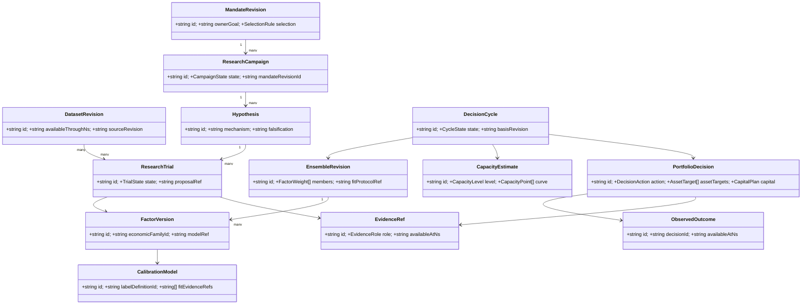

类图中的对象是领域合同，不要求在 TS 中实现成有继承关系的 class。计算服务无状态或仅引用版本化文档；数值科学状态由原生结果及明确模型版本管理。

<a id="README--112-服务职责图"></a>

### 11.2 服务职责图

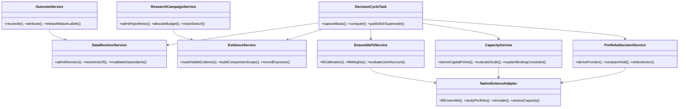

<a id="README--12-一次持续决策的时序与一致性"></a>

## 12. 一次持续决策的时序与一致性

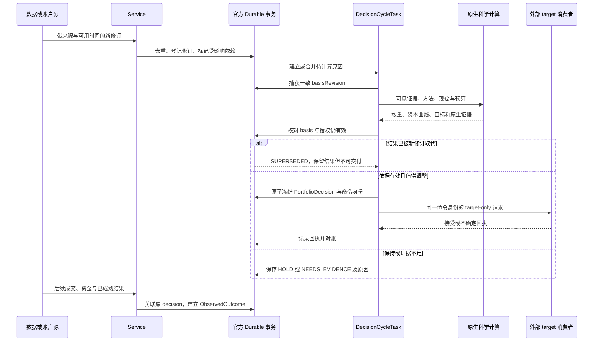

重放恢复原任务、原输入与原命令。传输不确定时先查询原命令回执，不能新建 target 重发。计算期间资金预留、源数据或授权变化，旧计算只能成为历史证据，不能覆盖新依据。`basisRevision` 是业务版本组合，不是重新实现官方任务状态。

<a id="README--13-产品体验"></a>

## 13. 产品体验

首页以“当前资金在哪、为什么、什么在变化、哪里还缺证据”为中心。默认展示最新投资判断、与上一版差异、现金与可投入资本、容量限制、每日净收益路径和待处理的真实例外。

研究页展示假设池、已投入资源、淘汰/继续理由、候选前沿、独立评估状态。组合页展示因子成员及比例变化、边际贡献、资产仓位、成本后调整价值和容量曲线。用户可以展开原生证据与方法版本，但不需要填写协方差、权重或参与率。

自动建议解释应形如：“新成交数据显示市场 A 的有效流动性下降；原组合在当前资金下的退出约束成为瓶颈，系统比较保持、减仓和替代组合后选择减少 A 的净需求。具体比例来自所列求解与回放。”解释必须由结构化决策事实生成；语言模型不能补出未计算的因果关系。

没有数据或授权时，界面显示能继续做什么研究、需要什么可观测证据。缺省值不展示成已计算结果；历史结果显式标时点、范围和是否过期。

<a id="README--14-兼容迁移与上线分期"></a>

## 14. 兼容、迁移与上线分期

旧 `ResearchSpecification` v1 与已冻结 trial 不重解释：旧 `evaluation.target` 仍保持其原 HELDOUT 含义。新业务合同使用独立版本，旧研究可作为带边界的历史证据引用，不能自动补出缺失的训练划分、容量或独立资格。

| 阶段 | 可验收的业务交付 | 前置条件 | 明确不能冒充的能力 |
| --- | --- | --- | --- |
| D0 设计 | 本方案、字段合同、独立审阅、未决证据清单 | 当前只读调研 | 尚无新能力落地 |
| D1 研究决策 | 自动账户 scorecard、同口径比较、预算结项、可解释选择记录 | 现有原生统计与账本 | 不是动态最优权重/经济容量 |
| D2 自动组合 | 数据支持的因子成员与比例学习、原生联合回放、基准与贡献对比 | 因果预测面板、校准和内层验证 | 不是只拼独立净值或强选 top1 |
| D3 资金与容量 | 自动资本曲线、共享流动性/退出约束、资金变化重求解 | 可识别成本/成交与规模模型 | 缺冲击数据时不声称经济容量 |
| D4 持续闭环 | 数据修订自动接入、事件重算、版本化 target、归因与失效恢复 | 可持续数据源与账户协议 | 定时刷新旧数据不算完成 |
| D5 业务验证 | 完整自适应过程前推、真实源影子运行、资源与时延实测 | 数据/模型/外部消费可用且授权 | 合成夹具与 CI 不证明收益 |

分期是依赖顺序，不是将 D1 当作全部目标完成。可并行建设字段/数据、科学适配、编排、界面与独立验收；合同稳定后才交给各 agent 实现。未来每个代码增量仍应在最新远程 `dev` 新分支开发，完成最终 Head 适用 CI、独立 review 和 GitHub Codex 明确无问题后，按用户届时指令合入远程 `dev`。

<a id="README--15-必须验证的假设与未决输入"></a>

## 15. 必须验证的假设与未决输入

| 问题 | 怎样解决 | 在解决前可以做什么 |
| --- | --- | --- |
| 真实数据能否支持全市场同 horizon 的因果预测面板 | 数据审计、样本标签和时钟验证 | 保持场景能力声明，支持已验证子路径 |
| 是否有足够成交/盘口识别冲击和退出模型 | 接入被授权源并做拟合/外部验证 | 条件容量与证据补齐计划 |
| 因子组合目标能否改善账户结果 | 内层前推与联合账户基准对比 | 不用预测 MSE 改善替代交易收益证据 |
| 自动更新策略是否比固定策略更好 | 对完整更新协议进行外层前推 | 保留固定/现金/保持基准 |
| 每轮数据与计算成本是多少 | 代表性数据规模的实测 | 预算字段与降级路径，不凭空承诺毫秒级 |
| 原生模型目录是否支持指定真实 Agent 评测 | 精确模型/推理级别与授权核实 | 确定性测试可独立执行，不冒充模型效果 |
| 业主偏好足不足以从前沿选一点 | 对结构化解释做一次有意义的确认 | 继续研究与前沿计算，保持运行状态 |

<a id="README--16-方案完成标准"></a>

## 16. 方案完成标准

本轮完成标准是：形成可读的全链路业务与技术设计；所有关键自动推导量有输入、算法、输出、时效、失败方式和验证方法；所有核心实体有字段合同与关系图；研究、运行、容量与收益的证据边界一致；独立审阅中的阻断性设计问题得到修订或清晰标为实施前条件。

本轮不会将设计提交为已开发能力，不会继续扩大工程改动，不会合并草稿 PR。下一次进入开发时，以本方案的业务验收而不是代码行数、Agent 数量或测试数量衡量交付。


---

<a id="chapter-business"></a>

<a id="business--quazonai个人量化-pm-的自动投资决策设计"></a>

# QuaZonai：个人量化 PM 的自动投资决策设计

> 合同：本章直接使用 [规范字段合同](#chapter-contracts) 的实体、字段与状态，不定义平行 DTO。全平台策略范式和专业生命周期见 [平台流程](#chapter-platform-pipeline)。本章保留投资决策及算法依据，所有新增能力仍为设计。
> 状态：只读研究与方案，未实现，未进行本方案的业务验证。2026-10-22。
> 当前代码参考工作区 `/workspace/QuaZonai`。工作区含本轮工程修复；这些修复与 PR #230 不等于下述业务目标完成。
> 本文用【事实】标识已读源码或原始来源支持的结论，用【设计】标识建议，用【开放】标识尚需取证或产品决策的问题。这里的“专业”指可复现、可解释、约束一致的投资决策过程，不是行业认证或监管合规结论。

<a id="business--1-要解决的投资问题"></a>

## 1. 要解决的投资问题

【事实】用户在相关研究上下文表达过约 3000 pUSD、全市场动态组合、每日净收益、稳定性、亏损日和回撤等目标。约 3000 pUSD 仅为现有研究上下文中的一个例子，不限定本次平台设计，也不是可自动认定的实时券商权益或未来固定本金。用户明确希望指标、容量、因子组合与比例尽可能由系统推导并持续更新，而非手工配置。

【设计】QZ 应当回答六个连续问题：

1. 现在的数据里，哪些经济假设值得继续研究？
2. 哪些因子提供互补且能覆盖成本的信息，哪些只是重复或噪声？
3. 在当前市场、持仓和账户资金下，应持有哪些资产、各占多少、留多少现金？
4. 这一规模下真实做过哪些回放、受什么成交或退出约束、增加本金是否仍有收益价值？
5. 新证据到来时该维持、增配、替换、减配还是退出？
6. 下一笔研究计算预算应花在哪里，什么时候继续研究已不值得？

交付物应是一条持续维护的投资决策链及其实际目标输出。指标页面只是观察决策的入口。因子数量、Sharpe、IC、回测次数和“完成”状态都不能替代账户结果。因子研究仍可独立存在；只有以投资组合为目标的程序才进入完整资金决策流程。

<a id="business--11-可以自动推导与不能伪装成推导的内容"></a>

### 1.1 可以自动推导与不能伪装成推导的内容

| 内容 | 处理方式 |
| --- | --- |
| 可用本金、已预留资金、持仓、现有费用与最小订单 | 从已绑定的权威账户和原始交易规则读取；研究模式用明确标注的初始场景 |
| 市场集合、可用特征、因子候选、样本覆盖 | 从当前可得数据与版本化研究记录发现，按证据筛选 |
| 因子权重、资产比例、资金使用量、现金比例 | 科学计算的输出，保存计算输入与方法版本；不要求用户逐项填写 |
| 风险、相关性、成本、预测误差与流动性变化 | 从有来源的数据估计；未知项保持未知，不能以零或默认“安全”替代 |
| 窗口、正则强度、风险惩罚、更新频率 | 作为待学习策略参数，用训练期内部的时序验证选择；不能从 Sealed 结果倒推 |
| 投资偏好与使用授权 | 系统可把已有自然语言意愿转换为可解释政策；不能从市场价格推断个人愿意损失多少钱、是否允许借贷或是否授权真实执行 |

【设计】常规使用不出现长配置表。已有明确偏好可解释为 `MandateRevision.selection`；若收益与稳定性取舍仍有关键歧义，写入 `unresolvedIntent`，允许继续合法研究并用 `FRONTIER_ONLY` 返回前沿，不能暗中生成新的业主风险偏好。只有不可从数据得知的授权、资金用途或相互冲突的目标才需要澄清。政策版本必须承认风险取舍是产品选择，不包装成市场唯一正确答案。

<a id="business--2-当前真实能力与断点"></a>

## 2. 当前真实能力与断点

| 环节 | 已存在的事实 | 业务断点 |
| --- | --- | --- |
| 研究意图 | `ResearchSpecification` 记录问题、依据、单一评价指标、成员界限 | 仅支持 Pearson IC 或 252/365 日 Sharpe；不能表达并执行账户净收益与稳定性取舍 |
| 日历证据 | `apps/job/src/simulation/calendar_returns.rs` 已给出完整日几何收益、最差/最好日、最大绝对偏差、负收益日、零收益日和覆盖率；未定价或缺完整日时绩效不可用 | 这些证据尚未主导选池、资金选择及后续研究 |
| 试验 | 官方 Durable Study 留下尝试、失败、结果及原始输入 | `max_trials` 只是资源上限；当前 `noProgress` 看有没有新增试验，不看投资价值是否进步 |
| 比较 | `validation-compare.ts` 仅比较 `validation.pearson_ic` | 不支持全市场策略在共同本金、成本和期限下的组合取舍 |
| 停止 | `continuation.ts:25–32` 在预算耗尽时写 `STOPPED`、`trialId:null` | 预算用完直接终结，不保证先形成最佳已知组合或解释“无可行机会” |
| 全市场策略 | `catalog_ensemble_policy.rs` 在因果流上计算成员固定权重加权 score，并把当前正分数归一化到市场；同一 Nautilus 账户执行 | 市场份额会动态变化，但因子成员及成员比例不是系统估计的；score 不是预期收益或风险预算 |
| 原生优化 | `optimization.rs::allocate` 已用 Clarabel 求资产权重；有方差/CVaR、现仓、成本、现金、参与率和暴露约束 | `AlphaForecastV1.ensemble_weight` 仍是输入；现成求解器不会自动选择因子。需要同期限收益预测，不能直接填 IC 或任意 score |
| 时序回放 | `study.rs::evaluate` 已按决策时点构造输入，在一个原生账户内求解与回放 | 当前 TS 主研究路径尚未把它接成全市场自动 PM；其完整对齐的资产历史合同不能直接视为支持稀疏、异步的全部市场 |
| 容量 | `capacity.rs::assess` 有历史 BAR 参与率容量、最小实用本金、净换仓/全退出约束和资金情景 | 参与率为显式模型假设，经济容量明确不可用；`catalog-ensemble` 在 service 中直接返回容量不可用 |
| 自动调整 | `automatic.ts::AdjustAccount` 每约 5 秒读账户并调用 `size-account`，保留预留、费用、最小订单和回执 | 源组合、因子权重、目标与容量仍来自固定 portfolio；主要按资金缩放，过期则阻止，并不会自动重新选池或生成新策略 |
| 数据更新 | 配置登记数据集，离线准备/导入原数据 | 未发现 service 内完整的新市场数据登记和持续刷新任务；“持续求解”不能被写成已经拥有实时数据 |

【事实】当前目录全市场场景是长仓、1 倍保证金、pUSD 代理，使用记录成交、完成 BAR、记录费用及声明的延迟模型。它不建立真实历史盘口、原始接收时钟、物理现金账户、市场冲击或未来退出深度证据。其他科学入口有各自能力，不能借其存在替目录场景宣称支持。

<a id="business--3-能力分层与自动决策职责"></a>

## 3. 能力分层与自动决策职责

【设计】保持官方 Pi Durable 负责执行/恢复，Nautilus 负责共享账户回放，Clarabel 负责优化。新增的是自动投资决策语义，不能再造任务数据库、交易所或权益引擎。

| 层 | 自动职责 | 必须输出的事实 |
| --- | --- | --- |
| 数据与能力层 | 发现当前市场、可得特征、费用/成交/退出支持；形成带时钟的数据修订 | 当前确实能计算什么、依据来自哪里、哪些未知 |
| 研究层 | 按经济假设生成候选，判断新增候选的边际价值，分配探索计算 | 假设谱系、所有试验、已证伪内容、剩余资源与下一步理由 |
| 预测与组合层 | 校准信号，学习因子组合，估计风险，计算资产与现金比例 | 因子权重与资产权重分别列出，禁止互相混淆 |
| 资金与执行可行性层 | 根据权益、持仓、成本、成交限制、退出需求推导可用资金 | 资金曲线、条件容量、最小实用规模、未投入资金、约束来源 |
| 运营层 | 随新行情、账户或已成熟证据更新，决定维持/换仓/降风险/退出 | 每次决定的输入修订、变动原因、目标、期限与回执；ACK 不表示成交 |
| 学习与检验层 | 比较预期和实际、检测失效、形成新研究问题 | 模型误差与执行误差分开；不能用同一段最终验证反复挑赢家 |

<a id="business--4-从研究到运营的完整流程"></a>

## 4. 从研究到运营的完整流程

<a id="business--41-从-idea-生成可计算研究计划"></a>

### 4.1 从 idea 生成可计算研究计划

【设计】模型将原始意图解释为 `MandateRevision`，建立 `StrategyDefinition`，再生成绑定原数据和预算的 `ResearchCampaign`。系统识别投资研究、纯预测因子研究或执行研究，避免所有任务强制走同一模板。对于本目标，研究单元是“全市场动态策略在一个账户内的净结果”。它自动绑定当前研究本金、币种、数据修订、原生费用和模型可支持的交易规则。研究原型由 `StrategyDefinition.archetype` 区分；预测 alpha 并非平台唯一入口。

假设必须解释预期收益来自何处、何种观察可证伪、依赖什么数据。例如成交方向与短期价格响应的假设可使用已有 ABI；盘口做市、真实跨市场套利或资金费套利必须先具备相应数据及原生结算能力。系统不能为了填满搜索空间生成不可验证策略。

<a id="business--42-搜索预算由信息增益驱动"></a>

### 4.2 搜索预算由信息增益驱动

【设计】沿用原 Study 全量账本：`Hypothesis.economicFamilyId` 与 `incrementalQuestion` 表达假设族和新增问题，`ResearchTrial.parentTrialIds / purpose / proposalRef` 记录试验血缘、用途和原方案；资源由 `ResearchBudget` 与用量证据约束；`ResearchWorkAllocation` 保存本轮选哪些假设、预计信息收益证据和继续/等待/收尾动作，跨相关研究的搜索规模由 `SearchFamily` 保留。基线、不同经济假设及改良候选共同竞争资源；不以试验数多代表进步。

初期采用可解释的分批探索：先测实际可运行的低复杂度基线，再扩展有成本后增益或不确定性值得减少的候选；对高度相似的参数变体减少重复投入。昂贵的多本金回放只给有潜力的组合。失败仍消费真实资源，不能通过换研究 ID 免费重置。

资源耗尽先执行确定性结项：保存最佳已知候选、未解决的取舍、无机会或证据不足原因。资源上限只约束工作量，不证明统计显著性。若要进一步用 bandit/贝叶斯优化分配预算，必须将强相关试验与不断变化的搜索空间纳入假设，不能把独立臂理论直接套到重复回测。

<a id="business--43-自动学习因子组合再求资产比例"></a>

### 4.3 自动学习因子组合，再求资产比例

【设计】本节细化预测型策略的因子权重与资产权重。跨多个完整策略时还要区分 `StrategyAllocation` 的策略预算；它不属于以下因子拟合系数。状态/事件策略可以没有 `EnsembleRevision`，不能为了进入通用流程而伪造预测因子。

第一层从授权训练窗内生成同一目标期限的因子预测矩阵 `F` 和成熟标签 `y`。复用 `ScoreCalibration::fit` 的真实拟合思想，将任意 score 校准为同期限收益预测；新科学适配可用已有 Clarabel 解非负、和为 1 的正则组合：

`a* = argmin ||y - F a||² + λ ||a||², a >= 0, sum(a) = 1`。

这是一项设计，不是当前已实现的因子学习器。正则强度、训练窗口与必要的成员筛除从训练期内部的连续时序验证确定；记录所有参数尝试。线性误差最小不等于赚钱，必须再由完整共享账户回放决定该组合的投资价值。不能把一个成员的独立账户收益直接加权当成联合资金结果，也不能用因子 IC 排名直接分配资金。

第二层把组合预测、同期资产风险、现仓、现金和交易成本交给原生 `allocate`：

`max_w μ_t' w - λ_r Risk_t(w) - TradingCost_t(w - w_prev) - HoldingCost_t(w)`。

其中当前原生已实现的成本/风险项按真实合同使用；上式的完整持有成本项不是对现有全部支持的声明。每次用最新可得数据更新预测、协方差与现仓，现金是可选择结果。费用后机会不足时，系统可以减少投资而不是把全部正 score 强制分完。

【开放】跨期限信号不能直接混合；高维、稀疏、异步市场不适合将不存在的共同收益补零。第一版需先建立共同可观测风险面板或经验证的结构风险模型。样本协方差可合法半正定不表示估计可靠。互斥预测市场的共同条件风险也需要真实条件关系，不能把市场数量当分散化程度。

<a id="business--44-自动选择资金规模和识别容量边界"></a>

### 4.4 自动选择资金规模和识别容量边界

【设计】系统从账户权益扣真实预留取得当前可分配范围，从原生最小订单得到下界，自动提出资金测试点并逐步细化。每个点必须用相同原模型、同一费用/成交假设和同一时期重新运行共享账户。输出资金—净收益—风险—成交覆盖曲线，找出在当前意图下有证据支持的投入规模，剩余为现金。

不能将同一条收益曲线乘以 10 当成 10 倍本金效果；费用阶梯、最小订单、可成交量和持仓路径都可能改变。

现有历史流动性上界可复用：

`Cmax = min_(instrument,BAR) [p × observedNotional / max(累计绝对净目标变动权重, 保留仓位全退出权重)]`。

其中 `p` 不是从 BAR 自然推导的真理。若没有有来源且已验证的参与率/冲击模型，不能暗中塞入 1% 并称为自动容量。此时系统仍可以计算实际测试本金下的参与率、成交、最小订单和条件收益曲线，但 `CapacityEstimate.level=ECONOMIC` 对应的证据状态维持 `UNAVAILABLE`，`supportedCapitalUpperBound=null`。

目录全市场路径需要将每次真实目标变化与当时可得 BAR 量送入需求聚合器，形成联合换仓和退出需求；不能加总成员容量。实时经济容量进一步要求当前盘口/可执行报价、费用规则、冲击标定与退出证据。数据不存在时，明确区分“研究场景下测试到的资金范围”和“当前可执行资金”。

<a id="business--45-validation-的选择对象是一个完整策略政策"></a>

### 4.5 Validation 的选择对象是一个完整策略政策

【设计】对比对象包含成员、权重学习规则、资产分配规则、成本模型、资金规模和在线更新规则，而不是一个最好看的标量。保持共同币种、本金、时间、数据与费用口径。先判断计算可用性，再比较账户收益与稳定性；缺日不能少算分母，原生已扣费用不能再扣一次。

主证据复用完整日几何收益、负收益日、最差日、回撤、零收益日、完整日覆盖以及账户实际 PnL。几何日收益是复合增长率，不是算术日均现金收入。若需要“每天赚多少 pUSD”，应由权威权益和现金流算每日净 PnL，并独立显示提取/入金；不能简单把百分比乘初始 3000 冒充实际收入。

用户不必提供数值技术阈值；系统先形成收益—下行风险前沿，只有 `SelectionRule` 已由明确用户目标或已接受偏好建立时才给出唯一推荐。若关键取舍未明确，则使用 `FRONTIER_ONLY` 与 `unresolvedIntent`，不默选所谓“稳定增长”默认值。推荐政策应能和现金/不调整基线比较，显示为何愿意牺牲部分收益换取更少亏损日或更浅回撤。不能声称数据本身唯一确定这种偏好，也不应把所有数值留给用户手填。

<a id="business--46-sealed-验证与后续更新"></a>

### 4.6 Sealed 验证与后续更新

【设计】仅在 Validation 选定完整政策后调用一次最终评价。评价使用相同账户口径；失败是失败，不能读最终指标继续调参。最终结果可决定该政策是否进入 Forward 观察，但不能反向选择它的参数。

需要区分两种适应：冻结政策按照预先声明的因果在线规则更新状态，是被评价的策略行为；研究模型看到 Sealed 汇总成绩后换规则，是对测试集调参。前者必须在原生模拟里实现并保存状态时钟，后者不能发生。

【事实】当前 exposure 检查禁止新 iteration 范围和既有 FINAL 区间重叠。不能声称只加定时器就能把此前 Sealed 自动转为下一期训练集。第一版持续研究可使用明确新到达、未暴露的时间段；更一般的滚动阶段迁移需要显式定义 as-of、历史角色和暴露继承，并单独验证。

<a id="business--47-运营中的两种更新速度"></a>

### 4.7 运营中的两种更新速度

【设计】快环由新已完成 BAR、可执行流动性、持仓/权益/预留或费用修订触发。使用当前已生效策略政策重新求资产与现金目标；收益很小且不足以覆盖换仓成本时输出“不调整”。快环不会每 5 秒重新训练模型，也不会反复消耗同一历史数据挑策略。

慢环由新成熟标签、新研究结果、持久预测误差变化或新市场覆盖触发。它重新评估成员边际贡献、校准、相关性、资金效率与策略替代，形成新候选政策并走相应独立检验。新政策只在其信息已可得的未来时点生效。

退出同样是投资决策：机会衰减、组合边际收益转差、原数据不可用或资金被预留时，重新求解可减少目标或回到现金。实际平仓/资金退出仍走既有 target-only 和下游能力合同。目标零仓位、下游 ACK、真实仓位归零是三件事；没有可执行行情时不能宣称已经退出。

<a id="business--5-业务判断与规范字段映射"></a>

## 5. 业务判断与规范字段映射

本章不再声明候选类型。以下所有对象、枚举和字段均在 [规范字段合同](#chapter-contracts) 中定义；精确金额与权重使用 `Decimal`，时钟使用 `Ns`，大对象使用 `EvidenceRef`。推导参数不能只留一个值：方法通过 `DecisionPolicyRevision` 和其引用的拟合证据保存，观测指标使用 `MetricObservation` 的来源、角色、区间与不确定性。

| PM 问题 | 规范对象/字段 | 业务规则 |
| --- | --- | --- |
| 用户到底要什么 | `MandateRevision.ownerGoal / interpretation / selection / unresolvedIntent` | 原话不覆盖；选择规则先于结果；关键偏好未知时返回前沿 |
| 用什么钱研究或运行 | `capitalSource`、`AccountBasis`、`PortfolioDecision.researchStartingStateRef` | 原研究场景和实际账户互斥；不能把约 3000 pUSD 当成实时权益 |
| 当前研究在做什么 | `ResearchCampaign.state / evaluationProtocolRef / budgetId / latestComparisonId` | `SEARCHING` 与 `CLOSING` 分开，预算耗尽仍保留结项 |
| 下一实验为什么有价值 | `Hypothesis.incrementalQuestion / economicFamilyId`、`ResearchTrial.purpose / parentTrialIds` | 新问题与重复变体可区分；失败保留原资源消耗 |
| 候选策略是什么 | `StrategyDefinition`、`StrategyVersion`、`DecisionPolicyRevision` | 完整经济/模型/配置/执行/退出规则与方法引用，不能仅存模型文件 |
| 因子比例如何得来 | `EnsembleRevision.members` 中的 `FactorWeight`、`CalibrationModel` | 因子权重与资产权重分开；训练/联合回放证据绑定原版本 |
| 多个完整策略如何分配预算 | `StrategyVersion.componentStrategyVersionIds`、`PortfolioDecision.strategyAllocations` | 外层版本采用 `PORTFOLIO_OVERLAY`；`StrategyAllocation.capitalFraction` 分母是组合承诺资金，零资金时为 null；不是预测系数 |
| 状态型策略如何运行 | `StrategyVersion.stateSchemaRef / entryRuleRef / holdingRuleRef / invalidationRuleRef`、`StrategyStateContract` | 保留库存/多腿和退出语义；不需要预测组合时 `ensembleRevisionId=null` |
| 候选为何可比较 | `CandidateComparison.scopes`、`CandidateScorecard.metrics / frontierMembership` | 相同资金、日历、原状态与成本；前沿成员不自动具备投资价值 |
| 日收益与稳定性 | `MetricObservation.definition / value / status / raw / sampleCount / expectedCount` | 正式 key 使用规范指标目录；原生键保留在 raw，不建立第二组 API 字段 |
| 容量及本金曲线 | `CapacityEstimate.level / curve / minimumTestedCapital / maximumTestedCapital / supportedCapitalUpperBound` | 流动性、条件可行性和经济容量分开；最大测试本金不等于容量 |
| 某档本金的实际结果 | `CapacityPoint.capital / netPerformance / fillRatio / replayEvidenceRef` | 费用后账户指标来自该档原生回放，不能线性缩放 |
| 配多少资产、留多少现金 | `PortfolioDecision.assetTargets`、`CapitalPlan` | `AssetTarget.navWeight` 分母是同一 NAV；`committedCapital` 与两类现金分开 |
| 当前基于什么事实 | `DecisionCycle.basisRevision / datasetRevisionIds / availableCutoffNs / dependencyRevisionRefs` | 所有输入先于可用截止；发布前核对修订，迟到计算不覆盖新事实 |
| 为什么本轮更新 | `BusinessEvent.kind`、`DecisionCycle.triggerEventIds` | 账户、成本、标签、新研究等使用规范事件枚举，不另设 cause 枚举 |
| 保持、调整还是缺证据 | `PortfolioDecision.action / status / reasonCodes` | `HOLD`、`CASH`、`NEEDS_EVIDENCE` 不混同；版本过期也不等于科学失败 |
| 已经交付或实现了吗 | `TargetCommand.state`、`ObservedOutcome.reconciliationStatus / realizedMetrics` | 目标 ACK 与真实成交/收益分开，部分对账不发布完整归因 |

指标目录中的账户净收益、亏损日比例、最大回撤等都遵循共同 `MetricObservation`。规范最大回撤为非负损失幅度，原生负值须显式转换并记录 `raw.conversionVersion`；不得在比较时混用正负方向。缺日、未定价或缺标签时，正式不可用值为 `null`，不会产生假现金收益。

拟合产生的零权重在 `EnsembleRevision.members` 中保留，和不可用数据不同。当前原生成员合同要求正权重时，仅在调用适配中剔除零权重，并保留原拟合结果及原因；不能给被淘汰成员补 epsilon。目录入口至少两个成员，最佳结果为单成员时须明确扩展原生能力或返回能力缺口，不能复制同一模型凑数。

科学接口统一使用根合同中的 `fit-ensemble`、`derive-risk`、`study-portfolio`、`evaluate-capital-curve` 和 `derive-portfolio-decision` 语义。前几项提供 `EnsembleRevision`、风险模型和 `CapacityEstimate` 所需原生证据；最后一项组成 `PortfolioDecision` 所需仓位、金额及保持/调整比较。它们不接收用户手写的最终因子比例或推荐本金，也不意味着一个万能命令已经实现。

<a id="business--6-领域关系图"></a>

## 6. 领域关系图

以下类名和字段来自规范合同，没有独立的候选 DTO 或运行状态枚举。

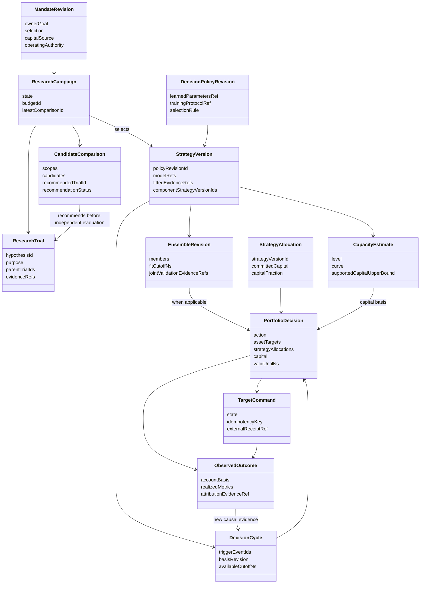

<a id="business--7-算法取舍及不能跳过的验证"></a>

## 7. 算法取舍及不能跳过的验证

| 问题 | 建议初始方法 | 替代与边界 |
| --- | --- | --- |
| 因子组合 | 同期限校准后的非负正则组合，时序验证学习参数 | 简单平均可作真实基线；黑盒全局搜索成本更高且扩大选择偏差；IC 加权不保证成本后收益 |
| 资产比例 | 复用 MaxUtility + 成本 + 当前仓位；先按已支持风险模型计算 | CVaR 适合尾部损失但小样本尾部估计不稳定；方差不等于最大回撤；复杂模型必须赢过基线 |
| 风险估计 | 可观测共同期限样本、明确估计区间 | 收缩/因子风险模型可能改善高维估计，但当前只提供样本协方差，不能宣称已经支持 |
| 资金规模 | 自动本金网格与边界细化，每档原生共享账户回放 | 不能以线性缩放或 BAR 量替代市场冲击；缺实时证据保留条件结论 |
| 更新频率 | 按实际新信息与预测期限触发，比较交易前后净价值 | 高频重新求解不等于高频应该交易；应有由成本和不确定性推导的“不交易区域” |
| 研究停止 | 边际信息价值、可执行候选、资源上限分别记录 | 不以次数或单指标达标替代结项；没有机会时保留现金是合法结果 |
| 选择偏差 | 全试验账本、内部时序验证、外部 Validation、一次 Sealed | DSR/PBO 需要对应原始样本和完整试验分布；拥有 CPCV 或次数计数不等于已计算这些统计量 |

下列业务验证比单纯接口通过更重要：重复因子加入后不能凭数量增加资金；高 Sharpe 但成本后亏钱的候选不能占优；缺一天估值不能提高稳定性；可用本金增加不能自动假设净收益同比增长；无新信息不能反复换仓；新信息只能影响其可得时间之后；新真实预留必须减少可分配资金；预测失败与成交失败必须在归因中分开。

<a id="business--8-完整场景"></a>

## 8. 完整场景

1. **首次约 3000 pUSD 研究。** 系统读真实可用市场与费用，生成不同经济假设，学习成员比例，在同一共享账户比较策略与现金基线。自动测试相关资金规模，给出推荐投入和条件限制。若仅代理数据可用，结论明确属于代理研究，不宣称可以实盘交付。
2. **新增高相关因子。** 单因子 IC 很高，但其预测和已有成员高度重复。系统比较加入前后成本后账户结果及预测残差，可能给零权重或很小权重；因子库保留研究成果，组合不因“新增成功”机械扩容。
3. **新市场突然活跃。** 全市场扫描发现新数据。只有足够的历史、规则与风险估计可用时才参与分配；缺风险关系不自动假定独立。已持仓市场即使暂时无新 BAR，仍保留真实持仓与未知可交易状态。
4. **费用上升或流动性下降。** 更新成本/流动性输入重新求解；目标可能不变、降仓或留现金。容量曲线按新修订重算，旧容量到期不续签。不能凭回测历史量声称当前退出顺畅。
5. **账户权益增加或发生提取预留。** 读取权威快照，先扣预留，再重新计算资金和资产目标。新增本金可能成为现金；成员组合也可因规模改变而变化，不能仅按原比例放大。
6. **长期有收益但偶发大亏损。** 系统展示净增长、亏损日与回撤的权衡，自动研究降低尾部暴露或替代组合；不能通过只统计交易日或隐藏未定价日期改善曲线。
7. **全部候选都不足以覆盖成本。** 输出现金/不调整建议与下一条最有价值研究问题，而非为了交付组合强行选 top 1。预算到期也保留已完成比较结果。
8. **Sealed 不通过。** 保留完整失败和曝露记录；研究模型不能看其详细成绩继续调当前策略。新研究使用允许的新数据角色，不重置旧测试集。
9. **策略目标要求退出，但市场无报价。** 输出退出目标意图与不可执行原因；保留真实风险敞口。下游确认接收后仍等待真实账户证据，不把 ACK 记为平仓。
10. **新数据未接入或服务离线。** 系统显示最后可得截止时间与当前证据状态，保持旧决策不可延长的期限；不能把定时任务运行次数当成持续实时学习。

<a id="business--9-原始来源及适用范围"></a>

## 9. 原始来源及适用范围

1. [QuantConnect Research Guide](https://www.quantconnect.com/docs/v2/writing-algorithms/key-concepts/research-guide)：支持经济假设驱动研究、避免反复调参、时序样本外检验、动态 universe 与 PIT。不能证明本项目某个策略盈利，也不规定所有基金必须采用相同流程或试验时长。
2. [QuantConnect Algorithm Framework](https://www.quantconnect.com/docs/v2/writing-algorithms/algorithm-framework/overview)：区分 universe、alpha、资产目标、风险和执行，并指出信号变化可能带来集中度及换手成本。支持分开“因子组合”和“资产配置”。不能证明其默认等权或全投资方式符合本用户目标。
3. [QuantConnect Backtest Report](https://www.quantconnect.com/docs/v2/cloud-platform/backtesting/report)：同时报告每日正负收益、回撤、换手、暴露与容量；其容量定义涉及流动性和市场冲击。支持账户多维决策证据，不能把我们的历史 BAR 上界自动等同其经济容量定义。
4. [Nautilus Portfolio](https://nautilustrader.io/docs/latest/concepts/portfolio/)：区分逐仓实现回报和账户逐日盯市收益，解释每日快照、货币转换与统计可用性。QZ 应继续使用明确的 portfolio returns。页面的 latest 行为需与锁定的 0.63.0 源码/测试核对，不能仅凭最新文档断言固定版本行为；原生可能回填估值，因此还需要本项目 fully_priced 与完整日检查。
5. [Nautilus Backtesting](https://nautilustrader.io/docs/latest/concepts/backtesting/)：支持依照数据粒度及明示费用、撮合和延迟模型做一致回放。使用成熟引擎不意味着缺失盘口、PIT 或冲击模型会自动获得补足。
6. [Boyd 等，Multi-Period Trading via Convex Optimization](https://web.stanford.edu/~boyd/papers/cvx_portfolio.html)：支持用预测收益、风险、交易/持有成本共同决定每期交易，以及滚动执行首期动作。作者明确不解决预测如何产生；因此求解器成功不能替代预测证据和独立评价。
7. [Cvxportfolio Manual](https://www.cvxportfolio.com/en/stable/manual.html)：支持按每个时点历史数据更新均值/协方差、变化 universe、现金账户与成本约束，说明风险惩罚是超参数。可借鉴自动估计与滚动求解的结构；不建议新增平行的 Python 投资引擎，也不把文档示例风险参数复制为本项目标准。
8. [Bailey 与 López de Prado，Deflated Sharpe Ratio](https://www.davidhbailey.com/dhbpapers/deflated-sharpe.pdf)：支持保留所有尝试并审视择优造成的表现膨胀与非正态回报。`max_trials` 不是修正本身；没有相应样本长度、试验分布与回报矩信息不能宣称已做 DSR。
9. [Bailey 等，Probability of Backtest Overfitting](https://www.davidhbailey.com/dhbpapers/backtest-prob.pdf)：讨论以候选表现集合评估择优过拟合。不能把普通 heldout、walk-forward 或 CPCV 字样当作已经计算 PBO。
10. [scikit-learn Common Pitfalls](https://scikit-learn.org/stable/common_pitfalls.html)：支持训练/测试分离与仅在训练集拟合变换，适用于校准、标准化及权重学习。普通随机切分建议不能直接替代有标签期限重叠的金融时序切分。

<a id="business--10-开放问题与建议交付顺序"></a>

## 10. 开放问题与建议交付顺序

【开放】仍需精确解决：新数据源如何持续登记及证明 available time；如何在不改变曝露事实的前提下推进研究周期；稀疏全市场风险面板；原始条件/市场相关结构；目录资金需求追踪；现金日收益及入金/提取口径；真实经济容量必需的报价/冲击/退出来源；自然语言稳定性意图对应的默认推荐政策。

【设计】先完成一条有业务结果的研究闭环：自动生成候选组合与比例、原生共享账户比较、自动本金曲线、推荐/不推荐与一次独立评价。随后接新数据修订和实际账户，建立快环目标更新及慢环再研究。最后在确实有执行数据时逐步增加实时经济容量和执行误差学习。每阶段都必须产生可观察的投资决策变化，不以增加字段、看板、定时器或配置页充当完成。

整个方案当前是设计。没有在本文工作中改动项目代码、完成新算法测试、连接实时行情或发出目标/真实订单。


---

<a id="chapter-platform-pipeline"></a>

<a id="platform-pipeline--quazonai-总架构业务章通用量化研究策略组合与持续运营"></a>

# QuaZonai 总架构业务章：通用量化研究、策略、组合与持续运营

> 设计状态：2026-10-22，方案文档，尚未实现或验证。本文件补足全项目总架构，不能用此前工程修复或单一“自动组合”功能替代本次总任务。
> 【事实】来自当前 `/workspace/QuaZonai` 源码、架构和已核验原始来源；【设计】是拟议目标；【待验证】是不得默认为已具备的能力。
> 合同：本章直接使用 [规范字段合同](#chapter-contracts) 的实体、字段与状态，不再定义第二套 DTO。自动因子权重、资产配置、资金曲线与双速更新见 [业务设计](#chapter-business)；全任务范围和需求编号见 [设计总览](#chapter-README)。

<a id="platform-pipeline--1-原始任务与成功定义"></a>

## 1. 原始任务与成功定义

本次目标是**整个项目更加通用化、策略化、规范化，核心流程严谨且智能，满足专业量化小自营基金的实际 pipeline 需要**。自动指标、容量、因子组合和比例是其中的决策能力，而非全部范围。当前按用户要求只设计，不开发。

【设计】平台的成功表现应是：用户提出一个投资想法，系统能识别策略范式与所需证据，自动找到可用市场和数据，组织研究，分配试验资源，把可信结果转为明确策略，组合资金、风险和退出需求，持续产生有根据的目标，观察账户与执行反馈，归因并改良或淘汰策略。系统能说明每一步为何可做、为何不做和缺少什么。

“专业 pipeline”在这里是业务质量定义：研究可证伪、证据可追溯、选择偏差可见、模拟与执行假设一致、资金共享、风险和退出有依据、运营结果能反哺研究。它不是某套法规的全行业强制模板，也不要求单人 PM 模拟投委会、合规部、交易台和多层审批。

<a id="platform-pipeline--11-原始需求追踪"></a>

### 1.1 原始需求追踪

编号与 [总览需求表](#chapter-README) 一致，本章不另建需求编号体系。

| ID | 总任务要求 | 本章架构响应 | 后续可验证结果 |
| --- | --- | --- | --- |
| R01 | 项目通用化 | 策略范式、跨市场能力矩阵与能力匹配 | 新市场/策略复用主流程，未知能力不能伪装支持 |
| R02 | 项目策略化 | 经济机制、信号、持有/退出与政策版本 | 模型与完整可运行策略有明确区别 |
| R03 | 项目规范化 | 统一合同、单位、时钟与阶段证据 | 任一决策可追溯，专题不另定义冲突字段 |
| R04 | 核心流程严谨 | PIT、隔离、共同账户、成本、退出、回执 | 不漏费、不重用本金、不伪造独立评价 |
| R05 | 核心流程智能 | 自主研究、选池、配置、反馈与淘汰 | 新证据实际改变下一步动作，含保持不动 |
| R06 | 专业小自营基金 pipeline | 完整阶段合同与单人轻量治理 | 从原数据到后续账户归因闭环 |
| R07 | 容量、组合、比例自动推导 | 分层推导责任及原始计算证据 | 业主不手配技术权重、容量与资金档位 |
| R08 | 动态、实时、持续更新 | 行情/账户快环、研究慢环与异常事件 | 新证据形成新判断，旧数据不续期 |
| R09 | 多 agent、调研与验证 | 共享试验/暴露、原始来源与场景验证 | 并行不形成隐形试验或互相矛盾的事实 |
| R10 | 最新 dev、新分支、最终合入 dev | 本章保留设计/实施边界，开发路线由总览统一 | 恢复开发后以届时最新 dev 和最终 Head 验收 |
| R11 | 先详尽设计，不开发 | 阶段/字段映射、类图与能力边界 | 本轮仅文档，不把方案宣称为已实现 |

约 3000 pUSD、全市场动态组合和每日稳定净收益是已知业务场景，用于检验架构是否有投资价值；不能把平台永久写死为此本金、Polymarket、特定七个特征或单一日频目标。

<a id="platform-pipeline--2-统一领域语言与三条路径"></a>

## 2. 统一领域语言与三条路径

【设计】统一领域对象，允许三种自然结束点：

1. **研究资产路径**：idea → 假设 → 数据/实验 → 可复用预测、因子、估计器或被否定的知识。无需强制生成组合。
2. **策略路径**：idea/研究资产 → 入场、持有、退出和状态更新规则 → 成本后共享账户评价 → 可投入或待验证策略。
3. **组合与运营路径**：一个或多个策略 → 联合资金与风险分配 → 目标交付/观察 → 归因 → 更新、暂停或淘汰。

下列对象不能合并：

| 对象 | 业务含义 | 不意味着什么 |
| --- | --- | --- |
| 数据观察 | 某来源在某时刻可得的观察 | 下载时间不证明历史时点已知 |
| 特征 | 对观察做了明确因果变换 | 特征不自动是 alpha |
| 信号/预测 | 对某标的、事件或价差的看法，带单位/期限 | score 不等于收益、概率或仓位 |
| 策略 | 消费观察/信号并更新持有或目标的规则 | 单一模型分数不包含完整退出逻辑 |
| 组合 | 同一资金约束下的策略/资产联合决策 | 不等于各自回测净值相加 |
| 目标 | 某时点希望达到的暴露 | 不是订单、成交或当前持仓 |
| 回执 | 下游对原目标的处理事实 | ACK 不证明成交 |
| 账户观察 | 已绑定来源提供的权益/持仓/预留/成交 | 未连接、过期或缺估值不能作零处理 |
| 归因 | 对实际与反事实结果差异的解释 | 单因子曲线不自动等于其组合边际贡献 |

<a id="platform-pipeline--3-策略范式共用流程保留不同经济语义"></a>

## 3. 策略范式：共用流程，保留不同经济语义

`StrategyDefinition.archetype` 使用规范 `StrategyArchetype` 标识主范式；`CapabilityDescriptor.strategyArchetypes` 声明某适配支持的多个范式。事件策略可以消费预测 alpha，相对价值策略可以消费微观结构信号，但不能为同一字段另加标签数组。复合组合由 `PORTFOLIO_OVERLAY` 主范式和 `StrategyVersion.componentStrategyVersionIds` 表达，成员可以采用不同范式，见第 7 节。

| 范式 | 研究的经济问题 | 必需输入与输出 | 评价及退出要点 | 当前平台边界 |
| --- | --- | --- | --- | --- |
| 预测 alpha | 哪些可得信息预测未来同期限收益/概率？ | 带期限与可得时钟的特征、成熟标签；输出 `RANK_SCORE`、`RETURN_FORECAST` 或 `EVENT_PROBABILITY` | 校准、分期稳定性、成本后映射；信号失效和期限结束 | 因子/Wasm 评价、原生校准部分基础存在；TS 默认仍偏 IC/Sharpe |
| 相对价值 | 两个或多个可交易权益之间的差异是否可收敛？ | 原始腿关系、共同币种/换汇、借贷或融资、可同时观察的报价；输出带 hedge ratio 的组合意图 | 净价差、腿风险、基差、融资、退出不对称；不能只评单腿IC | 无证据证明当前 TS 已有通用多腿相对价值生命周期；不能用 cross-market-threshold 名称替代 |
| 事件驱动 | 新公布信息、状态变化、到期/结算如何改变价值？ | event_at/published_at/available_at、原事件身份、状态与修订、合约事件关系；输出概率/状态或持有意图 | 事件簇隔离、反应延迟、到期结算、撤销/修订；不能用事后标签当事前输入 | 有部分原生结算合同和来源数据能力，不等于已接通通用事件研究与运行 |
| 微观结构 | 订单流、价差、深度与队列如何影响短期成交/价格？ | 逐笔、盘口增量/快照、序列与接收时钟、费用/延迟；输出短期预测或报价研究意图 | 成交概率、逆向选择、库存、撤单/队列、交易后成本 | 目录入口有记录成交方向及完成 BAR 特征；没有原盘口时不能宣称支持队列做市或真实盘口套利 |
| 组合/资产配置 | 如何将多个机会转换成更好的共同账户结果？ | 可比较收益预测/策略暴露、风险、成本、现仓、资金；输出资产及现金目标 | 联合容量、相关性、尾部风险、换手、资本效率、全部退出 | 原生 Clarabel、共享账户、容量/size-account 存在；自动成员学习与持续选池尚需接通 |

【设计】策略不是一律“score > threshold 后投资固定比例”。每个范式注册自己的状态、经济输入和决策输出，同时共用证据、执行、比较与运行合同。

需要区分两类策略适配：

- **组合型适配**：消费可比较预测，由组合器求仓位；适合排名、多因子及再平衡。
- **状态型适配**：策略本身定义进入、持有、退出和状态依赖；适合事件和多腿逻辑。组合器管理其总预算和暴露边界，不破坏内部经济关系。

Nautilus 的策略类可支持多种事件型逻辑，LEAN 也明确指出某些紧耦合入场/退出策略不适合默认 alpha→等权框架。因此通用化不应把所有策略压成同一个数值分数。[Nautilus Strategies](https://nautilustrader.io/docs/latest/concepts/strategies/)，[LEAN Framework](https://www.quantconnect.com/docs/v2/writing-algorithms/algorithm-framework/overview)。

<a id="platform-pipeline--4-跨市场能力矩阵按事实组合不能按市场名字打勾"></a>

## 4. 跨市场能力矩阵：按事实组合，不能按市场名字打勾

<a id="platform-pipeline--41-必需能力维度"></a>

### 4.1 必需能力维度

【设计】每个市场/数据修订必须报告下面的能力，并给出 规范 `SupportState`：`SUPPORTED / CONDITIONAL / UNSUPPORTED`。证据未核验用 `CONDITIONAL` 加 `requiredEvidence` 和原因表达；具体数据/指标是否可用则使用独立的 `Availability`，不把两组状态混成一个枚举。

| 维度 | 需要明确的语义 | 影响的业务 |
| --- | --- | --- |
| 身份与合约历史 | instrument、venue、币种、tick/lot、有效区间、历史变更 | 目标是否代表同一可交易权益，最小本金 |
| 时钟与可得性 | event、publication、receive、available、decision；真实或 modeled | 能否声称因果预测、可模拟延迟 |
| 观察类型 | BAR、trade、quote、L1/L2/L3、event、fundamental、settlement | 哪类策略可以研究、哪种撮合可信 |
| 交易与持有规则 | 交易日历、期限、停牌、借贷、保证金、资金费、交割/结算 | 真实成本、风险与退出 |
| 账户语义 | 单币现金、多币现货、保证金、代理账户、换汇/资金转移 | 共享资金、可用余额和权益口径 |
| 费用与执行 | 历史费率、可执行报价、撮合/队列、延迟、冲击 | 净收益及容量是否有依据 |
| 宇宙与关系 | 历史上市/退市、可观察集合、跨腿/共同条件/行业关系 | 存活偏差、分散化与多腿管理 |
| 下游与观察 | target 接收、权威账户、预留、对账、退出接口 | 目标能否进入运行及持续评估 |

<a id="platform-pipeline--42-典型市场需求与本项目当前结论"></a>

### 4.2 典型市场需求与本项目当前结论

| 市场/场景 | 可复用统一能力 | 额外必需能力 | 当前证据结论 |
| --- | --- | --- | --- |
| Polymarket v2 全市场目录代理 | 因果特征、共享账户、记录费用、动态市场扫描 | 原始接收/PIT、真实盘口/结算/现金语义、条件风险、目录容量 | 当前已支持有明确限制的长仓 1x pUSD 代理研究；不能声称全部真实场内能力 |
| 有原始定义的普通 BAR 市场 | 特征/标签、原生回放、阈值策略、费用设置 | 原数据时钟、历史规则、账户和交易日历 | 是否可跑由具体输入与原生接受结果决定，不由“股票/币/外汇”标签保证 |
| 现货多币种 | 相同预测/组合流程 | 实物币库存、余额限制、FX、跨币费用/转换 | 原生存在专用科学类型，但当前 TS `validateNativeSimulationSettings` 明确拒绝 `multi_currency_spot_cash`，不能宣称端到端集成 |
| 永续/期货 | 相同假设/试验/组合语义 | 资金费/结算、合约乘数、保证金/清算、换月 | 数据导入能力不等于持有收益结算；当前完整业务链未证实 |
| 股票/ETF | 相同研究/目标合同 | 公司行动、停牌/退市、PIT universe、借券/融资、交易日历 | 不因底层引擎支持相关 instrument 就宣称 QZ 已具备完整研究/运营支持 |
| 期权/组合合约 | 相同阶段/证据合同 | 合约链、行权/指派、希腊风险、波动率、保证金、腿关系 | 应经能力注册后逐项接入；当前没有足够端到端证据 |

【事实】仓库已有 `runtimes/data/source_plugins.py` 的 capability-oriented registry，支持 plan/download/verify/convert/prepare 等不同组合。不同来源没有的操作直接不提供；下载、转换与研究数据可用性彼此分开。这是总平台注册设计的可复用模式。

【设计】市场选择自动化意味着遍历有来源且当时可得的市场，再按能力、数据充分性与投资价值筛选。它不意味着提前写死几个市场，也不意味着所有未知市场必须立刻交易。新市场缺少估值、风险或规则时，系统应自动留下待补证据的工作项。

<a id="platform-pipeline--5-专业阶段合同与轻量推进规则"></a>

## 5. 专业阶段合同与轻量推进规则

阶段是一个决策与产物合同，不是一张审批单。大多数转换由证据自动完成；单人所有者只决定目标、资本意图与已授权的运行范围。

| 业务步骤 | 规范阶段/状态落点 | 输入与自动工作 | 正式产物与推进含义 |
| --- | --- | --- | --- |
| 机会/意图 | `PipelineStage.IDEA` | 用户原话、经济机制、能力匹配与重复研究发现 | `MandateRevision`、`StrategyDefinition`、`CapabilityDescriptor`；未知用 `EvidenceGap`，不补造能力 |
| 数据准备 | `IDEA` 或 `RESEARCH` 内的工作，不另设阶段枚举 | 原来源、时钟、instrument 历史、质量、分区 | `DatasetRevision` 和 `EvidenceRef`；技术可读与研究可用分别记录 |
| 研究计划 | `RESEARCH`；`CampaignState.PLANNED` | 假设、基线、标签、内部时序验证、资源分配 | `Hypothesis`、`LabelDefinition`、`ResearchBudget`、`ResearchCampaign.evaluationProtocolRef` |
| 实验/学习 | `RESEARCH`；`CampaignState.SEARCHING` | 校准、模型/策略搜索、全部尝试计账 | `ResearchTrial`、`FactorVersion`、`CalibrationModel`、`EnsembleRevision`；允许因子研究在这里形成结论 |
| 策略构造 | `RESEARCH` 到 `SELECTION` | 绑定经济定义、模型、配置、执行/退出规则 | `StrategyVersion` 与 `DecisionPolicyRevision`，不将模型文件等同完整策略 |
| 联合 Validation | `SELECTION` | 同一资金/成本/时期下回放、资金曲线与候选比较 | `CandidateComparison`、`CapacityEstimate`；推荐、前沿、无可行候选或缺证据分别表达 |
| 独立最终评价 | `INDEPENDENT_EVALUATION`；campaign 为 `EVALUATING_INDEPENDENT` | 预选完整版本的一次 Sealed 评价 | `PipelineAssessment` 引用 `EvidenceRole.INDEPENDENT`；不反馈研究继续调参 |
| 运行准备 | 对应拟进入的 `SHADOW`、`PAPER` 或 `TARGET_OPERATION` | 核对策略、账户、资本、当前执行能力 | `PipelineAssessment` 只回答该阶段是否 READY；历史独立评价不自动建立实时能力 |
| 持续运行 | `SHADOW` / `PAPER` / `TARGET_OPERATION`；更新进展用 `CycleState` | 新数据/账户驱动快环求解、交付和核对 | `DecisionCycle`、`PortfolioDecision`、`TargetCommand`、`ObservedOutcome` |
| 归因与复盘 | `MONITORING` | 对齐实际与反事实，分离预测/组合/成本/资金/执行差异 | `ObservedOutcome.attributionEvidenceRef`、`MetricObservation` 与原始 `EvidenceRef` |
| 更新/淘汰 | 新版本重入适用阶段；退休为 `RETIRED` | 重学、替换、减配、暂停或结束，保留未完成处置 | 新 `StrategyVersion`/`PipelineAssessment` 与下一 `ResearchCampaign`；暂停不等于平仓 |

业务步骤不是另一套状态机。`PipelineAssessment.stage`、`outcome`、`evaluatedAtNs`、`requirementsVersion`、`evidenceRefs`、`reasonCodes` 与 `nextPermittedActions` 统一表达阶段判断。`TrialState.COMPUTED` 只证明计算完成；`PipelineAssessment.outcome=READY` 仅对当前阶段成立；`PortfolioDecision.status=CURRENT` 表示当前消费版本，三者不能合并为同一“成功”。

研究阶段中的资源上限不能直接替代业务结束条件。预算耗尽必须形成结论：最佳已知结果、缺口、下一项研究收益预期与停止理由，而非仅 `trialId:null`。

<a id="platform-pipeline--6-插件类型与-capability-registry"></a>

## 6. 插件类型与 capability registry

<a id="platform-pipeline--61-插件职责"></a>

### 6.1 插件职责

【设计】注册表应连接现有官方 Pi Extension registry、来源插件和原生科学适配，维护业务匹配元数据，而不另建执行引擎。

| 插件角色 | 输入→输出 | 例子 |
| --- | --- | --- |
| `DATA_SOURCE` | 来源选择→原始观察/修订 | 已有来源下载/准备插件 |
| `NORMALIZER` | 原观察/定义→统一有单位观察 | 原生 BAR/逐笔转换，不补造数据 |
| `FEATURE` | 因果观察→特征 | 流量、趋势、价差、事件状态 |
| `FORECAST` | 特征/状态→有类型信号 | 分数、收益预测、概率、价差 |
| `CALIBRATOR` | 训练信号/成熟标签→可重放映射 | score→return；仅训练窗拟合 |
| `STRATEGY` | 观察/信号/状态→目标或研究意图 | 多腿、事件、阈值、配置策略 |
| `ENSEMBLER` | 同语义预测/策略→组合规则 | 学习因子权重；不得混单位 |
| `ALLOCATOR` | 预测/风险/成本/现仓→资产/现金 | 原生 Clarabel |
| `RISK_MODEL` | 历史/关系/现仓→风险估计 | 协方差、尾部、条件关系风险 |
| `COST_MODEL` | 规则/报价/成交→成本估计 | 费用、滑点、融资、冲击 |
| `CAPACITY_MODEL` | 联合需求/流动性/规模回放→容量证据 | BAR 上界、资金曲线、实时执行约束 |
| `EVALUATOR` | 原生结果/预声明规则→评估 | 因子、策略、稳定性、执行比较 |
| `TARGET_TRANSPORT` | 原目标→回执/状态 | 现有下游目标桥接，不直接发券商订单 |
| `ACCOUNT_OBSERVER` | 绑定账户→权威观察 | 权益、持仓、预留、真实成交 |
| `ATTRIBUTOR` | 观察/反事实→可解释差异 | 成本、资金、预测、执行贡献 |

<a id="platform-pipeline--62-能力不是一个-enabled-布尔值"></a>

### 6.2 能力不是一个 `enabled` 布尔值

【事实】当前 service 的 `ExtensionConfig` 只有 name/module/enabled/version?/kind?，装载插件不证明业务能力。原生输入还约束上游类、版本、账户、币种和模型组合。

【设计】前表是职责分工，不新增 `PluginRole` 枚举或第二套插件 DTO。业务匹配统一使用 `CapabilityDescriptor`；实际装载和执行继续使用已有 Extension/来源插件注册表。匹配结果通过对应 `PipelineAssessment` 与 `EvidenceGap` 记录，不增加平行能力状态机。

| 业务匹配问题 | 规范字段 | 规则与边界 |
| --- | --- | --- |
| 谁提供什么版本 | `CapabilityDescriptor.provider / providerVersion / producerVersion` | 分清上游能力版本与产生本业务事实的适配版本 |
| 支持什么策略 | `strategyArchetypes` | 只声明已说明的范式；底层库支持不等于已接通当前产品路径 |
| 观察与信号语义 | `dataKinds / predictionUnits / nativeSchemaIds` | 不把 `RANK_SCORE` 当 `RETURN_FORECAST`，也不静默改变单位/期限 |
| 账户与执行可兼容性 | `accountingModels / executionModels` | 代理账户、单币现金、多币现货、保证金分开 |
| 可以执行哪一步 | `supportedOperations / boundaries.operation` | 同一来源可以支持导入而不支持某类撮合或目标运行 |
| 当前支持结论 | `boundaries.state / requiredEvidence / reasonCodes` | 只用 `SupportState`；条件未满足不能视为已支持 |
| 策略实际采用哪些能力 | `StrategyVersion.capabilityBindingIds` 与 `DecisionPolicyRevision.applicableCapabilityIds` | 绑定具体已登记修订，不能只存当前插件名称 |
| 缺口怎么办 | `EvidenceGap.requiredCapability / permittedRemedy / state` | 明确等待、刷新、重算或不支持；不扩大数据或执行授权 |

能力匹配是“策略所需能力 ∩ 已验证适配 ∩ 当前数据证据 ∩ 当前账户/下游能力”。缺盘口时可以研究分钟订单流信号，不能转而宣称排队做市可行。registry 发现和匹配能力；原科学合同仍验证输入合法性，不能用自由 JSON 绕过数值校验。

通用插件调用使用规范`OperationContract`绑定input/output schema、effect、replayPolicy和不兼容能力集合；它必须与实际官方插件注册相符，不构建另一套执行运行时。`nativeSchemaIds`、`FeatureSchema`、`SignalContract`、`StrategyStateContract`及`MarketAdapterContract`承载数据/信号/状态/市场语义。阶段所需能力证据继续由PipelineAssessment与EvidenceGap表达。

<a id="platform-pipeline--7-策略方法与政策版本化"></a>

## 7. 策略、方法与政策版本化

【设计】直接使用 `StrategyDefinition → StrategyVersion → DecisionPolicyRevision`，并通过 `MandateRevision` 保留所有者意愿。业务与方法版本分开，不新增同义政策 DTO。

| 业务含义 | 规范字段落点 | 不能混淆的边界 |
| --- | --- | --- |
| 想解决什么投资问题 | `MandateRevision.ownerGoal / interpretation / selection / operatingAuthority` | 原话与解释分开；不从市场数据推断运行授权 |
| 策略经济机制与失效 | `StrategyDefinition.economicMechanism / falsificationConditions / knownFailureModes` | 单模型代码不能替代完整经济定义 |
| 范式、机会集合与期限 | `StrategyDefinition.archetype / opportunityUniverseRef / intendedHoldingHorizonRef` | 一种输出单位或一个日历不能覆盖所有策略 |
| 冻结可评估策略版本 | `StrategyVersion.definitionId / mandateRevisionId / policyRevisionId / modelRefs` | 语义改变产生新版本，旧结果不改写 |
| 特征和信号接口 | `StrategyVersion.featureSchemaRef / signalContractRef` → `FeatureSchema` / `SignalContract` | 信号合同明确 kind、单位、期限、值 schema 和有效性；状态型策略可按规范不依赖预测信号 |
| 状态、入场、持有与失效 | `stateSchemaRef / entryRuleRef / holdingRuleRef / invalidationRuleRef` → `StrategyStateContract` | 状态型策略绑定初始状态、事件 schema 和转移规则；纯因子研究可不具有交易状态 |
| 多策略成员 | `componentStrategyVersionIds` 与 `PortfolioDecision.strategyAllocations` | 外层策略为 `PORTFOLIO_OVERLAY`；成员身份与策略预算单独表达，不借用因子成员权重 |
| 配置、执行与退出 | `portfolioRuleRef / executionRuleRef / exitRuleRef` | 适配不支持时不补造规则；因子研究可合法没有交易规则 |
| 学习和更新方法 | `DecisionPolicyRevision.methodFamily / learnedParametersRef / trainingProtocolRef / validDomain` | 学习系数不是用户偏好；有效域与训练截止保留在被引用科学证据 |
| 拟合和阶段资格 | `StrategyVersion.fittedEvidenceRefs / pipelineAssessmentId` | 模型拟合、最终评价和运行可行性分别记录 |
| 事实与工作聚合修订 | `VersionedFact.id / revision / supersedesId / createdAtNs / producerVersion` | 科学内容版本不可覆盖；campaign/cycle 等工作聚合保持稳定 ID 与递增 revision，保留历史转换 |
| 原生执行与运行状态 | `RuntimeRef`、`DecisionCycle` 及原官方 task/checkpoint | 不新增第二套执行状态机 |

| 变化 | 规范记录方式 | 相应研究/评价 |
| --- | --- | --- |
| 新行情、现仓、权益或预留 | `BusinessEvent` → 新 `DecisionCycle` / `PortfolioDecision` | 原政策下更新；事件无新证据时不能刷新事实有效期 |
| 原冻结在线算法取得成熟标签 | `LABEL_MATURED`，新拟合结果/`EnsembleRevision` 与原 policy 关联 | 在冻结因果规则内发生；旧成员和权重不可原位改写 |
| 改校准方法、特征含义、风险或退出规则 | 新 `DecisionPolicyRevision` 和 `StrategyVersion` | 对改变的经济行为形成新证据及适用阶段评估 |
| 因子成员/权重变化 | 新 `EnsembleRevision`、联合回放证据与策略关联 | 不用成员单独绩效替代新的联合结果 |
| 多策略成员或预算变化 | `PORTFOLIO_OVERLAY` 策略版本、`strategyAllocations` 与联合证据 | 成员变化产生相应版本；预算按原规则动态更新时是新决策，不能建立多份独立本金 |
| 科学 bug 修复改变输出 | 新 `producerVersion`、新证据和受影响对象修订 | 明确影响范围，不能以新二进制给旧结论追授资格 |
| 非语义文案变化 | 展示修改 | 不制造不必要的科学重评 |

状态型策略和多策略组合均按正式字段表达：`StrategyStateContract` 绑定入场/持有/退出、库存、多腿协议和失效规则；`StrategyAllocation` 记录独立策略预算。其 `capitalFraction` 为该策略承诺资金/组合承诺资金，组合承诺资金为零时为 `null`，不是因子系数或资产 NAV 权重。`capital`可用时，非复合策略的`strategyAllocations`恰有一项指向根策略版本；只有复合策略才要求其成员集合与`componentStrategyVersionIds`一致。初始合同先扁平化/去重叶策略，禁止递归重复计资；所有策略承诺资金之和等于组合承诺资金。

非预测型策略不强制配一个因子 ensemble。仅适用单一预测组合时才填写 `ensembleRevisionId`；多策略组合或不依赖预测组合时按根合同使用 `null`。运行策略仍需要其所消费数据和所需交易规则的能力证据。

新版本消费时须同时满足 `EvidenceRef.availableAtNs`、`DecisionCycle.availableCutoffNs`、原运行授权和决策有效期。具体在线更新规则由 `AdaptiveUpdateProtocol` 的触发、成熟度、训练窗、方法和越界动作定义；不能用新文案追认过去的生效时间。

<a id="platform-pipeline--8-组合资本与持续自动推导在全架构中的位置"></a>

## 8. 组合、资本与持续自动推导在全架构中的位置

【设计】系统估计器将每个推导值记录为“来源数据+算法版本+训练窗口+不确定性+使用范围”。因子权重、策略预算、资产比例、现金、建议规模与运行频率都是计算输出。用户提供投资意愿，不逐项充当优化器。

组合至少要处理三个不同问题：

1. **预测组合**：同期限、同单位的预测如何合并；研究重复性、校准误差与边际信息。
2. **策略预算**：用 `PortfolioDecision.strategyAllocations` 表达状态型策略、不同期限和不同风险来源如何共享总资金；保持腿关系、`nettingGroupId` 与资本预留。
3. **净资产目标**：同一市场上的需求如何净额化，如何在真实现仓/流动性/成本下形成最终目标。

仓位净额化可以减少真实交易，但不意味着两个策略互相抵消后都没有研究价值；归因同时保留策略意图和实际账户净交易。虚拟贡献记录不能建立多个独立本金。

容量用 `CapacityEstimate.level` 区分 `OBSERVED_LIQUIDITY`、`CONDITIONAL_FEASIBILITY`、`ECONOMIC`，相应估计可分别存在。当前账户/报价下的可用规模还须结合 `AccountBasis`、模型有效域及 `CapitalPlan.sizingEvidenceRef`；它不是凭空新增的第四个容量级别。退出需计算联合全部需求；不能将成员容量相加。

持续更新包含行情/账户快环、成熟标签/新研究慢环与异常事件环。真实新信息、费用变化、资金预留和政策失效决定是否重算。没有新数据时定时醒来不是“实时智能”。在缺实时源或目录容量支持的环境，输出的是明确时点的研究决策，不能伪装成当前可执行组合。

<a id="platform-pipeline--9-运行归因迭代与淘汰"></a>

## 9. 运行、归因、迭代与淘汰

【设计】“预期—目标—下游—实际”的正式链是 `PortfolioDecision → TargetCommand → ObservedOutcome`。实际账户基准用 `AccountBasis`。归因作为 `ObservedOutcome.attributionEvidenceRef` 引用的证据对象，汇总指标使用 `MetricObservation`；本章只解释其业务语义与证据内容。

| 业务问题 | 规范字段/操作 | 语义 |
| --- | --- | --- |
| 本轮希望调整什么 | `PortfolioDecision.action / assetTargets / capital / reasonCodes` | `HOLD`、`REDUCE`、`CASH` 与 `NEEDS_EVIDENCE` 有不同含义 |
| 下游是否收到原目标 | `TargetCommand.state / externalReceiptRef / idempotencyKey` | `ACKNOWLEDGED` 仅证明接收；不确定只核对原命令 |
| 实际发生什么 | `ObservedOutcome.accountBasis / interval / realizedMetrics` | 原账户权益、持仓、现金流与成交，不能用目标反推 |
| 是否能归因 | `reconciliationStatus / attributionEvidenceRef / reasonCodes` | 部分匹配只发布其证据支持的归因；保留未解释差异 |
| 哪些反馈可用于未来学习 | `matureLabelEvidenceRef / availableAtNs` | 成熟与可得之后释放，不把已发生但未知的标签回填过去 |
| 暂停或淘汰 | 规范 pause/retire API、`PipelineAssessment` 与实际未完成命令 | 退休可记录 `stage=RETIRED`，但不能推断已经平仓 |
| 如何继续研究 | 新 `ResearchCampaign`、`Hypothesis` 与原证据关联 | 不把改名或新 agent 当作独立新发现 |

费用可来自原生明确事实；预测、配置和规模贡献可能需要移除成员等反事实回放，存在交互作用。归因证据必须说明所用方法、原策略/目标、对比期间与未解释残差。不能默认把所有贡献加总成精确因果解释。

归因证据由规范`OutcomeAttribution`定义，区分确定记账与非加性反事实、未识别原因和剩余误差；退休处置由`RetirementDisposition`定义，记录剩余持仓、未完成目标及权威闭环证据。通过`EvidenceRef.schemaId`与既有账户/命令衔接，不新建平行运行时。

淘汰依据是边际价值、稳定性、风险/成本、数据可用性与资源机会成本。因子暂不入组合不等于删除；暂停不等于账户空仓；永久退役保留原模型、证据和原因。

【事实】既有 target-only 架构、权威账户/预留读取、独立回执和不确定状态对账可以复用。QZ 不持有券商账户、不发送真实订单。微观结构研究需要报价/撤单级语义时，当前 target-weight 下游没有支持则保持研究用途，不能以设计文字扩大执行权限。

<a id="platform-pipeline--10-单人-pm-的轻量治理"></a>

## 10. 单人 PM 的轻量治理

【设计】治理围绕事实与决策，不围绕人员和审批层级：

- **一个意图记录**：保留用户目标、账户范围和已授权自动化边界；已有授权不反复确认。
- **一个完整试验账本**：全部尝试及选择过程留存，失败不免费、改名不重置。
- **一个政策版本链**：知道当前运行什么、为何换成它、何时生效。
- **一个独立检验事实**：研究反馈与最终评价隔离；计算成功和投资证据分别呈现。
- **一个账户级资金事实**：共享预算、真实预留和退出需求，不多算本金。
- **一个归因与下一步结论**：每轮研究或运营观察都改变知识或下一决策，不能只留下任务日志。

多 agent 的角色是研究员、策略构造、科学验证、组合分析和独立审阅等可并行职责；不是互相批示的虚拟部门。它们使用同一冻结输入与合同，不各自定义净收益或“通过”。并行探索共享预算与暴露记录，不能通过不同 agent 形成隐形多重试验。

<a id="platform-pipeline--11-总类图与阶段图"></a>

## 11. 总类图与阶段图

图中的类名和字段均直接取自 [规范字段合同](#chapter-contracts)。科学大对象通过 `EvidenceRef` 关联；图不表示每个类都必须建立独立数据库表。

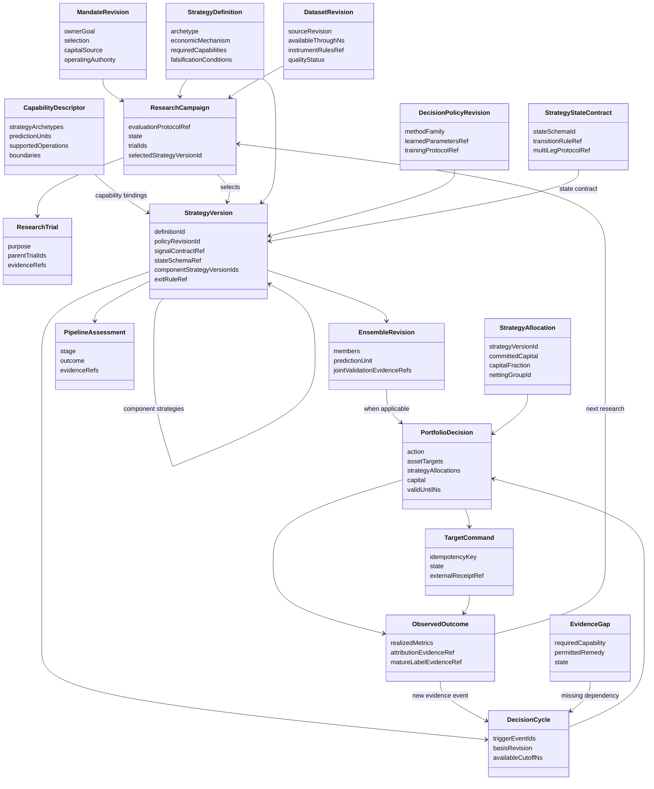

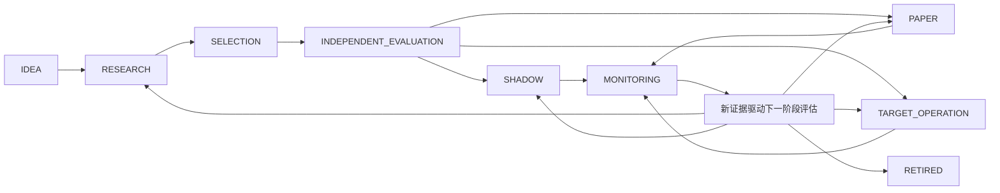

此图表达可评估的路径，不表示自动晋级顺序：`SHADOW`、`PAPER`、`TARGET_OPERATION` 由实际能力与 `operatingAuthority` 决定。纯因子研究可在 `RESEARCH`/`SELECTION` 形成结论，不被强制进入交易阶段。每次推进都保存原 `PipelineAssessment`，不能改标签追授旧事实。

<a id="platform-pipeline--12-验证场景检查整个架构而非单项指标"></a>

## 12. 验证场景：检查整个架构，而非单项指标

| 场景 | 必须观察到的行为 |
| --- | --- |
| 同一预测因子分别用于现货与保证金研究 | 复用模型和证据语义，分别匹配账户/融资/执行；不能复制一个账户假设 |
| 相对价值策略缺第二腿借贷或同时报价 | 保留可做的研究结论，运行能力不成立；不能静默变单边投机 |
| 事件公告事后修订 | 训练与运行按原可得版本，后修订形成新事件事实，不改写过去 |
| 仅有分钟成交却请求盘口做市 | 注册表解释缺盘口/队列/延迟证据，允许研究已有订单流信号，不伪造做市成功 |
| 同一策略换入场阈值或退出逻辑 | 形成新政策及相应试验，不能复用旧最终验证资格 |
| 三个高相关因子组合 | 自动边际价值比较，可能降权/排除，不按数量增加本金 |
| 两个策略在同一资产上相反需求 | 账户净交易正确，策略意图与归因仍保留，费用不重复计算 |
| 权益增长但流动性下降 | 资金和组合联合重算，可能多留现金，不按权益机械同比放大 |
| 资金预留/退出在运行中出现 | 所有策略共享扣减，目标与下游实况分别记录 |
| 新 agent 重试曾失败的模型 | 继承试验/暴露谱系与资源消耗，不当成独立新证据 |
| 旧 Sealed 想用于新一轮自动训练 | 遵循明确的阶段与曝露政策；当前禁止重叠不能靠换标签绕过 |
| 原策略无新数据，但定时任务仍运行 | 不宣称实时学习或刷新证据时效；保留具体截止时点 |
| 某插件升级改变输出单位 | 能力匹配拒绝旧接线，要求明确新适配与新政策，不能数值兼容即自动通过 |
| 策略退出目标已ACK但持仓仍在 | 状态为未完成退出，继续对账与风险观察，不显示已清仓 |

<a id="platform-pipeline--13-来源及工程映射"></a>

## 13. 来源及工程映射

原始来源支持设计原则，不为本项目缺失的数据、集成或盈利背书：

- [LEAN Framework](https://www.quantconnect.com/docs/v2/writing-algorithms/algorithm-framework/overview)：支持 universe/alpha/portfolio/risk/execution 分离，且明确并非所有入场/退出策略适合默认框架。对应策略范式与语义端口设计。
- [Nautilus Strategies](https://nautilustrader.io/docs/latest/concepts/strategies/)：支持事件型策略、状态回调和共同策略代码；同时指出 live 与 backtest 仍有运输、时序、外部活动与对账差异。对应 policy/runtime 分离，不构成 QZ 已集成全部策略的证明。
- [Nautilus Backtesting](https://nautilustrader.io/docs/latest/concepts/backtesting/)：支持原数据及明示费用/撮合/延迟下的共享模拟。对应不同市场能力和真实模拟输入。
- [Nautilus Portfolio](https://nautilustrader.io/docs/latest/concepts/portfolio/)：区分账户权益与逐仓收益等事实。对应账户层与归因，latest 文档仍须与固定依赖版本核对。
- [QuantConnect Research Guide](https://www.quantconnect.com/docs/v2/writing-algorithms/key-concepts/research-guide)：支持经济假设、动态 universe、PIT、样本外与过拟合控制。对应研究计划和阶段合同。
- [Boyd 等，Multi-Period Trading via Convex Optimization](https://web.stanford.edu/~boyd/papers/cvx_portfolio.html)：支持预期收益、风险、成本与滚动交易决策；明确预测来源仍需另行解决。对应组合层而非万能策略生成器。
- [Deflated Sharpe Ratio](https://www.davidhbailey.com/dhbpapers/deflated-sharpe.pdf)：支持显式考虑搜索规模与选择偏差。对应跨 agent、跨策略族全试验谱系；次数上限本身不是统计修正。
- [QuantConnect Live Reconciliation](https://www.quantconnect.com/docs/v2/research-environment/meta-analysis/live-reconciliation)：支持对齐初始权益、时段与参数后比较 live 和对应回放。对应运营归因；不直接采纳其特定阈值作为本平台硬规则。

当前代码映射：[strategy.ts](../../../apps/research/src/strategy.ts) 定义策略类型与语义限制；[feedback.ts](../../../apps/research/src/feedback.ts) 定义研究可见反馈与目录假设；[config.ts](../../../apps/service/src/config.ts) 保存 Extension/Dataset 配置；[来源插件](../../../runtimes/data/source_plugins.py) 是实际能力注册范例；[校准](../../../apps/job/src/validation.rs)、[优化](../../../apps/job/src/optimization.rs)、[滚动回放](../../../apps/job/src/study.rs)、[共享模拟](../../../apps/job/src/simulation.rs)、[容量](../../../apps/job/src/capacity.rs) 提供必要科学计算；[自动账户调整](../../../apps/service/src/automatic.ts) 和 [账户传输合同](../../../apps/service/account-transport.md) 提供既有 target-only 运营基础。

【设计】后续详细技术方案应围绕这些边界扩展现有实现，统一 TS 业务合同与原生科学合同。不恢复已经退役的 Rust Store/Mission 控制面，不复制官方组件源码，不另做同功能框架。

<a id="platform-pipeline--14-总体完成标准"></a>

## 14. 总体完成标准

完整目标不能由一个最小切片宣告完成。可以分阶段实施，但必须同时保留总需求映射和未完成能力：

1. 多种策略范式通过同一生命周期，且保留正确的信号、交易和账户语义。
2. 跨市场支持由实际数据/原生/下游证据匹配，不依靠市场名或插件 installed 状态。
3. 自动研究、组合、资金和持续更新真实改变决策；用户不承担算法参数配置工作。
4. 所有策略共享同一证据、试验、资金和运行事实；可重放、可归因、可退出。
5. 原始需求 R01–R11 均有已验收行为或明确未完成项；科学能力和实时能力没有被工程检查通过掩盖。

本章仅完成架构设计材料。项目开发、算法验收、数据接通、实时运营和最终交付均未在本文件工作中完成。


---

<a id="chapter-contracts"></a>

<a id="contracts--规范字段合同业务实体状态数据语义与-api"></a>

# 规范字段合同：业务实体、状态、数据语义与 API

> 本文件是设计包的字段规范，不是已发布 API。所有新增合同为拟议。专题中的候选类型、函数名与本文件不一致时，以这里的语义与名称为准，并在实现前修订专题。以下 TypeScript 是自洽的领域 DTO 草案，不是要求立即添加到生产源码。

<a id="contracts--1-通用规则"></a>

## 1. 通用规则

1. 新业务 ID 使用不可解释的字符串；官方 Pi `conversationId`、`taskId` 仍使用其 branded 安全整数，单独存放，不能通过转换数字生成新的业务身份。来源市场/事件/资产 ID 保留命名空间，不与 factor ID 混用。
2. 金额、数量、权重及精确费率使用十进制字符串。禁止经过 JS `Number` 计算金额再转回字符串。浮点统计仅接受有限值；`NaN`、`Infinity` 不进入 JSON。
3. 时钟使用非负整数 `Ns` 字符串，另记实际精度。把毫秒乘一百万不代表获得纳秒精度。所有业务区间采用 `[startNs, endExclusiveNs)`；有可用时钟才可证明 as-of 合法。
4. 不可用指标必须 `value:null`，同时给出状态和原因；未知不等于零、风险小、不合格或现金策略成功。`AVAILABLE` 与“有投资价值”独立。
5. 原生统计保留 `nativeKey`、原始值/单位和转换版本。规范最大回撤为非负损失幅度；当前 Nautilus 负数回撤经显式取负转换，不直接改变原证据。
6. 不可变对象产生新 ID/版本，不原位覆盖。活动指针、待处理修订和官方 task 引用是运行控制信息；不复制官方运行时任务状态。
7. 事实来源、方法推导、业主意愿、产品方法默认值分开记录。系统推导值也有假设、方法版本与有效域，不能包装成天然真值。
8. 大样本面板、模型、原生日志、回放与净值序列使用 `EvidenceRef` 引用；API 返回摘要和分页，不把它们内联到所有周期。

<a id="contracts--2-可校验的核心类型"></a>

## 2. 可校验的核心类型

```ts
type Id = string;
type Decimal = string;
type Ns = string;
type Currency = string;
type Json = null | boolean | number | string | Json[] | { [key: string]: Json };
type Direction = 'MAXIMIZE' | 'MINIMIZE' | 'DIAGNOSTIC';
type ClockPrecision = 'SECOND' | 'MILLISECOND' | 'MICROSECOND' | 'NANOSECOND' | 'UNKNOWN';
type EvidenceRole = 'TRAINING' | 'INNER_VALIDATION' | 'SELECTION'
  | 'INDEPENDENT' | 'PREQUENTIAL' | 'OBSERVED' | 'CONTROL';
type Availability = 'AVAILABLE' | 'INSUFFICIENT' | 'UNAVAILABLE' | 'STALE'
  | 'INCOMPARABLE' | 'AMBIGUOUS' | 'INVALID';
type FactOrigin = 'SOURCE' | 'ACCOUNT' | 'OWNER_INTENT' | 'ESTIMATED'
  | 'DERIVED' | 'METHOD_POLICY';
interface Interval { startNs: Ns; endExclusiveNs: Ns }
interface RuntimeRef { conversationId: number; taskId: number | null }
interface VersionedFact {
  schemaVersion: 1;
  id: Id;
  revision: string;
  supersedesId: Id | null;
  createdAtNs: Ns;
  producerVersion: string;
}
interface Money { amount: Decimal; currency: Currency }
interface EvidenceRef {
  id: Id;
  sourceKind: 'NATIVE_RESULT' | 'DATASET' | 'MODEL' | 'ACCOUNT' | 'DERIVED';
  role: EvidenceRole;
  runtime: RuntimeRef | null;
  objectKey: string;
  contentDigest: string | null;
  mediaType: string;
  sourceRevision: string;
  eventInterval: Interval | null;
  availableAtNs: Ns;
  clockPrecision: ClockPrecision;
  schemaId: string;
  visibility: 'RESEARCH_VISIBLE' | 'OWNER_ONLY';
}
interface EstimateInterval {
  lower: number;
  upper: number;
  coverageProbability: number;
  methodRef: Id;
  effectiveSampleSize: number | null;
}
interface MetricDefinition {
  id: Id;
  key: string;
  definitionVersion: string;
  label: string;
  unit: 'RETURN_RATIO' | 'LOSS_RATIO' | 'RATIO' | 'COUNT' | 'SECONDS'
    | 'CURRENCY' | 'NATIVE_QUANTITY' | 'DIMENSIONLESS';
  valueEncoding: 'FLOAT64' | 'DECIMAL' | 'INTEGER_STRING';
  direction: Direction;
  aggregation: string;
  calendarId: Id | null;
  annualizationDays: number | null;
  horizonRef: Id | null;
  requiredInputs: string[];
}
interface MetricObservation {
  definition: MetricDefinition;
  status: Availability;
  value: number | Decimal | null;
  currency: Currency | null;
  reasonCodes: string[];
  role: EvidenceRole;
  interval: Interval;
  asOfNs: Ns;
  availableAtNs: Ns;
  origin: FactOrigin;
  methodRef: Id | null;
  evidenceRefs: Id[];
  sampleCount: string | null;
  expectedCount: string | null;
  uncertainty: EstimateInterval | null;
  raw: { nativeKey: string; value: number | Decimal | null;
    unit: string; conversionVersion: string | null } | null;
}

interface Objective {
  metricKey: string;
  metricDefinitionId: Id;
  direction: 'MAXIMIZE' | 'MINIMIZE';
  horizonRef: Id;
  scope: 'ACCOUNT' | 'FORECAST' | 'RESEARCH';
}
interface OwnerBoundary {
  id: Id;
  kind: 'LOSS' | 'LEVERAGE' | 'MARKET_SCOPE' | 'LIQUIDITY_NEED'
    | 'CAPITAL_COMMITMENT' | 'DATA_USE';
  value: Json;
  sourceStatement: string;
  effectiveFromNs: Ns;
}
interface SelectionRule {
  mode: 'LEXICOGRAPHIC' | 'EXPECTED_UTILITY' | 'FRONTIER_ONLY';
  objectives: Objective[];
  utilityModelRef: Id | null;
  establishedBy: 'OWNER_GOAL' | 'ACCEPTED_PROFILE';
  rationale: string;
}
interface MandateRevision extends VersionedFact {
  ownerGoal: string;
  interpretation: string;
  baseCurrency: Currency;
  capitalSource: { kind: 'ACCOUNT'; accountBindingId: Id }
    | { kind: 'RESEARCH_SCENARIO'; capital: Money };
  allowedUniverseRef: Id;
  ownerBoundaries: OwnerBoundary[];
  selection: SelectionRule;
  operatingAuthority: 'RESEARCH_ONLY' | 'SHADOW_TARGETS' | 'AUTHORIZED_TARGETS';
  researchBudgetRef: Id;
  unresolvedIntent: string[];
}
interface DecisionPolicyRevision extends VersionedFact {
  mandateRevisionId: Id;
  methodFamily: string;
  nativeImplementationVersion: string;
  learnedParametersRef: Id | null;
  trainingProtocolRef: Id;
  validationEvidenceRefs: Id[];
  applicableCapabilityIds: Id[];
  validDomain: Json;
  numericalToleranceRef: Id;
  selectionRule: SelectionRule;
  limitations: string[];
}

type StrategyArchetype = 'PREDICTIVE_ALPHA' | 'RELATIVE_VALUE' | 'EVENT_DRIVEN'
  | 'MICROSTRUCTURE' | 'PORTFOLIO_OVERLAY' | 'FACTOR_RESEARCH';
type SupportState = 'SUPPORTED' | 'CONDITIONAL' | 'UNSUPPORTED';
interface CapabilityDescriptor extends VersionedFact {
  provider: string;
  providerVersion: string;
  strategyArchetypes: StrategyArchetype[];
  dataKinds: string[];
  predictionUnits: string[];
  accountingModels: string[];
  executionModels: string[];
  supportedOperations: string[];
  operationContracts: OperationContract[];
  boundaries: { operation: string; state: SupportState;
    requiredEvidence: string[]; reasonCodes: string[] }[];
  nativeSchemaIds: string[];
}
interface OperationContract {
  name: string;
  inputSchemaId: string;
  outputSchemaId: string;
  requiredCapabilityIds: Id[];
  effect: 'PURE' | 'NATIVE_COMPUTE' | 'EXTERNAL_EFFECT';
  replayPolicy: 'DETERMINISTIC' | 'REQUEST_BOUND' | 'RECONCILE_REQUIRED';
  incompatibleCapabilityIds: Id[];
}
interface StrategyDefinition extends VersionedFact {
  name: string;
  archetype: StrategyArchetype;
  economicMechanism: string;
  falsificationConditions: string[];
  opportunityUniverseRef: Id;
  requiredCapabilities: string[];
  intendedHoldingHorizonRef: Id;
  knownFailureModes: string[];
}
interface StrategyVersion extends VersionedFact {
  definitionId: Id;
  mandateRevisionId: Id;
  policyRevisionId: Id;
  modelRefs: Id[];
  featureSchemaRef: Id;
  signalContractRef: Id | null;
  stateSchemaRef: Id | null;
  entryRuleRef: Id | null;
  holdingRuleRef: Id | null;
  invalidationRuleRef: Id | null;
  portfolioRuleRef: Id | null;
  executionRuleRef: Id | null;
  exitRuleRef: Id | null;
  componentStrategyVersionIds: Id[];
  capabilityBindingIds: Id[];
  fittedEvidenceRefs: Id[];
  pipelineAssessmentId: Id;
}
type PipelineStage = 'IDEA' | 'RESEARCH' | 'SELECTION' | 'INDEPENDENT_EVALUATION'
  | 'SHADOW' | 'PAPER' | 'TARGET_OPERATION' | 'MONITORING' | 'RETIRED';
interface PipelineAssessment extends VersionedFact {
  strategyVersionId: Id;
  stage: PipelineStage;
  outcome: 'READY' | 'NOT_READY' | 'NEEDS_EVIDENCE' | 'SUPERSEDED' | 'RETIRED';
  evaluatedAtNs: Ns;
  requirementsVersion: string;
  evidenceRefs: Id[];
  reasonCodes: string[];
  nextPermittedActions: string[];
}

interface DatasetRevision extends VersionedFact {
  datasetId: Id;
  sourceId: Id;
  sourceRevision: string;
  parentRevisionId: Id | null;
  contentRef: Id;
  eventInterval: Interval;
  availableThroughNs: Ns;
  admittedAtNs: Ns;
  sourceClockPrecision: ClockPrecision;
  universeSnapshotRef: Id;
  instrumentRulesRef: Id;
  schemaId: string;
  qualityEvidenceRefs: Id[];
  qualityStatus: Availability;
  missingCapabilities: string[];
  revisionKind: 'APPEND' | 'CORRECTION' | 'RETRACTION';
}
interface LabelDefinition {
  id: Id;
  targetKind: 'FORWARD_RETURN' | 'EVENT_OUTCOME' | 'EXECUTION_OUTCOME';
  horizonKind: 'OBSERVATION' | 'CLOCK_TIME' | 'EVENT';
  horizonValue: string;
  unit: string;
  returnBasis: 'GROSS_PRICE_RETURN' | 'NET_ACCOUNT_RETURN' | 'NOT_APPLICABLE';
  priceBasis: 'TRADE' | 'BID' | 'ASK' | 'MID' | 'SETTLEMENT' | 'NOT_APPLICABLE';
  priceAndCashflowRuleRef: Id;
  availabilityRuleRef: Id;
}
interface PredictionRow {
  instrumentId: string;
  eventAtNs: Ns;
  decisionAtNs: Ns;
  featureAvailableAtNs: Ns;
  factorVersionId: Id;
  prediction: number | null;
  status: Availability;
  labelDefinitionId: Id;
  labelEndNs: Ns | null;
  labelAvailableAtNs: Ns | null;
  realizedValue: number | null;
  foldId: Id;
}
interface ResearchBudget extends VersionedFact {
  maximumTrials: number;
  nativeComputeSeconds: number | null;
  modelSpend: Money | null;
  dataBytes: string | null;
  reservationForClosureRef: Id;
  usageEvidenceRefs: Id[];
}
type CampaignState = 'PLANNED' | 'SEARCHING' | 'CLOSING'
  | 'EVALUATING_INDEPENDENT' | 'CONCLUDED' | 'PAUSED';
interface ResearchCampaign extends VersionedFact {
  mandateRevisionId: Id;
  strategyDefinitionId: Id;
  state: CampaignState;
  runtime: RuntimeRef;
  datasetRevisionIds: Id[];
  evaluationProtocolRef: Id;
  budgetId: Id;
  hypothesisIds: Id[];
  trialIds: Id[];
  latestComparisonId: Id | null;
  selectedStrategyVersionId: Id | null;
  conclusionReason: string | null;
}
interface Hypothesis extends VersionedFact {
  campaignId: Id;
  economicFamilyId: Id;
  parentHypothesisId: Id | null;
  mechanism: string;
  prediction: string;
  falsification: string;
  requiredDataCapabilities: string[];
  incrementalQuestion: string;
  state: 'PROPOSED' | 'TESTING' | 'SUPPORTED' | 'REFUTED' | 'INCONCLUSIVE' | 'RETIRED';
  evidenceRefs: Id[];
}
type TrialState = 'ADMITTED' | 'RUNNING' | 'COMPUTED' | 'FAILED' | 'REJECTED';
interface ResearchTrial extends VersionedFact {
  campaignId: Id;
  hypothesisId: Id;
  parentTrialIds: Id[];
  runtime: RuntimeRef;
  state: TrialState;
  purpose: 'FEASIBILITY' | 'CALIBRATION' | 'ENSEMBLE_FIT' | 'JOINT_REPLAY'
    | 'CAPITAL_SCALE' | 'ABLATION' | 'ROBUSTNESS';
  proposalRef: Id;
  datasetRevisionIds: Id[];
  protocolRef: Id;
  methodVersion: string;
  countedAttempt: boolean;
  resourceUsageRef: Id | null;
  evidenceRefs: Id[];
  errorCode: string | null;
}
interface ComparisonScope {
  id: Id;
  allowedUniverseRef: Id;
  datasetRevisionIds: Id[];
  interval: Interval;
  role: EvidenceRole;
  calendarId: Id;
  labelDefinitionId: Id | null;
  accountingPolicyRef: Id | null;
  costModelRef: Id | null;
  startingStateRef: Id | null;
  capital: Money | null;
}
interface CandidateScorecard {
  trialId: Id;
  comparisonScopeId: Id | null;
  status: Availability;
  metrics: MetricObservation[];
  frontierMembership: 'MEMBER' | 'DOMINATED' | 'UNDETERMINED';
  dominatedByTrialIds: Id[];
  missingEvidence: string[];
  baselineComparisonRef: Id | null;
}
interface CandidateComparison extends VersionedFact {
  campaignId: Id;
  policyRevisionId: Id;
  scopes: ComparisonScope[];
  candidates: CandidateScorecard[];
  objectiveRankings: { scopeId: Id; metricKey: string; metricDefinitionId: Id; ties: Id[][] }[];
  recommendedTrialId: Id | null;
  recommendationStatus: 'SELECTED' | 'FRONTIER_ONLY' | 'NO_VIABLE_CANDIDATE' | 'NEEDS_EVIDENCE';
  reasonCodes: string[];
  evidenceRefs: Id[];
}
interface OperatingComparison extends VersionedFact {
  cycleId: Id;
  basisRevision: string;
  policyRevisionId: Id;
  scope: ComparisonScope;
  incumbentDecisionId: Id | null;
  evaluationContext: 'HISTORICAL_JOINT_REPLAY' | 'FORWARD_MODEL_ESTIMATE' | 'OBSERVED_FORWARD';
  candidates: {
    id: Id;
    kind: 'HOLD_CURRENT' | 'CASH' | 'REBALANCE' | 'REDUCE';
    configurationEvidenceRef: Id;
    status: Availability;
    transitionCost: MetricObservation[];
    netOutcome: MetricObservation[];
    downside: MetricObservation[];
    capacityEstimateIds: Id[];
    reasonCodes: string[];
  }[];
  pairedDifferenceEvidenceRefs: Id[];
  selectedCandidateId: Id | null;
  conclusion: 'SELECTED' | 'UNRESOLVED_TRADEOFF' | 'NEEDS_EVIDENCE' | 'NO_FEASIBLE_SOLUTION';
  reasonCodes: string[];
}

interface FactorVersion extends VersionedFact {
  economicFamilyId: Id;
  modelRef: Id;
  featureSchemaRef: Id;
  labelDefinitionId: Id;
  outputUnit: string;
  trainingEvidenceRefs: Id[];
  validationEvidenceRefs: Id[];
  supportedCapabilityIds: Id[];
  status: 'RESEARCH' | 'ELIGIBLE' | 'DEGRADED' | 'RETIRED';
}
interface CalibrationModel extends VersionedFact {
  factorVersionId: Id;
  inputUnit: string;
  outputUnit: string;
  labelDefinitionId: Id;
  trainingInterval: Interval;
  trainingCutoffNs: Ns;
  fitProtocolRef: Id;
  modelRef: Id;
  fitEvidenceRefs: Id[];
}
interface FactorWeight {
  factorVersionId: Id;
  calibrationModelId: Id | null;
  weight: Decimal;
  economicFamilyId: Id;
  contributionEvidenceRef: Id | null;
}
interface EnsembleRevision extends VersionedFact {
  strategyVersionId: Id;
  policyRevisionId: Id;
  members: FactorWeight[];
  predictionUnit: string;
  labelDefinitionId: Id;
  fitProtocolRef: Id;
  fitCutoffNs: Ns;
  trainingEvidenceRefs: Id[];
  jointValidationEvidenceRefs: Id[];
  qualification: 'CANDIDATE' | 'SELECTED' | 'INDEPENDENTLY_EVALUATED' | 'RETIRED';
  rejectionReasonCodes: string[];
}

type CapacityLevel = 'OBSERVED_LIQUIDITY' | 'CONDITIONAL_FEASIBILITY' | 'ECONOMIC';
interface CapacityPoint {
  capital: Money;
  status: Availability;
  replayEvidenceRef: Id | null;
  strategyVersionId: Id;
  portfolioDecisionRef: Id | null;
  netPerformance: MetricObservation[];
  entryDemand: Money | null;
  exitDemand: Money | null;
  estimatedCost: Money | null;
  fillRatio: number | null;
  bindingConstraints: string[];
  reasonCodes: string[];
}
interface CapacityEstimate extends VersionedFact {
  strategyVersionId: Id;
  ensembleRevisionId: Id | null;
  basisRevision: string;
  level: CapacityLevel;
  status: Availability;
  currency: Currency;
  observedInterval: Interval;
  asOfNs: Ns;
  validUntilNs: Ns | null;
  minimumTestedCapital: Money | null;
  maximumTestedCapital: Money | null;
  supportedCapitalUpperBound: Money | null;
  feasibleRegions: { lower: Money; upper: Money;
    kind: 'TESTED_POINT' | 'VALIDATED_INTERVAL';
    configurationEvidenceRef: Id; evidenceRef: Id }[];
  curve: CapacityPoint[];
  liquidityModelRef: Id | null;
  impactModelRef: Id | null;
  executionModelRef: Id;
  exitModelRef: Id | null;
  evidenceRefs: Id[];
  assumptions: string[];
  missingEvidence: string[];
}
interface AccountBasis {
  accountBindingId: Id;
  accountSourceId: string;
  observationId: string;
  sequence: string;
  observedAtNs: Ns;
  availableAtNs: Ns;
  controlRevision: string;
  currency: Currency;
  equity: Money | null;
  reserved: Money | null;
  positionsEvidenceRef: Id;
  outstandingCommandsRef: Id;
}
interface CapitalPlan {
  equity: Money;
  reserved: Money;
  ownerLiquidityReserve: Money;
  deployableBudget: Money;
  committedCapital: Money;
  uncommittedCash: Money;
  projectedTradingCash: Money;
  capacityEstimateIds: Id[];
  sizingEvidenceRef: Id;
}
interface AssetTarget {
  instrumentId: string;
  navWeight: Decimal;
  targetQuantity: Decimal | null;
  targetNotional: Money;
  currentNotional: Money;
  netTradeNotional: Money;
  quantityRuleRef: Id;
  riskContribution: MetricObservation | null;
}
interface StrategyAllocation {
  strategyVersionId: Id;
  ensembleRevisionId: Id | null;
  committedCapital: Money;
  capitalFraction: Decimal | null;
  allocationEvidenceRef: Id;
  riskContributionEvidenceRef: Id | null;
  nettingGroupId: Id;
}
type DecisionAction = 'HOLD' | 'REBALANCE' | 'REDUCE' | 'CASH'
  | 'NEEDS_EVIDENCE' | 'NO_FEASIBLE_SOLUTION';
interface PortfolioDecision extends VersionedFact {
  cycleId: Id;
  mandateRevisionId: Id;
  strategyVersionId: Id;
  ensembleRevisionId: Id | null;
  strategyAllocations: StrategyAllocation[];
  policyRevisionId: Id;
  basisRevision: string;
  incumbentDecisionId: Id | null;
  accountBasis: AccountBasis | null;
  researchStartingStateRef: Id | null;
  action: DecisionAction;
  status: 'CANDIDATE' | 'CURRENT' | 'SUPERSEDED' | 'EXPIRED' | 'REVOKED';
  assetTargets: AssetTarget[];
  capital: CapitalPlan | null;
  comparisonRef: Id;
  solverEvidenceRef: Id | null;
  jointReplayEvidenceRef: Id | null;
  reasonCodes: string[];
  explanationFacts: Json;
  validUntilNs: Ns | null;
  nextInvalidationDependencies: Id[];
  targetCommandId: Id | null;
}
type CycleState = 'PENDING' | 'CAPTURING' | 'COMPUTING' | 'EVALUATING'
  | 'CONCLUDED' | 'SUPERSEDED' | 'WAITING_EVIDENCE' | 'FAILED';
interface DecisionCycle extends VersionedFact {
  mandateRevisionId: Id;
  runtime: RuntimeRef;
  state: CycleState;
  triggerEventIds: Id[];
  basisRevision: string;
  datasetRevisionIds: Id[];
  accountBasis: AccountBasis | null;
  policyRevisionId: Id;
  strategyVersionId: Id;
  asOfNs: Ns;
  availableCutoffNs: Ns;
  dependencyRevisionRefs: Id[];
  outputDecisionId: Id | null;
  supersededByCycleId: Id | null;
  reasonCodes: string[];
}
interface ObservedOutcome extends VersionedFact {
  decisionId: Id;
  targetCommandId: Id | null;
  accountBasis: AccountBasis;
  interval: Interval;
  availableAtNs: Ns;
  receiptState: 'NOT_OFFERED' | 'PENDING' | 'ACKNOWLEDGED' | 'REJECTED' | 'UNCERTAIN';
  reconciliationStatus: 'MATCHED' | 'PARTIAL' | 'UNMATCHED';
  realizedMetrics: MetricObservation[];
  attributionEvidenceRef: Id | null;
  matureLabelEvidenceRef: Id | null;
  reasonCodes: string[];
}
type DecisionTrigger = 'DATA_REVISION' | 'LABEL_MATURED' | 'ACCOUNT_CHANGED'
  | 'COST_OR_RULE_CHANGED' | 'RESEARCH_EVIDENCE' | 'EVIDENCE_INVALIDATED'
  | 'MANDATE_CHANGED' | 'FRESHNESS_DEADLINE';
interface BusinessEvent {
  id: Id;
  kind: DecisionTrigger;
  sourceRevisionRef: Id;
  availableAtNs: Ns;
  affectedMandateIds: Id[];
  supersedesEventId: Id | null;
}
interface TargetCommand extends VersionedFact {
  decisionId: Id;
  idempotencyKey: string;
  accountBindingId: Id;
  basisRevision: string;
  controlRevision: string;
  payloadEvidenceRef: Id;
  validUntilNs: Ns;
  state: 'NOT_OFFERED' | 'PENDING' | 'ACKNOWLEDGED' | 'REJECTED' | 'UNCERTAIN';
  externalReceiptRef: Id | null;
}
interface EvidenceGap extends VersionedFact {
  affectedEntityId: Id;
  requiredCapability: string;
  reasonCode: string;
  permittedRemedy: 'WAIT_LABEL' | 'RECOMPUTE' | 'REFRESH_SOURCE'
    | 'COLLECT_AUTHORIZED_DATA' | 'CLARIFY_INTENT' | 'UNSUPPORTED';
  dataAuthorizationRef: Id | null;
  state: 'OPEN' | 'IN_PROGRESS' | 'RESOLVED' | 'UNRESOLVABLE';
  resolutionEvidenceRefs: Id[];
}
interface EvaluationProtocol extends VersionedFact {
  campaignId: Id;
  searchFamilyId: Id;
  labelDefinitionId: Id;
  folds: { id: Id; train: Interval; select: Interval;
    independent: Interval | null; purgeRuleRef: Id; embargoRuleRef: Id | null }[];
  comparisonScopeIds: Id[];
  methodSelectionRuleRef: Id;
  statisticalDiagnostics: string[];
  requiredCapabilities: string[];
  stoppingRuleRef: Id;
  intendedUse: 'FACTOR_EVIDENCE' | 'STRATEGY_SELECTION' | 'ADAPTIVE_POLICY_EVALUATION';
}
interface SearchFamily extends VersionedFact {
  economicFamilyId: Id;
  campaignIds: Id[];
  trialIds: Id[];
  methodVariantRefs: Id[];
  countedAttempts: string;
  failedAttempts: string;
  costEvidenceRefs: Id[];
  selectionExposureRefs: Id[];
  effectiveTrialEstimate: MetricObservation | null;
}
interface ExposureRecord extends VersionedFact {
  evidenceRef: Id;
  roleAtExposure: EvidenceRole;
  campaignId: Id | null;
  policyRevisionId: Id | null;
  exposedAtNs: Ns;
  consumer: 'RESEARCH_AGENT' | 'SELECTION_METHOD' | 'INDEPENDENT_EVALUATOR' | 'OWNER';
  allowedUse: 'FIT' | 'SELECT' | 'EVALUATE_ONCE' | 'OBSERVE';
  resultingEvidenceRefs: Id[];
}
interface AdaptiveUpdateProtocol extends VersionedFact {
  strategyVersionId: Id;
  eligibleTriggers: DecisionTrigger[];
  maturityRuleRef: Id;
  updateMethodRef: Id;
  trainingWindowRuleRef: Id;
  modelSelectionProtocolRef: Id;
  riskAndCostRefreshRuleRef: Id;
  evidenceFreshnessRuleRef: Id;
  resourceBudgetRef: Id;
  wholeProcessValidationRefs: Id[];
  allowedParameterDomain: Json;
  outOfDomainAction: 'KEEP_VALID_INCUMBENT' | 'REDUCE_WITH_EVIDENCE' | 'WAIT_EVIDENCE';
}
interface RiskModel extends VersionedFact {
  method: 'SAMPLE_COVARIANCE' | 'SCENARIO_CVAR' | 'VALIDATED_EXTENSION';
  labelDefinitionId: Id;
  assetUniverseRef: Id;
  trainingInterval: Interval;
  cutoffNs: Ns;
  matrixOrScenarioRef: Id;
  sampleCoverageRef: Id;
  numericalDiagnosticsRef: Id;
  validationEvidenceRefs: Id[];
  status: Availability;
  reasonCodes: string[];
}
interface CostModel extends VersionedFact {
  currency: Currency;
  horizonRef: Id;
  basis: 'VENUE_RULES' | 'OBSERVED_EXECUTION' | 'CONDITIONAL_SIMULATION';
  feeRuleRef: Id;
  spreadModelRef: Id | null;
  impactModelRef: Id | null;
  latencyModelRef: Id | null;
  exitModelRef: Id | null;
  calibrationEvidenceRefs: Id[];
  validationEvidenceRefs: Id[];
  applicableScale: { minimum: Money; maximum: Money } | null;
  status: Availability;
  missingComponents: string[];
}
interface ResearchWorkAllocation extends VersionedFact {
  campaignId: Id;
  budgetId: Id;
  consideredHypothesisIds: Id[];
  selectedHypothesisIds: Id[];
  nextExperimentPurpose: ResearchTrial['purpose'] | null;
  expectedInformationEvidenceRef: Id | null;
  resourceEstimateRef: Id;
  incumbentComparisonRef: Id | null;
  reasonCodes: string[];
  action: 'EXPERIMENT' | 'WAIT_DATA' | 'CLOSE_SEARCH' | 'RETIRE_HYPOTHESIS';
}
interface BudgetMovement extends VersionedFact {
  budgetId: Id;
  campaignId: Id;
  hypothesisId: Id | null;
  trialId: Id | null;
  kind: 'RESERVE' | 'CONSUME' | 'RELEASE' | 'TRANSFER';
  resource: 'TRIAL' | 'NATIVE_SECONDS' | 'MODEL_COST' | 'DATA_BYTES';
  amount: Decimal;
  currency: Currency | null;
  fromReservationId: Id | null;
  toReservationId: Id | null;
  measurementEvidenceRef: Id | null;
  reasonCode: string;
}
interface FeatureField {
  name: string;
  dataType: 'FLOAT64' | 'DECIMAL' | 'INTEGER_STRING' | 'BOOLEAN' | 'CATEGORY';
  unit: string;
  sourceFieldRef: Id;
  transformationRef: Id | null;
  availabilityRuleRef: Id;
  missingValuePolicy: 'UNAVAILABLE' | 'EXPLICIT_MASK';
}
interface FeatureSchema extends VersionedFact {
  fields: FeatureField[];
  instrumentIdentitySchemaId: string;
  eventClockField: string;
  availableClockField: string;
  warmupRuleRef: Id;
  fitParameterEvidenceRefs: Id[];
}
interface SignalContract extends VersionedFact {
  kind: 'RETURN_FORECAST' | 'RANK_SCORE' | 'EVENT_PROBABILITY' | 'RELATIVE_VALUE'
    | 'ORDER_INTENT' | 'TARGET_INTENT';
  unit: string;
  labelDefinitionId: Id | null;
  valueSchemaId: string;
  horizonRef: Id;
  confidenceEvidenceRequired: boolean;
  validityRuleRef: Id;
  requiredCapabilities: string[];
}
interface StrategyStateContract extends VersionedFact {
  stateSchemaId: string;
  initialStateRef: Id;
  eventSchemaIds: string[];
  transitionRuleRef: Id;
  entryRuleRef: Id | null;
  holdingRuleRef: Id | null;
  exitRuleRef: Id | null;
  invalidationRuleRef: Id;
  inventoryModelRef: Id | null;
  multiLegProtocolRef: Id | null;
  requiredCapabilities: string[];
}
interface MarketAdapterContract extends VersionedFact {
  venueId: string;
  instrumentSchemaId: string;
  instrumentRulesRef: Id;
  calendarRef: Id;
  eventRelationsRef: Id | null;
  priceAndSettlementRuleRef: Id;
  currencyAndCollateralRuleRef: Id;
  feesRef: Id;
  corporateActionRuleRef: Id | null;
  borrowingAndMarginRuleRef: Id | null;
  sourceClockRuleRef: Id;
  capabilityDescriptorId: Id;
}
interface OutcomeAttribution extends VersionedFact {
  observedOutcomeId: Id;
  decisionId: Id;
  scope: ComparisonScope;
  cashFlowNormalizationRef: Id;
  actualObservationRefs: Id[];
  counterfactualEvidenceRefs: Id[];
  components: {
    kind: 'FORECAST' | 'ALLOCATION' | 'CAPITAL' | 'FEES' | 'EXECUTION' | 'DATA';
    metric: MetricObservation;
    identification: 'EXACT_ACCOUNTING' | 'MATCHED_COUNTERFACTUAL' | 'UNIDENTIFIED';
    methodRef: Id | null;
  }[];
  aggregation: 'ADDITIVE_ACCOUNTING' | 'NON_ADDITIVE_COUNTERFACTUAL';
  residual: MetricObservation | null;
  limitations: string[];
}
interface RetirementDisposition extends VersionedFact {
  strategyVersionId: Id;
  pipelineAssessmentId: Id;
  signalGeneration: 'STOPPED';
  positionDisposition: 'NONE' | 'MONITORING_EXISTING' | 'EXIT_TARGET_PENDING'
    | 'EXTERNAL_HANDOFF' | 'FLAT_CONFIRMED';
  residualPositionsEvidenceRef: Id | null;
  outstandingTargetCommandIds: Id[];
  exitDecisionId: Id | null;
  reconciliationRequired: boolean;
  closureEvidenceRefs: Id[];
}
```

<a id="contracts--3-字段语义与跨字段不变量"></a>

## 3. 字段语义与跨字段不变量

<a id="contracts--31-身份版本与时间"></a>

### 3.1 身份、版本与时间

| 字段/组合 | 精确定义 | 校验与失败结果 |
| --- | --- | --- |
| `schemaVersion` | DTO 的结构版本，不是方法、数据或任务版本 | 结构未知拒绝，不按相似字段猜 |
| `producerVersion` | 产生该业务事实的部署/计算适配版本 | 与 native 版本同时保留，不能只存当前 Git HEAD |
| `id` / `supersedesId` | 新事实身份及被取代事实；旧事实仍可查询 | 不形成环；已消费输出不得原位修改 |
| `revision` | 非负整数修订字符串，供expectedRevision比较 | 数据/模型/策略/证据版本不可变；Campaign、Trial、Hypothesis、Cycle、命令、EvidenceGap等工作聚合使用稳定ID+递增revision，保存历史转换，不为进度更新制造新业务身份 |
| `EvidenceRef.objectKey` | 服务内可解析的原存储引用 | 不向模型暴露私有文件路径或凭据；不存在则证据不可用 |
| `contentDigest` | 大型不可变科学对象内容校验；不是第二个任务/幂等账本 | 若源合同不提供可留 null，但不能声称已校验不可变内容 |
| `availableAtNs` | 本系统或该协议实际可使用该证据的最早时间 | 必须不晚于当前决策可用截止；晚到修订不得回写过去 |
| `asOfNs` | 该估计描述的决策时点 | 不等于生成时间；数据可用条件另校验 |
| `validUntilNs` | 有依据推导的最晚可用时间 | null 表示未建立有效期，不是永久有效；运行交付不接受未知时效 |
| `basisRevision` | 数据、账户、方法、策略、授权的精确版本集合身份 | 发布前 compare-and-check；变化则 supersede，不能“尽力提交” |
| `availableThroughNs` | 数据源可用 watermark | 不是最大 event timestamp；不自动证明缺失之前都完整 |

上述类型同时包含事实内容与 API 生命周期投影。`FactorVersion.status`、`PortfolioDecision.status`、`StrategyVersion.pipelineAssessmentId` 是通过带版本生命周期事实/索引解析的当前投影；状态变化不能原位修改对应模型、成员、权重、计算输入或原始独立评估。查询历史 revision 返回当时投影。官方 Task 的执行状态保持原 owner，不在这些 DTO 内重新实现。

<a id="contracts--32-意愿策略与能力"></a>

### 3.2 意愿、策略与能力

| 对象/字段 | 来源与约束 |
| --- | --- |
| `MandateRevision.ownerGoal` | 用户原话保留；`interpretation` 是系统解释，不覆盖原话 |
| `OwnerBoundary.value` | 受 kind 对应 schema 校验，不能任意 JSON 绕过；经济损失用金额/比例+时间口径，授权使用明确资源范围 |
| `SelectionRule.objectives` | 不用未定义的加权总分；lexicographic 顺序是业务偏好，不能每次看结果后重排 |
| `utilityModelRef` | EXPECTED_UTILITY 必填，其他模式必须 null；包含风险取舍与参数来源 |
| `unresolvedIntent` | 不阻止合法研究；涉及实际目标输出的关键歧义必须解决或仅返回前沿 |
| `CapabilityDescriptor.boundaries` | 每项具体能力的支持、条件与缺口；“支持 catalog”不代表支持盘口冲击/真实套利执行 |
| `StrategyVersion` | 经济定义、模型、组合、执行及退出规则的冻结集合；模型文件单独更新即产生新版本 |
| `stateSchemaRef/entryRuleRef/holdingRuleRef/invalidationRuleRef` | 状态型策略的机器可校验状态、入场、持有与失效规则；纯因子研究可null，需状态/执行的策略不能缺少其所需规则 |
| `componentStrategyVersionIds` | 多策略组合的原成员身份；与因子成员分离。空数组表示非复合策略，不代表因子为空；初始合同禁止嵌套复合成员，先去重/扁平化叶策略后登记，避免递归重复计资 |
| `pipelineAssessmentId` | 当前该版本对应评估；评估 history 可追加新事实，不修改旧晋级记录 |
| `PipelineAssessment` | READY 仅针对当前阶段及适用能力，不是永久合格；因子研究不强制进入交易阶段 |

`OwnerBoundary.value` 按 kind 使用注册子 schema：LOSS 至少有 `metricKey,metricDefinitionId,limit,unit,horizonRef`；LEVERAGE 有 `maximumGrossNavRatio,borrowingAllowed`；MARKET_SCOPE 有 `universeRef,excludedCapabilityIds`；LIQUIDITY_NEED 有 `amount,currency,neededByNs`；CAPITAL_COMMITMENT 有 `maximumAmount,currency,validUntilNs`；DATA_USE 有 `sourceIds,permittedPurposes,validUntilNs`。其值来自意愿或授权事实，不由波动率替代。不存在的边界不能自动填一套行业默认值。

`OperationContract` 是绑定已安装官方插件/科学适配的业务调用合同，不是新插件运行时。input/output schema、effect及replayPolicy必须与实际注册工具的能力一致，不能因为声明DETERMINISTIC就将有副作用调用标成官方safe。平台在运行前核对依赖与不兼容集合，拒绝无法恢复/对账的外部作用。

`FeatureSchema`、`SignalContract`、`StrategyStateContract`、`MarketAdapterContract` 给通用化提供真实扩展点。规则引用必须解析到有schema与版本的规则/原生合同，不接受任意自然语言直接执行；状态型微观结构或多腿策略需要inventory/multiLeg能力，不能仅凭信号字段存在就自动接入当前threshold路径。

<a id="contracts--33-科学数据与比较"></a>

### 3.3 科学数据与比较

| 对象/字段 | 单位/来源/空值 | 不变量 |
| --- | --- | --- |
| `PredictionRow.prediction` | 原生预测，明确 unit；缺失 null | 与 label、horizon 一致；缺失不能填零进入 covariance |
| `LabelDefinition.returnBasis/priceBasis` | 预测收益是原价格收益还是账户净收益，及trade/bid/ask/mid/settlement基准 | 资产配置μ不能把已扣账户成本的收益当毛收益再扣一次；事件标签使用NOT_APPLICABLE并绑定定义 |
| `labelAvailableAtNs` | 结算/完整持有周期真正可得时点 | 超出训练 cutoff 的标签不能参与拟合，即使其 eventAt 在训练期 |
| `MetricObservation.value` | 与 valueEncoding 一致 | AVAILABLE 必须有合法有限值；其他状态必须 null；raw 可保留原异常证据 |
| `sampleCount/expectedCount` | 十进制整数，完整日或定义的样本单位 | 分子不超过分母；有效独立样本数不得用原 tick 数替代 |
| `uncertainty` | 有模型依据的区间 | lower≤upper，coverageProbability∈(0,1)，方法/相关性处理可追溯；无法估计为 null |
| `CandidateComparison.scopes` | 同一允许 universe、数据、资本/现仓、成本、窗口与日历 | 候选持仓、因子数量/权重属于搜索变量，不据此拆成不能比较的孤立组 |
| `frontierMembership` | 同一comparison scope与登记维度上的经验点估计Pareto关系，不是统计显著性或投资资格 | 全亏损候选仍可在前沿；需现金/原组合基准和业务规则选择。置信支配若启用，另由方法版本与配对证据报告，不覆盖此字段含义 |
| `objectiveRankings.ties` | 从好到坏的并列集合 | 仅可比较候选；数值误差/tie 规则来自方法，不按 trial ID 伪造收益差异 |
| `recommendedTrialId` | 科学事实+冻结偏好导出的推荐 | SELECTED 时必填且属于可选集合；其他状态 null；不默认拿排序第一个 |

所有消费指标的规则（Objective、LOSS边界、objectiveRankings）均绑定不可变`MetricDefinition.id`，并验证metricKey、horizon、单位和日历一致。`account.sharpe`的252天与365天是不同定义身份，key相同也不互换。MetricObservation内嵌定义须与注册原定义一致；同一比较scope/定义/主体存在多条矛盾值时判AMBIGUOUS，不选第一条。旧spec的具体native key通过版本化迁移映射到精确定义；原来无法确定的日历/期限不能自动补默认值。

`CandidateComparison` 仅比较研究试验；`OperatingComparison` 比较运行周期中的保持/现金/重配候选，不能为了满足trialId伪造实时ResearchTrial。`PortfolioDecision.comparisonRef` 必须解析为同cycleId/basisRevision的OperatingComparison；该运行比较可以引用研究证据，但不继承其独立资格。comparison scope定义共同现仓/资金/成本/时点，configurationEvidenceRef定义候选本身。实时预测估计、历史回放和实际前瞻结果用evaluationContext区分，不混成“已实现增益”；差值的不确定性/配对方法由pairedDifferenceEvidenceRefs承载。选择候选必须属于当前比较、状态支持其用途；保持和现金也要计入其真实退出/持有成本。

`EvaluationProtocol` 冻结方法选择、时间 folds 与统计诊断的用途；`SearchFamily` 将相关研究、失败和多次方法尝试归并；`ExposureRecord` 记录数据何时被哪个角色用于何种目的；`AdaptiveUpdateProtocol` 是整个持续更新过程的被验证对象。它们不能通过改ID或重新开campaign消除已经发生的选择偏差。

`BudgetMovement` 的 TRIAL/DATA_BYTES 数量为整数；NATIVE_SECONDS 为非负时长；MODEL_COST 必有币种。RESERVE不等于已消耗，RELEASE只释放未消耗预留，TRANSFER不增加总预算。资源不可互换单位；结项预留引用可解析到这组记录。未知实际成本保持未计量状态，不能以0消费假装剩余额度无限。

<a id="contracts--34-因子权重资产权重和资金守恒"></a>

### 3.4 因子权重、资产权重和资金守恒

| 字段 | 定义 | 约束 |
| --- | --- | --- |
| `FactorWeight.weight` | 同目标预测的组合系数，无量纲 | 初始非负凸组合；含零的拟合结果保留，正系数归一化和精确舍入由 native 负责；禁止给无效因子补 epsilon |
| `EnsembleRevision` | 一次拟合结果与证据的不可变对象 | 因子成员或权重变化创建新 revision；后续在线拟合规则属于 policy，不能原位更新旧 weights |
| `StrategyAllocation` | 多策略预算分配；capitalFraction=该策略committedCapital/组合committedCapital | 组合投入为0时fraction=null；策略预算和因子预测权重不同；共享资产先按nettingGroup净额化，风险贡献不按预算比例假算 |
| `PortfolioDecision.strategyVersionId` | 单策略版本，或PORTFOLIO_OVERLAY复合策略版本 | capital可用时，非复合决策strategyAllocations恰有一项指根strategyVersionId；复合时成员集才与componentStrategyVersionIds一致。所有策略committedCapital之和等于组合committedCapital；ensembleRevisionId仅适用当前有单一ensemble时，否则null |
| `AssetTarget.navWeight` | 有符号目标市值 / 同一基准 NAV | 不是可投入资本的比例；与 targetNotional 及 NAV 一致；当前实际支持卖空/杠杆依 capability |
| `netTradeNotional` | targetNotional−currentNotional，按结算币种 | 与未完成命令/订单做净额协调；禁止把多因子需求当不同账户叠加 |
| `targetQuantity` | 原交易规则步长后的数量；仅估计金额时可 null | 需要精确数量的执行能力不接受 null |
| `deployableBudget` | 账户可分配资金减已预留与业主流动性安排 | 避免预留与冻结余额重复扣减；确切项目依原权威账户 schema 解释 |
| `committedCapital` | 本轮实际承诺策略的资本，不是总名义敞口 | ≥0 且不超过可用预算；允许杠杆时另由风险/保证金规则控制 gross exposure |
| `uncommittedCash` | 可用预算−committedCapital | 与策略内部 projectedTradingCash 区分，不能双重计入可提现现金 |
| `projectedTradingCash` | 策略内部预计留在交易账户的现金 | 来自 native 模拟/配置，不等于无风险可立即提现金额 |
| `PortfolioDecision.accountBasis` | 实际账户路径的权威一致快照 | 有账户则 researchStartingStateRef=null；研究模式相反，不能混用 |
| `capital:null` | 无法推导有效资金计划 | 不是零投入；不能输出可执行 target |

在已验证AdaptiveUpdateProtocol适用域内生成的新权重仍是新EnsembleRevision，可标为SELECTED并通过PipelineAssessment说明来自已验证更新方法；不能因此标记为该新权重本身已做过一次独立HELDOUT。超出更新协议的模型/方法变化，必须作为新研究候选重新评价。

初始实现先覆盖现有真实账户模型支持的 long-only、现金与相应预测市场语义。通用类型为其他模型留能力边界，不意味着所有模型已经支持。杠杆、衍生品、保证金、借券等必须按资产/账户适配扩展现金与风险合同，不能套同一个资金守恒公式。

<a id="contracts--35-容量决策与反馈"></a>

### 3.5 容量、决策与反馈

| 字段 | 语义与边界 |
| --- | --- |
| `CapacityEstimate.level` | 观测流动性、条件可执行、经济容量三种不同结论；level 高低不是可自动晋级的整数 |
| `maximumTestedCapital` | 最大实际测试资金；可能仍未达到瓶颈，不等于容量上限 |
| `supportedCapitalUpperBound` | 证据支持的边界；未知 null，不能用 maximumTestedCapital 替代；还需检查是否为有限范围内的条件值 |
| `feasibleRegions` | 同basis/config下真实验证的点或有证据支持的区间；TESTED_POINT要求lower=upper，区间下界≤上界且币种一致 | 容量可非单调，capital≤上界不等于可行。不得跨不连续区间插值；本次资本无匹配点/有效区间时自动补回放并计预算，不能将摘要上界用作运行通行证 |
| `CapacityPoint.portfolioDecisionRef` | 同一资金规模下重新求解的配置；未重求解时明确保持同一策略/权重条件 |
| `fillRatio` | 在定义执行窗口内的原生/权威成交满足率，不是 BAR 参与率 |
| `PortfolioDecision.action` | 选择的经济动作；NEEDS_EVIDENCE 与 CASH 不等价 |
| `PortfolioDecision.status` | 该版本能否仍被消费；和经济动作、计算是否成功分开 |
| `explanationFacts` | 受版本 schema 约束的结构化原因，不存模型编造的解释事实 |
| `CycleState` | 业务工作阶段，不复制官方 task phase 的完整机器状态 |
| `ObservedOutcome.receiptState` | 目标接收状态；ACKNOWLEDGED 不证明成交或收益 |
| `reconciliationStatus` | 目标、实际持仓/成交与现金流是否匹配；部分匹配只发布其支持的归因 |
| `matureLabelEvidenceRef` | 满足可用时点后释放给未来学习的数据 |
| `EvidenceGap.permittedRemedy` | 缺证据后的合法下一动作；不能凭“智能补齐”扩大数据授权 |

`ObservedOutcome.attributionEvidenceRef`解析为`OutcomeAttribution`或其原生证据manifest：费用/资金流等确定记账差异，与经过匹配的反事实影响分开。只有ADDITIVE_ACCOUNTING且单位、范围相同的项允许求和，并保留无法解释的residual；消融或反事实影响非加性，不编造完全分摊的因子PnL。UNIDENTIFIED项的metric不得携带伪造数值。

退休处置使用`RetirementDisposition`：停止生成新信号不意味着已撤回外部目标或已平仓；剩余持仓和未完成命令继续对账。NONE仅适用于纯研究或可证明从未存在目标/仓位责任的情况；已关联账户但仓位未知不能使用NONE，必须保留监测/对账及EvidenceGap。FLAT_CONFIRMED只能由权威持仓/现金流证据建立，EXTERNAL_HANDOFF记录真实承接回执，不把本地task终止作为完成退出的依据。

<a id="contracts--4-规范指标目录首批按能力逐项接入"></a>

## 4. 规范指标目录（首批，按能力逐项接入）

| 规范 key | 单位/方向 | 原始来源或拟议算法 | 支持条件 |
| --- | --- | --- | --- |
| `factor.pearson_ic` | DIMENSIONLESS / MAXIMIZE | 原因子VALIDATION Pearson IC | 纯因子证据；不代替共享账户净收益 |
| `data.expected_days` / `data.observed_days` | COUNT / DIAGNOSTIC | Calendar原完整日计数 | INTEGER_STRING、同一个日历/窗口 |
| `account.negative_days` / `account.zero_days` | COUNT / DIAGNOSTIC | Calendar原负/零收益日计数 | 不跨不同分母直接排名 |
| `account.daily_geometric_net_return` | RETURN_RATIO / MAXIMIZE | 原生 Calendar Geometric Daily Return | 完整日、原费用已经进入权益；当前并非全部路径已接通 |
| `account.worst_daily_net_return` | RETURN_RATIO / MAXIMIZE | Calendar Minimum Daily Return | 同上；不能绝对值化负收益 |
| `account.negative_day_fraction` | RATIO / MINIMIZE | negativeDays/expectedDays | 完整覆盖、分母>0；保留分子分母 |
| `account.longest_losing_streak` | COUNT / MINIMIZE | 拟议原生日序列路径统计 | 当前无该完整业务合同；缺日不能跳过继续拼串 |
| `account.maximum_drawdown` | LOSS_RATIO / MINIMIZE | 原生 Max Drawdown 经显式负→正转换 | 有效净权益路径；与原 nativeKey 对照 |
| `account.daily_maximum_deviation` | RETURN_RATIO / MINIMIZE | Calendar Maximum Absolute Deviation | 不是标准差或置信界 |
| `account.daily_cash_pnl` | CURRENCY / DIAGNOSTIC | 权威权益与现金流调节 | 不以收益率×当前本金回填 |
| `account.sharpe` | DIMENSIONLESS / MAXIMIZE | 原生统计，annualizationDays 必须明确 | 同日历/窗口；252与365不混排 |
| `data.complete_day_coverage` | RATIO / DIAGNOSTIC | 原生完整日计数 | coverage=1 也不能覆盖未定价状态 |
| `cost.recorded_commission` | CURRENCY / DIAGNOSTIC | 原 recorded_fee_totals | 精确 Decimal；净收益不再减一次 |
| `execution.gross_fill_notional` / `execution.fill_count` | CURRENCY或COUNT / DIAGNOSTIC | 原 recorded_fee_totals | 不是独立交易样本数，不据此推导经济容量 |
| `cost.implementation_shortfall` | RETURN_RATIO或CURRENCY / MINIMIZE | 拟议目标—实现归因 | 同一原目标、价格基准、时间与成交证据 |
| `factor.incremental_net_value` | RETURN_RATIO / MAXIMIZE | 拟议消融+重拟合+联合回放 | 非加性，不直接求和变成账户 PnL |
| `risk.volatility_contribution` | RATIO / DIAGNOSTIC | w_i(Σw)_i/σ | σ>0、PSD、单位/horizon一致；允许负贡献 |
| `forecast.calibration_error` | 由目标单位定义 / MINIMIZE | 时间 OOF 预测及成熟标签 | 训练损失不是投资资格 |
| `capacity.economic_upper_bound` | CURRENCY / DIAGNOSTIC | 拟议规模回放+冲击/退出模型 | 无经济证据不输出；不得替换成历史 BAR 上界 |

新增 key 必须注册定义、单位、原始来源、计算/转换版本、业务用途与可用条件。指标计算的增量/在线版本必须与同输入离线重算在登记的数值容差内一致。

<a id="contracts--5-api-规范拟议增量沿用现有-api-前缀与认证"></a>

## 5. API 规范（拟议增量；沿用现有 API 前缀与认证）

请求使用 `requestId` 和 `expectedRevision` 处理幂等与并发；服务端生成事实身份。模型接口不允许指定未经登记的私有证据路径。路径中的 ID 均为 opaque string；已有数字研究 API 保持兼容。

| 方法与相对路径 | 请求字段 | 返回 | 业务效果 |
| --- | --- | --- | --- |
| `GET /capabilities` | 无 | `CapabilityDescriptor[]` | 确认支持范围，不猜测原生能力 |
| `POST /mandates` | requestId, goal, capitalSource, allowedUniverseRef, operatingAuthority | 原话、结构化解释、MandateRevision、歧义 | 从意图建合同；不要求技术配置 |
| `POST /mandates/:id/revisions` | requestId, expectedRevision, goal/已明确意愿变化 | 新 MandateRevision | 不覆盖旧授权/目标 |
| `POST /datasets/:id/revisions` | requestId, sourceRevision, contentRef, 时间/源证明 | DatasetRevision+验证任务回执 | 可用时点/质量核实后事件生效 |
| `POST /campaigns` | requestId, mandateRevisionId, strategyDefinitionId, datasetRevisionIds | ResearchCampaign+runtime | 开始预算内研究 |
| `GET /campaigns/:id` | 无 | ResearchCampaign及预算/原回执引用 | 读取当前进度和原输入 |
| `GET /campaigns/:id/trials` | cursor, status可选 | ResearchTrial页 | 包含失败和拒绝，不只返回赢家 |
| `GET /campaigns/:id/decision` | cursor可选 | CandidateComparison | 自动最新比较与完整证据范围 |
| `POST /campaigns/:id/close` | requestId, expectedRevision, reason | 收尾状态与结论回执 | 关闭新实验，保留比较/终审或不选择 |
| `POST /campaigns/:id/pause` | requestId, expectedRevision, reason | PAUSED回执 | 暂停后继工作，保留预算与数据暴露 |
| `POST /campaigns/:id/resume` | requestId, expectedRevision, predecessorReceiptId | 原Campaign的合法后继回执 | 从原检查点续接；不重置预算，不重算已结算失败 |
| `GET /strategies/:id/versions` | cursor | StrategyVersion[] | 版本/方法/证据生命周期 |
| `GET /strategies/:id/assessments` | cursor | PipelineAssessment[] | 各阶段何时及为何具备/失去资格 |
| `GET /mandates/:id/decision` | 无 | 当前PortfolioDecision及时效 | 直接回答现阶段的投资判断 |
| `GET /mandates/:id/decisions` | cursor | PortfolioDecision历史页 | 查询原时点判断，不被最新投影抹掉 |
| `POST /mandates/:id/recompute` | requestId, expectedRevision, reason | DecisionCycle回执 | 运维/研究重算入口；正常事件无需人工调用 |
| `GET /cycles/:id` | 无 | DecisionCycle+耗时/原因 | 观察依赖、状态、失败，不暴露运行时私密信息 |
| `GET /capacity-estimates/:id` | 无 | CapacityEstimate | 分层曲线、测试范围、瓶颈与未知 |
| `GET /decisions/:id/diff` | againstDecisionId | weights/capital/cost/原因差异 | 变化由证据解释，不只给新数字 |
| `GET /decisions/:id/evidence` | cursor | 所有者可见 EvidenceRef页 | 遵守角色隔离，不给研究模型返回Sealed |
| `GET /decisions/:id/outcomes` | cursor | ObservedOutcome页 | 原目标→后续实际账户归因 |
| `POST /strategies/:id/pause` | requestId, expectedRevision, reason | 停止新增目标的业务回执 | 本地暂停不代表撤回外部已接受目标 |
| `POST /strategies/:id/resume` | requestId, expectedRevision, predecessorReceiptId | 新鲜依据下的运行准备评估 | 重新核对时效、账户与能力，不直接重发旧target |
| `POST /strategies/:id/retire` | requestId, expectedRevision, reason | RETIRED评估及持仓/目标处置状态 | 不直接假定已平仓；继续对账 |

异步写接口返回 `202`，回执至少 `{requestId, entityId, runtime, state, viewPath}`。只读成功 `200`；语义不支持 `422`，版本/请求内容冲突 `409`，资源不存在 `404`，依赖暂不可用 `503`。现有 API 仍保持原错误合同，新 API 不通过静默重试掩盖冲突。

错误体：`{code, category, entityId, reasonCodes, retryable, requiredEvidence, correlationId}`。category 为 `INTENT | DATA | SCIENCE | CAPABILITY | CONFLICT | EXECUTION`。`retryable` 只描述相同原请求是否适合重试；科学不支持不会通过无限重试变成功。外部目标回执不确定时关联原命令进行 reconcile。

<a id="contracts--6-原生适配合同与职责"></a>

## 6. 原生适配合同与职责

| 拟议操作 | 核心输入 | 核心输出 | 复用与新增 |
| --- | --- | --- | --- |
| `fit-ensemble` | PredictionPanelRef、校准/label单位、时间fold协议、方法版本 | EnsembleRevision所需成员系数、拟合证据、原生solver结果 | 新 typed QP adapter 调用官方 Clarabel；不是新优化器 |
| `derive-risk` | 原收益/暴露面板、as-of、方法版本 | covariance/scenario模型、覆盖、单位与有效域 | 先复用已支持sample covariance；其他估计器单独验收 |
| `study-portfolio` | 原生已支持的市场、预测、执行/风险/流动性合同 | 滚动资产解与共享账户回放 | 复用现有；同步BAR限制不能隐藏 |
| `evaluate-capital-curve` | 资金意图、市场最小单位、已冻结策略、现仓/成本模型、预算 | 实际测试CapacityPoint、瓶颈与边界 | 新编排+原生回放；资本点自适应生成且计账 |
| `derive-portfolio-decision` | 三层方法输入、账户basis、有效证据引用 | PortfolioDecision所需金额、仓位、保持/调整比较 | 可组合已有科学工具，名称不等于一次万能求解器 |

科学请求与结果都需要 schemaVersion、methodVersion、inputEvidenceRefs、cutoff、units、status/reason、diagnostics、原预算消耗。TS 负责冻结/调用/持久化与策略决策，Rust负责数值计算和必要纯校验。具体 native CLI 新操作是否合并为同一个命令属于实现细节；其语义合同不能因此合并三种权重。

<a id="contracts--7-事件存储与恢复映射"></a>

## 7. 事件、存储与恢复映射

| 业务事实 | 拟议存储方式 | 注意点 |
| --- | --- | --- |
| Mandate/Policy/Strategy/Capability版本 | 官方Doc/DocFamily中不可变版本记录，Application保留活动引用 | 逻辑不可变通过业务写入规则实现，不宣称Doc本身不可变 |
| Campaign/Trial/Hypothesis与比较 | 复用Study所属conversation与原native任务，新增版本合同/引用 | 保留原试验身份、总尝试及失败，不新建独立scheduler |
| DecisionCycle及待处理事件 | 官方Task+业务Doc，revision frontier同事务更新 | 业务事件不等于新增Kafka/自研消息总线 |
| 大型预测/收益/模型/回放 | 现有原生证据分块/数据存储，EvidenceRef定位 | 与原conversation/task绑定；不复制全部行情进Application |
| PortfolioDecision/TargetCommand | 正式版本事实+当前活动引用，沿原回执/对账结构演进 | 原事务冻结命令身份后交付；不确定只对账原命令 |
| Outcome/归因与成熟标签 | 权威账户原件+派生引用 | 不能用目标权重或ACK来伪造实际收益 |

官方 `Doc.migrate(value, fromVersion)` 与 `TaskDefinition.migrate(input, checkpoint, fromVersion)` 只在经过兼容测试的情况下使用。旧 v1 冻结研究继续原语义；不能运行一次 migrate 就补出原本没做过的独立验证、校准或容量证明。

<a id="contracts--8-合同级验收"></a>

## 8. 合同级验收

字段校验至少覆盖：金额与币种一致、时间区间/可用性、指标状态与值互斥、目标与标签horizon、成本净额、三层权重分母、资金守恒、原生能力支持、前沿与资格独立、容量测试区间与真正上界分离、研究样本角色隔离、旧版本兼容以及过时basis不能交付。

这份合同用于让业务设计可实现和可核对；不是要求一次性把所有实体变成重型服务。实际模块可以采用纯函数、官方Doc与少量Task组合，前提是所有业务事实与责任仍然清晰。


---

<a id="chapter-research-decision"></a>

<a id="research-decision--自动科学评价候选比较与权重学习设计草稿"></a>

# 自动科学评价、候选比较与权重学习设计草稿

> 本章逐项映射 [规范字段合同](#chapter-contracts)，不另定义顶层实体；局部算法说明用于解释科学口径，不代表已经实现。

状态：设计候选，未实现。本文不要求用户填写新的绩效阈值，也不把历史最优 Sharpe 直接变成组合权重。目标是每次新试验、新可用行情或账户状态到达后，系统自动刷新可比较证据，找到有数据支持的候选组合和资金权重建议；证据不足时保留未知及原组合，不伪造最优解。本稿是父级完整方案的“研究决策与科学证据”章节。

<a id="research-decision--1-当前能力与真正缺口"></a>

## 1. 当前能力与真正缺口

现有 TypeScript ResearchSpecification 只支持一个评价指标及可选 target。`researchCriterion` 的默认分区是 HELDOUT；这个 target 不能在本次设计中被默默改成 Validation 准入阈值。当前 `validation_compare` 只读 legacy `validation.pearson_ic`，排序并返回首个 trial；组合结果的 `partitions` 可能只是第一个成员的诊断，账户表现位于 `portfolio.statistics`。因此从成员 IC 排名不能推出最好的共享资金账户组合。

原生已有比单一 Sharpe 丰富的材料：完整 UTC 日几何平均收益、最差日、最好日、相对日几何收益的最大绝对偏差、负收益日、零收益日、预期/已观测完整日数、覆盖率，以及 Nautilus 的账户 Sharpe、Sortino、Max Drawdown 等。Calendar 性能统计在缺日、非法序列或未定价权益时为空，不能把缺失补成零。完整日统计适用于当前已接通的非 spot 路径；`simulate` 的 spot 分支没有接这组 Calendar 指标，不能假定所有策略天然可用。

费用：catalog 结果已有原始成交手续费、成交名义量及币种的精确字符串；这不是完整市场冲击模型。容量：当前有条件历史 BAR 流动性容量，catalog 容量不可用，经济容量依然缺少成本/冲击/不同资金规模净收益证据。当前 summary 没有因子配对收益矩阵，不能从 IC、Sharpe 和几个日统计反推出相关性、风险贡献或最优权重。

<a id="research-decision--2-业务闭环与自动化边界"></a>

## 2. 业务闭环与自动化边界

自动闭环为：原始试验结算 → 生成可比较的证据卡 → 更新目标排名和候选前沿 → 找到最有信息价值的组合/权重实验 → 原生同账户 Validation 重放 → 更新前沿、边际改善和 incumbent 比较 → 冻结决策 → 独立评价。动态持续更新是新事实驱动的新决策版本，不是不断重算同一窗口直至通过。

首阶段完全不需要新增用户阈值：系统自动展示多目标关系、识别被全面改善的候选、比较新旧完整组合、解释缺失证据。第二阶段在时间对齐的样本外收益/预测和真实成本条件下学习权重。自动权重需要合法投资边界，如可投资账户资金、允许杠杆、原生最小订单和可用流动性；这些来自已有账户/市场事实及既有投资授权，不用新增一页“调 Sharpe 阈值”的表单代替智能计算。

Pareto 前沿通常不唯一，也不能识别“好策略”：所有亏损候选中仍然存在数学前沿。系统必须分别输出“有无可比较证据”“是否在前沿”“相对原目标排名”“是否优于有匹配证据的原组合/现金基准”，不能合并成一个 PASS。若偏好未定义且候选各有所长，系统仍可自动安排辨别性实验，但不能伪称存在唯一科学最优组合。

<a id="research-decision--3-规范合同的研究决策映射"></a>

## 3. 规范合同的研究决策映射

本章使用 [规范字段合同](#chapter-contracts) 的 `ResearchTrial`、`ComparisonScope`、`MetricObservation`、`CandidateScorecard` 和 `CandidateComparison`，不定义第二套顶层 DTO。业务试验身份为不透明字符串 `ResearchTrial.id`；官方 Pi 数字任务身份单独保存在 `ResearchTrial.runtime.taskId`。旧试验迁移建立可追溯的身份映射，不能把数字转成字符串就称为新的业务 ID，也不改写原 Task。

下列为局部纯函数签名示意，参数及返回字段均引用规范合同；不是新增 API 或独立的实体定义：

```text
compareCandidates(
  policy: DecisionPolicyRevision,
  trials: readonly ResearchTrial[],
  scopes: readonly ComparisonScope[],
  metricsByTrial: ReadonlyMap<Id, readonly MetricObservation[]>
) -> Pick<CandidateComparison,
  'scopes' | 'candidates' | 'objectiveRankings' |
  'recommendedTrialId' | 'recommendationStatus' | 'reasonCodes'>
```

函数只读取冻结的方法、原试验、已解析证据及比较范围，不读 `Study.final`、独立样本原日序列、实时行情或系统时钟，不执行科学进程、不改变旧 target。宿主为正式 `CandidateComparison` 补充规范的 `VersionedFact` 元数据、campaign/policy 引用和 `evidenceRefs`，沿官方 Durable 保存不可变结果。不同试验结算产生新的比较事实；旧比较继续可以按其原证据重放。

<a id="research-decision--31-comparisonscope同一条件下比较什么"></a>

### 3.1 ComparisonScope：同一条件下比较什么

| 规范字段 | 类型 | 本章具体语义与原始来源 |
| --- | --- | --- |
| `id` | Id | 比较范围的 opaque 身份；不是 Pi taskId，也不是来源市场代码。 |
| `allowedUniverseRef` | Id | 原允许市场/目录 scope；持仓、因子数量、成员权重属于搜索变量，不因变化就分成孤立组。 |
| `datasetRevisionIds` | Id[] | 原 source/revision 对应的 DatasetRevision；不能仅凭目录路径判断数据相同。 |
| `interval` | Interval | 原比较窗口 `[startNs,endExclusiveNs)`；当前 native train/validation 边界由适配器精确映射，不改变端点。 |
| `role` | EvidenceRole | 用于训练、内层择模或最终候选选择的用途；由冻结 protocol 指定，不能只凭 native 字符串 `VALIDATION` 猜测。 |
| `calendarId` | Id | 完整 UTC 日或其他已登记日历；年化周期另外保存在指标定义。不同日历不混比。 |
| `labelDefinitionId` | Id 或 null | 纯因子/预测比较绑定原 horizon、标签单位及成熟规则；账户绩效无对应预测标签时为 null。 |
| `accountingPolicyRef` | Id 或 null | 原共享账户币种、现金/保证金、权益和收益计算规则；纯因子不建立账户时可为 null。 |
| `costModelRef` | Id 或 null | 原费用、成交、延迟、冲击模型依据；缺失为 null，并保留能力缺口，不解释为零费用。 |
| `startingStateRef` | Id 或 null | 相同初始资金/仓位/未完成需求的原证据；纯因子可不适用。重放比较不能各自采用有利起点。 |
| `capital` | Money 或 null | 同一总账户资本及币种；纯因子不适用时为 null。不同资本规模属于容量曲线不同点，不能冒充同资本比较。 |

`ComparisonScope` 不重复内联 request、nativeVersion、返回数据和策略 JSON。完整原请求、source/revision、runtime、收益种类及能力说明保存在 `EvidenceRef`、`DatasetRevision`、`StrategyVersion`、`DecisionPolicyRevision` 中，由规范引用解析。指标的决策时点和可得时点分别使用 `MetricObservation.asOfNs/availableAtNs`；上层周期的可用截止使用 `DecisionCycle.availableCutoffNs`。这些时钟不能用 comparison 的生成时间替代。

冻结输入相同只是必要条件。实际 native 返回的窗口、资金、费用、角色和日历还需与原协议吻合；矛盾记录 `INCOMPARABLE`。搜索变量由协议明确定义，其余上下文必须相同。没有真实可得时钟时保留原证据及缺口，不能通过制造时间戳将它包装成 PIT 合格材料。

<a id="research-decision--32-metricobservation保留原值并显式规范化"></a>

### 3.2 MetricObservation：保留原值并显式规范化

| 规范字段 | 类型/单位 | 映射及空值规则 |
| --- | --- | --- |
| `definition` | MetricDefinition | 绑定不可变 `id`，并校验内嵌定义与注册原件一致；包含key、definitionVersion、单位、编码、方向、aggregation、calendarId、annualizationDays、horizonRef，不能只凭同名key替代定义。 |
| `status/value/reasonCodes` | Availability / number或Decimal或null / string[] | AVAILABLE 必须有合法值；其余状态值必须 null。计算失败属于 ResearchTrial.state=FAILED，指标使用 UNAVAILABLE/INVALID 等状态并保留原因，不新增 metric FAILED 枚举。 |
| `currency` | Currency 或 null | 金额必须有原币种；收益比例不伪造币种转换。 |
| `role/interval` | EvidenceRole / Interval | 与实际评估用途及原窗口一致；角色不从展示名称推断。 |
| `asOfNs/availableAtNs` | Ns / Ns | 指标描述的决策时点与系统实际可使用证据的时间，必须分别保留；源时钟精度在 EvidenceRef 中记录。 |
| `origin/methodRef` | FactOrigin / Id或null | 原生汇总/派生比例属于 DERIVED 等相应来源，方法可追溯；用户目标及产品默认方法不冒充来源事实。 |
| `evidenceRefs` | Id[] | 指向完整 native 结果、数据、费用和转换输入；私有路径不进入模型接口。 |
| `sampleCount/expectedCount` | string或null | 定义对应的样本与完整日分母；不是 tick 数等价于独立样本数。 |
| `uncertainty` | EstimateInterval或null | 有校验方法才提供；无法估计保留 null，不以零宽区间冒充确定性。 |
| `raw` | 规范 raw 对象或null | 保存 nativeKey、原始值、单位及 conversionVersion；规范值和原证据可逐项对照。 |

首批规范指标与本章科学口径对应如下：

| 规范 key | 原生来源、规范单位及方向 | 具体限制 |
| --- | --- | --- |
| `factor.pearson_ic` | 原纯因子Validation Pearson IC；DIMENSIONLESS / MAXIMIZE | 绑定原标签与horizon，显式AVAILABLE且唯一；组件诊断不代替账户证据。 |
| `data.expected_days` / `data.observed_days` | Calendar Expected Days / Observed Return Days；COUNT / DIAGNOSTIC | INTEGER_STRING编码；同一日历/窗口，原数值必须先验证整数及可精确转换。 |
| `account.negative_days` / `account.zero_days` | Calendar Negative Days / Zero Days；COUNT / DIAGNOSTIC | 保留实际分母，零收益不自动视为好/坏；不跨不同天数排序原计数。 |
| `account.daily_geometric_net_return` | Calendar Geometric Daily Return；RETURN_RATIO / MAXIMIZE | 0.01 表示日收益1%；不自行年化。只有原费用已正确进入权益时称 net；完整日缺口不补零。 |
| `account.worst_daily_net_return` | Calendar Minimum Daily Return；RETURN_RATIO / MAXIMIZE | -0.01 优于 -0.10，不绝对值化负收益。 |
| `account.daily_maximum_deviation` | Calendar Maximum Absolute Deviation；RETURN_RATIO / MINIMIZE | 相对原日几何收益的最大绝对偏差，不是标准差或置信界。 |
| `account.maximum_drawdown` | Max Drawdown；LOSS_RATIO / MINIMIZE | native `raw.value=-0.20` 经登记转换得到规范 `value=0.20`；保留 conversionVersion。比较规范正损失，不再按原负数 direction 排名。 |
| `account.negative_day_fraction` | 原 negativeDays/expectedDays；RATIO / MINIMIZE | 完整覆盖且分母>0才导出；原分子分母保存在源证据，样本数按指标定义记录。 |
| `data.complete_day_coverage` | 原完整日计数；RATIO / DIAGNOSTIC | 计数必须一致；coverage=1不能覆盖未定价权益。 |
| `account.sharpe` | 原生 exact Sharpe key；DIMENSIONLESS / MAXIMIZE | 252与365对应不同MetricDefinition.id，annualizationDays明确记录，raw.nativeKey保留完整原键；两者不混排、不换算替代。 |
| `cost.recorded_commission` | recorded_fee_totals.commission_total；CURRENCY / DIAGNOSTIC | DECIMAL编码与原币种；缺失不当免手续费，净账户收益不重复减费。 |
| `execution.gross_fill_notional` | recorded_fee_totals.gross_fill_notional；CURRENCY / DIAGNOSTIC | 原币种与DECIMAL编码；毛成交名义量不是净换手或经济容量。 |
| `execution.fill_count` | recorded_fee_totals.fills；COUNT / DIAGNOSTIC | INTEGER_STRING编码；成交笔数不是独立统计样本数。 |

最好日、部分日计数及原零收益日比例等尚未登记的派生展示，继续保留在 `EvidenceRef` 的native诊断中，不在本章另造canonical key。以后需要独立排序或统一展示，先登记规范MetricDefinition。原ResearchSpecification的IC或指定252/365天Sharpe，经版本化的精确native key映射进入Objective.metricDefinitionId，保持旧目标语义及原始键可追溯。原证据无法确定的日历、期限或年化周期保持缺口，不自动填默认值。

Objective、objectiveRankings及OwnerBoundary中LOSS子schema都绑定metricDefinitionId；metricKey仅协助语义检查和展示，不能单独充当消费身份。引用的单位、horizonRef及日历必须与注册定义及ComparisonScope相容；定义改变产生新身份，不原位改变历史比较的含义。

原 `gross_fill_notional` 是毛成交名义量，不等于净换手或容量。手续费除以毛成交名义量只能在同币种且分母为正时以精确十进制派生；它仍不是完整成本率，不能重复惩罚已在净收益中计入的费用。未登记该派生指标前，作为证据说明保留。

读取只接受唯一匹配的原角色、原主体及不可变定义。同一ComparisonScope、metricDefinitionId和主体出现重复或矛盾观察时判AMBIGUOUS，不选第一条或最有利值；跨scope/定义的观察保留分组，不因key相同而合并。其他上下文不兼容或定义原件不一致分别报告INCOMPARABLE或INVALID。显式不可用状态/reason_code优先于携带的有限数。旧无状态账户标量仅在原合同允许时兼容；原trial失败和全部缺口始终可查。

<a id="research-decision--33-样本用途与-native-分区的映射"></a>

### 3.3 样本用途与 native 分区的映射

| 规范 EvidenceRole | 用途 | 与当前 native 分区的关系 |
| --- | --- | --- |
| `TRAINING` | 参数拟合、预测映射、成本/风险模型训练 | 原 TRAIN 是证据来源之一；仍需检验标签成熟及可得时钟。 |
| `INNER_VALIDATION` | 内层学习器、超参数和方法比较 | 必须来自冻结的内层时间切分；不能将完整原 Validation 复制命名后声称新独立折。 |
| `SELECTION` | 比较冻结候选、完整组合重放与最终择优 | 当前用于候选比较的原 VALIDATION 映射到此角色；不是 INDEPENDENT。 |
| `INDEPENDENT` | 选择冻结后的独立评价 | 原 HELDOUT 仅在既有暴露规则证明未使用时可映射；始终 owner-only，不给搜索模型反馈。 |
| `PREQUENTIAL` | 先冻结预测/权重，再到达结果的前滚评价 | 使用真实决策历史与后续成熟结果，不能回填未来修订。 |
| `OBSERVED` / `CONTROL` | 实际账户观测 / 配对基准及干预对照 | 各自保留真实来源；ACK、目标权重不能生成 OBSERVED 收益。 |

历史重评不能被升级为 INDEPENDENT。角色由 protocol 和实际暴露事实决定，`EvidenceRef.visibility` 还需单独校验；角色标签不能授权读取 owner-only 证据。

<a id="research-decision--4-自动前沿目标排名与选择解释"></a>

## 4. 自动前沿、目标排名与选择解释

规范 `CandidateScorecard` 只使用 `trialId`、`comparisonScopeId`、`status`、`metrics`、`frontierMembership`、`dominatedByTrialIds`、`missingEvidence` 和 `baselineComparisonRef`。原试验状态从ResearchTrial.state读取，不再复制成另一份trialStatus。frontierMembership表达同scope及登记维度上的经验点估计Pareto关系，不是统计显著性或投资资格；UNDETERMINED表示证据不足或不可比较，不能降格为DOMINATED。

首版方法候选的账户比较向量为规范日几何收益 MAXIMIZE、最差日 MAXIMIZE、规范正回撤 MINIMIZE、日偏差 MINIMIZE、负收益日比例 MINIMIZE。向量由 DecisionPolicyRevision 的冻结方法决定；这是一项可校验的方法选择，不是天然最优投资偏好。原目标另有 objectiveRankings，不暗中重复加权收益/风险。成本、覆盖率及样本数用于诊断和可比较性判断，不拼成任意总分。

A 的经验点估计在全部登记维度不差于B且至少一维严格改善才构成此处的支配。比较同一ComparisonScope及同组metricDefinitionId的完整向量；数值容差/tie规则引用policy.numericalToleranceRef，该数值容差不是统计显著性阈值。全部未被支配的候选为MEMBER，被支配者为DOMINATED。缺少任一必要维度则UNDETERMINED，不靠少报风险进入前沿；不在不同pair中随意删维度。完全相同的向量全部保留并列，不能用业务ID、Pi taskId或时间先后伪造优劣。纯因子只消费适用的预测证据，不冒称账户多目标前沿。

若方法启用置信支配或配对改善判断，须另记录方法版本、样本配对/时间依赖处理及相应不确定性证据，通过研究comparison.evidenceRefs或运行OperatingComparison.pairedDifferenceEvidenceRefs引用。该结论不覆盖frontierMembership，也不能把单项指标区间或试验预算自动解释为多目标统计显著性。

逐对支配/权衡解释是由 `CandidateComparison.evidenceRefs` 引用的版本化派生证据，不再另定义同名顶层CandidateComparison。局部证据记录双方ResearchTrial.id、ComparisonScope.id、关系、改善/恶化/相同/不可用的metricDefinitionId及对应key、原数值和原因；关系可表述为支配、被支配、相同、权衡、不可比较。差值只对相同定义及可比口径计算，也不能直接称为因子经济边际贡献。`dominatedByTrialIds`提供经验点估计关系的卡片摘要，解释原件可按证据引用读取。

目标排名使用规范 `objectiveRankings[{scopeId,metricKey,metricDefinitionId,ties}]`；ties按从好到坏的并列集合保存。每个排名只消费目标绑定的精确定义；相同key但不同定义、年化、日历、horizon的观察不混排，也不回退到默认定义。缺失/失败不排成某个最差数字。

选择状态严格使用规范合同：

| recommendationStatus | recommendedTrialId | 决策含义 |
| --- | --- | --- |
| `SELECTED` | 受原选择规则支持的 ResearchTrial.id | 原 LEXICOGRAPHIC 顺序或有来源的 EXPECTED_UTILITY 能确定推荐，基准及适用条件同时成立；不能默认取排序第一。 |
| `FRONTIER_ONLY` | null | 已有可比较前沿，但冻结规则只要求前沿或当前证据不能唯一排序；保留权衡、继续合法研究。 |
| `NO_VIABLE_CANDIDATE` | null | 证据足以判断当前候选在适用业务规则/基准下均不可选；“有数学前沿”不改变该结论。 |
| `NEEDS_EVIDENCE` | null | 缺失、矛盾或不可比证据影响选择；不能称为亏损已证实，也不能变成零风险/现金成功。 |

SelectionRule来自OWNER_GOAL或ACCEPTED_PROFILE；LEXICOGRAPHIC顺序不能看完结果重排，EXPECTED_UTILITY要求有utilityModelRef，FRONTIER_ONLY不强选一个。旧ResearchSpecification.target继续原HELDOUT意义，不自动变为新SELECTION门槛。搜索反馈可以自动指出被全面改善的候选、前沿权衡及下一次应补的证据；新组合实验仍按原预算记账，读取旧结果不重复算一次试验。

<a id="research-decision--5-权重学习与边际贡献的规范引用"></a>

## 5. 权重学习与边际贡献的规范引用

summary只能生成比较证据。自动学权重需要时间对齐的预测/成熟标签及收益面板；大型面板作为有schemaId的EvidenceRef产物保存，不新增一套顶层Panel实体。其行采用规范PredictionRow，额外的矩阵布局、币种、收益horizon、市场ID和缺失掩码写入该科学产物schema及原protocol。不得把未观察收益补零，一个因子没有暴露也不等于市场收益没有观察到。

| 学习所需信息 | 规范承载位置 | 语义 |
| --- | --- | --- |
| 源试验、模型及参数来源 | ResearchTrial.parentTrialIds/evidenceRefs；FactorVersion.modelRef/trainingEvidenceRefs | 业务引用为opaque ID，实际科学Task由EvidenceRef.runtime绑定。 |
| 时点、可得性、标签成熟 | PredictionRow.eventAtNs/decisionAtNs/featureAvailableAtNs/labelEndNs/labelAvailableAtNs | 决策前不可得特征及训练截止后成熟标签不能进入相应拟合。 |
| 内外层折与面板引用 | PredictionRow.foldId；ResearchTrial.protocolRef；EvaluationProtocol；EvidenceRef | 折协议明确TRAINING/INNER_VALIDATION/SELECTION；不把同批选择结果反复当独立评价。 |
| 校准和因子系数 | CalibrationModel；EnsembleRevision.members:FactorWeight[] | 系数作用于同label/unit的可比较预测，不是资金仓位。 |
| 拟合方法/截止/版本 | EnsembleRevision.fitProtocolRef/fitCutoffNs；policyRevisionId | 新权重产生新revision，线上方法也需保留截止和输入证据。 |
| 拟合与联合验证证据 | EnsembleRevision.trainingEvidenceRefs/jointValidationEvidenceRefs | 拟合优度不充当同账户实证结果；qualification按CANDIDATE/SELECTED/INDEPENDENTLY_EVALUATED/RETIRED表达。 |
| 多策略预算 | PortfolioDecision.strategyAllocations:StrategyAllocation[] | capitalFraction是该策略承诺资金占组合承诺资金的比例，分母为零时null；共享资产按原nettingGroup净额化，不与因子预测系数混用。 |
| 资产仓位、资金与费用约束 | PortfolioDecision.assetTargets/capital/accountBasis/researchStartingStateRef | navWeight以同一NAV为分母；与因子系数及承诺资本分开。 |
| 风险/成本/容量及求解 | RiskModel；CostModel；CapacityEstimate；PortfolioDecision.solverEvidenceRef | RiskModel保留matrixOrScenarioRef、cutoffNs和数值诊断；CostModel保留可识别组成及适用资金范围，不从几个汇总绩效数值倒推出协方差、冲击或容量。 |
| 真实重放和建议状态 | ResearchTrial.state；PortfolioDecision.jointReplayEvidenceRef/status/action | 无解、缺证据、拟议和实际可消费状态按对应实体表达，不另造WeightProposal状态机。 |
| 研究候选比较 | CandidateComparison.campaignId/candidates/recommendedTrialId | 比较原ResearchTrial；候选身份、研究账本和选择用途保留在研究域。 |
| 运行保持/现金/重配比较 | PortfolioDecision.comparisonRef → OperatingComparison | 必须属于同一cycleId/basisRevision；scope固定现仓、资金、成本及评价时点，candidates的configurationEvidenceRef定义候选配置，不为运行候选伪造ResearchTrial。 |

当前ensemble入口只接受严格正系数；新拟合合同初始为非负凸组合，允许精确零。拟合结果的零系数保留在EnsembleRevision，执行适配时只将正系数组成现有入口可接受的成员集，并由native做精确归一化/舍入及成员能力校验。不能给零系数补epsilon；也不能把资产优化器支持的负navWeight塞入不支持signed因子系数的ABI。若正系数成员数不满足现有catalog至少两个成员等能力，报告能力缺口，不能伪造成员。

方法采用时间内层训练估计校准、协方差和可识别成本，内层验证选择学习器，外层前滚样本评价冻结规则。因子系数拟合按规范拟议fit-ensemble typed Clarabel适配；现有allocate/study-portfolio用于其支持的资产预测、约束和账户重放，不替代因子拟合。现有sample covariance可以复用，shrinkage等是待实现能力，不能只换方法名。MaxUtility的风险厌恶不是数据能唯一识别的业主偏好；缺少原SelectionRule所需意愿时保留前沿或incumbent，不虚构唯一最优。

边际贡献通过同ComparisonScope的配对原生重放建立：incumbent、加候选的组合、移除候选的组合。干预来源使用ResearchTrial.purpose=ABLATION及parentTrialIds记录；派生解释通过FactorWeight.contributionEvidenceRef、CandidateScorecard.baselineComparisonRef及comparison.evidenceRefs引用。规范`factor.incremental_net_value`只描述相应干预下的非加性净改善；回撤、费用、换手及不确定性分别保留原定义和证据。保持其余权重留现金与重新拟合剩余权重是不同消融，不能把重优化全部收益归给被移除因子，更不能相加独立单因子净值。

上述研究消融仍属于CandidateComparison。运行周期使用OperatingComparison比较HOLD_CURRENT、CASH、REBALANCE、REDUCE配置，并分别记录transitionCost、netOutcome、downside和capacityEstimateIds。evaluationContext明确区分HISTORICAL_JOINT_REPLAY、FORWARD_MODEL_ESTIMATE和OBSERVED_FORWARD，不能将估计改善写成已实现增益。配对差值及不确定性保存在pairedDifferenceEvidenceRefs；保持和现金也计入真实持有/退出成本。selectedCandidateId只指向该运行比较内的候选；引用研究证据不自动继承其独立资格。

<a id="research-decision--6-滚动学习污染与规范状态机"></a>

## 6. 滚动学习、污染与规范状态机

SELECTION用于候选比较；INDEPENDENT不进入该比较或学习。候选/权重/方法在独立评价前冻结，最终结果不返回搜索模型继续调参。历史重评不能改标成独立证据；同一独立窗口看过后不因重启、复制目录、换版本/conversation重新获得资格。现有session Exposures按资产原身份和时间重叠检查，继续作为原事实边界。

新增成熟Forward数据通过OBSERVED/PREQUENTIAL事实进入后续版本；记录当时模型、权重、可得输入、成本与容量依据。labelAvailableAtNs晚于训练截止的标签不可用；purge覆盖标签重叠、embargo按冻结protocol记录。现有Rust切分能力不等于当前TS研究已接通。不同折新注资的收益不能拼接连续净值，不平均Sharpe；连续账户路径和折级诊断分别解释。

连续学习及自适应搜索的科学约束直接引用下列规范对象，不以本章另设状态或方法参数替代：

| 规范对象/字段 | 研究决策用途 |
| --- | --- |
| `EvaluationProtocol.folds/methodSelectionRuleRef/stoppingRuleRef` | 冻结时间折、purge/embargo、方法选择及停止规则；内层具体划分作为methodSelectionRuleRef所指协议的内容，不能虚构字段或独立样本。 |
| `SearchFamily.trialIds/methodVariantRefs/countedAttempts/failedAttempts` | 跨campaign保持完整假设/方法搜索账本；failedAttempts仍计入研究成本。effectiveTrialEstimate有统计依据才填，不等于简单maxTrials。 |
| `ExposureRecord.roleAtExposure/consumer/allowedUse/resultingEvidenceRefs` | 记录谁在何时将证据用于拟合、选择、一次评价或观察；与既有session暴露事实对应，不借新对象重置原暴露。 |
| `AdaptiveUpdateProtocol.maturityRuleRef/trainingWindowRuleRef/modelSelectionProtocolRef` | 明确标签成熟、滚动窗口与再选择规则；allowedParameterDomain限定可自动更新范围。 |
| `AdaptiveUpdateProtocol.wholeProcessValidationRefs/outOfDomainAction` | 评价完整更新过程；越出有效域时使用KEEP_VALID_INCUMBENT、REDUCE_WITH_EVIDENCE或WAIT_EVIDENCE，不能重新拟合直到有利。 |
| `ResearchWorkAllocation.expectedInformationEvidenceRef/resourceEstimateRef/action` | 自动决定下一实验、等待、关闭搜索或退役假设；信息增益未知时引用为空并解释，不假装存在可靠评分。 |

下图只展开规范ResearchCampaign.state，不新增另一套业务状态枚举。证据不足/前沿/推荐等子结论由CandidateComparison表达；实际操作持续更新由DecisionCycle承接。

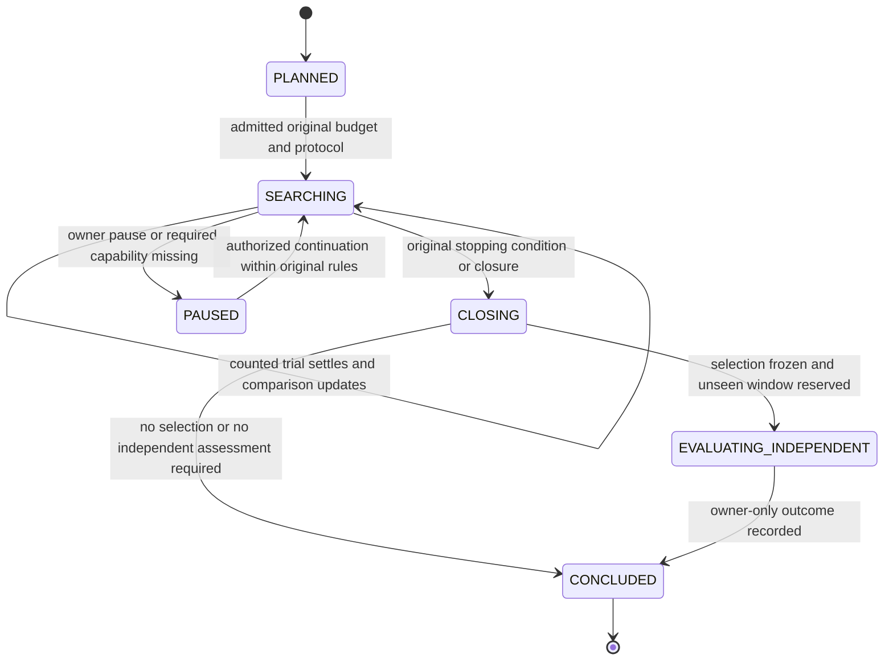

CONCLUDED不是“证据通过”。独立评价是否达到相应阶段条件由PipelineAssessment.outcome和原指标表达。新的成熟数据启动新DecisionCycle，不能原位重新开放已结束Campaign并重置试验/暴露。NEEDS_EVIDENCE与NO_VIABLE_CANDIDATE使用规范comparison状态及reasonCodes；预算尚余且仍有合法实验可继续研究，到原停止条件则结论落账。

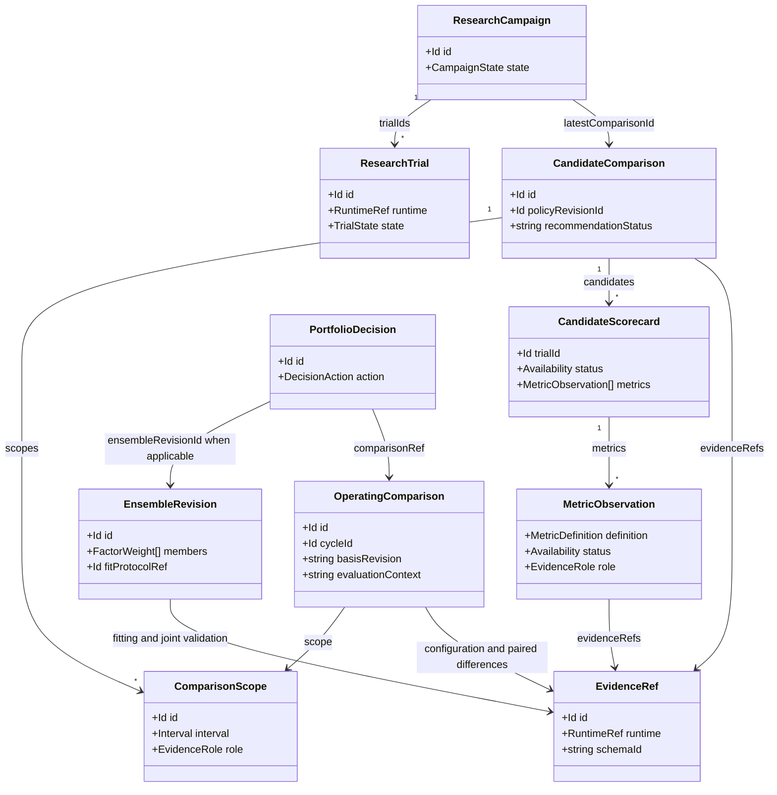

类图引用规范实体及部分字段，仅说明依赖，不复写完整类型。TS负责事实适配、确定性投影和决策编排；拟合、原生收益、求解与共享账户评价留在native科学边界。自动研究建议不等于授权交付，PortfolioDecision和TargetCommand仍遵循原账户、能力、期限及授权合同。

<a id="research-decision--7-验收与分期"></a>

## 7. 验收与分期

第一期验证“自动读证据并解释”：每次结算增量刷新；较低目标值但更小下行风险的候选仍可在前沿；全等候选并列；全亏损仍不能称达标；缺项不填零；252/365绑定不同metricDefinitionId且不默认回退；同scope/定义/主体重复或矛盾值为AMBIGUOUS；经验点估计Pareto不被展示成统计显著，置信结论另有方法与配对证据；原生负号回撤显式转换为规范正损失、保留raw与conversionVersion，方向为MINIMIZE；成员IC不充当账户指标；部分日不充完整日；完整覆盖但未定价不获得稳定性成绩；成本 Decimal 不丢精度、不重复扣费；同样证据、policyRevisionId及登记方法得到相同结果；SELECTION比较绝不读取INDEPENDENT证据；opaque业务ID与numeric runtime.taskId映射可追溯。

第二期验证“权重由真实数据学习”：PIT时间违规/未成熟标签被排除；缺失矩阵不补零；训练选择与外层评价分离；缺成本或容量时返回具体未知；Clarabel 无解不退回假成功等权；拟议权重只在原生重放后成为实证候选；加因子后相关性变化可改变建议，单因子IC排序不能预定结果；incumbent与新组合共用同一总资本/市场输入；不确定的改善不覆盖 incumbent。

第三期验证“动态持续更新”：原决策可按当时数据重放；新修订不污染旧独立结论；未来数据无法影响较早权重；费用/容量/账户状态过期时建议失效而非续期；新增真实 Forward 足迹可触发新一轮学习，已有 exposed window 不被再次认作独立验证。

每期分别报告协议正确性、科学数值正确性和真实市场绩效。自动 scorecard 通过测试不等于已发现 alpha，历史组合改善不等于实盘收益或经济容量成立。

<a id="research-decision--8-证据来源"></a>

## 8. 证据来源

仓库：

- `packages/contracts/src/index.ts:28`：当前 ResearchSpecification；`packages/contracts/src/research.ts:41`：原 criterion 分区和目标语义。
- `apps/research/plugins/validation-compare.ts:14`：legacy IC/top1；`apps/research/plugins/native-portfolio.ts:101`：component诊断与账户统计边界；同文件 `:146`、`:172`：catalog统计、费用和独立日序列范围。
- `apps/job/src/simulation/calendar_returns.rs:28`：完整日范围、覆盖、有效性、可用状态及现有测试；`apps/job/src/simulation.rs:1244`、`:2117`：实际接入点与spot边界。
- `crates/contracts/src/science.rs:204`：NativeStatisticV1 的 group/native_key/currency/value/reason_code。
- `apps/research/plugins/native-exposure.ts:40`：暴露账本；`apps/research/src/trials.ts:8`：试验身份、失败、预算与结算；`apps/research/plugins/heldout-group.ts:21`：先冻结全组、后暴露。
- `apps/service/src/capacity.ts:17`、`:71`：经济容量未建立与现有factorCapacity依赖最终独立结果。
- `crates/contracts/src/portfolio.rs:120`、`:434`、`:471`：原生目标/约束/收益历史/AllocationInput；`crates/domain/src/portfolio.rs:588`：现有sample covariance方法边界；`crates/domain/src/execution/validation.rs:74`：原生purge/embargo。
- 已安装官方 `nautilus-analysis-0.63.0/src/statistics/max_drawdown.rs:24`：Max Drawdown 为负比例；本稿已核对实际依赖源码而非猜测符号。

原始外部来源（原则支持，不作为项目已实现能力）：

- QuantConnect Framework：<https://www.quantconnect.com/docs/v2/writing-algorithms/algorithm-framework/overview>，区分Alpha、组合目标、风险、执行，信号强度不等于可投资账户价值。
- QuantConnect Backtest Report：<https://www.quantconnect.com/docs/v2/cloud-platform/backtesting/report>，共同报告收益、回撤、换手、容量及账户证据。
- Bailey / López de Prado，Deflated Sharpe Ratio：<https://www.davidhbailey.com/dhbpapers/deflated-sharpe.pdf>，多次试验及只报告赢家导致膨胀；本稿不声称当前已实现DSR，也不把有限试验预算称为统计显著性。

以上自动向量、前沿和学习接口属于明确的产品/方法设计候选，不是某篇论文规定所有基金必须采用的唯一规范。


---

<a id="chapter-portfolio-capacity"></a>

<a id="portfolio-capacity--自动组合资产配置与动态容量个人量化-pm-业务及技术设计"></a>

# 自动组合、资产配置与动态容量：个人量化 PM 业务及技术设计

> 规范说明：本章展开设计依据与候选实现。实体与字段以 [规范字段合同](#chapter-contracts) 为准；专题代码示意不是另一套 API，也不代表已经实现。
文档性质：2026-10-22 的只读设计建议；没有据此修改实现、重跑真实研究、部署或提交目标。基于 `/workspace/QuaZonai` 当前 dev 架构及本轮 draft 改动。实体名称与主方案统一；下面的新字段、算法适配器和状态均是拟议合同，不是已上线能力。

<a id="portfolio-capacity--1-真正要自动化的业务决策"></a>

## 1. 真正要自动化的业务决策

3000 pUSD 是一次原始账户场景，而不是写进代码的常量。系统应持续回答：现在有哪些因子值得共同使用；它们对同一个市场的预测怎样组合；真实账户在当前价格、成本、持仓和流动性下应该持有什么；有多少资金值得投入、多少应该保留；新组合相对原组合是否带来增量净收益；证据不足时应停止哪些动作。

必须分清预测因子比例、策略预算比例、资产持仓比例，以及账户总资金计划：

| 层 | 结果 | 分母、单位 | 系统如何产生 | 不能冒充的东西 |
|---|---|---|---|---|
| 信号层 | `EnsembleRevision.members[].weight` | 无量纲，归一化的预测组合系数 | 同周期、同标签单位的因子训练与验证；可包含零系数并记录淘汰 | 不是各因子的独立资金账户，也不是资产仓位 |
| 多策略预算 | `PortfolioDecision.strategyAllocations` | 每个策略committedCapital / 组合committedCapital；组合投入为0时capitalFraction=null | 原多策略联合回放、增量价值、现金/风险和共享容量约束 | 不是FactorWeight，不是策略各占完整账户；不能相加各策略单独容量 |
| 资产层 | `PortfolioDecision.assetTargets` | 资产市值 / 同一真实账户 NAV；同时保留原生数量 | 合成预测、联合风险、净交易成本、持仓及约束输入现有 Clarabel | 不是把因子权重直接乘资本；不能把 factorId 伪装成 instrumentId |
| 资金层 | `PortfolioDecision.capital` | 原始币种金额；可用、拟投入、闲置、保留分别记录 | 权威账户、已占用现金、费用、经济机会和动态容量共同限制 | 不是固定 80% 投入，也不是看到 3000 就必须全部用满 |

一个因子可以影响许多市场；多个因子可以同时解释同一资产。它们应先在信号层组合，再在同一个账户中对同一资产净额化。交易成本和风险只对最终净持仓/净交易计算。单因子各自使用完整 3000 回测后相加，会虚增资本、重复计算流动性，不能成为组合结果。

因子模型不是所有策略的必经形式。相对价值、事件驱动、执行/微结构和组合覆盖策略可以按自身StrategyVersion的entry/holding/invalidation/exit规则输出原生机会与持仓意图；不需要为它们伪造IC、收益预测或EnsembleRevision。单一预测策略可绑定其ensemble；非预测策略或多策略复合决策的`ensembleRevisionId=null`。多策略复合版本通过`StrategyVersion.componentStrategyVersionIds`列出原组件，在同一账户生成`StrategyAllocation[]`并由`nettingGroupId`协调共享资产和流动性。本文第3节的stacking只适用于具备合格可比预测的能力分支，不是通用策略门槛。

“自动”意味着资金、比例、机会集合和更新时点由原始事实与已验证方法计算，不要求用户填每个因子权重或容量。它不意味着没有方法假设。目标排序、估计器、缺失值政策、候选方法集合、模型复杂度约束和预算规则必须作为 `DecisionPolicyRevision` 冻结、验证、留版本。风险承受意愿和已承诺提款属于账户/业务事实，不能从行情里“学习”出来。

<a id="portfolio-capacity--2-当前已经存在尚未接通的能力"></a>

## 2. 当前已经存在、尚未接通的能力

1. 原生 `allocate` 已经使用 Clarabel 0.11.1，支持 `MIN_RISK / MAX_UTILITY / RISK_BUDGETING`、`VARIANCE / CVAR`、现金、资产/分组上下限、总净敞口、换手、参与率与风险上限；`AllocationInputV1` 每项资产必须有当前权重、交易成本率及同周期共同收益窗口。见 `apps/job/src/optimization.rs:122`、`crates/contracts/src/portfolio.rs:149,434,449,471`。
2. 原生 `study-portfolio` 已经逐 cutoff 准备新预测、风险样本和滚动 BAR 流动性，并在一个 Nautilus 账户里根据真实模拟持仓重新求解资产目标。它复用现有求解器，不需要新数学引擎。见 `apps/job/src/study.rs:71-165`。但 `members[].ensemble_weight` 原封不动进入预测混合，**它不学习因子组合比例**；prepare 还要求资产 BAR 完全同钟、同长度，不能直接拿来驱动几百万异步市场。见 `apps/job/src/portfolio.rs:148-156,245-257`。
3. 当前全市场 catalog 模式逐市场计算成员固定加权分数，正分数减阈值后归一化分配风险预算。它会动态改变资产份额，但没有校准到可比预期收益的保证，也没有统一的联合风险/交易成本最优化。只有一个正机会时，该机会可能承接全部既定风险敞口。见 `apps/job/src/catalog_ensemble_policy.rs:384-448`、`apps/job/src/catalog_ensemble.rs:728-738`。
4. 当前 TS `computePortfolio` 主要接收原始研究或用户给定的 weights，调用 `blend-targets` 后联合回放。catalog 模式只接受一个原 ensemble，并返回 `target: null`、容量 `UNAVAILABLE`。见 `apps/service/src/native.ts:30-36,51-57,86-94`。
5. 当前 `AdjustAccount` 每轮读取新的账户/提款事实，但使用已保存的原 target、原成员比例和原 capacity，再调用 `size-account`。其 5 秒循环是原目标缩放/交付协调，不是动态训练、自动因子选择或容量重新估计。见 `apps/service/src/automatic.ts:77-104,152,220-222`。
6. 每日账户统计已存在：完整 UTC 日覆盖、几何日均、最低日收益、日收益最大绝对偏差、亏损日、零收益日。缺失完整日或权益未定价时表现统计不可用。见 `apps/job/src/simulation/calendar_returns.rs:6-12,50-105`。当前catalog所走非spot路径已接入，不能据此宣称spot分支也自动具备Calendar统计。官方 Nautilus Max Drawdown 与准确的原始费用合计也已存在。应复用，不重写收益率/Sharpe 引擎。
7. 当前 research specification 和准入只支持一个 IC/Sharpe 标量。原生有的每日净收益信息尚未成为完整自动选择标准。`strategy_portfolio_finalize` 仍由模型提供 trialId；它验证该候选曾计算，并不自动比较所有真实账户候选。见 `packages/contracts/src/index.ts:30`、`apps/research/plugins/strategy-portfolio.ts:38-56`。

<a id="portfolio-capacity--3-信号层真正计算因子组合比例"></a>

## 3. 信号层：真正计算因子组合比例

<a id="portfolio-capacity--31-输入和预测单位"></a>

### 3.1 输入和预测单位

每个 `FactorVersion` 必须绑定不可变模型、特征版本、时点语义、预测周期、原始训练样本及输出单位。只有“未来同一 H 周期、相同价格基准、交易成本前的简单资产收益率”可以与相同定义的另一预测直接组合。任意 score、概率、IC、Sharpe、资产价格与年化收益不能互换；已扣费账户收益不能再作为未扣费资产μ混入。raw score 必须先经 `CalibrationModel` 映射到该周期收益；已有 `linregress` 训练/冻结校准可复用。概率预测则需要真实事件标签及相应专业校准，不应套收益率 OLS。原始BAR为成交价格时必须如实绑定TRADE价格，不得称为MID。

训练记录 `(instrumentId, eventEndNs, availableAtNs, labelEndNs, labelAvailableAtNs, factorVersionId, prediction, realizedReturn)` 中，`availableAtNs` 和 `labelAvailableAtNs` 均须不晚于训练 cutoff。延迟公开的结算/标签不能按照事件日提前使用。完整同一市场/时间/周期的记录才构成一行联合样本；不能零填新市场、用前值构造未出现 BAR，也不能把缺预测解释为零 alpha。

<a id="portfolio-capacity--32-训练拟合与选择"></a>

### 3.2 训练、拟合与选择

建议第一种新增方法是可解释的非负凸组合 stacking：对训练集内的 out-of-fold 校准预测矩阵 X 和真实未来收益 y，求 `min_a Σ q_t (y_t - X_t a)^2`，约束 `a >= 0, Σa = 1`。`q_t` 的样本平衡方式由版本化方法规定并记录；不能让每条成交当独立样本而掩盖同一事件/同一天的强相关。该问题是标准凸 QP，新增一个**信号专用 typed adapter**调用现有 Clarabel；不复用伪造 instrument 的资产 DTO，不新写优化器。这里是带simplex约束的convex stacking，不简称普通NNLS，因为普通NNLS没有系数和为1的约束。每一折的特征预处理、校准模型和超参选择都须仅使用该折训练数据fit，再预测对应验证折；先在全训练集校准后拼OOF预测仍会泄漏。

训练损失只是学习候选系数的方法，**不是盈利资格**。训练得到的系数冻结后，在 VALIDATION 上执行完整共享账户回放，用净日收益、亏损日、回撤、费用、资金利用率等业务表现选择方法/候选。最终只把冻结胜者带入 HELDOUT；最终结果不返回模型调参。若收益标签不足，不能仅凭 IC 大小生成资金比例。

至少保留原 ensemble 作为可比较基线；可比较新拟合组合、原组合、训练阶段自动识别的去除冗余因子组合。所有新的真实回放均进入原预算/尝试 ledger。线性组合训练允许系数为零；零系数因子的退出有明确原因和原拟合证据。不要为了满足“至少两个成员”的旧技术边界，强行给无效成员极小正权重。只剩一个有效因子或全体没有可验证增量时，应成为明确结果，必要时保持现金。

若新方法要加入 ridge、稀疏惩罚、近期衰减或误差协方差估计，其参数只能从训练折/内部验证得出，原估计值及选取过程进入 `DecisionPolicyRevision`。不能在求解奇异时偷偷加 diagonal jitter。普通 QP 可接受 PSD；目前风险预算/显式方差锥分解路径需 PD，达不到则精确报告限制。

<a id="portfolio-capacity--33-多目标与增量价值"></a>

### 3.3 多目标与增量价值

不把所有业务目标塞进随意加权的“综合分”。先计算完整证据矩阵和 Pareto 支配关系，再按冻结的业务决策政策选择：实际可行性与约束满足优先，其后比较经费用的账户增长与下行表现。选择政策必须说明怎样处理收益更高但亏损日更多的冲突；市场数据不能唯一推出人的这种偏好。系统可自动比较已获授权的政策族并在验证集选择，但不能借此暗改已有业务边界。

增量检验必须在相同数据、时钟、起始资本、交易成本、退出方式和原持仓条件下，对 challenger 与 incumbent 各跑一个独立共享账户。消融某因子后重新拟合/重新求解并联合回放，才有“加入此因子的增量净收益/回撤变化”。消融结果通常非加性，不应当作各因子独立资金 PnL。重复使用 VALIDATION 选择会增加过拟合；记录所有尝试、模型版本、数据暴露和方法数量，不以一次高 Sharpe 宣称稳健。

<a id="portfolio-capacity--34-pm逐日结果的精确口径"></a>

### 3.4 PM逐日结果的精确口径

| 业务问题 | 原始来源/单位 | 缺证据时的处理 |
|---|---|---|
| 每日净值赚亏多少 | 同一币种原生UTC日边界权益及现金流，金额为精确decimal | 现金流缺失时不能用权益差声称策略PnL |
| 每日收益率与几何日均 | 原生账户daily returns；Calendar Geometric Daily Return；比例 | 不把初始3000乘每一天收益当每日金额；复利分母每天不同 |
| 稳定、亏损日 | Calendar Minimum Daily Return / Maximum Absolute Deviation / Negative Days / Zero Days | 只对完整、充分定价UTC日；缺失日不当零 |
| 最大回撤 | 官方原收益复合曲线Max Drawdown，保留实际区间及转换版本 | 不能改叫盘中回撤；与UI权益曲线投影不同口径分开 |
| 费用、换手 | 原fee replay逐笔实际commission及quantity×price；金额/累计成交名义额 | 原净值已含费用；累计成交名义额不是持仓金额，也不默认是年换手 |
| 已实现现金利润 | 原成交/结算/现金账本中的realized PnL | 不能把含浮盈的NAV增长当可提现利润 |

完整日数、部分日数、日序列起止和未定价覆盖必须在PM结果旁边显示。前瞻经营存在入金/提款时，应复用能正确处理外部现金流的原生收益计算；原流水不完整则收益归因不可用，不自写补零或把提款当亏损。

<a id="portfolio-capacity--4-资产层持仓现金成本与风险一起求解"></a>

## 4. 资产层：持仓、现金、成本与风险一起求解

首个正式实现应复用 `AllocationInputV1` 和原 Clarabel，在支持的共同窗口资产集合上执行：

`max_w μᵀw − λ Risk(w) − Σ_i c_i |w_i − h_i|`

其中 μ 为冻结信号组合输出的同周期预期资产收益；h 为当期**真实已有持仓**按同一账户 NAV 折算的权重；c 为同一交易方向/有效时点的原成本计划；Risk 使用现成方差或经验 CVaR。现金作为显式变量满足资金守恒。λ 是方法/业务政策的版本化参数，只能在已冻结SelectionRule、效用模型及owner boundaries明确许可的参数域内拟合和验证，以检验参数是否实现既定偏好；不能通过挑回测收益最高的λ重新定义业主风险偏好。缺少成立的偏好时输出可行前沿或保持仍有效原决策，不声称数据能唯一学出风险厌恶。原资产目标、原因子比例与资金金额不相互覆盖。

单位也属于合同：VARIANCE 是每周期收益率平方，CVaR 是每周期损失比例，二者的上限和λ不得直接复用。方差目标中的λ具有相对于收益率的尺度，CVaR目标中的λ为相同收益尺度的相对权衡；参数证据必须记录risk measure、horizon和归一化方式。年化波动率、日内风险与每日收益目标都不能无转换地塞入同一个`max_ex_ante_risk`。

需要同时考虑：当前不可立即卖出的库存、已在途目标、净交易量、最低订单和数量步长、退出费用、已保留现金、事件/发行方敞口、保证金/交割规则。真实事件分组应来自登记的 condition/market/underlying 元数据；不能从 token 字符串猜 YES/NO 互补或独立事件。

信号增加不足以覆盖确定成本/已验证不确定成本时，解可以是不动；没有可信正机会时，解可以是现金。手续费被计入原生权益后，报告不能再从净收益中扣一次。目标求解使用成本估计，最终业务评估使用原生实际模拟费用，两者必须并列展示偏差。

方差风险贡献采用 `RC_i = w_i(Σw)_i / σ`，仅在 σ>0 且输入有效时提供；和为组合 σ。相对贡献再除以 σ，不能与方差贡献混称。负贡献允许存在，反映对冲而不是坏数据。CVaR 贡献使用原经验场景与已验证的 tail witness，尾部分位并列时记录非唯一性；不能任意挑一组尾部。每日最大回撤是路径依赖统计，不能假装作为现有 QP 的简单线性约束直接放进去；通过联合情景回放及已冻结的在线风险预算状态控制。

<a id="portfolio-capacity--多策略预算与统一账户"></a>

### 多策略预算与统一账户

上述μ/协方差求解针对预测型资产配置；非预测策略按其已验证的原生规则产生经济意图，不被强制改写成alpha。多策略总组合根据原共享账户、成熟策略净收益场景、资金尺度回放、现金需求与成本/退出约束提出`StrategyAllocation`，再对兼容的同账户、同币种、同真实instrument净额化。不同账户、结算/抵押品或不同经济合约不能仅因同名字就相互抵销。

现有资产`allocate`不能把strategyVersionId伪装成instrumentId求策略预算。若以后需要数值策略预算适配器，应以真实可验证的策略资金/联合情景合同另建typed adapter并复用官方solver；暂不把它记作当前能力。对于可缩放线性策略，线性/二次近似只能生成候选预算；存在共享持仓、最小订单、费用台阶或相互冲击时，不能直接加独立策略净收益。每个候选预算须经过原统一账户联合回放后才进入比较，资本曲线和增量风险也按最终净敞口验证。

有资本计划的单策略决策，其strategyAllocations必须恰有一项，strategyVersionId就是根策略版本；不能因componentStrategyVersionIds为空而输出空预算明细。只有复合策略才以其componentStrategyVersionIds逐项匹配预算成员。初始合同禁止嵌套复合成员，先去重并扁平化叶策略再登记，不把复合总预算和其子策略预算同时相加。所有明细committedCapital之和必须等于组合CapitalPlan.committedCapital；组合投入非零时capitalFraction按该共同分母计算，零时为null。纯覆盖/风险控制策略可有零独立资金承诺，不能据此推断零风险贡献。缺少配对净场景、共同账户行为或退出证据时，输出明确缺口/前沿或保留仍有效原决策，不制造“系统最优预算”。

<a id="portfolio-capacity--全市场规模与异步数据"></a>

### 全市场规模与异步数据

全市场扫描继续覆盖原登记 universe；“有资格进入当期风险求解”由新鲜预测、成本、历史/风险覆盖和实际可交易性自动决定，并逐市场记录排除原因。它不是用户固定名单或按未来收益选出来的 shortlist。当前同步 dense 样本协方差不适合几百万异步市场；不能填零/前值把全量矩阵拼出来。

分期上，先证明当前支持的真实共同窗口模式，再建立完整因果风险覆盖：可使用登记的低秩风险暴露/分组因子及原生矩阵运算构造可扩展模型，但需要原训练样本、残差覆盖和模型验证。不能用未经验证的独立性假设把所有协方差置零。若任何需保留的持仓没有可靠估值/风险覆盖，应冻结增加风险；新机会不足资料时保持观测资格但不投资。计算时间耗尽时不发布半个 universe 的“全局最优”，记录 `COMPUTE_BUDGET_EXHAUSTED`。

<a id="portfolio-capacity--5-资金层与容量三种不同证据"></a>

## 5. 资金层与容量：三种不同证据

<a id="portfolio-capacity--51-可观测上限"></a>

### 5.1 可观测上限

原始输入包括：当前订单簿可执行价格档与数量、原始 event/receive clocks、venue 订单最小值/步长、账户自由/锁定余额、未完成订单、费用资格及退出路径。每个原 book/BAR/成交池只允许消耗一次；多个因子/重复决策共享净订单预算。买入和退出分别评估，两个方向不能凭同一个总成交量对称推断。

报告 `CapacityEstimate.level=OBSERVED_LIQUIDITY` 的意思是“在这批可观察事实、该执行时窗及适用规则下测得的上限”，不是未来保证。原账户资金可用数与退出能力必须同时可行。全市场没有新鲜连续 book 时不能输出这一等级。

<a id="portfolio-capacity--52-条件容量"></a>

### 5.2 条件容量

当前原生 `assess-capacity` 的历史公式为：每个原 instrument/BAR 的可用参与金额，除以重复决策累计的绝对净目标变化与单独全退出所需份额中的较大者，再取跨约束最小值。它是静态资本/目标权重近似，不重建真实成交和持仓漂移，也不估净收益。源代码 `apps/job/src/capacity.rs:45-66` 已明确这些限制。

未来 catalog 直接从实际原生 replay 的持仓、源池剩余额度、成交、费用与目标事件生成条件容量证据，避免把之前只支持显式 BAR 的方法硬接上。参与率、延迟和历史定义若不是观测而是情景假设，应记录方法来源；不能声称系统从当前成交池“测得”一个任意 1% 限制。没有可校准执行资料时，可做原授权条件研究，但 `level=ECONOMIC` 的CapacityEstimate保持UNAVAILABLE。

<a id="portfolio-capacity--53-经济容量与自动资金配置"></a>

### 5.3 经济容量与自动资金配置

经济容量回答的是：增加资本后，边际净收益是否仍有验证支持，以及退出/下行是否仍可承受。必须对候选资本规模运行同账户、同成本、同执行情景的原生回放，得到资金—净收益—风险—成本曲线。资金测试点由权威账户可用资本、真实最小订单、可观测流动性断点与已发现的约束变化自动产生；用户不用填 1000/3000/5000 的表。可以使用版本化的上游优化/搜索方法安排后续测试点；因为阶梯费用/最小订单/仓位变化可能非单调，不能默认二分搜索必然有效。

运行使用`CapacityEstimate.feasibleRegions`确认实际资本的证据覆盖。TESTED_POINT的lower=upper，只支持该原测试金额；VALIDATED_INTERVAL仅在原方法确实验证了该区间时成立，且逐项绑定configurationEvidenceRef与evidenceRef。supportedCapitalUpperBound只是摘要边界，capital≤该上界不代表可行，不能跨不连续区间插值。新账户资本或新配置不匹配任何仍有效的点/区间时，系统自动登记并完成对应原生规模回放、计入原预算，再作运行结论；原预算/数据不支持补验则NEEDS_EVIDENCE，不给假通过。

系统选择本账户可投入金额时，以真实 NAV 为风险分母，以实际可用现金/保证金为资金约束，并保留退出成本和已承诺现金流。`reserved`、锁单现金、提款预留、已扣提款不得重复扣除；它们通过权威控制 revision 对账。现金缓冲应由已知费用、最小面额、待执行现金流及经验证的压力退出成本计算，无法估计的部分为未知，不作为零。

经济容量是组合属性；不能把因子各自的上限相加。当前 catalog capacity 明确 `UNAVAILABLE`，不能仅因 3000 看起来很小就声称可执行。当前历史源包含成交、方向、费用；缺原始连续订单簿、接收钟和历史执行定义。现有 margin1x pUSD proxy 不等于真实 cash-token 交割账户。这些限制由 `apps/job/src/catalog_ensemble.rs:855-864` 明文输出。

<a id="portfolio-capacity--6-动态持续更新与独立验证的关系"></a>

## 6. 动态持续更新与独立验证的关系

系统维护两个不同速率的闭环。

**经营循环**：新的可用市场批次、账户持仓/余额变更、订单状态、费用/规则 revision 或容量证据失效触发 `DecisionCycle`。在一个不可变 source/account cutoff 上刷新预测、容量、成本和风险，复用已冻结的 EnsembleRevision 求解资产/现金。没有经济变化则PortfolioDecision.action=HOLD；证据不足则action=NEEDS_EVIDENCE，周期进入WAITING_EVIDENCE；目标期限届满则该决策status=EXPIRED。目标期限取各输入的有效期限最小值；在实际发送 target 前重新核对账户和控制 revision。不得因为 wall-clock 轮询发生就人为给旧数据新的 asof。

**学习循环**：只有新标签真正可用、训练覆盖达到已验证条件、原登记训练计划到点或可验证漂移事件发生，才训练新 CalibrationModel/EnsembleRevision；成员或系数任何改变都创建新EnsembleRevision，绝不原位更新members。所有训练/验证 cut 都使用 available clock。新模型在新验证样本/受控回放胜出后换版；处理状态不影响原账户执行状态。数据因子模型不应在每个 tick 全量重新训练。

HELDOUT 是封存评估，不是经营循环的数据缓存。它一旦用于方法选择，就必须改记 exposed/history reassessment，不能对同一历史重复声称独立。未来前瞻观测可成为后续训练资料，但其当时的预测/目标/结果须先作为原 `ObservedOutcome` 留存。新一轮是新数据/政策绑定，不覆盖旧研究历史，不重新补足试验额度。

QZ 持续输出仍为 target-only；下游负责交易执行。计划中须保留现有不确定回执协调、账户 revision 栅栏和幂等目标身份。一个新模型产生胜者，不等于自动突破尚未具备的交易/数据能力。

<a id="portfolio-capacity--7-与规范合同的逐字段映射及算法证据"></a>

## 7. 与规范合同的逐字段映射及算法证据

本节只解释[规范字段合同](#chapter-contracts)的既有字段如何承载组合与容量事实，不再定义第二组 TS 实体。原始 Pi task/conversation ID 留在 `RuntimeRef`；业务 ID、精确十进制、时钟、指标状态和方法版本全部使用规范合同。下表中数值的来源、分母与缺失语义也是校验要求。

<a id="portfolio-capacity--71-因子校准与不可变组合"></a>

### 7.1 因子、校准与不可变组合

| 规范字段 | 来源与单位 | 组合侧约束 |
|---|---|---|
| `FactorVersion.modelRef / featureSchemaRef / labelDefinitionId` | 原模型、特征与标签定义 evidence | 模型名称相似不能证明预测可组合；label/horizon/价格口径一致才可混合 |
| `FactorVersion.outputUnit` | 原生模型实际输出单位 | RAW_SCORE不能直接当RETURN_PER_HORIZON；同收益单位还须核查成本前/后口径 |
| `FactorVersion.status` | RESEARCH / ELIGIBLE / DEGRADED / RETIRED | 这是研究/业务资格，不新增ACTIVE/ZEROED状态；某拟合权重为零不等于该因子永久退役 |
| `CalibrationModel.inputUnit / outputUnit / labelDefinitionId` | 原校准模型输入输出与标签 | 本文收益stacking要求输出绑定成本前同周期资产收益；概率校准须另有真实标签与方法 |
| `CalibrationModel.trainingInterval / trainingCutoffNs / fitProtocolRef` | 原折内训练窗口、可用截止、协议 | 特征变换、校准和超参选择均在该折训练数据内完成，再预测其验证折 |
| `CalibrationModel.modelRef / fitEvidenceRefs` | 原拟合产物和训练、残差、fold evidence | 原样本/模型不可因新标签到来原位更新；训练输入应能独立重建 |
| `EnsembleRevision.members: FactorWeight[]` | 一个冻结拟合结果，成员顺序与原矩阵列一一绑定 | 系数更新或成员改变必建新EnsembleRevision，以supersedesId关联旧版 |
| `FactorWeight.weight` | 非负、精确十进制、无量纲信号系数 | 全部成员权重精确合计1，零系数保留；不得用epsilon补无效成员；不代表成员资金 |
| `FactorWeight.calibrationModelId` | 原校准模型ID；仅经证明确为同口径预测才可null | 不能把null解释成自动校准；有校准时必须绑定当时冻结版本 |
| `FactorWeight.economicFamilyId / contributionEvidenceRef` | 原经济家族及消融/增量检验引用 | 家族不能靠同一模型名字推断；贡献为诊断，不必可加 |
| `EnsembleRevision.predictionUnit / labelDefinitionId` | 组合后预测单位及同一标签定义 | 对所有成员严格一致；不把daily net account return与asset μ混在一起 |
| `EnsembleRevision.fitCutoffNs / fitProtocolRef / trainingEvidenceRefs` | 原拟合截止、方法与样本 | 截止依据available clock；因子训练、校准、预处理与权重拟合链均可追溯 |
| `EnsembleRevision.jointValidationEvidenceRefs / qualification` | 真正单账户回放及CANDIDATE/SELECTED等阶段 | 求解成功不是SELECTED；独立评价也不是永久可运行资格 |

`DecisionPolicyRevision.learnedParametersRef` 存放原训练产生的参数 evidence；`trainingProtocolRef` 冻结拆分、purge/embargo、候选方法与调参规则；`selectionRule` 是已经成立的业务选择规则，不能看完结果再换目标顺序。信号拟合的正则项、样本平衡、数值容差和选取依据作为受版本schema约束的方法证据，不能塞进每个FactorWeight变成用户配置。

规范 `LabelDefinition.returnBasis / priceBasis / priceAndCashflowRuleRef` 已明确成本前后、TRADE/BID/ASK/MID/SETTLEMENT价格口径及原来源/现金流规则。本信号分支绑定`GROSS_PRICE_RETURN`；`NET_ACCOUNT_RETURN`不能拿来当未扣成本资产μ，事件或非收益标签按原定义使用NOT_APPLICABLE。以上语义只在LabelDefinition维护，不再复制成FactorVersion/CalibrationModel/EnsembleRevision的平行顶层字段。

<a id="portfolio-capacity--72-方法风险成本与自动更新协议"></a>

### 7.2 方法、风险、成本与自动更新协议

| 规范字段 | 原始依据与使用要求 |
|---|---|
| `RiskModel.method / labelDefinitionId / assetUniverseRef` | SAMPLE_COVARIANCE、SCENARIO_CVAR或明确验证的扩展；同一收益周期、允许资产集合和价格口径 |
| `RiskModel.matrixOrScenarioRef / sampleCoverageRef / numericalDiagnosticsRef` | 原矩阵/场景、完整覆盖、PSD/秩/残差诊断；新因子或新市场缺样本不可填零 |
| `RiskModel.trainingInterval / cutoffNs / validationEvidenceRefs / status` | 原因果拟合区间及验证能力；不能借当时未知数据改善过去风险估计 |
| `CostModel.currency / horizonRef / basis / feeRuleRef` | 原币种、持有/执行周期、VENUE_RULES/OBSERVED_EXECUTION/CONDITIONAL_SIMULATION及真实费率规则 |
| `CostModel.spreadModelRef / impactModelRef / latencyModelRef / exitModelRef` | 各成本组成的原方法；缺失保持null并列入missingComponents，不能隐式零成本 |
| `CostModel.applicableScale / calibrationEvidenceRefs / validationEvidenceRefs` | 原资本尺度、拟合和验证范围；规模外推不是已有经济容量 |
| `AdaptiveUpdateProtocol.eligibleTriggers / maturityRuleRef / trainingWindowRuleRef` | 哪些新事件/成熟标签触发更新及真实训练窗口；wall-clock轮询不制造新事实 |
| `updateMethodRef / modelSelectionProtocolRef / allowedParameterDomain` | 冻结更新方法、模型比较与可更新参数域；成员/系数更新产生新ensemble |
| `riskAndCostRefreshRuleRef / evidenceFreshnessRuleRef / resourceBudgetRef` | 风险/成本刷新、失效和原资源预算；证据到期不续写旧asof |
| `wholeProcessValidationRefs / outOfDomainAction` | 整套连续学习过程的前滚验证；越域按KEEP_VALID_INCUMBENT、REDUCE_WITH_EVIDENCE或WAIT_EVIDENCE处理 |

原生请求证据与basisRevision要绑定本次实际使用的RiskModel、CostModel和更新协议版本；不能只给一个方法族名字后运行时换估计器。方法版本、预测模型、实际持仓三类变化分别留证。新方法不能通过“实时学习”绕过研究预算或独立评价。

<a id="portfolio-capacity--73-容量三层是一组事实不是一个嵌套新dto"></a>

### 7.3 容量三层是一组事实，不是一个嵌套新DTO

同一组合、数据/账户basis可以有多个 `CapacityEstimate`，每个对象只有一个规范 `level`：OBSERVED_LIQUIDITY、CONDITIONAL_FEASIBILITY或ECONOMIC。`CapitalPlan.capacityEstimateIds` 引用实际被资金计划使用的那些原事实；三层可以分别为AVAILABLE或UNAVAILABLE，不能把“条件”塞进Availability状态，也不能因为有第一层就自动生出第三层。

| 规范字段 | 来源与单位 | 必须区分的结论 |
|---|---|---|
| `CapacityEstimate.strategyVersionId / ensembleRevisionId / basisRevision` | 原策略、适用时的因子系数及本次数据/账户/方法basis | 非预测/复合场景ensembleRevisionId=null；新组合不能复用旧组合容量却不标明条件 |
| `level / status` | 容量种类与证据可用性 | OBSERVED_LIQUIDITY有值不证明ECONOMIC有值；未知不当无限容量 |
| `observedInterval / asOfNs / validUntilNs` | 所测事实区间、决策时点、实际依据下的期限 | validUntilNs=null不是永久有效；不可用于需已知期限的运行交付 |
| `minimumTestedCapital / maximumTestedCapital` | 原实际测试点最小/最大金额 | 不是最低可交易资本/经济上限，不能改名复用 |
| `supportedCapitalUpperBound` | 原约束与模型支持的摘要上界，Money或null | 没测到瓶颈与不知道上界均保留null并在missingEvidence/assumptions解释；capital≤上界不能作为运行可行证明 |
| `feasibleRegions[].lower / upper / kind` | 原实际测试点或经方法验证的资金区间，Money | TESTED_POINT上下界相等；VALIDATED_INTERVAL仅覆盖真实验证区间，禁止跨不连续区域插值 |
| `feasibleRegions[].configurationEvidenceRef / evidenceRef` | 该点/区间所对应的原配置与验证证据 | 当前资本、配置和有效basis必须匹配；未覆盖时自动补回放并计预算，不能拿摘要upper放行 |
| `curve: CapacityPoint[]` | 每个实际资金测试点和原重放结果 | 不用拟合曲线补造未测试的point；展示插值须明确另属模型 |
| `CapacityPoint.capital / strategyVersionId / portfolioDecisionRef` | 本点起始金额、策略及实际重求解目标 | 每个规模是否重新优化必须可查；不把小资金同权重缩放冒充大资金最优 |
| `CapacityPoint.netPerformance / entryDemand / exitDemand / estimatedCost` | 原账户净指标、分方向需求和成本金额 | 净收益与成本诊断不重复扣；退出需求不能漏掉原留仓 |
| `CapacityPoint.fillRatio` | 指定执行窗口中的原成交满足率 | 不是BAR参与率，也不是未来成交概率 |
| `liquidityModelRef / impactModelRef / executionModelRef / exitModelRef` | 原模型evidence | 缺冲击/退出模型导致ECONOMIC缺证据；不放虚构零成本模型 |
| `evidenceRefs / assumptions / missingEvidence` | 原结果、情景和缺项 | 当前catalog的历史proxy与source-pool限制必须仍可见 |

当前legacy报告的`economicCapacity`、`maximumCapital`等字段只作为原native证据保留，经有版本的adapter映射到以上对象；新业务合同不再另加同名嵌套CapacityBound。

<a id="portfolio-capacity--74-策略预算账户资产目标和资金计划"></a>

### 7.4 策略预算、账户、资产目标和资金计划

| 规范字段 | 来源与单位 | 不变量 |
|---|---|---|
| `PortfolioDecision.strategyVersionId / strategyAllocations` | 单策略版本或复合PORTFOLIO_OVERLAY，以及原策略预算明细 | 单策略有capital时恰一项根策略；复合才与去重扁平化components一致；禁止嵌套重复计资 |
| `StrategyAllocation.strategyVersionId / ensembleRevisionId` | 原策略与适用时的ensemble | 不同策略可用不同原生方法；无预测ensemble时为null |
| `StrategyAllocation.committedCapital / capitalFraction` | 策略承诺金额与其占组合承诺资本比例 | 金额非负且明细和=CapitalPlan.committedCapital；组合投入为0则fraction=null，不能除零或补均分 |
| `allocationEvidenceRef / riskContributionEvidenceRef / nettingGroupId` | 原资金求解、风险贡献与净额组证据 | 先合并共享资产净需求再评估风险/成本/容量，风险贡献不按预算比例假算 |
| `PortfolioDecision.accountBasis` | 当前权威账户一致快照 | 有真实账户则researchStartingStateRef=null；离线研究使用原starting state，不能混用 |
| `AccountBasis.equity / reserved / controlRevision` | 原币种NAV、已保留金额、控制版本 | NAV不是free cash；锁单/提款各项目以原账户schema对账，不能重复扣 |
| `AccountBasis.positionsEvidenceRef / outstandingCommandsRef` | 真实持仓及未完成目标/订单证据 | 上次target不能替代当前holding；未完成订单不能视为已消失 |
| `AssetTarget.navWeight` | targetNotional / 同一account NAV，精确decimal | 分母不是committedCapital或deployableBudget；符号遵循实际short/leverage能力 |
| `targetNotional / currentNotional / netTradeNotional` | 同结算币种目标、当前市值、净差额 | netTrade=target−current；多个因子共同需求在此净额化 |
| `targetQuantity / quantityRuleRef` | 原venue规则下的可交付数量与规则evidence | 步长/lot处理后重验预算、费用与风险；需数量的交付不接受null |
| `riskContribution: MetricObservation` | 原风险模型与实际目标下的Euler/场景诊断 | 单位/period/methodRef明确；不能把模型系数当风险贡献；未知为null |
| `CapitalPlan.equity / reserved / ownerLiquidityReserve` | 权威账事实及已成立业主流动性安排 | 不能从当前行情推断业主提款意愿；已扣提款不再重复保留 |
| `deployableBudget / committedCapital / uncommittedCash` | 可分配预算、实际承诺资本、未承诺现金 | committed不超过deployable；uncommitted=deployable−committed，不等于可立即提现余额 |
| `projectedTradingCash` | 原生配置预计留在策略内部的现金 | 不与uncommitted重复加为第二份闲置现金；不等于gross exposure的补数 |
| `sizingEvidenceRef / capacityEstimateIds` | 原资金分解、费用/lot复核及容量引用 | 细分free/locked cash、退出成本等保留在原证据，不从展示摘要反猜 |
| `solverEvidenceRef / jointReplayEvidenceRef / comparisonRef` | 原求解、联合回放，以及同cycleId/basisRevision的OperatingComparison | 运行保持/现金/重配比较不能伪造ResearchTrial；求解状态/残差从solverEvidenceRef读取，不另加solveStatus字段 |
| `action / status / validUntilNs` | 经济动作、版本可消费状态和期限 | HOLD/REBALANCE/REDUCE/CASH与NEEDS_EVIDENCE/NO_FEASIBLE_SOLUTION分离；EXPIRED是版本状态，不是求解失败 |

只有真实可行、资本/成本完整、时效确定且运行能力支持时才生成 `TargetCommand`。`action=NEEDS_EVIDENCE/NO_FEASIBLE_SOLUTION` 时不给可执行目标；按规范 `assetTargets=[]`、`capital=null`或已被证据支持的诊断值保存，`targetCommandId=null`。空目标数组单独不说明全现金；只有`action=CASH`及真实退出/资金证据才能代表可执行退现金。若权威NAV本身未知，`DecisionCycle.state=WAITING_EVIDENCE`且`outputDecisionId=null`，保存EvidenceGap而不制造金额。

**账户细分建议：**规范AccountBasis目前仅直接包含equity/reserved；free、order-locked、withdrawal-reserved与已执行现金流需由其权威账户证据和CapitalPlan.sizingEvidenceRef提供可校验分解。若以后API要独立消费这些值，建议主合同扩展有原schema语义的账户现金明细，而不是本分册私增freeCash/orderLockedCash字段。

<a id="portfolio-capacity--75-指标逐日反馈与原生转换"></a>

### 7.5 指标、逐日反馈与原生转换

所有指标使用 `MetricObservation.definition`、`role`、`interval`、`asOfNs`、`availableAtNs`、`status/value/reasonCodes`。内嵌definition必须与不可变注册`MetricDefinition.id`的原定义完全一致；Objective通过`metricDefinitionId`绑定精确定义，不仅匹配metricKey。LOSS边界、排名及比较同样核对定义身份、单位、horizon与日历。不要新增partition/valueType平行DTO。原native TRAIN/VALIDATION/HELDOUT标签按明确evaluation protocol映射为TRAINING/INNER_VALIDATION/SELECTION/INDEPENDENT等EvidenceRole；不能只看名字把内层validation与用于最终选择的validation混成一类。

- 原生几何日均映射`account.daily_geometric_net_return`，单位RETURN_RATIO；负收益日比例映射`account.negative_day_fraction`并保留原分子/分母。完整日、部分日和未定价coverage仍绑定原evidence。
- 原生`Max Drawdown`负比例映射`account.maximum_drawdown`非负LOSS_RATIO时，`raw.nativeKey/value/unit`保留原负值，`raw.conversionVersion`登记`native_max_drawdown_sign_v1`，`methodRef/evidenceRefs`指向转换依据。不混用最大化负值与最小化正损失。
- 原生Sharpe252/365都映射`account.sharpe`但各有不同的不可变MetricDefinition.id，`definition.annualizationDays`保持原值。Objective.metricDefinitionId必须选中原对应定义；相同key不允许换周期。不同annualization不得混排、自动换算或fallback。
- 金额型日损益/费用使用CURRENCY、DECIMAL和currency；数量/计数按定义使用NATIVE_QUANTITY/COUNT及相应编码。不得经JS Number再转十进制。
- `ObservedOutcome.realizedMetrics`保存原权益/现金流支持的真实指标，`attributionEvidenceRef`承载日开闭权益、外部现金流、费用、已实现PnL及原完整日序列。不要把这些大数组新内联进ObservedOutcome。
- `ObservedOutcome.receiptState=ACKNOWLEDGED`不证明成交或收益；归因只覆盖`reconciliationStatus`真正支持的范围。原现金流缺失时日PnL/return不可用，不能用日收益×初始3000回填。
- 成熟标签仅通过`matureLabelEvidenceRef`在实际available时点进入下一轮训练；原最终评估不会因后续成熟而被追溯改成当时可用于训练。

<a id="portfolio-capacity--76-原生拟合证据的算法特有内容"></a>

### 7.6 原生拟合证据的算法特有内容

下节新Rust适配器的matrix/sample/labels/weights引用分别解析为原EvidenceRef，原输出系数与factor列顺序映射到新 `EnsembleRevision.members[].weight`。拟合evidence必须保留：原样本keys、factor/calibration版本、label定义、折内生成路径、fit cutoff、样本平衡方法、目标函数、求解状态、原浮点系数、精确decimal转换版本、约束残差和独立目标复算。这是算法输入/结果证据内容，不是另一组业务实体字段。

一个新学习事件生成新模型/组合对象，旧EnsembleRevision的members不变。仅资产价格/账户变化而原信号系数不变时，可以沿用原ensemble并生成新PortfolioDecision；新的风险/成本方法参数则先形成新的DecisionPolicyRevision并绑定新basis。任何重拟合、量化系数或换成员操作都不能以“自动更新”为名覆盖旧事实。

<a id="portfolio-capacity--8-rust-science-合同与现有接口复用"></a>

## 8. Rust science 合同与现有接口复用

下述是拟议新 DTO；复用现有 `DecimalValue`、`DbCounter`、有限浮点序列化与 `EvidenceRef` 对应的原 artifact。实际 DTO 仍由 Rust 官方 exporter 生成 schema，TS 不手写另一份 numerical contract。

```rust
// 新的信号层适配器；绝不能别名到 AllocationInputV1。
pub struct NativeSignalBlendFitRequestV1 {
    pub schema_version: SchemaV1,
    pub factor_version_ids: Vec<String>,
    pub calibration_model_ids: Vec<Option<String>>,
    pub dataset_revision_ids: Vec<String>,
    pub label_definition_id: String,
    pub policy_revision_id: String,
    pub fit_available_through_ns: DbCounter,
    pub horizon: NativeHorizonV1,
    pub sample_keys_artifact_id: String,
    pub prediction_matrix_artifact_id: String,
    pub labels_artifact_id: String,
    pub sample_weights_artifact_id: String,
    pub optimizer: NativeModelRefV1,
}
pub struct NativeSignalBlendFitResultV1 {
    pub schema_version: SchemaV1,
    pub solver_status: SolverStatus,
    pub reason_code: Option<String>,
    pub signal_weights: Option<Vec<DecimalValue>>,
    pub sample_count: DbCounter,
    pub objective_value: Option<f64>,
    pub primal_residual: Option<f64>,
    pub dual_residual: Option<f64>,
    pub native_input_artifact_id: String,
    pub native_result_artifact_id: String,
}
```

`NativeHorizonV1` 是对现有 HorizonKind/value/bar specification 的结构化引用，须与label_definition_id解析出的规范LabelDefinition一致，不发明新交易周期。calibration_model_ids与factor_version_ids逐项等长绑定；None仅表示该原预测已具备直接可比的单位/标签证据，不是默认经过校准。矩阵 artifact 每行附原 sample key；服务不能仅传一块无来源数字矩阵。训练数据可以 streaming 汇总正规方程，但原样本证据和独立重算路径必须保留；规模过大时官方稀疏矩阵/求解器适配优先，不引入近似后仍声称精确结果。系数转 DecimalValue 必须按明确 converter 量化并重验 simplex/目标差异；失败不能造等权。

资产求解继续复用 `AllocationInputV1`；离线滚动优先 `NativePortfolioStudyRequestV1`。新增工作是提供实际合格输入以及全 catalog 的因果风险适配，不能只改 TS 路由。现有原生 `NativeAccountSizingRequestV1` 保留最终账户/费用/步长检查用途，但其 members.capital 仅是现行比例展示，不能解释为信号因子真实独立资本。新界面应显示资产目标和组合资本，因子贡献单列证据型诊断。

catalog 原生结果的原目标、持仓、source pool、费用和退出事件可汇入 `CapacityEstimate` 证据；不要把全部订单/成交直接塞进模型上下文。模型只能接收允许 partition 的紧凑标量和引用，完整证据保留在现有 restricted artifact。服务层使用现有 Chord/Pi Durable ownership/commit，不建新调度器/数据库。

<a id="portfolio-capacity--9-类图与时序建议"></a>

## 9. 类图与时序建议

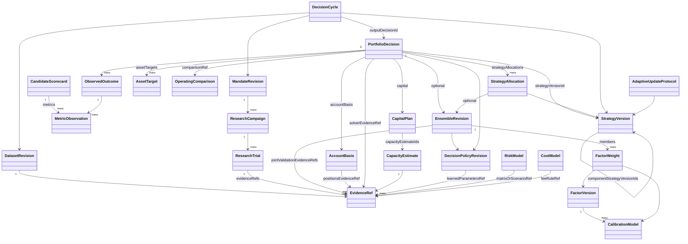

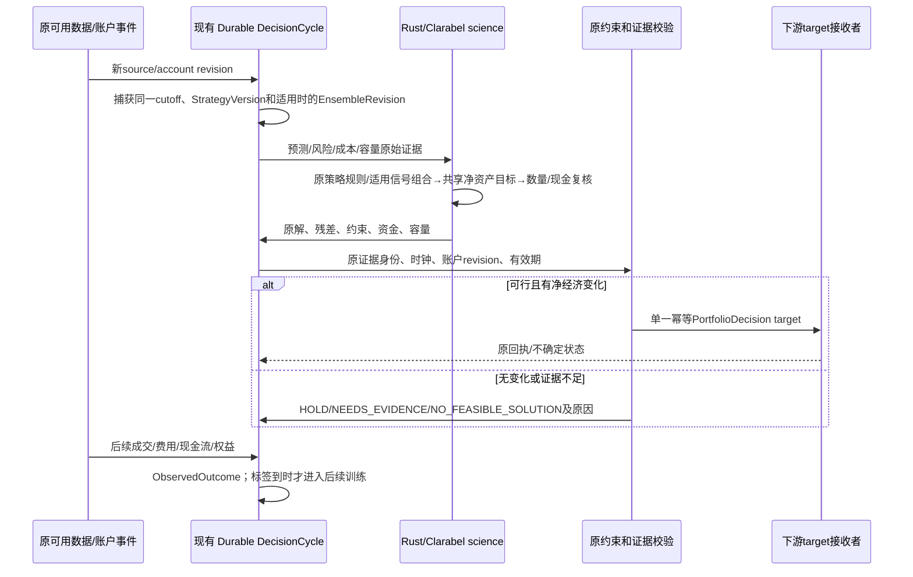

<a id="portfolio-capacity--10-不确定性无解和坏数据的业务处理"></a>

## 10. 不确定性、无解和坏数据的业务处理

不确定性必须注明来源：样本有限、源缺失、模型误差、执行冲击未知、事件相关性未知、时钟不可观察是不同问题。只有经过验证的统计方法才能给区间；用0.5倍量做情景不叫50%置信区间。新不确定性估计依赖应先研究上游实现与序列相关适用性，未实现前明确 `INSUFFICIENT`，不能写“保守95%”数字占位。

| 事件 | 新风险动作 | 已有持仓 | 系统结论 |
|---|---|---|---|
| 某新因子缺可用校准或标签 | 不赋予有效组合系数 | 原有效ensemble可继续 | 记录排除原因，绝不补权 |
| 某资产缺新鲜价格/规则/风险 | 不增加该资产风险 | 保留原持仓事实，退出也需可执行报价 | action=NEEDS_EVIDENCE或证据支持的REDUCE |
| 费用/经济容量未知 | 条件研究可运行，不能声称经济可部署 | 不以未知=0做扩大 | 容量层分别显示缺项 |
| 新QP无解/超时/不可接受残差 | 不发布伪目标/等权/归一化修复 | 不自动认为保持原仓已安全；重新检查已有敞口 | 原因、冲突约束、最早过期证据 |
| 下游回执不确定 | 暂停替代目标 | 保留原身份协调结果 | 原有UNCERTAIN流程 |
| 实际持仓偏离目标 | 从实际数量重新估值求解 | 不用上次target替换真实仓位 | 新DecisionCycle |
| 最低订单/费用使小资金不可行 | 资金不强制投入 | 正确保留现金/既有不能卖的小额持仓 | action=NO_FEASIBLE_SOLUTION，reason=TOO_SMALL及具体binding |
| 源数据修订或范围缩小 | 新revision重新检查 | 不静默沿用旧模型合格声明 | 历史结果不重写 |

“退回现金”是只有当实际可交易退出成立时才能执行的目标；缺报价时把账面权益标为现金是造假。无法求解与已求解全现金是两个不同状态。

<a id="portfolio-capacity--11-验收矩阵与实施分期"></a>

## 11. 验收矩阵与实施分期

<a id="portfolio-capacity--a-首个真实业务闭环自动选择与账户目标评分"></a>

### A. 首个真实业务闭环：自动选择与账户目标评分

复用现有研究 ledger、VALIDATION 原生账户 statistics、原 candidate weights；系统在每个完成的候选结果后更新组合比较结论，若冻结业务政策确有明确胜者则finalize使用该原候选；多目标各有优劣或并列时保留前沿/原incumbent，不能按taskId伪造优胜者。这个阶段可以去掉用户/模型任意挑trial的业务断点，但必须注明“在已验证候选内自动选择”，不能称连续数值权重最优。对应 `research/src/trials.ts`、`plugins/strategy-portfolio.ts`、contracts评价合同、service projection及界面。不要改 Rust 引擎。

<a id="portfolio-capacity--b-自动信号比例学习"></a>

### B. 自动信号比例学习

引入上述 signal-fit 原生适配器、因果样本/校准绑定和 nested train/validation 回放；冻结胜者 `EnsembleRevision`。验证相同因子/退化因子不会伪造权重、零系数合法、未来标签绝不能改变过去模型、固定模型同输入可重现、原拟合可被独立数值 oracle 复算。对角/相关构造可检查可行域与目标；真实市场测试检验的是联合账户业务表现而不是数学最优就等于赚钱。

<a id="portfolio-capacity--c-自动资产比例与资金缩放"></a>

### C. 自动资产比例与资金缩放

先将原生 `study-portfolio` 接入有真实共同窗口/合格预测的服务入口，并使用原模拟持仓、动态BAR证据和原成本。验证价格/协方差/成本/已持仓变化会改变原生解；净edge低于成本会不交易/保留现金；容量下降、提款保留增加会减小可用规模；NAV增长不等于强制同比加仓。这个阶段还不能冒称已支持全异步catalog。

<a id="portfolio-capacity--d-全市场连续经营与经济容量"></a>

### D. 全市场连续经营与经济容量

接通连续源、真实接收时钟、历史规则/当前venue规则、共同风险覆盖及source-pool容量证据；事件驱动更新DecisionCycle。全catalog模式从比例归一化迁移到具备证据的资产求解。需要实际全源性能测试证明覆盖、时钟、内存与时限，不能用8个instrument probe代替全市场采集。经济容量必须有资本规模回放曲线、校准成本/退出证据后才升级状态。

<a id="portfolio-capacity--e-专业验收必须实际观察的结果"></a>

### E. 专业验收必须实际观察的结果

1. 同一账户，两个信号指向同一资产时，订单和手续费按净交易计；原共享源量不被双花。
2. challenger 的单因子IC/Sharpe更高但联合净收益更差，系统不能因此替换原组合；独立持仓反事实给出明确依据。
3. 完整日缺一日、仅有部分日或未定价权益，亏损日/几何收益不被填零；真实零收益日保留。
4. 同一真实账户资本改变，目标数量、费用、最低lot、现金残留和退出约束一起重算。
5. 开始已有资产A，新的信号只有B时，A不能从预算/风险/退出中消失。
6. 所有数值结果附原币种、周期、partition、数据revision、时钟和方法版本；252/365 Sharpe绝不混用。
7. 新source revision/新账户revision触发一次可恢复循环；重放不重复发目标、不重复计科研预算；无变化不制造交易。
8. 目标发布前任一关键证据过期，旧目标不得通过改时间续命；回执不确定不得新发覆盖。
9. 滚动训练不读取未来label/HELDOUT；最终测试结果不回流模型；对修订数据/暴露历史有审计。
10. 所有新方法需在原实际3000pUSD场景与至少另一真实资本场景验证；合成测试通过不等于取得每日正收益。
11. 构造资金可行区间不连续的案例：低于摘要上界但落在未验证缺口的金额不会获得可行结论，自动补回放且计预算；配置不同的测试点不互相复用。
12. 单策略预算恰一项根策略、复合预算只含去重扁平叶策略，明细和与组合承诺资本精确相等；零总资本不产生除零比例。
13. λ变化只能在原SelectionRule许可域内作为方法拟合；高回测收益不能扩大owner边界或把未定义风险偏好补成系统默认。

目前本云workspace未挂载用户原完整catalog或当前研究账户结果。仓库历史任务记录证明源数据/准备流程曾在用户主机存在，但本次没有读取它们的实际当前状态。不能在本方案中声称已有合格策略、稳定每日2%、无亏损日、经济容量或实时可执行目标。

<a id="portfolio-capacity--12-官方来源与可核查依据"></a>

## 12. 官方来源与可核查依据

- Clarabel 0.11.1 官方 README：<https://github.com/oxfordcontrol/Clarabel.rs/blob/v0.11.1/README.md>，本次实际下载核对支持 convex QP/conic programs。现有项目已固定版本；复用它的求解、状态和残差，不另写数值算法。
- Clarabel 官方问题标准形式：<https://clarabel.org/stable/>。本方案引用标准凸QP形式；拟议signal adapter仍须对自身输入矩阵PSD、约束及求解结果做独立验证，不能只凭“使用官方solver”证明业务正确。
- NautilusTrader 0.63.0 官方包源码，本次实际读取本地锁定包 `nautilus-analysis-0.63.0/src/analyzer.rs`、`statistics/max_drawdown.rs`、`statistics/sharpe_ratio.rs`；可核查版本来源 <https://docs.rs/nautilus-analysis/0.63.0/>。`MaxDrawdown`原实现返回负值，Sharpe原period默认252；项目Polymarket路径显式365。
- linregress 官方仓库：<https://github.com/n1m3/linregress>，本次下载README核对其OLS定位；锁定使用0.5.4，不把OLS包装成概率校准/因果效应证明。
- ndarray-stats 0.7.0 `CorrelationExt::cov`：<https://docs.rs/ndarray-stats/0.7.0/ndarray_stats/trait.CorrelationExt.html>；现有 `crates/domain/src/portfolio/covariance.rs:6-28` 明确同步样本、ddof=1、无填补/缩减/年化。新风险估计器如有需要必须独立承认和验证，不能偷改此合同。
- 原业务与源限制：`.opensdlc/tasks/astra-full-data-recovery/task.md:14-34` 明确原3000pUSD、全登记市场、动态选择、目标是假设、现有proxy和数据缺项。本方案遵循这些事实，不以旧任务历史状态替代当前安装状态检查。

以上来源支持工具/算法性质和已读实现事实，不支持任何未来盈利承诺。信号stacking、经济容量搜索、低秩全市场风险适配是拟议新增科学工作，需分别验证后才可成为正式能力。


---

<a id="chapter-continuous-workflow"></a>

<a id="continuous-workflow--个人量化-pm研究组合与持续更新闭环设计"></a>

# 个人量化 PM：研究、组合与持续更新闭环设计

> 规范说明：本章展开设计依据与候选实现。实体、字段、状态及 API 均以 [规范字段合同](#chapter-contracts) 为准；本章只解释其工作流映射，不重复定义 DTO，也不代表已经实现。
状态：设计稿，未修改生产代码或测试。依据当前工作区 `19803c47aeb1d22775d594780b8417d7cf63c3ed` 的实际实现；本稿中的新增类型、接口、任务名称均为拟建合同，不表示已经存在。研究计算仍交给原生内核，运行与恢复仍交给官方 Pi Durable，不增加第二套调度器。

<a id="continuous-workflow--1-业务目标与现状"></a>

## 1. 业务目标与现状

用户应表达“用这笔资金，在这些市场寻找更好的收益、稳定性和可承担的回撤，并持续更新”。系统承担数据选择、经济假设拆解、试验分配、候选淘汰、组合选择、权重求解、条件容量估计、更新和解释。指标、容量、因子数量及比例主要是系统计算的结果，不能变成要求用户逐个填写的参数表。

自动推导不代表可以从行情中推导个人损失承受力、账户授权、数据许可或缺失盘口。沿用已授权的账户/市场/资金边界；系统内部方法、默认偏好、估计误差和条件假设全部版本化并可查看。未给定明确风险偏好时，可以输出多目标有效候选及系统推荐依据，不能声称存在唯一客观最优组合。不要将自然语言中的“稳定”静默等同于单一 Sharpe 或波动率。

已存在的能力及其边界：

| 现有入口 | 已实现 | 尚未形成的业务闭环 |
| --- | --- | --- |
| `apps/research/src/trials.ts` | 原 Task 身份、失败留痕、全局 `max_trials` | 没有经济假设族、阶段配额、信息价值与淘汰决策 |
| `apps/research/plugins/research.ts` | 读取原目标/账本/验证结果、显式结项 | 结构化研究未耗尽预算且不选择候选时，不能按“证据不足”等业务原因结束 |
| `apps/research/src/continuation.ts` | 官方 generation 续作、预算不重置 | 耗尽后直接 `STOPPED/trialId:null`，没有独立结项比较阶段 |
| `validation-compare.ts` | 可选的验证 IC 排序 | 不读取结构化研究的账户目标，不能做组合/风险/容量权衡 |
| `apps/service/src/native.ts` | 原模型、明确权重、同一资金账户回测 | 权重来自请求或原提案；此路径没有调用 `allocate` 自动选池求解 |
| `apps/service/src/automatic.ts` | Durable 常驻任务，读取账户、`size-account`、交付/对账 | 固定旧 `portfolioId`、成员/权重、目标和容量；只按账户变化调整金额，过期后阻止交付，不生成新信号 |
| `apps/service/src/service.ts` | GET 数据集、研究/组合/容量/观测 API | 数据集来自启动配置，无在线数据修订发布和刷新任务；容量 POST 返回报告，不更新自动任务所引用的旧事实 |
| `runtimes/data`、`dataset-export.ts` | 来源获取、转换、离线 DatasetConfig 导出 | 未接通“新有效数据 → 重评候选 → 新组合修订” |

现有账户自动任务中的 5 秒等待只是当前实现的轮询间隔，不是实时性承诺，也不是拟建产品的刷新标准。

<a id="continuous-workflow--2-持续业务对象一个研究计划多轮不可改写研究"></a>

## 2. 持续业务对象：一个研究计划，多轮不可改写研究

持续目标由不可变 **MandateRevision** 表达，活动修订指针及官方根 Task 引用保存在现有 Application 业务事实中。**ResearchCampaign** 管理一轮冻结研究并引用现有 Study/Conversation；**DecisionCycle** 管理运行期一次数据、模型、账户条件下的决定。不能不断清空同一个 Study 的终态、预算和 Sealed 暴露记录来制造“持续”。每轮 ResearchCampaign 绑定数据版本、方法版本、决策时点和原预算，由新的 Study 执行。研究产出 Hypothesis、ResearchTrial 与 StrategyVersion；适用因子预测链时还产出 FactorVersion、CalibrationModel、EnsembleRevision；运行期形成 PortfolioDecision、CapacityEstimate 和 ObservedOutcome。两条链可相互触发工作，但不共享可修改的证据终态。

生命周期为：目标解释 → 数据可研究性检查 → 登记可证伪经济假设 → 基线与候选探索 → 验证比较和预算重分配 → 冻结候选、组合与权重 → 一次独立评价 → 形成可激活组合修订 → 新数据/新候选/账户变化触发后续工作。

研究完成不强制交付目标。允许长期研究计划保持活动，而本轮明确结束为“有可用方案”“没有可行候选”“证据不足”或“业务条件失效”。数据或执行能力缺失时进入等待/阻塞，不把它解释为经济假设失败。

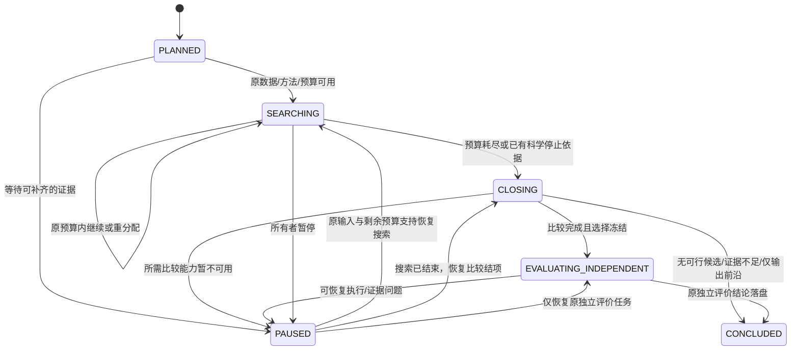

本图严格使用 `CampaignState`。是否支持策略由 `CandidateComparison`、`PipelineAssessment.outcome` 与 `ResearchCampaign.conclusionReason` 表达，不增加独立的成功/失败 Campaign 状态。不可恢复的执行失败可结项并保留原错误证据；PAUSED 恢复到哪个业务阶段依据已落盘的原任务检查点及原事实，不能重开终态试验。CONCLUDED 不表示盈利、成交或永久资格。全部 Campaign 状态与 Durable Task 的 running/terminal 分离。

<a id="continuous-workflow--21-策略全生命周期从经济机制到退出使用"></a>

## 2.1 策略全生命周期：从经济机制到退出使用

研究阶段完成只是策略生命周期中的一段。**可交易策略版本**由 `StrategyDefinition` 与 `StrategyVersion` 表达：经济机制及失效条件属于前者；后者通过 `modelRefs`、`signalContractRef`、`portfolioRuleRef`、`executionRuleRef`、`exitRuleRef`、`capabilityBindingIds` 和 `policyRevisionId` 绑定完整规则及其证据。市场/日历/费用/容量等嵌套规则由这些引用对应的版本合同描述，EnsembleRevision 只保存一次组合拟合及其证据。单因子也可形成一个成员的完整策略。FactorVersion 的任意打分仍不是预期收益、仓位或可交付目标。

| 阶段 | 原始输入 → 必须产出 | 自动晋级依据 | 降级/退出与回滚 |
| --- | --- | --- | --- |
| IDEA | 目标/现象/已有失败 → Hypothesis 经济机制、反例、研究范围 | 有可证伪问题、可研究数据与支持的测量方法 | 数据不可得则等待；不可证伪则保留为待澄清想法，不烧计算预算 |
| IDEA（策略草案） | 因子版本、校准、市场机制 → StrategyVersion 与规则引用 | 信号/收益单位、时钟、交易规则和资金映射完整；不依赖未来数据 | 原生接口不支持则明确能力缺口；不伪造订单/收益 |
| RESEARCH | 原冻结数据/预算 → 全部 ResearchTrial、验证比较、联合回放 | 候选在可比验证证据与经济可行性上有支持 | 被否证则淘汰，依赖缺失则暂缓，不把二者混为失败 |
| INDEPENDENT_EVALUATION | 冻结模型、组合及自适应规则 → 不可修改独立评价 | 原方法与完整策略均支持；仅 COMPUTED 不够 | 不支持则本轮结束；新假设进入新 Campaign，旧终审不可循环调参 |
| SHADOW | 已冻结策略、当时可得数据 → 带时钟的未发送目标与前向观测 | 目标生成、数据时效、信号稳定及可实施性符合原更新方法 | 异常转观察/暂停；没有成交事实时收益只能标模拟/反事实 |
| PAPER | 明确 PAPER 来源、共享模拟资金 → 外部纸面账户回执及实际模拟观测 | 身份/资金/费用/回执完整，前向偏差能解释，方法判断支持 | 延迟/拒单/费用异常单独归因；paper 不能改标真实资金表现 |
| SELECTION（组合消费资格） | 研究与适用的前向证据 → 可消费 FactorVersion/EnsembleRevision | 与其他成员共同资金、相关性、净风险、净成本和容量可合并 | 不能因单体最好而必配资金；系统可保留零资金候选 |
| TARGET_OPERATION | 合格策略池、账户及当前可得数据 → PortfolioDecision | 自动求解和目标有效，当前方法与账户边界匹配 | 信号或容量变差可降权/保持现金；数据未知时阻止新增目标 |
| MONITORING | ObservedOutcome、外部执行/账户证据 → 归因、漂移与健康状态 | 定期/事件驱动复核；支持不变则保持，不为“更新”而换模型 | 区分研究失效、源数据异常、账户问题、执行偏差，进入对应恢复路径 |
| RESEARCH（再研究） | 监测解释、未决问题 → 新 Hypothesis/Campaign | 新研究有改变决定的价值，且有合法新数据/资源 | 生产旧版本不会因新研究开始而被原位修改 |
| RETIRED | 持续不适用、被替代、市场终止或所有者退出 → 退役决定与证据 | 停止新增消费并完成原目标/外部未知结果对账 | 留存模型、证据、失败和归因；重新启用须新版本与新有效依据 |

路径不是所有策略都必须顺序经过每个消费环节：纯研究可止于独立评价；SHADOW/PAPER 是否需要及如何累计证据由已登记的部署用途与方法决定。QZ 不以“运行满固定 N 天”自动认定合格；采用实际有效观测、覆盖的市场条件及证据不确定性。不存在用演示 paper、历史回测或单一协议测试冒充真实前向运行的捷径。

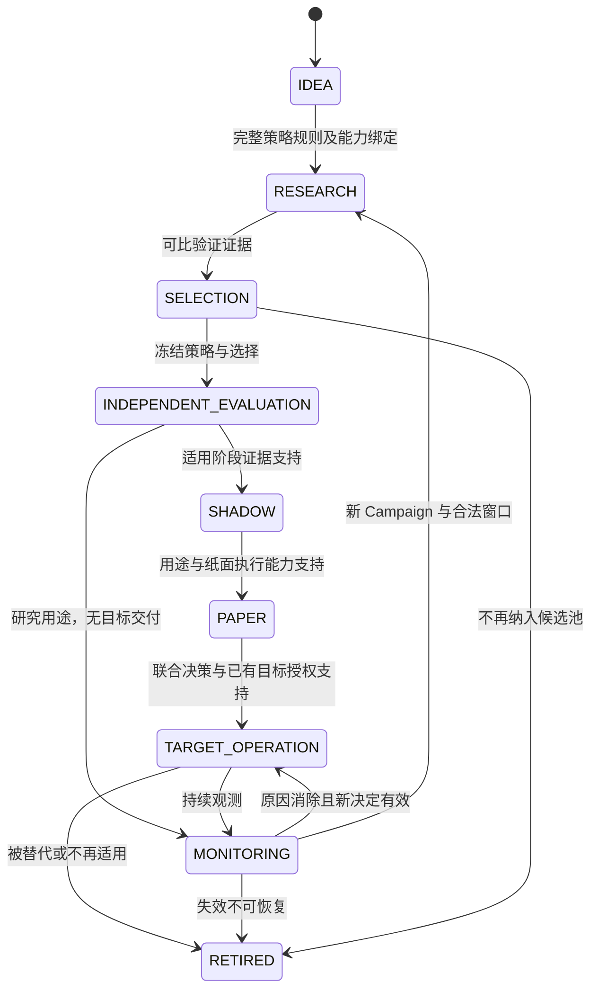

本图只使用 `PipelineStage`；每次晋级、降级、暂停或退役追加 `PipelineAssessment`，其 outcome 是 READY、NOT_READY、NEEDS_EVIDENCE、SUPERSEDED 或 RETIRED。活动/观察中/可消费是阶段与资格的业务说明，不形成另一套持久状态枚举。纯研究可停在 MONITORING；阶段是否需要 shadow/paper 取决于已登记用途与能力，图中的典型路径不扩大操作授权。

<a id="continuous-workflow--22-阶段角色合同与执行权界"></a>

## 2.2 阶段角色合同与执行权界

这里的“角色”是代码组件和方法的责任，不要求一个人扮演多名审批员，也不增设多用户权限系统。达到已登记证据条件后自动推进；只有缺少必要的目标含义/授权边界时才形成具体待解决事项。

| 角色/组件 | 能读/能写 | 必须禁止 |
| --- | --- | --- |
| 研究提案者 | 合法训练/验证反馈；写假设、提案及解释 | 读取未暴露终审、修改预算和历史结果、宣布自己的方案已经独立通过 |
| 数据适配/质量组件 | 来源收据、可得时钟、历史元数据；发布不可变修订 | 原位改旧目录、补造缺失历史规则、把当前快照当过去可得 |
| 独立评价组件 | 冻结提案及独立窗口；写原生结果/资格事实 | 根据终审结果修改该提案、给本轮研究员返回调参反馈 |
| PM 比较/组合组件 | 合法训练/验证估计、资格和运行时可得信息；写选择/比例与资金决定 | 用 HELDOUT 选最优权重、混淆单体与联合容量、自己伪造科学统计 |
| 账户 sizing/交付组件 | 已激活决定、原权威账户与执行能力；写带身份的目标回执 | 未对账即重发、续期过期证据、推断 ACK 就是成交 |
| 观测/归因组件 | 外部账户与执行事实、版本历史；写 ObservedOutcome/归因 | 改写原独立结果、把外部故障直接归因模型、把缺收益补零 |
| 所有者 | 表达目标、账户/资金范围及启停；查看决定与修改目标修订 | 系统不要求其手填所有指标/容量/因子比例；自动化不能反向扩大其已授权范围 |

QZ 的终点是可核验的 target-only 目标和观测；券商/交易所订单、成交、撤单及实际仓位属于外部执行系统。QZ 停止任务、暂停目标或退役策略都不等于外部清仓。需要减风险时，系统可在有效能力范围生成新的降风险目标并跟踪回执；在外部结果未知时保留旧身份对账，不能声称已解除敞口。

**回滚合同：** 回滚的是策略/构建规则到有证据支持的旧版本，不是复用旧目标包。系统用当前数据、持仓、资金预留、费用与流动性重新产生 PortfolioDecision，拥有新修订和新回执。旧版本当前也不可行时保持阻塞或现金目标所支持的可行状态，不自动选任意备用模型。新旧版本切换和退役均保留替换原因、未决交付与原账户范围。

<a id="continuous-workflow--23-数据与资金的日常运营"></a>

## 2.3 数据与资金的日常运营

日常检查由数据水位、交易日历、来源更新和账户事件触发并汇总成一个可行动的健康视图，不是每天人工打勾的审批清单：

* 数据：最新可得水位、完整性、源修订/许可适用、交易规则变更、PIT、同资产不同来源的一致性。只有受影响结果重算；故障数据不会流入新目标。
* 资金：权威净值/现金/持仓、未决目标、外部资金预留、币种、可部署容量、当前流动性与费用。账户未知时阻止扩仓；资金变化不必重做因子发现。
* 研究：已花/预留预算、候选信息价值、被重复追逐的假设族、尚未解决的证据缺口。预算耗尽自动结项，不要求人来清理循环。
* 运行：目标是否过期、外部回执是否需要对账、实际执行偏离、数据或模型退化、当前/前一策略版本。无变化时不制造重算或通知噪声。

<a id="continuous-workflow--3-研究预算分配给能改变决定的试验"></a>

## 3. 研究预算：分配给能改变决定的试验

总预算来自授权范围和系统资源，内部比例由系统根据候选与实际成本调整，不固定“探索 20%、确认 60%”。一次完整组合是一次原生评价；不能拆分成员绕过预算。失败、无效、取消后已消耗的计算仍保留，只有尚未启动的预留可以释放。

预算分配有四步：

1. 先登记基线及假设族。每个候选写清经济机制、预测方向、相对基线的改动和可否证结果。参数变体归属同一族，不能通过换描述掩盖搜索次数。
2. 依据支持的输入和成本历史预留一次独立评价所需资源，再分配搜索资源。旧 `max_trials` 仍只按原语义执行；新预算合同显式分开搜索、验证和独立评价，不能偷偷改变老研究计数。
3. 优先处理能够区分现有候选的试验。若有经过验证的误差/成本估计，比较“预期决策改善或信息增益 / 预计成本”；没有合格估计时使用明确记录的公平探索与逐阶段筛选方法，不编造概率、货币成本或信息增益。
4. 每次反馈后用 `ResearchWorkAllocation` 保存考虑/选择的假设、下一实验用途、信息价值证据和资源估计；用 `BudgetMovement` 的 RESERVE/CONSUME/RELEASE/TRANSFER 保存资源流向。TRANSFER 只移动未消耗预留，不增加总额；TRIAL、NATIVE_SECONDS、MODEL_COST、DATA_BYTES 不跨单位冲抵。未知实际成本保持未计量，不能填 0。新预算只能成为新的明确授权修订，不能由模型在续作中自行补充。

淘汰与继续的业务含义：

| 决策 | 必要依据 | 后续 |
| --- | --- | --- |
| 继续探索 | 经济机制未被现有证据否定，下一试验能回答具体未决问题 | 分配剩余预算，写明预期区分点 |
| 暂缓 | 依赖数据或执行能力不足 | 等待对应依赖变化，禁止同输入盲目重算 |
| 淘汰 | 在本轮已声明比较方法下，被基线/可行候选支配或假设被否证 | 保留候选与全部变体，不再分配该轮预算 |
| 晋级验证 | 具备可比样本和经济意义，有进一步确认价值 | 冻结该阶段提案，验证失败不能删档 |
| 冻结终审 | 所有比较只用了允许的训练/验证证据，组合及比例已确定 | 独立评价，不再用最终结果修改本轮 |

**预算耗尽关闭新增实验，不关闭决策。** 现有 `trialFeedback` 与 `onYield` 应触发官方 `qz.research-close` 任务，保留读账本、比较和一次已登记的独立终审。若有候选，由确定性比较器按冻结 SelectionRule 形成可比排序/非支配集及推荐；缺少必要偏好时输出 FRONTIER_ONLY，不自行替用户选择；若比较器不支持，以 `EvidenceGap` 记录原因并将 Campaign 置为 PAUSED，或以 NEEDS_EVIDENCE 比较结果结束本轮，不能无限提示模型“继续”。模型可以解释结果，但不是结项是否发生的唯一依赖。

不采用“再给一次 generation”或“连续 N 次 yield”作为没有好候选的科学证明。第三方工具需登记业务能力：`READ_VALIDATION`、`SEARCH_EVALUATE`、`COMPARE_VALIDATION`、`FINALIZE_INDEPENDENT`、`CLOSE_RESEARCH`。宿主在结项阶段通过官方工具配置收窄能力；未知工具不自动被视为只读。原生试验入口仍独立检查预算，防止并发或旧调用绕过。技术重试耗尽记执行故障，不记经济假设失败。

<a id="continuous-workflow--4-目标评价自动选池和比例推导"></a>

## 4. 目标评价、自动选池和比例推导

系统把自然语言目标转成版本化的多目标比较策略，而不是向用户索要一组数字阈值。收益、日际稳定性、回撤、交易成本、容量及证据质量各保留原生单位与来源。已有 `Calendar Geometric Daily Return`、日收益极值、`Calendar Maximum Absolute Deviation`、负收益/零收益日数、完整日覆盖、原生 Max Drawdown 等可复用；缺指标不补零，252/365 年化身份不互换。

研究期 CandidateComparison 先区分“可评价”和“不可评价”，再比较经济效果及不确定性。运行期 OperatingComparison 比较保持当前、现金、重配和减风险方案，绑定同一 cycleId/basisRevision 和共同现仓/资本/成本口径；HISTORICAL_JOINT_REPLAY、FORWARD_MODEL_ESTIMATE、OBSERVED_FORWARD 分开，不能将预测差异冒充实际收益改善，也不能为了填 trialId 伪造运行期 ResearchTrial。候选数、成员数和权重由验证期联合效果、相关性、成本与容量约束推导；不能只把最好的若干单因子拼起来，也不能把 IC 当作收益预测。具体估计与优化方法由原生计算合同实现，TS 只冻结输入、调用和保存结果。

容量输出至少分开：历史成交量条件下的可行资金、执行数据支持的当前可部署资金、扣除费用/冲击后仍有效的经济容量。现有 `assess-capacity` 主要支持第一类；`catalog-ensemble` 当前明确不支持容量/可交付目标。未知经济容量不能冒充无限，也不能取单因子容量之和作为组合容量。

自动选择需要保留 `candidateSet → estimates → constraints → solver → jointReplay → selectedRevision` 的证据链。只在相同合法窗口与共同账户假设下比较方案；资金规模会改变交易最小单位、流动性与费用，不能简单把小资金收益率乘上新本金。

<a id="continuous-workflow--5-新事件驱动持续更新"></a>

## 5. 新事件驱动持续更新

新增事件是业务事实及其修订引用，不是另建消息队列。任务 admission 与待处理修订在同一官方事务落盘。已完成事件合并处理；同一输入修订不重复求解。进程重开时对账 Application 中对应 mandate 的待处理/已处理修订，而不是依赖内存回调曾经运行。

| 事件 | 重算范围 | 禁止行为 |
| --- | --- | --- |
| `DATA_REVISION` | 验证来源/可得时钟后形成新周期；重算受影响候选、相关性、容量、组合 | 原位覆盖旧目录或仅改标签重置独立性 |
| `RESEARCH_EVIDENCE`（原试验落盘） | 本轮验证比较、候选状态、剩余额度分配、必要的联合验证求解 | 把当前未终审 trial 直接送往账户 |
| `RESEARCH_EVIDENCE`（本轮研究结项） | 更新候选资格与计划进度，提出下一组合修订 | 用本轮 HELDOUT 数值优化其权重再声称同样独立 |
| `ACCOUNT_CHANGED` | 按方法适用域重新评估资本、容量与可行配置；必要时联合重求因子/资产比例，只有经验证线性区间内才能只 sizing | 仅因净值变化重跑全部因子发现 |
| `COST_OR_RULE_CHANGED` / `EVIDENCE_INVALIDATED` | 重新估计流动性/费用适用性/容量，必要时缩减资金或保留现金 | 用已过期目标和旧容量续期 |
| `MANDATE_CHANGED` / `RESEARCH_EVIDENCE`（方法修订） | 新方法修订与受影响计算；保留旧结果 | 将旧结果修改成新方法计算 |

成熟标签通过 `LABEL_MATURED` 触发后续合法拟合；`FRESHNESS_DEADLINE` 只使依赖重新核实，不自动延长证据有效期。以上全部使用规范 `BusinessEvent.kind`，具体发生类型通过 `sourceRevisionRef` 所指原事实区分。

数据源监视复用现有来源适配器，输出完成的不可变修订及 import-report。刷新时机来自来源更新节律、最后水位、数据实际到达和下一决策期限；在官方 Durable 中用 `runtime.sleep(nextWakeAt)` 或公开的文档观察能力等待。不是每隔固定秒数强行重算。

实时性必须分别记录 source event、available、ingested、decision、publish、downstream ACK 时钟。只有完整链路延迟和源能力支持时才能宣称满足目标时效。

<a id="continuous-workflow--6-规范字段在工作流中的映射"></a>

## 6. 规范字段在工作流中的映射

本章不复制 TypeScript DTO。以下全部指向 [规范合同第 2 节](#contracts--2-可校验的核心类型) 已定义字段；原生 Task/Conversation ID 独立保存在 `runtime`，新业务 ID 为 opaque string，金额/权重遵循 Decimal，时钟遵循 Ns。表中的证据产物使用已有 `EvidenceRef` 引用，不增加另一套身份或任务账本。

| 业务问题/步骤 | 唯一规范实体及字段 | 写入责任与不变量 |
| --- | --- | --- |
| 原始目标与解释 | `MandateRevision.ownerGoal/interpretation/selection/unresolvedIntent` | 原话不覆盖；未解决的关键取舍输出前沿或仅研究 |
| 账户资金与授权 | `MandateRevision.capitalSource/ownerBoundaries/operatingAuthority/researchBudgetRef` | 用户边界与估计分开；不从行情推导授权 |
| 策略经济机制 | `StrategyDefinition.economicMechanism/falsificationConditions/knownFailureModes/intendedHoldingHorizonRef` | 研究者提出，方法组件核对是否可证伪 |
| 可交易规则冻结 | `StrategyVersion.definitionId/modelRefs/featureSchemaRef/signalContractRef/portfolioRuleRef/executionRuleRef/exitRuleRef/capabilityBindingIds` | 明确分数→预测→目标及退出边界；规则归 StrategyVersion 及其版本引用 |
| 方法及在线更新规则 | `DecisionPolicyRevision.methodFamily/learnedParametersRef/trainingProtocolRef/validDomain/selectionRule`；`AdaptiveUpdateProtocol.eligibleTriggers/maturityRuleRef/updateMethodRef/trainingWindowRuleRef/wholeProcessValidationRefs/allowedParameterDomain/outOfDomainAction` | 整个更新过程必须有验证，成熟标签及训练窗规则明确；越域按原策略保持、减风险或等待 |
| 阶段晋级/降级 | `PipelineAssessment.strategyVersionId/stage/outcome/requirementsVersion/evidenceRefs/reasonCodes/nextPermittedActions` | 追加阶段事实；不以计算成功代替 READY |
| 数据修订与有效窗口 | `DatasetRevision.contentRef/eventInterval/availableThroughNs/admittedAtNs/qualityStatus/revisionKind` | APPEND/CORRECTION/RETRACTION 分开；available 不等于 event |
| 研究身份与状态 | `ResearchCampaign.runtime/state/datasetRevisionIds/evaluationProtocolRef/budgetId` | 状态仅 PLANNED/SEARCHING/CLOSING/EVALUATING_INDEPENDENT/CONCLUDED/PAUSED |
| 假设族及下一试验问题 | `Hypothesis.economicFamilyId/parentHypothesisId/incrementalQuestion/state/evidenceRefs` | 同经济机制的变体不因换名逃离搜索账本 |
| 实际试验与计账 | `ResearchTrial.parentTrialIds/runtime/state/purpose/countedAttempt/resourceUsageRef` | 与原 Task 绑定；失败继续保留；不复写官方执行状态 |
| 研究总额及结项预留 | `ResearchBudget.maximumTrials/reservationForClosureRef/usageEvidenceRefs` | 结项预留解析到 BudgetMovement；预留不是追加额度 |
| 假设与下一实验分配 | `ResearchWorkAllocation.consideredHypothesisIds/selectedHypothesisIds/nextExperimentPurpose/expectedInformationEvidenceRef/resourceEstimateRef/action` | 记录为何实验、等待数据、关闭搜索或淘汰假设；没有有效信息价值估计则保留 null |
| 预算预留/消耗/转移 | `BudgetMovement.kind/resource/amount/currency/fromReservationId/toReservationId/measurementEvidenceRef` | TRIAL/DATA_BYTES 为整数，MODEL_COST 必有币种；释放仅限未消耗预留，转移不增加总预算 |
| 可比范围 | `CandidateComparison.scopes` 下的 `ComparisonScope` | 固定时段/日历/成本/资本/账户起点；候选仓位和成员数仍是搜索变量 |
| 候选评价与选择 | `CandidateComparison.candidates/objectiveRankings/recommendedTrialId/recommendationStatus` | NEEDS_EVIDENCE/FRONTIER_ONLY 不自动变 SELECTED |
| 研究结项 | `ResearchCampaign.latestComparisonId/selectedStrategyVersionId/conclusionReason` | 本轮选择与终审可追溯 |
| 因子和校准 | `FactorVersion`、`CalibrationModel.trainingCutoffNs/fitProtocolRef/fitEvidenceRefs/modelRef` | 标签必须在 cutoff 前成熟；任意得分不当收益预测 |
| 因子比例及学习状态 | `EnsembleRevision.members/fitProtocolRef/fitCutoffNs/trainingEvidenceRefs/jointValidationEvidenceRefs` | 每次成员或因子权重变化创建新不可变 revision；权重属于 FactorWeight，不写入 AssetTarget |
| 运行期输入冻结 | `DecisionCycle.triggerEventIds/basisRevision/datasetRevisionIds/accountBasis/policyRevisionId/strategyVersionId/asOfNs/availableCutoffNs/dependencyRevisionRefs` | 所有取数与可用截止一致；输入变化新周期 |
| 运行期状态及输出 | `DecisionCycle.state/outputDecisionId/supersededByCycleId/reasonCodes` | 仅采用规范 CycleState，旧结果不覆盖较新 basis |
| 联合投资决定 | `PortfolioDecision.ensembleRevisionId/strategyAllocations/assetTargets/capital/action/status/comparisonRef/solverEvidenceRef/jointReplayEvidenceRef` | 因子权重、策略资金比例、资产 NAV 权重各自归位；无需因子的策略可保留 ensembleRevisionId=null |
| 运行期候选比较 | `OperatingComparison.cycleId/basisRevision/scope/evaluationContext/candidates/pairedDifferenceEvidenceRefs/selectedCandidateId/conclusion` | PortfolioDecision.comparisonRef 必须指向同 cycle/basis 的 OperatingComparison；研究比较仍独立使用 CandidateComparison |
| 容量与规模依赖 | `CapacityEstimate.level/curve/supportedCapitalUpperBound/maximumTestedCapital/validUntilNs` | 最大测试本金不是容量上限；每个资本点可关联重求解的 PortfolioDecision |
| 交付身份及对账 | `PortfolioDecision.targetCommandId` → `TargetCommand.idempotencyKey/basisRevision/controlRevision/state` | 不确定仅查原命令；新决定不得覆盖原未知结果 |
| 观测与再学习 | `ObservedOutcome.realizedMetrics/attributionEvidenceRef/matureLabelEvidenceRef/reconciliationStatus` | ACK 不构造收益；成熟标签只进入以后合法学习 |
| 可恢复的证据缺口 | `EvidenceGap.affectedEntityId/permittedRemedy/state/resolutionEvidenceRefs` | 解决具体依赖；不会扩大数据/账户授权 |

活动指针、待处理事件 frontier、根 Task 引用继续保存在现有 Application 业务事实中，遵循 [规范合同第 7 节](#contracts--7-事件存储与恢复映射)。它们是内部控制映射，不构成第二套业务实体或运行状态 DTO。

若已验证的 `AdaptiveUpdateProtocol` 在其 `allowedParameterDomain` 内根据新成熟标签学得因子权重，必须保存新的 `EnsembleRevision`；`PortfolioDecision.ensembleRevisionId` 指向这次实际使用的学习结果，训练 cutoff、校准模型和方法引用完整保留。新权重可标 SELECTED，并通过 PipelineAssessment 说明其来自已验证的更新过程；不能据此标为该组新权重自身已经完成独立 HELDOUT，也不能自动标为 INDEPENDENTLY_EVALUATED。整个更新算法的验证与单次拟合的独立评价是不同事实。不能只新增 PortfolioDecision 却沿用旧权重 artifact；超出更新协议的模型/方法、准入机制或允许范围变化时，产生新研究候选并重新评价。

<a id="continuous-workflow--7-官方-durable-doctask-与-api"></a>

## 7. 官方 Durable Doc、Task 与 API

拟建 session family Docs：`qz.mandate-revision`、`qz.research-campaign`、`qz.dataset-revision`、`qz.ensemble-revision`、`qz.decision-cycle`、`qz.portfolio-decision`。它们保存业务事实；Task 的重试/运行/取消状态只在官方 TaskRecord，不复制到自己的任务表。候选及预算初期可嵌入 ResearchCampaign，达到实际规模后才拆 family Doc。每轮计算使用原 Task 身份和确定的输入修订重放。

拟建 Task：

| Task | 输入 | 业务阶段 | 输出 |
| --- | --- | --- | --- |
| `qz.pm-reconcile` | mandateRevisionId、triggerEventIds | collect → plan → join → publish → wait | 已处理修订与下一待办 |
| `qz.dataset-refresh` | sourceBindingRef、previousRevision | discover → acquire → verify → publish | 新 DatasetRevision 或 unchanged |
| `qz.research-close` | campaignId、原试验/协议/预算引用 | compare → choose → freeze/close | CandidateComparison + Campaign 原结论字段；必要时原独立评价子任务 |
| `qz.portfolio-recompute` | campaignId、frozen validation input refs | estimate → solve → jointReplay → freeze | 研究期不可变 EnsembleRevision |
| `qz.decision-cycle` | StrategyVersion、适用时 EnsembleRevision、运行期可得数据与账户 refs | estimate → solve → assessCapacity → decide | PortfolioDecision；不自行修改研究算法 |
| 现有 `qz.account-adjustment` | observationId 等 | 原有 snapshot/deliver/reconcile/wait | 扩展读取已激活修订，继续负责下游未知结果对账 |

同一 mandate 的 Application 活动指针同时只发布一个 CURRENT 决定。计算过程中新 BusinessEvent 推进依赖 frontier；旧输入算出的结果保留，通过 basisRevision 核对后置为 SUPERSEDED 而不覆盖较新决定，随后处理新周期。`subscribeCommits` 可用于低延迟唤醒提示，不能成为唯一触发事实。新建任务必须在保存 revision/receipt 的同一 `tx.createTask` 事务中 admission。

工作流只使用 [规范合同第 5 节](#contracts--5-api-规范拟议增量沿用现有-api-前缀与认证) 的增量 API；以下路径均位于现有 `/api/v3` 前缀下：

| 业务动作 | 规范 API | 工作流用途 |
| --- | --- | --- |
| 建立/修改目标 | `POST /mandates`、`POST /mandates/:id/revisions` | 保存原话、解释、资金来源与明确授权；不要求用户技术配置 |
| 接收已验证数据来源产物 | `POST /datasets/:id/revisions` | 验证任务确认质量及可得时点后才使 DATA_REVISION 生效 |
| 启动研究 | `POST /campaigns` | 引用 mandate、strategyDefinition、dataset 修订，开始原预算内研究 |
| 暂停/恢复原研究 | `POST /campaigns/:id/pause`、`POST /campaigns/:id/resume` | 保留预算/暴露；恢复绑定 predecessorReceiptId 与原检查点，不重算已结算失败 |
| 查看比较/关闭新增实验 | `GET /campaigns/:id/decision`、`POST /campaigns/:id/close` | 只读原事实比较不增加尝试；新联合回放/终审按原预留计账 |
| 当前/历史投资决定及重算 | `GET /mandates/:id/decision`、`GET /mandates/:id/decisions`、`POST /mandates/:id/recompute` | 正常事件自动走同一业务入口；人工重算保持原 requestId 与 expectedRevision |
| 周期状态与容量 | `GET /cycles/:id`、`GET /capacity-estimates/:id` | 展示依赖、原因、测试范围及真实容量未知项 |
| 策略版本/阶段 | `GET /strategies/:id/versions`、`GET /strategies/:id/assessments` | 展示可交易规则及晋级降级历史 |
| 决策解释与反馈 | `GET /decisions/:id/diff`、`GET /decisions/:id/evidence`、`GET /decisions/:id/outcomes` | 关联旧新决定、所有者证据与后续真实观测 |
| 暂停/恢复/退役策略 | `POST /strategies/:id/pause`、`POST /strategies/:id/resume`、`POST /strategies/:id/retire` | 暂停不代表外部撤回；恢复重验时效/账户/能力并绑定 predecessorReceiptId，不重发旧目标；退役仍对账 |

请求字段、202 回执及 409/422/503 等错误语义直接引用规范合同，不在专题添加另一套请求。旧数字 `/research`、`/portfolios`、`/observations` 及 request replay 保持兼容。数据适配器内部发布调用同一已登记来源/证据校验路径，不接受模型指定任意宿主路径或命令。

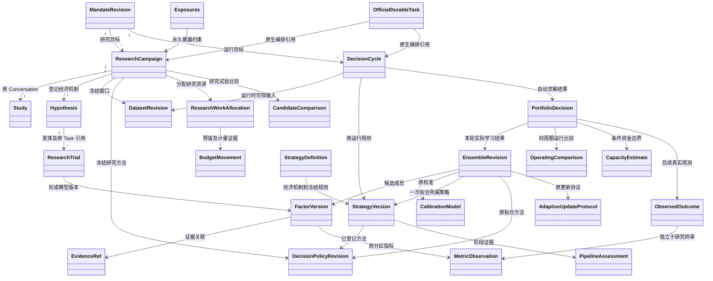

<a id="continuous-workflow--8-依赖失效与-sealed-隔离"></a>

## 8. 依赖失效与 Sealed 隔离

每个结果记录直接依赖的修订引用，不能只用“最新”指针。新数据不会自动判旧结果错误，而是使其对新决策时点过时；原历史结论保留。费用/交易规则变化使受影响回放与容量失效；账户净值变化由依赖图和方法适用域判定：仅在线性且原配置仍适用的范围内可只 sizing；最小订单、固定费占比、经济容量或可行成员改变时，重新执行联合资本—配置求解；持仓/预留变化使当前交付提案失效，并依账户预算与交易成本条件决定是否重求配置；模型/权重变化按 EvaluationProtocol 或已验证 AdaptiveUpdateProtocol 生成新拟合与相应联合验证/运行比较证据，不把每次合法在线更新一律当作重新使用 HELDOUT。未知依赖变化进入明确阻塞。

研究器的读取层只提供 TRAIN/VALIDATION 及其合法汇总；终审数值仅向所有者/独立资格流程披露。用于选池、相关性和权重求解的输入必须带 EvidenceRole、asOfNs 与 availableAtNs，且遵守 DecisionCycle.availableCutoffNs。独立结果可以改变“是否有资格激活”的事实，不能成为本轮再次调参输入。

**现有暴露合同是实施关键约束。** `native-exposure.ts:75-86` 对新迭代范围与旧 FINAL 的重叠采取严格拒绝；复制目录、改 revision 不解决。因此首个可交付闭环采用合法的新周期窗口，并保留暴露账本。不宣称当前实现已支持训练窗滚动包含旧 Sealed。设计中的 walk-forward/as-of 更新以规范 `AdaptiveUpdateProtocol.maturityRuleRef/trainingWindowRuleRef/modelSelectionProtocolRef`、`EvaluationProtocol`、`ExposureRecord` 和 `SearchFamily` 为依据：过去终审证据保留永久暴露身份；只有协议允许且标签真正成熟的历史输入才可参与后续拟合，新终审必须未暴露，旧独立结论与跨周期搜索记录不得重写。实施须用独立测试证明这些规则后才能改变当前严格拒绝；本设计合同已经给出归属，不表示现代码已支持。

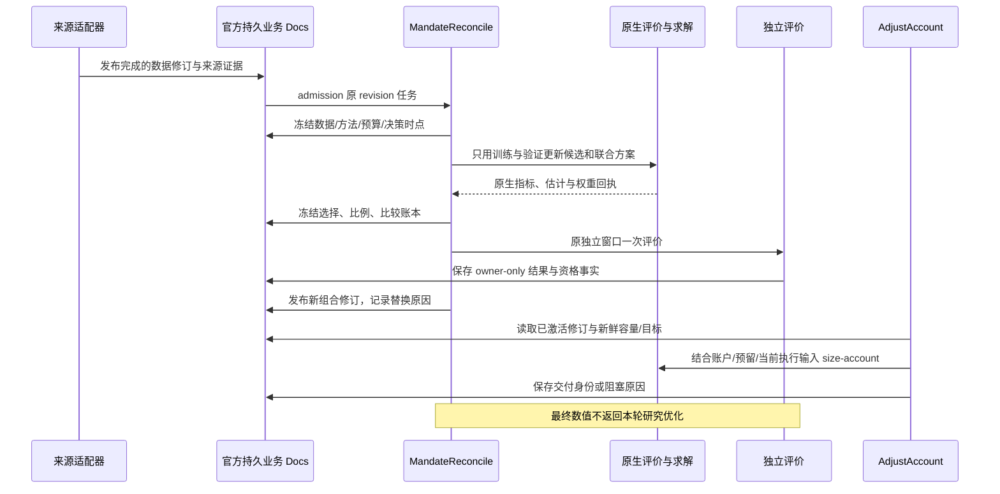

<a id="continuous-workflow--9-持续反馈归因与用户可见结果"></a>

## 9. 持续反馈归因与用户可见结果

每次变更回答：新增了什么信息、哪项旧判断改变、为什么增加/降低某成员、组合改善来自何处、剩余不确定性是什么。通过 `PortfolioDecision.incumbentDecisionId`、本次决定 ID、`DecisionCycle.triggerEventIds/asOfNs` 及 `explanationFacts`、关联 EvidenceRef 保存变更依据。

归因分别报告模型信号变化、成员及权重变化、账户资金变化、费用/流动性变化、执行偏差、数据或方法修订。进行反事实对照时，必须在相同合法窗口和账户假设下回放；没有原生支持就标 unavailable，不能把净值差全部归为模型 alpha。Forward 观测能够触发重新研究或降低部署，但不能回写已冻结的历史独立评价。

界面核心是“当前推荐组合、比例、可用资金区间、依据、上次变化与下一动作”，附候选淘汰/继续原因。研究总览的成功不得由请求 202、Task 完成或单一 Sharpe 达标推断。

运行期严格采用规范 `CycleState`：

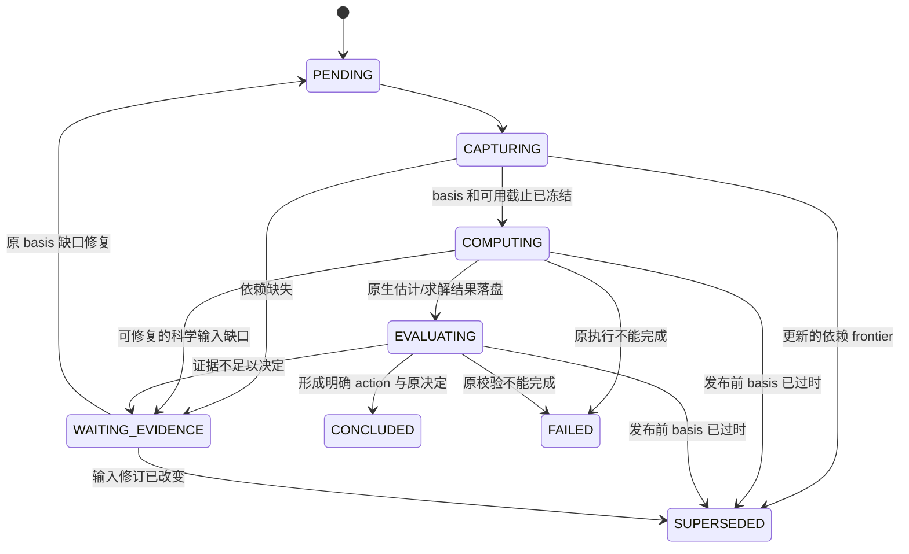

CONCLUDED 的具体经济动作由 PortfolioDecision.action 表达；NEEDS_EVIDENCE、NO_FEASIBLE_SOLUTION 与 CASH 不混用。相同 basis 的可恢复执行沿原 Task 继续；输入改变则建立新 DecisionCycle，旧周期通过 supersededByCycleId 指向后继。已登记自适应规则可产生新的学习结果和决定，但不得原位修改 EnsembleRevision；更换方法回到适用研究/评价阶段。交付与对账继续由现有官方账户任务负责，DecisionCycle 不复制其完整任务状态。

<a id="continuous-workflow--10-分阶段文件规划与验收"></a>

## 10. 分阶段文件规划与验收

第一阶段交付完整的“耗尽预算后仍形成候选决策”闭环：`apps/research/src/trials.ts`、`continuation.ts`、拟建 `decision.ts`、研究插件业务能力登记、现有终审入口、`packages/contracts/src/research.ts`。新增明确结项结果，保持现有 Task/请求/试验身份；不修改之前已修复的 start/stop 串行边界。

第二阶段交付真正的自动选池/比例与联合验证：拟建 `apps/service/src/mandate-workflow.ts`、`workflow-facts.ts`、`portfolio-recompute.ts`；接入原生估计/求解合同，复用 `native.ts`、`capacity.ts`、`science.ts`。现有 `computePortfolio` 是最终证据的消费者，不能直接把它当 Validation 优化器；要新增明确带验证分区的输入路径。

第三阶段接通数据与账户持续更新：`config.ts`、拟建 `dataset-refresh.ts`、`dataset-export.ts`、`runtimes/data` 的已登记来源适配、`service.ts` 新持续计划 API；`automatic.ts` 读取已激活组合修订和新鲜依赖，未对账旧交付不得被新修订覆盖。Web 展示系统决定及原因，用户不需要填写计算内部参数。

必须通过的业务验收：

1. 最后一次合法试验产生最佳候选后，即使模型先结束回答，仍完成比较及原终审；没有新增搜索次数。
2. 全部失败、全部不可比、全部不可行分别产生正确结项；缺数据不变成收益零、无候选不自动满仓。
3. 同一经济假设换参数、失败、恢复均正确计账；重分配不能超过原总额；不因循环次数推断科学失败。
4. 新数据只使依赖它的结果重算；相同修订重复事件不重复计算；计算中新事件不会被旧结果覆盖；重启不丢待办。
5. 同一共享资金与合法验证窗口中，候选/比例由实际原生估计和求解得出；求解无解不返回备用等权。
6. 当前目标/容量过期能产生新的研究/执行依赖处理或明确等待，而不靠延长旧回执期限假装更新。
7. 所有选池和权重输入均拒绝未授权 HELDOUT；旧暴露跨目录/标签/周期保持；独立失败不会自动调参再测同一窗口。
8. 新组合激活与旧未知交付并发时先对账；账户资金变动只调整其必要依赖；新比例和归因可从原事实重建。
9. 从 IDEA 到退役能完整追踪同一假设及版本；shadow 不伪称成交，paper 不改标真实，因子没有策略映射不能直接成为仓位。
10. 降级能区分数据、模型、执行和资金原因；回滚使用旧规则加当前输入产生新决定，不能复用过期目标；QZ 停止不被展示为外部清仓。
11. ResearchWorkAllocation 与 BudgetMovement 能重建每个假设族的预留/消耗/释放/转移；资源不能跨单位抵扣，未知成本不按零计。
12. PortfolioDecision.comparisonRef 解析为同周期/basis的 OperatingComparison；新自适应权重有独立 EnsembleRevision，SELECTED 不被展示为该组权重已独立验证；暂停/恢复不重发旧目标或重算原失败。
13. 用官方 Durable/Faux/SQLite 验证编排与恢复，用真实原生内核验证数值和分区，用真实来源独立检查数据质量；三类证据不互相替代。付费模型决策质量、实盘表现和运行时长单独报告。

调研依据：经济假设与独立验证见 QuantConnect research guide；多重尝试与赢家膨胀见 Bailey 等 Deflated Sharpe Ratio 原文 https://www.davidhbailey.com/dhbpapers/deflated-sharpe.pdf；收益、回撤、换手、容量联合报告见 https://www.quantconnect.com/docs/v2/cloud-platform/backtesting/report 。这些来源不规定本产品的固定预算比例，也不证明当前数据/模型已具备盈利能力。


---

<a id="chapter-architecture-api"></a>

<a id="architecture-api--pm-自营研究与决策系统技术边界持久化和业务验收设计"></a>

# PM 自营研究与决策系统：技术边界、持久化和业务验收设计

> 规范说明：本章展开设计依据与候选实现。实体与字段以 [规范字段合同](#chapter-contracts) 为准；专题代码示意不是另一套 API，也不代表已经实现。
状态：**拟建方案，未实现**。本文为主方案的技术附件，字段与实体名服从主方案 `contracts.md`。记录基于当前 TypeScript service/research/Web/CLI 与官方 Pi Durable 1.1.0 架构；不延用已退役 Rust Server/Store/Mission 控制面。现有测试证明的能力与新增业务方案的验收严格分开。

<a id="architecture-api--1-技术目标和不可混淆的责任"></a>

## 1. 技术目标和不可混淆的责任

系统应能回答：在当时真正可用的资料、已知账户条件和原投资授权下，为什么选择这一组因子，怎样映射为资产目标，为什么投入这笔资金，哪些证据支持其容量，以及何时需要更新或保留原决策。回答必须由可重放的事实产生，而不是事后补写一段模型解释。

四个所有权边界：

1. QuaZonai 的 TypeScript 业务层定义研究、事实、比较、决策、资金建议和 API；新业务实体属于这一层。
2. 官方 Pi Durable 定义任务持久化、执行、所有权、等待、恢复和取消；业务状态不能冒充第二套任务运行时。
3. 官方 NautilusTrader、Clarabel、Arrow 与保留的 Rust 科学内核负责它们已支持的回放、数值计算、原生类型和校验。新增方法通过公开适配接入，不复制上游实现。
4. 下游执行端拥有真实账户、订单、撤单、成交、资金出入和原生控制状态。QZ 交付 target；接收 target 的回执不是成交，停止本地任务也不是撤销远端订单。

主方案统一实体链为 `MandateRevision → ResearchCampaign / DecisionCycle → PortfolioDecision → ObservedOutcome`，其依据通过 `DatasetRevision、ResearchTrial、EvidenceRef、MetricObservation、FactorVersion、CalibrationModel、EnsembleRevision、CapacityEstimate、DecisionPolicyRevision` 连接。因子权重、资产权重和账户资金占比有不同分母与计算作用，任何接口都不能共用一个无类型的 `weights` 字段。若同一账户容纳多个独立策略，规范 `PortfolioDecision.strategyAllocations` 记录各 StrategyVersion 的资金计划，并在共同账户净额与风险层验证；它不能被解释为因子权重。

跨策略生命周期另由主合同的 `StrategyDefinition、StrategyVersion、CapabilityDescriptor、PipelineAssessment` 明确表达。实体是业务语义，不要求每个草稿节点都有一对一数据库文档；只有需要稳定身份、独立修订或正式引用的事实才单独持久化。值对象可嵌入其所属冻结版本，避免无必要的实体拆分。

<a id="architecture-api--2-现有能力逐项源码证据与拟建边界"></a>

## 2. 现有能力：逐项源码证据与拟建边界

以下路径均相对于仓库根目录。实施时应把验收 Head、依赖锁文件摘要和科学二进制摘要写入验收清单；路径只负责定位，不能代替版本绑定。

| 能力 | 当前真实落点 | 当前能证明什么 | 新方案必须补足什么 |
| --- | --- | --- | --- |
| 公共 Wire 合同 | `packages/contracts/src/index.ts`、`research.ts` | 已有 ResearchSpecification、ResearchStart、PortfolioStart、FactorView、TargetReceipt、ObservationView；金额及多处权重为 decimal string | 新实体及一致状态、版本、时钟和血缘；不能把旧 DTO 的展示字段当完整领域模型 |
| HTTP 业务准入 | `apps/service/src/service.ts`、`workbench.ts` | `/api/v3` 路由；研究/组合/观测请求准入和原输入保留 | 将新 Mandate/Policy/Dataset 修订冻结到命令；对业务修订做并发冲突检查 |
| 官方宿主和原请求恢复 | `apps/research/src/host.ts` | 官方 SQLite/Harness；原 request ID 与原 body 绑定；原 admission/stop/resume 串行；重启补交未提交的原请求 | 新实体到 Pi IDs 的独立映射；业务命令与任务创建同一持久化提交 |
| 研究输入与账本 | `apps/research/src/documents.ts`、`trials.ts` | Study 保存原 input/trials/final；计算前写 STARTED；已提交 FAILED 不变成免费重试 | 新 Hypothesis/ResearchTrial 和批量比较快照；不能丢掉失败、拒绝和曝光成本 |
| 持续研究 | `apps/research/src/continuation.ts` | 原 GenerationTask.onYield 在原试验预算内续接；没有第二后台循环；宿主关闭后不承诺继续 | 根据业务信息价值与原预算决定下一实验；不是按工具调用次数停止 |
| 原生子任务 | `apps/research/plugins/native-factor-task.ts`、`native-portfolio-task.ts` | 官方 Task；父任务一次记录并等待原子任务；因子和共享账户策略分别有原始结果 | 新校准、组合学习与容量实验也必须绑定原子任务和明确计算方法 |
| 证据分块 | `apps/research/plugins/native-evidence.ts` | 原生 JSON gzip/base64 分块保存在同一官方 DocFamily；最终 task outcome 引用完整产物 | 可校验内容摘要、媒体类型、结构/行数、方法和来源血缘；百万行序列不能塞进 UI/模型摘要 |
| Sealed 曝光事实 | `apps/research/plugins/native-exposure.ts` | session 级窗口，按实际 BAR 身份和时间交集检查；复制目录/改名/开新根不能自动恢复独立性 | 支持新 DatasetRevision 的跨版本内容与样本关联；未知关联不能标为独立 |
| 多因子共享资金回放 | `apps/research/plugins/strategy-portfolio.ts`、`native-portfolio.ts` | 原成员与权重冻结，一次共享账户模拟；Validation 和最终 Heldout 隔离 | 校准、成员学习、资产优化、PM 关系/结算/成本的明确业务方法和原始数据 |
| 组合事实 | `apps/service/src/facts.ts`、`science.ts` | Application session Doc 保存 portfolios/observations；BuildPortfolio 为官方 Task | 新 PortfolioDecision 及其因果输入；大规模历史按 DocFamily 拆分，避免所有事实无限增长在一个对象里 |
| 自动账户调整 | `apps/service/src/automatic.ts` | `qz.account-adjustment` 官方 Task 的 snapshot/deliver/reconcile/wait 相位；绑定账户序号、原生时钟、控制修订、容量和有效期 | DecisionCycle 的业务更新规则、升级/降级解释与学习策略；现有 wait 间隔不等于业务 SLO |
| target 外部交付 | `apps/service/src/science.ts`、`downstream.ts` | unsafe POST 前把 checkpoint 转到 reconcile 并写 UNCERTAIN；重启查原回执，不盲目重发 | 新决策绑定 target/receipt 的审计链；下游不支持所需原子控制时明确不可交付 |
| 账户观测 | `apps/service/src/downstream.ts` | client/account/currency/mode、sequence/nativeClockNs 校验；同序号不同物理内容冲突；缺估值保留 null | ObservedOutcome 的结算/成熟度、收益归因及来源可信性；不把 ACK 计为成交结果 |
| 数据入口 | `apps/service/src/config.ts`、`dataset-export.ts`；`runtimes/data` | 配置式 catalog 与请求；原始工具可导入更多数据形式，但当前科学链主要消费 BAR | 真实不可变 DatasetRevision、可得时间证据、修订历史、市场/事件关系、结算/规则版本 |
| 模型与设置 | `apps/research/src/models.ts`、`settings.ts`、`credentials.ts` | 官方 provider；独立 app 凭据库；原会话模型保存在 pi.agent；宿主设置可动态变化 | 冻结影响科学解释的模型/提示/工具/方法版本；运维重试设置不能偷偷改变投资策略 |

当前明确缺口：没有完整 PM 业务实体闭环；没有通用的不可变数据修订与内容摘要链；没有可从 summary 反推出的配对因子收益矩阵；没有由一组 IC/Sharpe 自动证明的净成本最优权重；没有得到原始盘口和规则支持的全市场可执行容量。`catalog-ensemble` 路径缺少原始 book/receive clocks/真实制度时只提供有声明条件的 pUSD、long-only、1x margin 代理回放，不能宣称真实市场可执行套利。

<a id="architecture-api--3-官方-pi-durable-与-chord-的公开-api-使用范围"></a>

## 3. 官方 Pi Durable 与 Chord 的公开 API 使用范围

本次核对版本为 `@earendil-works/pi-durable`、`pi-ai`、`chord` **1.1.0**，以 `apps/research/package.json` 与 lockfile 为准。

| 公开机制 | 方案中的使用方式 | 禁止误读 |
| --- | --- | --- |
| `defineDoc` / `defineDocFamily` | session 保存不可回卷的全局 admission、曝光、业务修订与索引；conversation 保存研究上下文；task 保存局部子任务关联 | conversation rewind/fork 不是删除已发生的预算消耗、曝光或外部交付 |
| `Harness.open` / `harness.commit` | 在同一官方持久化提交里检查业务版本、记录命令和创建官方任务 | 不直接写官方 SQLite 内部表，不并开多个宿主争用同一库 |
| `defineTask` / `tx.createTask` | 可恢复业务计算使用明确 phase；child 指定 task ownership | 不另建 cron、BullMQ、私有轮询队列或复制官方任务状态机 |
| `runtime.commit` | 同时提交领域事实和下一 checkpoint/terminal outcome | phase 返回前未取得持久化进展不算完成；内存对象改变不算保存 |
| `runtime.waitForTask` / waiting checkpoint | 等待原 owned child；崩溃后仍用原 ID | 每次重放新建 child 会重复计算、曝光和收费 |
| `runtime.memo` | 小型确定性原任务绑定可使用公开持久化 memo | memo 不能绕过业务命令冲突、证据鉴别或外部回执 |
| `runtime.signal`、Chord `Context` | 取消传播至进程与 I/O；清理与回收按官方环境语义处理 | 本地 abort 不证明 provider、下游或交易所已取消 |
| `runtime.sleep(until, context)` | 在官方任务已有 wait phase 内等待；checkpoint 保存 wakeAt | 不承诺硬实时唤醒，也不额外建立第二计划调度源 |
| Doc `version`、`migrate(value, fromVersion)` | 持久化形状演进；逐版本纯转换与兼容验证 | 升字段版本不是重新评价旧证据，也不能无依据补造历史数据 |
| Task `version`、`migrate(input, checkpoint, fromVersion)` | 兼容仍未终止的旧 input/checkpoint；公开声明支持的旧版本 | 不能只重命名 phase 就部署；不会自动证明旧外部副作用安全 |
| Chord services/facets/replicated state | 按需复用官方类型化服务组合与视图同步；当前 Fastify API 继续作为业务入口 | Chord 是组合/通信能力，不是第二持久化账本或恢复引擎 |

官方 Task runtime 在 phase 边界刷新 registry snapshot，宿主 settings 可动态读取。因此“输入没变”不自动等于“方法没变”：必须在业务输入固定 `DecisionPolicyRevision`、运行版本和所需方法；旧任务不能不留记录地用新模块解释旧 checkpoint。

官方 watch 是最新视图传递，不是完整审计事件流。消费端可能收到合并后的视图；重连必须重新读快照与其版本。若未来暴露 SSE/WebSocket，消息声明 `SNAPSHOT / UPDATE / RESET_REQUIRED`、绑定业务修订和游标，仍以持久化事实查询为准，不能承诺逐个 UI 消息无损重放。

官方来源：

- [Pi Durable 1.1.0 README](https://github.com/earendil-works/pi/blob/v1.1.0/packages/durable/README.md)
- [Pi Durable 公共类型](https://github.com/earendil-works/pi/blob/v1.1.0/packages/durable/src/types.ts)
- [Pi Durable 文档定义](https://github.com/earendil-works/pi/blob/v1.1.0/packages/durable/src/documents.ts)
- [Pi Durable Task 定义](https://github.com/earendil-works/pi/blob/v1.1.0/packages/durable/src/tasks.ts)
- [Chord 1.1.0 README](https://github.com/earendil-works/pi/blob/v1.1.0/packages/chord/README.md)
- [Chord 公共出口](https://github.com/earendil-works/pi/blob/v1.1.0/packages/chord/src/index.ts)

这里使用公开 API 的适配方案，不涉及上游 fork、源码复制、内部表协议或自制 scheduler。

<a id="architecture-api--4-类关系与落点"></a>

## 4. 类关系与落点

下图是主合同实体之间的技术引用关系；箭头表示冻结引用，不表示把被引用对象内嵌复制。金额与权重类型由主合同统一，`RuntimeRef` 只是运行时绑定值对象。

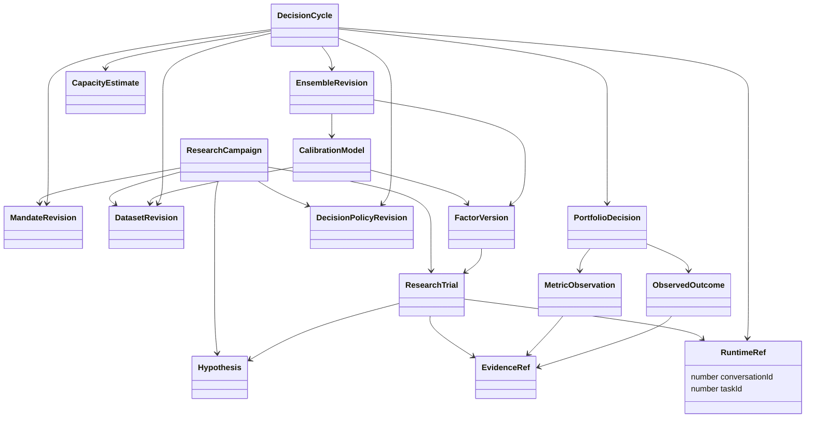

`RuntimeRef` 按主合同保存 `conversationId:number` 与 `taskId:number|null`，均按官方 branded ID 校验安全整数；尚未建立完整会话的回执不能伪造数字0。新业务 ID 绝不通过 `Number(id)` 转成 Pi ID。跨运行库复制/导入需有迁移清单记录库身份和映射，避免不同 SQLite 库内相同数字 ID 被误认为同一任务；这不是本版 Wire 合同新增的运行时字段。业务修订引用不以当前 Pi task state 为存在前提；结束的任务不能让已冻结业务事实消失。

拟建源码落点应服从现有模块边界：

| 内容 | 建议落点 | 适配关系 |
| --- | --- | --- |
| 精确 Wire 类型、校验枚举、视图 | `packages/contracts/src/` 的专题文件，由 `index.ts` 受控导出 | 主 `contracts.md` 先定义语义；生成/校验的来源唯一 |
| Mandate、DatasetRevision、Policy、DecisionCycle 的业务服务 | `apps/service/src/` 的专题模块 | 复用 facts/host 的官方事务；HTTP handler 不直接跑模型或数值循环 |
| 研究提案、账本、验证反馈与搜索工具 | `apps/research/src/`、`apps/research/plugins/` | 保留原 Study、trial/exposure 的所有权，不建平行 research DB |
| 对齐面板、校准、成本/容量实验的科学适配 | `apps/research/plugins/` + 必需的 `apps/job` 入口 | 大数组走原生证据/Arrow；TS 保存引用和结果摘要 |
| 纯科学合同、约束与数值实现 | `crates/contracts`、`crates/domain`、`apps/job` | 只新增科学所必需内容；不恢复 retired store/runtime/server |
| 数据 manifest/规范化来源工具 | `runtimes/data`、`apps/service/src/dataset-export.ts` 附近 | 保留原始证据；目录不是业务修订身份 |
| 主人视图与解释 | `apps/web/src/`、`apps/cli/src/` | UI/CLI 复用同一决策视图，不能各自计算排名和“通过” |

<a id="architecture-api--41-策略插件模板与能力绑定"></a>

### 4.1 策略插件、模板与能力绑定

当前 `apps/research/src/strategy.ts` 只有 `factor-threshold`、`cross-market-threshold` 与 `catalog-ensemble` 等明确联合类型；`forecastMode:'price-volume'` 也只是特定可支持输入路径。当前配置里载入官方 `defineExtension` 并不自动赋予所有策略类型、资产类别和市场制度的科学支持。新方案不能把“插件已启用”显示成“所有pipeline已就绪”。

`StrategyDefinition` 描述策略族及其专业处理阶段，例如信号/预测、事件关系、组合构造、执行假设、退出/结算及风险解释；`StrategyVersion` 冻结此策略某次可执行配置、template版本、参数/模型引用和所需能力。`CapabilityDescriptor` 描述适配器对实际数据/市场/工具合同的支持范围；`PipelineAssessment` 则对一个具体 StrategyVersion + DatasetRevision + MandateRevision + 执行目的进行检查。它不是一次安装时永远成立的布尔开关。

建议能力描述包含以下横切字段，具体字段名归入主合同：

| 维度 | 应冻结的内容 | 拒绝误判的例子 |
| --- | --- | --- |
| 适配器身份 | adapterId、版本、官方来源/依赖版本、模块内容摘要、toolSchemaVersion | 同名函数代码变更后仍声称原结果同方法 |
| 策略输入 | signal单位、horizon、featureSchema、label规则、允许成员/权重形式 | 将概率、raw score、IC直接当同周期收益 |
| 数据能力 | BAR/TRADE/BOOK、event/available/receive clocks、市场metadata/规则/关系、完整性 | 有BAR目录就宣称支持盘口套利或真实延迟回放 |
| 市场机制 | 支持资产类别、币种、保证金/现金、数量/最小订单、费用、结算/作废 | 用1x margin proxy声称cash-token settlement已验证 |
| 科学能力 | prediction/calibration/backtest/asset allocation/capacity/target、各自合同版本 | 因子可扫描便自动标为可组合、可交付 |
| 生命周期 | hypothesis/research/validation/sealed/shadow/target/observe可支持阶段 | 只有研究回放就跳到正式经营观察 |
| 数值约束 | PSD/PD需求、允许空/负权重、稀疏/异步支持、规模限制 | 数学solver能解不代表adapter接受或数据支持 |
| 交付能力 | target-only、下游控制修订/回执/撤销/观察合同、账户模式 | HTTP连通就宣称真实执行和现金退出可用 |
| 资源与兼容 | task/doc输入版本、所需binary版本、资源画像、migration支持 | 新template无法解释旧checkpoint仍自动恢复 |

模板是完整、可版本化的默认结构与允许搜索空间；它不是悄悄注入资金、费用或绩效阈值的装置。每次使用模板展开成冻结 StrategyVersion，保存templateId/version及实际effective参数。模板升级不会改变已经开始的ResearchTrial或已交付PortfolioDecision；新版本要产生新的策略修订和PipelineAssessment。

PipelineAssessment逐阶段输出“已支持/有条件支持/缺证据/不支持”的原因、所需证据、实际provider与能力版本绑定。具体状态枚举采用主合同，不再创建一套近义状态。检查必须以实际能力交集为准：策略需要的能力、数据确实提供的能力、科学adapter实现的能力、Mandate允许的范围、下游已确认的能力共同满足，才允许进入相应阶段。现有缺口不能由模型一句“可以做”覆盖。

新策略插件继续通过官方extension注册工具与Task，策略族不是新调度器；纯模板/能力校验可先独立验证，只有需要执行的步骤才创建官方任务。若新模板需要全新科学ABI、数据种类或市场机制，应明确列为新能力开发，不能将旧测试数量记作覆盖。

<a id="architecture-api--5-与规范合同的技术映射"></a>

## 5. 与规范合同的技术映射

本章解释 [contracts.md](#chapter-contracts) 中字段如何落到官方运行时，所有公开对象复用该规范。需要额外原始来源元数据时，放在有 `schemaId` 的 EvidenceRef 内容中；若将来成为公开 Wire 字段，先修改规范合同。

<a id="architecture-api--51-标量身份与结构版本"></a>

### 5.1 标量、身份与结构版本

| 规范字段/类型 | 持久化与校验语义 |
| --- | --- |
| `Id` | opaque string，非空；不从显示名称、可变目录或Pi数字强转生成 |
| `RuntimeRef` | 官方conversationId/taskId安全整数的明确引用；与新业务ID分开 |
| `Ns` | 非负整数字符串，无指数/小数，用BigInt比较；对接Rust时额外检查原接口范围 |
| `Decimal` / `Money` | 精确十进制字符串；金额绑定currency，权重明确分母；不经Number计算 |
| `VersionedFact.schemaVersion` | Wire/存储结构版本，不是业务内容、模型或任务版本 |
| `VersionedFact.revision` | 同一业务身份的单调状态修订；官方事务校验expectedRevision并推进 |
| `VersionedFact.id/supersedesId` | 不可变策略、方法、数据、正式证据等新内容产生新ID并链接前驱；不覆盖旧科学事实 |
| `VersionedFact.createdAtNs/producerVersion` | 原创建时间与生产者版本；源码版本不替代模型、二进制、依赖和提示证据 |

ResearchCampaign、ResearchTrial、DecisionCycle等活动聚合使用稳定ID，在官方事务内推进revision；保持原输入、原预算和状态转换历史。MandateRevision、DecisionPolicyRevision、StrategyVersion、EnsembleRevision等冻结对象发生语义改变时创建新ID。不可变对象的状态投影/活动指针可变化，但不改原科学正文。这些逻辑约束由业务服务实施，官方Doc不会天然禁止修改JSON。

旧 `ResearchReceipt.conversationId/submissionId` 与 `FactorReference.researchId/trialId/memberIndex` 保持原合同。新ResearchTrial通过规范 `runtime:RuntimeRef` 绑定原任务，不重新解释旧numeric trialId为新业务Id。

<a id="architecture-api--52-时钟字段与原始来源证据"></a>

### 5.2 时钟字段与原始来源证据

| 规范字段 | 精确定义及来源 |
| --- | --- |
| `EvidenceRef.eventInterval` | 此证据描述的原事件区间；可能未知为null |
| `EvidenceRef.availableAtNs` | 证据在指定信息集真实可使用的时刻；必须有来源，不能用下载时间倒填历史 |
| `EvidenceRef.clockPrecision` | 源实际分辨率；不因字符串编码为ns就声称NANOSECOND |
| `DatasetRevision.availableThroughNs` | 声明的数据可用watermark，不自动证明此前无缺失 |
| `DatasetRevision.admittedAtNs` | 此数据修订完成准入的本机时刻，不冒充原历史可得时刻 |
| `PredictionRow.eventAtNs/decisionAtNs/featureAvailableAtNs` | 分别保留事件、预测决策与特征可得时间 |
| `PredictionRow.labelEndNs/labelAvailableAtNs` | 标签周期终点和真实成熟可用时间；未成熟保持null |
| `DecisionCycle.asOfNs/availableCutoffNs` | 本次决策描述时点与允许读取信息的截止；输入依赖版本同时冻结 |
| `PortfolioDecision.validUntilNs` | 由所有输入时效和策略规则共同约束；null不代表永久有效 |

采集器received/ingested、时钟来源/偏差/质量、原始规则公布时间等，保存到Dataset/Evidence原始内容，由schemaId解释，不在本附件新增另一套同义公开字段。若原可得时钟未知，不能创建声称历史PIT成立的证据；相应DatasetRevision质量状态和PipelineAssessment明确不足。

当前 `nowNs()` 为 `Date.now() × 1_000_000`，即毫秒精度编码为ns。延迟测量使用单调时钟；跨重启不直接比较单调原点。原event早于cutoff但available晚于cutoff的数据不能进入该次决策。后下载全历史文件也不会让后来修订的字段在历史时点可用。

<a id="architecture-api--53-evidenceref-的完整性可见性与生产者"></a>

### 5.3 EvidenceRef 的完整性、可见性与生产者

规范字段 `sourceKind/role/runtime/objectKey/contentDigest/mediaType/sourceRevision/eventInterval/availableAtNs/clockPrecision/schemaId/visibility` 是唯一公开结构。

- `objectKey` 为服务内受控引用，不允许客户端提供任意本机私有路径；读取服务按证据ID解析。
- `contentDigest` 按规范为 `string|null`。schemaId规定具体摘要算法/规范序列化版本；null保留旧源能力限制，不能宣称已校验字节不可变。
- 原生数据体积、行数、shape、编码、上游证据、app/lockfile/native binary/model/prompt/tool版本放在有schemaId的产物manifest；引用链可检索，不要求每项元数据都变成独立领域实体。
- `role` 区分TRAINING/INNER_VALIDATION/SELECTION/INDEPENDENT/PREQUENTIAL/OBSERVED/CONTROL；`visibility` 只用规范RESEARCH_VISIBLE/OWNER_ONLY。展示到其他页面不会改变原研究角色或允许Sealed调参。
- 缺块/摘要不符的产物不可作为可用科学证据。计算失败可留诊断产物，其业务状态必须明确失败，不能发布成功指标。
- 大型产物校验完成后才发布其引用。同库分块最后一笔提交发布完整引用；若未来外置不可变文件，明确临时写入→校验→rename→manifest发布和孤儿回收，不伪造文件与SQLite跨介质原子事务。

<a id="architecture-api--54-metricobservation-的口径与排序"></a>

### 5.4 MetricObservation 的口径与排序

规范 `definition.valueEncoding` 决定value为finite number、Decimal或integer string；`status` 使用统一Availability，非AVAILABLE的value必须null。raw保留原nativeKey/value/unit/conversionVersion；规范回撤的非负损失与Nautilus原负回撤必须通过显式转换，不能在各页面各自取绝对值。

`role/interval/asOfNs/availableAtNs/origin/methodRef/evidenceRefs/sampleCount/expectedCount/uncertainty`共同解释指标。比较上下文还需冻结币种、费用、起始资金/现仓、收益类型、日历、年化天数和窗口；同名指标不代表可比较。sampleCount不等于独立事件数；有效样本量只在已验证uncertainty方法确实估计时给出。

本版MetricObservation作为有明确所属对象的值对象，不要求每条都新建独立ID/Doc。真正需要跨对象直接引用时，通过规范定义的EvidenceRef/MetricDefinition和所属业务版本检索，不能在附录私设另一套指标数据库。

<a id="architecture-api--55-命令回执并发与错误"></a>

### 5.5 命令回执、并发与错误

新命令采用规范 `requestId/expectedRevision`；浏览器重试复用原requestId和完整原body。异步回执至少为 `{requestId,entityId,runtime,state,viewPath}`。202只表示持久化准入，不表示计算、投资价值或可交付性成立。

服务内部可保存bodyDigest、admittedAtNs与完整原请求，以检查同key同内容；这些内部字段不构成另一个公开CommandReceipt合同。Digest需要版本化规范序列化，不能直接把现有canonical()函数等同哈希协议。

错误体统一为 `{code,category,entityId,reasonCodes,retryable,requiredEvidence,correlationId}`；category与HTTP状态采用规范API章节。旧Problem错误合同按兼容入口保留。provider限流、科学能力缺失、预算不足、证据不成熟与外部回执不确定是不同原因，不应统一显示“重试一下”。

<a id="architecture-api--6-新-api-清单与兼容策略"></a>

## 6. 新 API 清单与兼容策略

<a id="architecture-api--61-当前已存在的主要路由"></a>

### 6.1 当前已存在的主要路由

所有下列路径以 `/api/v3` 为前缀：

- `GET /datasets`、`GET /research/models`。
- `GET /research`、`GET /research/:id`、`GET /research/:id/diagnostics`、`POST /research`、`POST /research/:id/stop`、`POST /research/:id/resume`。
- `GET /factors`、`GET /factors/:id`、`GET|POST /factors/:id/capacity`。
- `GET /portfolios`、`GET /portfolios/:id`、`POST /portfolios`、`POST /portfolios/:id/capacity`。
- `GET /observations`、`POST /observations`、`POST /observations/:id/refresh`、`POST /observations/:id/stop`、`POST /observations/:id/automatic`。
- `GET /observations/:id/capital-exits`、`POST /observations/:id/capital-exits/preview`、`POST /observations/:id/capital-exits/commands`。
- `GET /usage`、`GET /workspace`、`GET /extensions`、`PATCH /extensions/:name`；模型/登录/设置路由另保持原合同。

当前 research path 中的 id 仍为原 numeric conversation 语义；新 campaign API 不应隐式替换这一点。

<a id="architecture-api--62-拟建路由严格复用规范名称"></a>

### 6.2 拟建路由：严格复用规范名称

完整API由 [contracts.md](#chapter-contracts) 第5章维护，下表说明同一路由的技术责任，由同一规范统一命名与语义。

| 规范方法/路径 | 技术责任与持久化边界 |
| --- | --- |
| `GET /capabilities` | 只读能力及实际adapter绑定；不触发新的科学计算 |
| `POST /mandates`、`POST /mandates/:id/revisions` | 原意愿冻结为新修订，保留原话/解释；修改通过expectedRevision检查 |
| `POST /datasets/:id/revisions` | 原始引用与来源证明准入；完成数据质量/时钟检查后发布新DatasetRevision |
| `POST /campaigns` | 冻结mandate、strategyDefinition、dataset等原输入与预算；同事务创建官方任务和runtime引用 |
| `GET /campaigns/:id/decision` | 读取正式CandidateComparison及其输入集合；不临时再调用模型选赢家 |
| `POST /campaigns/:id/close` | 关闭新增实验并完成原收尾；保留失败、预算与Sealed曝光事实 |
| `GET /strategies/:id/versions`、`GET /strategies/:id/assessments` | 分页读取正式版本及阶段证据，不因当前插件enabled伪造历史支持 |
| `GET /mandates/:id/decision` | 当前正式PortfolioDecision及其时效；原版仍可审计 |
| `POST /mandates/:id/recompute` | 显式重算创建DecisionCycle；正常新事实事件无需主人手动调用 |
| `GET /cycles/:id` | 业务状态、依赖、耗时和原因；不暴露运行时凭据/私有上下文 |
| `GET /capacity-estimates/:id` | 原容量等级、资本曲线、条件/有效期和未知项 |
| `GET /decisions/:id/diff` | 两个正式版本的因子/资产/资金/成本/原因差异 |
| `GET /decisions/:id/evidence` | owner可见原证据分页；模型反馈仍受原角色隔离 |
| `GET /decisions/:id/outcomes` | 原target到权威账户/成熟结果链；ACK不转换为fill |
| `POST /strategies/:id/pause`、`POST /strategies/:id/retire` | 关闭新目标的业务准入；原未决target/持仓继续保留对账责任 |

规范API亦包含Campaign及Trial读取、Campaign暂停/续接、Mandate决策历史、Strategy恢复等闭环操作，沿用相同官方事务、原账本和回执绑定，本表不重复列举。其他新target交付入口必须先补充规范及授权/幂等合同。现有 `/research`、`/portfolios`、`/observations` 继续保留原兼容行为。原始available时钟、费用模型、市场关系缺失时明确未知，不为兼容补假默认值。

<a id="architecture-api--7-持久化版本血缘与重放"></a>

## 7. 持久化、版本、血缘与重放

<a id="architecture-api--71-四种版本必须独立"></a>

### 7.1 四种版本必须独立

1. `schemaVersion`：字段结构如何解码。
2. 业务修订 ID/revision：谁的意愿、数据、成员、方法发生变化。
3. 方法/运行版本：这次结果由何种工具、提示、模型声明版本、native 二进制与依赖产生。
4. 观察序号/控制修订：外部账户或来源在什么时点给出的哪个事实。

schema migration 不得改变旧统计值、日期、现金、成交或评价分区。需要新口径时产生新的 EvidenceRef/MetricObservation 并引用原始证据，不覆盖原结论。技术 decode migration 和“使用新方法重新评价”是不同命令。

<a id="architecture-api--72-官方文档存储布局建议"></a>

### 7.2 官方文档存储布局建议

- 一个 session DocFamily 成员对应一份不可变业务修订/正式证据 manifest；键使用 opaque业务ID，kind 保持稳定，版本明确。
- 单独的 session Doc/DocFamily 维护 command admission 与 current pointer，使用官方 `commit` 原子检查 expectedRevision 和写入。
- conversation Doc 仍承载原研究上下文与模型可见摘要；全局预算消耗/曝光/正式决策不能被 conversation rewind 撤销。
- task Doc 保存原子任务/产物暂存关联；task 结束后业务 manifest 仍可解析原结果。
- 读索引是派生视图，记录 `sourceRevision/cursor`，允许重建；不是第二业务真实来源。读取超大历史使用分页，不能靠一次复制全部 Application JSON。

正式业务记录不调用“删除后重建”制造新鲜感。原证据若失效，产生明确 invalidation/retirement 事实，保留原因与受影响决策；过去某时点已作出的决定保持原样。

<a id="architecture-api--73-新命令的原子准入"></a>

### 7.3 新命令的原子准入

一次 `harness.commit` 里：检查 requestId 既有记录 → 同内容则返回原回执 → 不同内容则冲突 → 校验 expectedRevision 与所引用修订 → 校验本次预算保留是否允许 → 写规范命令回执/业务输入 → 创建 owned官方Task → 记 RuntimeRef/预算reservation。具体事务接口调用依实际官方类型实现，不能伪造跨库原子性。

`canonical()` 当前是键排序结构等价函数，并不是内容哈希协议。拟建 digest 需要单独版本化 canonicalization，规定 Decimal 字符串规范、对象键顺序、数组顺序、空值和禁止非JSON数值。原请求原文/原规范化版本仍保留；哈希冲突检查不能只比较一个用户可传 digest。

命令的 idempotency scope 明确为本地 runtimeInstance 与 command kind/requestId；是否跨导入库继承由迁移合同声明。错误响应丢失后客户端再次提交同 requestId，应返回同 command/resource，不增加 trial 或模型调用预算。改资金/数据/候选是新业务命令，不能偷偷沿用旧 key。

<a id="architecture-api--74-对外副作用的恢复状态机"></a>

### 7.4 对外副作用的恢复状态机

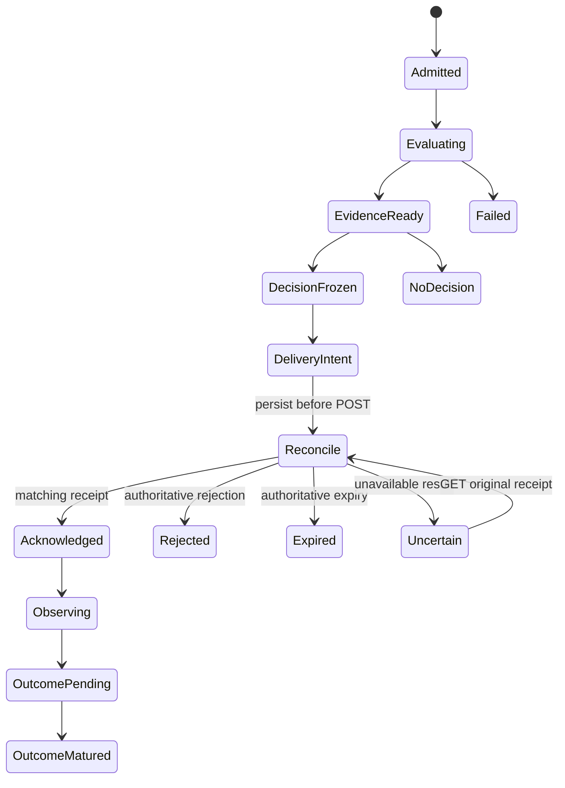

这是业务恢复模型，实际执行仍由官方 Task checkpoint 驱动；不得再实现一个独立执行状态机。`Acknowledged` 仅表示 target 被接受；`OutcomeMatured` 需要相应账户/市场/结算证据。停止和失效作为单独控制事实，不能把已经发生的 DeliveryIntent/ACK 抹掉。

发布新 target 前重新验证原 target TTL、EvidenceRef 有效期、capacity、账户sequence、controlRevision与资金reservation；任何一个变更应回到新 DecisionCycle 或明确拒绝，不能将新事实拼进旧 PortfolioDecision 并保留旧ID。无法证明未发出的错误保持 UNCERTAIN；只有明确 pretransport rejection 才可记 NOT_OFFERED。

<a id="architecture-api--75-重放的三个不同承诺"></a>

### 7.5 重放的三个不同承诺

- **事实重读**：读取同一原结果和解释，不重新运行模型，不重复消费试验预算。
- **计算复验**：在冻结数据/工具/方法下重新跑确定性内核，记录新复验结果及差异容忍规则；不重写原结果。浮点容忍按数值方法与量纲规定，不能统一拍一个 epsilon。
- **重新研究**：新模型调用、新方法或新可得数据均产生新 ResearchTrial/DecisionCycle，计入相应原预算/新授权预算；不能伪称“原样恢复”。

LLM provider 的后端版本可能不可固定。应保存原输入、模型声明、响应和工具轨迹以实现事实重读；除非实际取得可重现的后端与随机源证据，不承诺逐 token 重现。随机数 seed、线程/数值库差异与 deterministic 能力写入 producer 证据。

<a id="architecture-api--8-线上更新分层与时效"></a>

## 8. 线上更新分层与时效

原则：新事实进入时，先判断它会改变哪个业务结论；只失效相应依赖和开启必要的新周期。每个更新都保留原决策及新版本的原因，不能一边展示原依据一边运行新权重。

| 层 | 触发来源 | 工作内容 | 需要冻结的依据 | 未就绪时行为 |
| --- | --- | --- | --- | --- |
| 元数据/制度 | 新市场、规则/费用/结算变更 | 更新市场关系、可交易状态与 DatasetRevision | 原规则文本/时间、关系证据、版本 | 受影响市场标为不支持/待核实；不自动猜制度 |
| 行情/特征 | 原始事件或可用 BAR 到达 | PIT校验、增量特征、有效性/缺值 | 数据版本、availableAtNs、特征/校准版本 | 保留明确陈旧状态；是否减仓由原 Mandate/Policy 与执行能力决定 |
| 确定性决策 | 新可用特征、账户/控制变化 | 资产目标、成本/容量、资金约束、解释 | EnsembleRevision、Policy、账户sequence、时点 | 若原目标仍有效可保持；不能把未观察到的现金当已释放 |
| 目标交付/对账 | 新正式决策或未决回执 | target admission、原receipt查询、账户观测 | 决策ID、account/control、validUntil | 不重发未知POST；UNCERTAIN 明示并限制冲突命令 |
| 研究/学习 | 新成熟结果、结构漂移、信息缺口 | 新 Hypothesis/Trial、校准/组合/方法比较 | 训练与独立样本边界、预算、完整试验账本 | 在线使用已批准的原版本或无新决策；研究未完成不替换线上方法 |
| 主人视图 | 持久化事实/投影更新 | 展示依据、缺口、风险与新旧变化 | projection source revision | 重连读快照；stale提示，不伪造“实时” |

<a id="architecture-api--81-slo-必须先测量再冻结"></a>

### 8.1 SLO 必须先测量再冻结

不预写“毫秒级全市场更新”“每秒最优组合”或“24小时无间断”的承诺。先建立实际工作负载档案：市场/事件数、BAR/盘口频率、活跃因子数、持仓数、数据体积、设备CPU/RAM/I/O、provider限速、观察端延迟、算法复杂度和并发研究数量。

每层记录：输入可得至接收延迟、接收至校验延迟、排队时长、计算时长、持久化耗时、决定至offer耗时、offer至ACK/不确定耗时、账户观测年龄、视图年龄。分别统计 p50/p95/p99、最差样本、超时/失败/未知比例和样本量；端到端延迟不能由各层p99简单相加推算。

SLO清单拟建字段：`profileId`、`workloadDigest`、`hardwareRef`、`methodRevisionId`、`measurementWindow`、`metric`、`sampleCount`、`quantiles`、`failureRate`、`approvedTarget`、`measurementEvidenceRefId`。`approvedTarget` 在未测/未确定前为 null；这是诚实的未定合同，不是0。

业务 freshness budget 来自可接受信息年龄、市场机制和账户约束，系统处理SLO来自实际性能；二者不能互相替代。若处理速度达不到原业务有效期，应返回过期/不支持而不是延长TTL伪造可执行性。提供原期望有效期与实际耗时能让主人理解为何错过机会。

<a id="architecture-api--82-更新一致性和部署"></a>

### 8.2 更新一致性和部署

- 新 Mandate 影响后续决策；已交付目标是否替换/撤销必须经过下游能力和新明确命令，不因编辑表单就认为生效。
- 新 DecisionPolicyRevision 先用历史可得/独立数据验证，冻结版本后以新 DecisionCycle 生效；线上依据不得在后台无版本热替换。
- Registry/extension更新不自动升级旧科学语义；兼容旧Task的migrate须具备未完成phase、取消、重启和未知外部效果矩阵证据。
- 部署前暂停新的业务准入、在官方边界关闭/恢复宿主并保存一致备份；不能热拷贝若干SQLite/WAL文件就宣称一致备份。沿现有部署/备份流程验证恢复。
- 主SQLite与app拥有的`${database}.auth/credentials.sqlite`按原部署规则保存；凭据不进入计划、结果、模型上下文或普通日志。
- 旧方法仍有未决target时保留其执行/对账兼容路径。回滚程序不能回滚已发生的外部副作用、预算和曝光账本。

<a id="architecture-api--9-资源研究与执行预算"></a>

## 9. 资源、研究与执行预算

<a id="architecture-api--91-当前真实语义"></a>

### 9.1 当前真实语义

现有原试验预算 `max_trials` 在计算前记账；FAILED消耗一次原尝试，REJECTED不等于成功。续接不会重置账本。原生Wasm fuel可选，省略/null为未计量；显式fuel上限按原合同执行。当前QZ没有额外process timeout、memory ulimit或adapter output cap；官方Pi Durable1.1.0没有公开全局numeric concurrency参数。不能把“每轮串行工具”写成全系统并发限制。

当前自动账户调整已有资金reserve/cashBuffer/capacity/controlRevision等检查；这不等于对所有研究计算、token、历史下载和全市场内存有统一预算系统。下面是拟建业务计量与准入策略，不是现状。

<a id="architecture-api--92-预算维度必须独立"></a>

### 9.2 预算维度必须独立

| 预算 | 单位/绑定 | 预留与消费规则 | 未知时语义 |
| --- | --- | --- | --- |
| 科学尝试 | ResearchCampaign/Trial count | 首次准入消费；原任务恢复不再加一次；新提案是新尝试 | 缺required预算则不能声称无限自动研究获授权 |
| 最终曝光 | 实际数据/事件/窗口集合 | 暴露前reserve；失败也可能已曝光；不能退款成未见样本 | 不能证明未曝光则保持已用/未知，禁止重新标独立 |
| 模型花费 | currency Decimal、tokens integer | provider请求前可保留可估上界；完成按真实usage核对；不确定费用单列 | usage为null，不冒充免费；无可保证费用上界时不能声称硬cap |
| 原生计算 | fuel、CPU time、rows、bytes | 由可执行原合同/OS能力强制并记录；恢复按原计算计量约定 | 没有enforcement就仅称监测，不说硬限制 |
| 并发资源 | admission permits/类别 | 通过原子业务reservation控制哪些任务被准入；实际调度交官方 | 不借此重建worker队列；需先测资源画像 |
| 存储 | bytes、retention、artifact count | 写入前检查容量/预算；发布完整产物后记录占用 | 不能自动删正式证据来制造空间 |
| 投资资金 | account/currency Decimal | 按权威可支配资金、退出reserve、cashBuffer与目标交付绑定 | 估值/可用现金/控制状态未知则不能新增无法证明的风险 |
| 执行容量 | instrument、event、capital、horizon | 根据费用/参与率/深度/有效期/冲击条件生成CapacityEstimate | 不支持即UNAVAILABLE；不以历史成交量直接等同可用资金 |

技术预算记录建议保存 `policyRevisionId`、`scopeId`、`dimension`、`unit`、`limit`、`reserved`、`consumed`、`uncertain`、`remaining`、`updatedAtNs`、`sourceEvidenceRefIds`。Decimal与count按各自单位定义；未计量用null+status，不用超大数字假装无上限。一个失败任务可能花了token、计算和曝光，但没有创建有效FactorVersion；不同维度的费用不得只由“trial失败”统一退款。

若超限，需要原生可取消时取消本地工作，并记录已消耗与未确定成本；若远端执行不能证明停止，不释放全部reservation。严格费用预算若提供方不支持可确定上界，应在该维度说明best-effort/unsupported，或只准入可证明上界的任务；不能以事后usage统计伪装硬预算。

<a id="architecture-api--93-预算不应变成任意研究质量阈值"></a>

### 9.3 预算不应变成任意研究质量阈值

主人不应被迫为每个指标填一组Sharpe/IC门槛来替代系统研究判断。Mandate表达资金、风险边界与偏好；DecisionPolicy表达统计方法和学习规则；资源预算表达可以花多少成本。三者分开：资源耗尽可以导致STOPPED/证据不足，不自动宣判策略失败；数学最优也不能覆盖主人不允许的杠杆或市场。

<a id="architecture-api--10-从演示测试到业务可验证验收"></a>

## 10. 从演示测试到业务可验证验收

<a id="architecture-api--101-证据等级与通过条件"></a>

### 10.1 证据等级与通过条件

| 等级 | 输入/执行 | 必须断言的业务结果 | 不能宣称 |
| --- | --- | --- | --- |
| A 合同/纯规则 | 小型人工可解样本 | 字段单位、null/status、身份、时钟、费用口径、约束一致；人工oracle计算正确 | 真实市场有效性 |
| B 协议/恢复 | 官方Durable/Faux、SQLite、受控下游 | 同命令只准入一次；重启保留原账本；未知交付不重发；旧状态不漂移 | 模型质量、真实成交或收益 |
| C 原生连通 | 匹配Head真实科学binary与合成catalog | 真实内核完成因子→共享资金组合→目标；独立复算原统计/约束；已成交手续费进入正确净收益 | PM真实PIT、完整盘口、套利可执行性 |
| D 原始历史业务 | 已声明来源/许可/版本/可得时点的PM真实样本 | 决策只读当时可得；事件关系、费用、结算、市场停止/作废、资金占用按规则；跨修订可追溯 | 未见未来表现、实盘成交能力 |
| E 研究独立性 | 注册训练/验证/Sealed边界，完整试验与曝光ledger | 每次候选含全成员/权重/成本假设；最终冻结再看Sealed；不足/失效不补零 | 多次查看同窗后的“独立”显著性 |
| F Shadow/Paper | 实际线上时钟/数据/设备，target-only或经授权paper | 按预先定义业务时间运行并采样SLO；陈旧/断连/重启/制度变更下安全且解释一致 | 真实资金盈利或滑点已得到证明 |
| G 外部结果观察 | 经原授权下游提供原账户/成交/结算事实 | target↔receipt↔account↔outcome链闭合，成熟/未成熟分开；成本/资金归因可核对 | QZ自身下单、ACK即fill、尚未成熟即已赚取收益 |

现有工程检查仅作为A/B/C中的部分回归。新增设计没有实现，不能把已有592项science或42项core等通过数量当成Mandate/DecisionCycle/PM业务闭环已完成。现有合成catalog与Faux结果也不应成为“基金pipeline已经专业合规”的替代证据。

<a id="architecture-api--102-pm业务验收场景与预测市场示例"></a>

### 10.2 PM业务验收场景与预测市场示例

这里PM指投资组合经理；预测市场只是已有资料的一类具体市场示例，不是项目唯一市场。每项由业务oracle、冻结输入、预期决策/禁止行为、真实输出差异、证据链接五部分组成。不是只看HTTP200。其他市场按CapabilityDescriptor补齐相应交易、融资、结算与退出场景。

1. **同事件多个outcome**：原关系证据表明哪些结果互斥/穷尽、哪些不是；系统不得把同事件多个token当独立样本或独立风险来源；关系未知时仍可做合法因子观察，但不得宣称互斥套利。
2. **当时可得信息**：一条event早于cutoff但available晚于cutoff的消息不能影响原决策；后补规则/标签形成新DatasetRevision，旧因果重放不变。
3. **原始缺值**：缺盘口/费用/账户估值/label时保留null和原因；不填0使容量、回撤、净收益或可用现金变好。
4. **候选比较**：A收益高但尾部风险也高，B稳定且收益较低；系统给出真实tradeoff、缺失偏好/证据和后续实验，不能伪称Pareto唯一最优；全亏损前沿不能标为值得投入。
5. **组合增量价值**：新增因子单独IC更高但与原组合高度重合或增加成本；同账户原生实验识别其真实边际贡献，而不是按IC比例加权。
6. **权重分层**：改变factor member weight会改变信号组合；asset target变化由映射/约束产生；capital变化包含现金、reserve和容量。三者不能相等或归一化后被静默互换。
7. **资金规模**：同一策略在小资金/大资金场景的费用、最小订单、深度/参与率和净效应不同；无冲击证据时容量状态为有条件或不可用，不按历史Sharpe线性外推收益。
8. **账户变化**：决策计算中出现退出reservation或controlRevision变化，原target不得交付；需保留计算结果并给出失效原因/新周期，而不是重新签名旧ID。
9. **不确定交付**：POST已出但响应丢失；重启只查询原receipt。ACK后账户仍无成交时只显示已接受，Outcome保持待观察。
10. **市场生命周期**：交易停止不等于已结算，resolution时间不等于现金可提现时间；无效/争议/延期/退回费用用原规则和状态处理，不能以close价格或1/0默认代替。
11. **漂移与学习**：新可得成熟样本进入训练，未成熟结果和Sealed不进入调参；新方法版本要记录相对incumbent的结果与代价，无证据则保持原策略或明确无新决定。
12. **恢复/并发/停止**：同requestId双发、stop与start竞争、父任务关闭、child结束前崩溃、提交结果后回执丢失均不产生双trial、重复曝光、双target或凭空退款。
13. **版本更新**：停在每个旧Task phase的真实SQLite副本在新版本打开，旧任务或兼容恢复或明确拒绝；不能以迁移成功就声称业务语义保持。
14. **线上时效不足**：回放负载与数据规模增加导致决策晚于TTL，系统拒绝过期目标并呈现原因，不能悄悄延长期限使测试“通过”。

<a id="architecture-api--103-验收包的最小结构"></a>

### 10.3 验收包的最小结构

每次候选发布的验收包记录：`acceptanceId`、`headCommit`、`dirtyPatchDigest`（若有）、`contractVersion`、`runtimeVersions`、`binaryDigests`、`dataRevisionIds`、`workloadProfileId`、`caseIds`、`expectedBusinessOutcomes`、`actualDecisionIds`、`evidenceRefIds`、`knownLimitations`、`unexecutedChecks`、`reviewOutcome`。

每条case写“业务断言 + 为什么 + 原始oracle + 实际值”，同时保留不允许通过的反例。统计通过数仅是辅助摘要，不能掩盖单个资金/曝光/未来数据断言失败。没有原始真实数据/模型许可或下游能力时，对应等级明确NOT_RUN，不凭模拟补成功。

最终CI与独立Codex review只证明所审Head的适用工程变更；业务方案批准、市场证据、paper时效和实盘授权各有自己的证据，不相互替代。当前用户要求先设计，因此本阶段交付是经验证的设计文档，不推进部署、真实账户操作或合并。

<a id="architecture-api--11-实施前需要测量确定的清单"></a>

## 11. 实施前需要测量/确定的清单

以下不以猜测填数；主方案为每项标注来源与决策责任：

- 可得目标市场原始数据的实际字段、频率、缺口、修订/结算历史、费用/制度版本与许可；BAR数据不能自动回答盘口执行问题。
- 账户与下游的实际能力：receipt幂等scope、控制修订绑定、目标替换/过期、资金reservation、成交/结算原始事实、撤销语义。
- 当前硬件与catalog规模下的时延、内存、磁盘、吞吐与provider配额；形成SLO后再选择增量/缓存/并发方法。
- 主人已有投资意愿能确定的资本/风险/市场范围，和需要由方法学学习的参数边界；不可将研究质量偏好伪装成固定收益保证。
- 校准/相关性/容量的原始训练面板是否可得；尚无配对面板则先建可比较证据，不能直接输出“学习后的最优权重”。
- 现有数字Pi身份与新业务实体的只读历史映射；缺证据旧记录是否仅保留legacy view，不强行回填。
- 大证据产物规模下，继续官方同库分块还是增加受控不可变文件仓；先测再选，官方任务数据库仍唯一。
- 具体旧Task/Doc版本支持范围与升级恢复矩阵；不兼容的能力明确暂停，而不是伪造迁移成功。

<a id="architecture-api--12-文档与合同自身的独立验证"></a>

## 12. 文档与合同自身的独立验证

设计完成后，在临时目录抽取并验证：

1. Markdown本地链接可解析，仓库源码定位真实存在；官方文档URL固定版本。
2. Mermaid类图/状态图用正式parser渲染，长标签、关系和实体命名与主合同一致；提供可离线查看产物，不要求主人联网才能读图。
3. TypeScript完整合同snippet以临时tsconfig进行strict/noEmit校验；示意伪码明确标注，不冒充可编译代码。
4. 字段名/枚举/ID类型/金额单位/时间单位交叉核对；所有主体用统一实体名，旧PiID单独字段。
5. API按“现有/拟建”核查；主文档、字段合同、附录和单文件导出的目录锚点一致。
6. 无生产源码新增，无设计阶段承诺冒充已实现；现有回归结果有版本与局限，新增业务验收全部列明待执行。

这些是文档一致性与可读性验证，不是新业务系统已经实现的证明。


---

<a id="chapter-acceptance"></a>

<a id="acceptance--quazonai-动态量化-pm独立业务反例与验收设计"></a>

# QuaZonai 动态量化 PM：独立业务反例与验收设计

> 规范说明：本章展开设计依据与候选实现。实体与字段以 [规范字段合同](#chapter-contracts) 为准；专题代码示意不是另一套 API，也不代表已经实现。
版本：设计审阅稿 3，2026-10-22。作者角色：独立 PM / 架构审阅。代码事实基于 `/workspace/QuaZonai`、HEAD `19803c47aeb1d22775d594780b8417d7cf63c3ed` 及当时可见文件。本文只定义业务与设计验收，不声称下述能力已实现、通过真实账户验证或产生收益。没有修改源码。实体与字段已改为统一合同映射；补充统计与审计需求通过版本化 EvidenceRef 产物承载，新增正式字段须先修订 contracts.md。

<a id="acceptance--1-要验收的目标"></a>

## 1. 要验收的目标

系统在授权的市场和账户范围内，依据持续到来的可用证据，自行维护候选因子、组合结构、比例、资金规模和投资决定。用户不负责填因子权重、参与率、容量金额、估计窗口或调仓间隔。系统应能解释：为什么保留、加入或移除某个因子；为什么今天投入这些资金；为什么此次换仓值得或不值得；哪些未知证据阻止了更积极的配置；后续结果是否支持原判断。

这是一条 `新证据 → 因子与机会估计 → 组合比较 → 联合容量与资金求解 → 投资决定 → 授权范围内的目标交付/观测 → 后续归因与再估计` 的业务循环。每个箭头都必须有实际承担者、输入版本、输出事实和可执行验收。展示更多指标、增加几个风控条件、定时重跑旧配置，均不足以证明闭环成立。

始终分开四种事实：

1. **计算事实**：数学或模拟计算完成，不表示值得投资。
2. **条件投资判断**：在指定收益目标、账户、成本、时间和证据下，某行动优于所比较替代方案。
3. **独立验证事实**：只在声明的未暴露样本/前瞻区间内成立，不能被新的配置版本继承。
4. **实际账户结果**：源于权威账户、成交和现金流。目标已提交、ACK 或测试服务返回成功均不能替代它。

动态系统不等于持续交易。规范动作 `HOLD`、`NEEDS_EVIDENCE`、`NO_FEASIBLE_SOLUTION` 都是正常结论；`CASH` 必须来自可行且有依据的选择。减仓/退出也不是零成本操作，必须考虑当前持仓及退出可行性。

<a id="acceptance--2-当前仓库可复用事实与尚缺连接"></a>

## 2. 当前仓库可复用事实与尚缺连接

| 能力 | 已查证入口 | 真实范围 | 尚不能据此声称 |
|---|---|---|---|
| 单因子/组合研究输入 | `packages/contracts/src/research.ts:10` | 原结构 mandate、原数据与预算；criterion 仍为单 IC 或 Sharpe | 已有完整账户投资目标及多维取舍 |
| 原生账户统计 | `apps/job/src/simulation.rs`、`simulation/calendar_returns.rs` | 原生统计；当前工作树已有完整 UTC 日覆盖及若干补充统计 | 指标刷新已连接动态投资决定 |
| 候选比较 | `apps/research/plugins/validation-compare.ts:14` | 原 validation Pearson IC 排序 | 已实现 ensemble 账户级比较 |
| 终结与独立样本 | `strategy-portfolio.ts:43`、`native-exposure.ts:40` | 原候选绑定、暴露记录、最终结果不返模型 | 任意新权重/新本金/新模型自动拥有原独立证据 |
| 净值自动调整 | `apps/service/src/automatic.ts:77`、`:91`、`:100` | 原池/原权重/原目标/原容量，加新账户与流动性快照，调用 `size-account` | 自动发现/淘汰因子、学习因子比例、刷新源目标与容量 |
| 联合条件容量 | `apps/service/src/capacity.ts:41`、`apps/job/src/capacity.rs` | 已有共享预算、最小订单、流动性与资金计算；真实盘口/经济容量缺失明确不可用 | 所有策略和市场已具备经济容量估计 |
| 资产优化 | `apps/job/src/optimization.rs:122`、`portfolio.rs:316` | 原生 Clarabel、成本、风险、当前仓位及约束；具体目标由原输入决定 | 同一优化器已经学习了因子组合权重 |
| 滚动组合研究 | `apps/job/src/study.rs:71` | 离线滚动、同一原生账户、按 cutoff 重算 | 当前 TS 服务已调度持续实证循环 |
| 前瞻观测准备 | `apps/job/src/operator/preparation/polymarket_forward.rs:730` | 原始记录投影，产物 `PREPARED_UNREGISTERED` | 已自动登记、自动进入更新和交付链 |
| 实际账户观测 | `apps/service/src/downstream.ts`、`science.ts` | 原账户身份、权益、持仓、回执与来源时钟 | 自建券商/直接订单执行或已完成收益归因 |

特别注意：catalog ensemble 已支持根据新出现市场机会在一个账户内动态分配标的；这与跨研究因子入池、出池和因子权重的动态学习不同，方案不得混用概念。

<a id="acceptance--3-用户不该配置什么哪些价值判断不能假装由数据发现"></a>

## 3. 用户不该配置什么；哪些价值判断不能假装由数据发现

<a id="acceptance--31-系统负责的技术决策"></a>

### 3.1 系统负责的技术决策

| 不要求用户填写 | 系统依据 | 必须保留的解释 |
|---|---|---|
| 因子列表和固定比例 | 可用因子证据、净边际贡献、互补性、估计不确定性、共同资产暴露 | 入池/保留/降配/退出原因、反事实组合比较 |
| 单策略/联合容量金额 | 当前可用市场与成交条件、账户状态、净交易需求、最小单位、退出需求 | 最紧约束、容量适用时点、物理/经济容量区别 |
| “默认 10%”一类参与率 | 已验证的执行/影响估计或明确、版本化的系统限制政策 | 数据来源；无法校准时的未知范围，不虚构可交易深度 |
| 估计窗口、协方差收缩、重估周期 | 可验证的算法、过去可用训练/验证数据、稳定性和计算成本 | 方法与参数版本、训练截止、选择偏差记录 |
| 资金场景网格 | 真实可用资金、最小可行金额、约束拐点、现有投入和求解精度 | 网格/求解点产生依据，不能拿网格端点充当自然容量 |
| 因子数上限作为业务偏好 | 冗余、可识别性、净边际贡献和运行成本 | 资源上限与经济选择分开；资源上限不能伪装为最佳因子数 |
| 每隔固定时间必须调仓 | 信息变化、现金流、估值/交易状态与预期净改善 | 重算触发与交易触发分开，微小变化可保持 |
| DSR/PBO/显著性方法或折数 | 研究方法注册与适用条件、试验家族、依赖结构 | 方法适用性与未知项，不由 PM 选到“能过”的方法 |

这些参数可以由系统内部政策/经验证算法决定，**不能只是从用户表单移到隐藏的魔法常量**。当数据不足以识别参数时，记录未知、开展补证据或降低行动范围，不把任意默认值宣传成动态推断。

<a id="acceptance--32-不能从价格历史唯一推导的业务意图"></a>

### 3.2 不能从价格历史唯一推导的业务意图

收益与回撤的取舍、外部取款义务、禁止市场/行为、允许的账户授权范围，不是统计事实。系统应从已有用户意图、账户承诺、授权策略中继承这些信息；不重复索取已知输入，也不强迫填写技术数值。若确实存在两个不可比较的方案且意图无法消除歧义，保留 Pareto 候选及未决价值判断，避免编造效用系数。必要时提出简明业务选择，而非让用户调优化器。

“希望每天稳步增长”表达偏好，不等于确定性每日收益承诺。系统需暴露亏损日、连续亏损、尾部和资金需求，并承认不可能凭回测保证每天盈利。

<a id="acceptance--4-动态循环的业务分层与时间语义"></a>

## 4. 动态循环的业务分层与时间语义

<a id="acceptance--41-六类触发"></a>

### 4.1 六类触发

1. **新市场证据**：已完成 BAR/订单簿/成交/费用等有来源、事件与可用时钟的数据。
2. **新标签成熟**：预测期限已经结束且结果可得；未成熟结果不能进入训练/评价。
3. **账户变化**：权益、持仓、现金流、预留或交易义务发生变化。
4. **执行条件变化**：价格、最小订单、可用流动性、费用/交易规则有新有效版本。
5. **模型/证据变化**：因子更新、校准更新、数据修订或独立评价完成。
6. **有效性/观察窗口变化**：已有证据自然过期，或原定义的评价区间已经结束。

触发不是交易命令。先确定受影响的派生事实；用原样本版本重放同一输入不应生成额外投资变化。新增数据是否改变决策，由重估后的净比较决定。

<a id="acceptance--42-每个周期必须固定的边界"></a>

### 4.2 每个周期必须固定的边界

`decisionAsOfNs`：本次决策的信息截止；`availableAtNs`：某输入实际上可读的时间；`eventAtNs`：市场事件时间；`labelMatureAtNs`：结果可用于学习的最早时点；`computedAtNs`：系统执行完成时间；`effectiveFromNs`：新策略允许影响目标的起点。它们不可互相替代。

每个周期对一个明确输入集合计算，由规范 `DecisionCycle`、其 `basisRevision` 和精确输入引用固定本次依据。新的证据生成下一周期，不能无痕修改先前周期。并行 worker 在不同快照上产生的指标、容量和权重不能混装到一份“最新”结果里。

<a id="acceptance--43-权重必须分成三种"></a>

### 4.3 权重必须分成三种

- `ensembleWeight`：模型预测融合中的因子贡献；随模型证据更新，不能解释为账户资金。
- `strategyCapitalWeight`：跨策略/子池的资金分配；必须以共享账户和净化后交易需求验证。
- `instrumentTargetWeight`：最终资产/现金目标；考虑持仓、交易成本、最小单位、流动性和真实账户金额。

改变任一种权重均产生新的配置修订。因子得分在没有校准和单位说明时不能直接归一化成任一种权重。资产协方差优化不自动等于因子权重学习；共同资产上的净额交易，也不消除因子经济敞口的相关性。

<a id="acceptance--5-规范字段映射与补充审计要求"></a>

## 5. 规范字段映射与补充审计要求

本章不再定义候选 TypeScript DTO。实体、枚举、字段及单位均引用 [contracts.md](#chapter-contracts)；下表明确业务验收读取哪些规范字段，以及哪些细粒度统计/审计资料应由其 `EvidenceRef` 引用的版本化产物保存。补充审计内容不是第二套顶层 API；如果尚无对应产物 schema，必须先登记其 `schemaId` 和生产/消费规则，不能用任意 JSON 或解释文本代替。

<a id="acceptance--51-价值意图系统方法与策略版本"></a>

### 5.1 价值意图、系统方法与策略版本

| 验收所需语义 | 规范字段/对象 | 必须验证 |
|---|---|---|
| 业主真实目标、范围及未决取舍 | `MandateRevision.ownerGoal`、`interpretation`、`ownerBoundaries`、`selection`、`unresolvedIntent`、`operatingAuthority` | 系统解释不覆盖原话；不得把算法默认值伪装为业主意愿 |
| 业务偏好顺序或效用 | `SelectionRule.mode/objectives/utilityModelRef/establishedBy/rationale` | 顺序或效用来源清楚；看结果后改变偏好是新修订；真实权衡可保留前沿 |
| 可复现系统方法与训练来源 | `DecisionPolicyRevision.methodFamily/nativeImplementationVersion/learnedParametersRef/trainingProtocolRef/validationEvidenceRefs/validDomain` | 参数来自可用开发数据或登记政策；依赖、成本等可估计事实不能冒充学得的风险偏好 |
| 完整经济机制与失败条件 | `StrategyDefinition`、`StrategyVersion` | 模型、预测、组合、执行和退出规则有对应证据，因子分数不直接变仓位 |
| 一次拟合后的成员与比例 | `EnsembleRevision.members/fitProtocolRef/fitCutoffNs/trainingEvidenceRefs/jointValidationEvidenceRefs` | 运行期间重新拟合也产生不可变新修订；模型规则冻结不代表可以原位修改权重 |
| 候选与经济家族 | `FactorVersion.economicFamilyId`、`Hypothesis.economicFamilyId`、研究家族规范合同 | 重复因子或跨会话搜索不产生额外独立信念；方法选择也是搜索 |

<a id="acceptance--52-指标样本覆盖与不可用"></a>

### 5.2 指标、样本覆盖与不可用

| 验收所需语义 | 规范字段/对象 | 补充统计/审计资料 |
|---|---|---|
| 指标身份、单位、日历与年化 | `MetricObservation.definition` 中的 `MetricDefinition.id/horizonRef`、`Objective.metricDefinitionId` | 选择、LOSS 边界及排名绑定同一精确定义；保留定义版本、聚合规则、252/365 身份和适用条件，不仅按 key 匹配 |
| 实际数值与可用性 | `MetricObservation.status/value/reasonCodes/raw` | 非 AVAILABLE 数值保持 null；raw 保留原生异常/不可用证据，不能参与排序 |
| 数据角色与合法时点 | `MetricObservation.role/interval/asOfNs/availableAtNs/evidenceRefs` | 同一指标不可将 SELECTION、INDEPENDENT 或 PREQUENTIAL 混用 |
| 样本覆盖 | `sampleCount/expectedCount` 与覆盖类 `MetricObservation` | 产物需逐项保留预期周期、完整观测、确认零收益、缺失、部分周期、未定价周期及计数口径 |
| 原净账户收益定义 | `ComparisonScope.accountingPolicyRef`、`MetricObservation.evidenceRefs` | 原收益序列、外部现金流调整、费用是否已包含、估值规则及报告日历 |
| 区间/不确定性 | `MetricObservation.uncertainty`、`methodRef` | 依赖假设、有效样本估计、方法适用性；不能由 tick 数替代独立样本数 |
| 路径完整性 | 指向原序列与账户回放的 `EvidenceRef` | 日期顺序、日间缺口、最长亏损连续性、财富路径、修订和暴露关系 |

没有日期/定价覆盖时不计算“每日收益稳定”。确认未交易且完整估值的零收益日，与缺失日严格区别。区间估计缺失并不使原点估计变成零；某类指标不适用也不应永久阻止与之无关的所有研究。补充指标先注册 `MetricDefinition`，再产生 `MetricObservation`，不得新增一个同义的 `MeasuredValue` 接口。

<a id="acceptance--53-容量资本与三种权重"></a>

### 5.3 容量、资本与三种权重

| 验收所需语义 | 规范字段/对象 | 必须验证 |
|---|---|---|
| 观测/条件/经济容量 | `CapacityEstimate.level/status/assumptions/missingEvidence` | 三层分别形成事实；观测量不能自动晋级经济容量 |
| 实际测试资本曲线 | `CapacityEstimate.curve`、`CapacityPoint` | 每点绑定策略、对应配置、回放、净表现、需求、费用、成交及限制原因 |
| 真正边界与测试范围 | `minimumTestedCapital/maximumTestedCapital/supportedCapitalUpperBound` | 最大已测试点不等于自然容量上限；未知边界保持 null |
| 当前资金可行性 | `CapacityEstimate.feasibleRegions` | TESTED_POINT 是实际验证点；VALIDATED_INTERVAL 需有对应配置和区间证据。低于摘要上界不能证明可行，不跨不连续区间插值；缺少覆盖时自动补该资本点回放并计预算 |
| 当前可分配预算与最终承诺 | `CapitalPlan.deployableBudget/committedCapital/uncommittedCash/projectedTradingCash` | 账户净值、预留、提现安排与策略现金分开；不能重复扣/算 |
| 资本与配置来源 | `PortfolioDecision.accountBasis/researchStartingStateRef/capital`、`CapacityEstimate.basisRevision` | 同时点的真实账户或明确研究起点；不能拼接不同快照 |
| 入场、换仓与退出可行性 | `CapacityPoint.entryDemand/exitDemand/estimatedCost`；容量的 execution/impact/exit model 引用 | 共享流动性预算、净交易和约束拐点记录到原生证据；未来退出未知不伪装已知 |
| 预测融合系数 | `FactorWeight.weight`、`EnsembleRevision.members` | 无量纲且预测单位/horizon 匹配，不能当账户资金比例 |
| 资产目标 | `AssetTarget.navWeight/targetQuantity/targetNotional/currentNotional/netTradeNotional` | NAV 分母、金额、数量规则、净交易与实际持仓一致 |
| 多子策略资金归属 | `PortfolioDecision.strategyAllocations`、`StrategyAllocation.committedCapital/capitalFraction/nettingGroupId/allocationEvidenceRef/riskContributionEvidenceRef` | 有资金计划的单策略保留恰一项根策略分配；复合策略才与其叶成员集相等且不重复计资。金额之和等于组合 committedCapital，零投入时 fraction=null；先共享账户净额化，再核验风险和资金，不能将预测系数当资金比例 |

容量曲线上的各点必须重算非线性费率、订单增量和共享预算，不能从一个小本金回测线性外推。缺乏市场影响证据时，允许保留条件物理估计，经济容量保持未知。本金变化如果改变最小订单、固定费占比或成员可行性，应触发联合配置重求解；只有登记有效域明确支持线性缩放时才可仅做 sizing。

<a id="acceptance--54-决策快照候选比较与运行归因"></a>

### 5.4 决策快照、候选比较与运行归因

| 验收所需语义 | 规范字段/对象 | 必须验证 |
|---|---|---|
| 一次不可混装的决策依据 | `DecisionCycle.basisRevision/datasetRevisionIds/accountBasis/policyRevisionId/strategyVersionId/asOfNs/availableCutoffNs/dependencyRevisionRefs` | 使用统一 basis 修订合同解释版本集合；不新增第二个 DecisionInputSnapshot |
| 触发 | `DecisionCycle.triggerEventIds`、`BusinessEvent` | 重复输入可更新可用性，但不新增独立样本或假经济机会 |
| 研究候选比较 | `CandidateComparison`、`CandidateScorecard`、`ComparisonScope` | 同资金、日历、成本、可见范围；成员/权重是候选变量，不因不同而隔离成不能比较 |
| 原组合及过渡路径比较 | `PortfolioDecision.comparisonRef` → `OperatingComparison`，以及 `incumbentDecisionId/jointReplayEvidenceRef` | 运行候选使用配置身份；同 scope/basis 下保留净差异、下行差异、过渡成本和适用容量；不得硬冒充一个新 ResearchTrial |
| 当前投资动作 | `PortfolioDecision.action/status/capital/assetTargets/reasonCodes/explanationFacts` | 仅使用合同 DecisionAction；HOLD、CASH、NEEDS_EVIDENCE、NO_FEASIBLE_SOLUTION 含义不同 |
| 已采用的成员/方法 | `PortfolioDecision.strategyVersionId/ensembleRevisionId/policyRevisionId` | 能重建当时实际学得状态，不沿用旧权重引用解释新比例 |
| 后续账户与结果 | `ObservedOutcome.accountBasis/interval/realizedMetrics/attributionEvidenceRef/matureLabelEvidenceRef`、`OutcomeAttribution` | 回执不等于成交；归因保留现金流标准化、实际与反事实原件、未解释残差，精确记账与非加性影响分开 |
| 退役后敞口责任 | `RetirementDisposition.signalGeneration/positionDisposition/outstandingTargetCommandIds/exitDecisionId/reconciliationRequired/closureEvidenceRefs` | 停止新信号不等于撤回旧目标或已平仓；退出及外部交接有权威证据，未知结果保留原身份继续对账 |
| 证据不足的下一步 | `EvidenceGap.affectedEntityId/requiredCapability/reasonCode/permittedRemedy/dataAuthorizationRef/state/resolutionEvidenceRefs` | 明确影响范围、可继续行为、授权来源与解除条件 |

运行期的 `PortfolioDecision.comparisonRef` 必须解析为规范 `OperatingComparison`。其 `evaluationContext` 区分历史联合回放、前向模型估计和真实前向观测；候选配置、`transitionCost/netOutcome/downside/capacityEstimateIds`、配对差异证据及选择结论均可追溯。`CandidateComparison` 保持研究 trial 语义，不能伪造 `campaignId/trialId` 连接运行判断。`explanationFacts` 受 schema 约束，不能让 LLM 文字承担数值证据。

多目标支配只适用于明确可比较维度、同口径且可用的证据。`frontierMembership` 描述该 scope 下按冻结方法得到的经验点估计前沿，不自动证明统计显著性、未来优势或投资资格；不确定性与配对差异证据必须保留。若方法采用置信支配，另绑定其估计方法和适用前提，不将其与经验关系混称。`HOLD` 的比较对象是当前持仓继续运行的可执行路径；从有仓位出发达到全现金包含退出成本与时间，并非无成本基准。

<a id="acceptance--55-不另建顶层实体的审计产物"></a>

### 5.5 不另建顶层实体的审计产物

| 产物内容 | 规范承载 | 详细内容要求 |
|---|---|---|
| 日期覆盖/收益口径 | MetricObservation 的证据与原 native 产物 | 原日期序列、缺口类别、零日证明、现金流、定价与费用口径 |
| 候选 pairwise/基线差异 | CandidateComparison.evidenceRefs、CandidateScorecard.baselineComparisonRef、OperatingComparison.pairedDifferenceEvidenceRefs | 共同 scope、原/新配置、过渡成本、净差异、路径差异及无法比较原因 |
| 搜索与选择记录 | `SearchFamily`、`EvaluationProtocol`、`ExposureRecord` 及其 EvidenceRef | 原始搜索范围、方法/权重/资本择优、跨会话 lineage、有效尝试数估计与不确定性 |
| 运行归因 | ObservedOutcome.attributionEvidenceRef → OutcomeAttribution | 原决定、目标、真实持仓/成交、费用、现金流、估值、预测误差及未解释差异；仅适用的ADDITIVE_ACCOUNTING可求和，反事实影响不强行完全分摊 |
| 资源重分配 | `ResearchWorkAllocation`、`BudgetMovement`、ResearchBudget.usageEvidenceRefs、ResearchTrial.resourceUsageRef、reservationForClosureRef | 各种资源单位、已用/未用/预留、被替代工作、信息价值估计或明确优先理由 |
| 缺口处理调度 | EvidenceGap + 官方 Task/runtime 关联事实 | 阻断/允许动作、待何种新证据、工作预算、耗尽/不支持原因；不复制 Task 状态机 |

以上产物各自注册 schema 版本，不能一律靠自由 `Json` 绕过字段规范。需要进入稳定业务 API 的新语义应先补到 `contracts.md`，本文不维护平行类型。

<a id="acceptance--6-规范实体关系与职责边界"></a>

## 6. 规范实体关系与职责边界

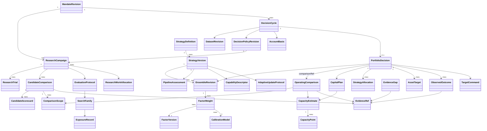

关系表达的是规范引用的业务语义，不新增替代实体、持久化平台或调度器。协调与持久化复用官方 Durable；科学与精确资金运算复用 Rust/原生库；下游仍是已有授权 target 接口。LLM 可以提出假设、解释取舍及安排调查，不能用文字生成不存在的市场证据、统计量或容量。

<a id="acceptance--7-统计治理动态学习不能扩大独立证据的含义"></a>

## 7. 统计治理：动态学习不能扩大独立证据的含义

<a id="acceptance--71-家族与搜索范围"></a>

### 7.1 家族与搜索范围

搜索家族使用规范 `SearchFamily`、`EvaluationProtocol` 与 `ExposureRecord`，不另建 ResearchFamilyLedger。其统计审计证据必须涵盖经济假设与数据范围、父/兄弟研究关系、实际尝试、配置与方法选择、观察过的指标族、原始尝试数、可比已完成数、有效尝试数估计及其不确定性、最终选择事件。规范 countedAttempts/failedAttempts/effectiveTrialEstimate 与 trial/methodVariant/exposure 引用承担可核查来源；可比已完成数、参数变体详情和选择时点由这些引用的审计证据保存，不能由一个总试验数代替。

尝试次数不是工具调用次数；资源预算计数与统计搜索计数要分开。失败/取消/无结果仍属于尝试轨迹，但不能伪造一个零收益列放入统计模型。重放同一确定性计算不是新独立试验；改变特征、窗口、分割、权重、资本或筛选指标的择优过程则不能通过新会话隐藏。相近策略之间存在相关性，不能无依据断言所有尝试独立，也不能把有效尝试数设为 1。

DSR 研究指出多重搜索与非正态收益会使报告的 Sharpe 过于乐观；本文据此要求披露完整搜索范围及方法输入，不规定一个通用“DSR 过线即投资”的阈值。参见 [Bailey 与 López de Prado，2014](https://www.davidhbailey.com/dhbpapers/deflated-sharpe.pdf)。

<a id="acceptance--72-依赖与样本边界"></a>

### 7.2 依赖与样本边界

- 标签跨度重叠时，训练和测试的分界必须依据真实标签完成区间及 purge/embargo 语义；固定删几个样本不能代替边界证明。
- 时间自相关、共同市场暴露和重叠持有期意味着“10000 行”不等于“10000 个独立观测”。不确定性方法必须声明依赖假设。
- 不能把缺失日填零后提高样本量；不能通过排除亏损日、不可交易日或失败标的获得漂亮统计。
- 协方差正则化/估计窗口/块长度等方法选择只能使用当时可用的开发证据，方法选择本身也参与搜索记录。
- PBO/CSCV 需要完整、可比较的候选表现资料和清楚的选择规则；不能拿几个互不匹配的汇总 Sharpe 计算一个貌似科学的 PBO。相关研究讨论的是搜索后过拟合风险，并不自动解决全部因果或执行偏差。参见 [Bailey 等，2015/2017](https://www.davidhbailey.com/dhbpapers/backtest-prob.pdf)。

<a id="acceptance--73-三条连续更新通道"></a>

### 7.3 三条连续更新通道

| 通道 | 可以动态更新 | 不允许的操作 |
|---|---|---|
| 运行观测 | 当前账户、容量、费用、亏损路径和数据质量 | 把不断观察的描述性波动称为新的独立显著性 |
| 模型开发 | 已公开的历史/验证/到期前瞻结果；生成下一版候选 | 更新后回到同一旧 HELDOUT 宣称未见样本 |
| 统计晋级 | 原登记的未见区间；适用的固定区间或合法顺序方法 | 每天反复用固定样本检验，首次好看时停止并声称原置信度 |

连续观察可选择预先定义的评价窗口，或适用且验证过的顺序推断方法。Confidence sequence 文献提供跨时间有效的区间框架，但其概率/尾部/依赖前提必须满足；不能直接给金融厚尾、相关收益套一个公式并宣称 anytime-valid。参见 [Howard、Ramdas、McAuliffe、Sekhon，2021](https://arxiv.org/abs/1810.08240)。

<a id="acceptance--74-旧结果可以用于学习但不可重新密封"></a>

### 7.4 旧结果可以用于学习，但不可重新密封

过去的独立结果被 PM、模型或开发者查看后，可以成为后续开发数据。新版本必须记录该暴露关系，并在未来新结果上评价。原版本在其原区间上的独立评价历史仍然存在；改变版本后不能继续沿用同一“独立通过”标签。滑动窗口中已看过的重叠部分不重新变独立。

动态更新采用规范 `AdaptiveUpdateProtocol`：eligibleTriggers、maturityRuleRef、updateMethodRef、trainingWindowRuleRef、modelSelectionProtocolRef、riskAndCostRefreshRuleRef、evidenceFreshnessRuleRef、resourceBudgetRef、allowedParameterDomain 与 outOfDomainAction 共同定义可自动更新范围；wholeProcessValidationRefs 保存整个过程的验证，不能由单个固定权重回测代替。

动态算法作为整体也需验证：测试时每个时点只使用当时可见信息，重现其学习、因子替换、容量和权重更新全过程，而不是事后拼接每个阶段最好的策略。真实收益归属于当时实际采用的配置；后见之明重算的最优权重仅属反事实研究。

<a id="acceptance--8-未知如何自动产生下一步工作"></a>

## 8. 未知如何自动产生下一步工作

未知不是单个 `BLOCKED` 标签。每项未知要说明被阻断的主张、可继续的行为和系统下一步。

| 未知类型 | 自动补证据动作 | 补证据期间的业务结论 | 不可接受替代 |
|---|---|---|---|
| 缺完整日估值 | 核对原账户快照/价格/现金流并等待完整日闭合 | 不声称该日收益或路径稳定；其他完整时段仍可描述 | 填零、删日期、前向填价冒充交易估值 |
| 新因子样本不足 | 在既有预算内收集/计算开发证据，或安排前瞻观察 | 不授予独立可信度；可继续假设研究 | 复制样本、降低标准直到通过 |
| 候选依赖不清 | 对齐共同可用样本，计算依赖/暴露与敏感性 | 不声称新增因子带来分散化 | 将未测相关设为零 |
| 经济容量缺失 | 获取合规可读的实际执行/费用资料，校准模型或等待前瞻观测 | 条件物理上限与经济未知并列；不自动扩大配置 | 拿 BAR notional 或固定参与率当收益容量 |
| 费用规则存在矛盾 | 对齐规则有效期与实际成交来源，保留冲突 | 不能比较受影响候选净结果 | 取最便宜规则或默认为零 |
| 独立区间已暴露 | 登记暴露，等待未来符合范围的新结果 | 旧结果降为开发/历史重评；保留既有事实 | 新建会话/改 ID 重置独立性 |
| 资金/持仓不明 | 调原账户核对接口，保留未知提交的原身份 | 不增加新不确定敞口，继续核对 | 猜空仓、重新提交目标 |
| 方法不适用 | 查已验证方法注册；无匹配时生成方法验证工作 | 描述性结论与推断未知分开 | 自动换一组能显著的方法 |
| 外部来源不支持 | 记录能力缺口、尝试已有授权替代来源；无来源则待机会 | 明确无法完成的特定主张，不要求用户伪造参数 | 无限轮询或把用户估计当市场证据 |

同一未改变的缺口应共用工作项，状态改变才触发新判断。补证据任务消耗自己的可见资源预算；预算耗尽进入 `EXHAUSTED`，不得无限计算。不存在新信息时系统可以等待，不需要持续交易或持续生成解释。

<a id="acceptance--9-场景输入--决策--证据业务验收集"></a>

## 9. 场景输入 → 决策 → 证据：业务验收集

以下数值仅用于可复现反例，均非产品默认阈值。每例应由一个固定的场景输入包、可重放事件顺序和实际决策输出证明。不得用 mock 返回某个预写结论替代科学计算。允许先以受控原生场景验证逻辑，再以已授权的真实数据验证适用性；二者证据等级不能互换。

<a id="acceptance--a01同-sharpe不同亏损路径"></a>

### A01：同 Sharpe、不同亏损路径

**输入**：完整净日收益 A 为 `[.02,.02,.02,-.01,-.01,-.01]`，B 为 `[.02,-.01,.02,-.01,.02,-.01]`，同初始资本、零外部现金流、同口径。原业务意图偏好较平缓的亏损路径。

**决策**：两者 Sharpe、总收益和亏损日数相同不能导致系统声称等价。应显示最大回撤 A `2.9701%`、B `1%`，最长连续亏损 A `3`、B `1`；根据已记录偏好解释 B 的路径优势，同时承认六天不足以建立未来稳健性。

**证据**：原序列、完整日覆盖、指标方法、逐日财富路径、比较记录。若没有业务偏好，则保留可比较差异而不猜唯一最优。

<a id="acceptance--a02相同比率不等于满足本金收益目的"></a>

### A02：相同比率不等于满足本金收益目的

**输入**：无风险基准为零时，将一组非退化净日收益全部乘以正数 `0.1`，算术 Sharpe 不变；两组应用于相同可用本金。另提供原业务收益与路径偏好。

**决策**：输出实际金额与回撤差异，不把同 Sharpe 解释为同等经济价值。不能直接乘十配杠杆：另行考虑成本非线性和授权。

**证据**：本金、收益单位、日净金额、风险与交易可行性、未用 Sharpe 替代效用的比较。

<a id="acceptance--a03多数盈利日与一次巨大亏损"></a>

### A03：多数盈利日与一次巨大亏损

**输入**：A 多数日期小赚，但一个日期亏损显著；B 盈利日比例较低但尾部较轻。使用同区间、可比净成本与完整样本。

**决策**：高胜率不能自动晋级；比较累计与几何净增长、最坏日、损失幅度及回撤。若收益与尾部形成真实权衡，应输出 tradeoff，不伪造所有维度都占优。

**证据**：完整分布/原路径、尾部样本量、区间不确定性与业务优先序。

<a id="acceptance--a04缺失日不是零收益日"></a>

### A04：缺失日不是零收益日

**输入**：A 有十个预期完整日，其中两个无估值；B 同十日有八个交易日、两个被完整定价证明的持币/现金零收益日。

**决策**：A 的完整日路径统计不足并触发估值补证据；B 可以按真实零日计算。不能让 A 与 B 共享同样“完整覆盖”的结论。

**证据**：expected/observed/confirmedZero/missing/unpriced/partial counts；原估值状态与补证据任务。

<a id="acceptance--a05本金流入不能成为策略收益"></a>

### A05：本金流入不能成为策略收益

**输入**：账户权益从 `1000` 变 `1500`，期间外部入金 `500`，持仓价格不变且无成本。并有来源完整的现金流记录。

**决策**：账户策略收益为零，资金可用量增加可能触发新配置评估；不得记成 `50%` 回报并因此提高因子权重。

**证据**：现金流与权益来源、原收益口径、资金触发和收益触发的分离。

<a id="acceptance--a06已含费用的净收益不得重复扣费"></a>

### A06：已含费用的净收益不得重复扣费

**输入**：原生结果明确净 P&L `8`、已计费用 `2`；独立费用明细也为 `2`。

**决策**：净结果保持 `8`，费用归因展示 `2`；不能计算成 `6`。只有来源说明允许时才导出毛值，不从不完整成本资料猜毛收益。

**证据**：收益口径、费用模型版本、实际计费位置与总额核对。后续成本情景另存为情景结果，不能覆盖原事实。

<a id="acceptance--a07未平仓亏损不能藏在已实现收益后面"></a>

### A07：未平仓亏损不能藏在已实现收益后面

**输入**：若干平仓交易获利，同时一个未平仓仓位有可用公允估值且亏损更大。

**决策**：PM 以同一账户含未实现损益的净值路径判断；已实现胜率可作诊断，不得代替账户日净收益。估值缺失时明确未知。

**证据**：账户净值、已实现/未实现归因、估值时点与数据来源。

<a id="acceptance--a08复制因子不能增加经济信念"></a>

### A08：复制因子不能增加经济信念

**输入**：原有 F1，再加入预测/交易需求完全相同但换名的 F2；同一底层市场、账户和数据。

**决策**：系统识别冗余，不因成员数或“两个都优秀”而增加总经济暴露；可以保留一个代表、按等价类记录，或在相同总暴露下分配内部权重。

**证据**：因子版本、预测与目标对齐、相关/等价判断、共同资产风险、入池净增益。

<a id="acceptance--a09较弱单因子可能改善组合也可能被成本抵消"></a>

### A09：较弱单因子可能改善组合，也可能被成本抵消

**输入**：F2 单独 Sharpe 低于 F1，但在 F1 亏损时期有互补收益。分别提供低换仓成本与高换仓成本两个相同信号场景。

**决策**：系统重新求解联合组合及过渡路径；在确有净改善的受控输入下可加入 F2，高成本下可不加入。不能硬写“低相关一定加入”或“只留最高 Sharpe”。

**证据**：同样本共同账户模拟、incumbent 比较、权重来源、费用和不确定性敏感性。

<a id="acceptance--a10共享市场容量不能加总"></a>

### A10：共享市场容量不能加总

**输入**：两因子同时要求买入同一低流动性标的，各自单独评估都使用同一份流动性。另给相反方向目标的可净额场景。

**决策**：同向合计需求共享一次流动性预算；相反方向在下游净额语义确实支持时按净交易评估成本。不能单纯相加独立容量，也不能把净交易相消解释成风险/相关性已经消失。

**证据**：共同账户净目标、当前持仓、共享预算分配、成本、风险敞口和执行适配语义。

<a id="acceptance--a11容量变化应影响组合而非只有总资金缩放"></a>

### A11：容量变化应影响组合，而非只有总资金缩放

**输入**：原组合在市场 X/Y 上投资；新增真实流动性证据仅显示 X 收缩，Y 机会与条件不变。

**决策**：系统重估 X 的可行与经济贡献，再比较保留、减 X、转 Y、保留现金等方案；不得无条件同比缩小所有标的。若 Y 的风险/成本使转移不值得，保留现金是合法结果。

**证据**：新旧容量曲线、最紧约束、联合优化输入、资产目标及决策差异原因。

<a id="acceptance--a12小本金与最小订单造成非线性"></a>

### A12：小本金与最小订单造成非线性

**输入**：候选组合需要多个最小交易单位，在较大本金可行；账户可用资金下降到无法实现该组合的金额，但某个简化组合可能可行。

**决策**：重算组合构成、离散交易需求及净表现；可选择简化组合或不配置。不得线性缩小后输出下游无法交易的碎额，也不要求用户手动删因子。

**证据**：真实最小单位、舍入后目标、剩余现金、替代组合比较、费用占比。

<a id="acceptance--a13入金取款和当前持仓改变可投资资金"></a>

### A13：入金/取款和当前持仓改变可投资资金

**输入**：账户新增现金、资金退出预留或已持有头寸改变，信号证据保持不变。

**决策**：自动使用权威可用资金和净交易差额；资金新增不保证必须投满，取款也不能让系统假装持仓已卖出。原因子预测权重未必改变，资金与标的目标可以改变。

**证据**：资金控制修订、真实持仓、预算、退出义务、三种权重分别记录。

<a id="acceptance--a14经济容量未知不能靠固定参与率补出"></a>

### A14：经济容量未知不能靠固定参与率补出

**输入**：有历史 BAR notional 和最小订单，但无可靠市场影响/真实费用或退出资料。

**决策**：保留有依据的条件物理估计，经济容量为未知；自动请求执行数据/校准或前瞻观察。不得要求用户猜一个容量金额才能继续，也不能默认为无限或零后统一解释为策略失效。

**证据**：物理与经济状态分离、缺失主张、可继续动作、EvidenceGap 和来源能力。

<a id="acceptance--a15微小信号更新不应制造无效换仓"></a>

### A15：微小信号更新不应制造无效换仓

**输入**：现有持仓与新候选预测仅有很小差异；明确的过渡费用高于受控场景里的毛改善。再给毛改善大于成本且风险适用的对照。

**决策**：前者保留，后者可以调整；两者均由同一方法与输入计算，而非硬编码次数/差值。未知的预期改善需要反映不确定性。

**证据**：incumbent 可执行路径、候选路径、净增益、成本一次计入、持有/调整原因。

<a id="acceptance--a16原目标过期后必须重算不能续时间戳"></a>

### A16：原目标过期后必须重算，不能续时间戳

**输入**：源目标和容量到期，但账户快照持续刷新；随后新市场证据到达。

**决策**：过期期间不能用新账户时间戳延长旧投资主张；系统自动补新数据并重建信号、组合和容量。新证据到达后生成新修订，不要求用户新建研究或重填比例。

**证据**：原/新目标与证据引用、as-of、有效期、自动补证据任务和新决策。

<a id="acceptance--a17因子失效与执行失真应得到不同调查"></a>

### A17：因子失效与执行失真应得到不同调查

**输入**：一组前瞻结果中，预测方向仍有信息但实际滑点上升；对照中执行符合假设但信号与结果关系衰减。

**决策**：前者优先更新执行成本/容量与是否值得继续，后者更新因子信念及候选研究；不能把两者都归因于“Sharpe 下跌”后随意换权重。若证据无法归因，输出未知并请求补证据。

**证据**：当时预测、持仓与订单/成交、价格基准、费用、可归因范围和剩余残差。

<a id="acceptance--a18并行搜索不能重置多重比较"></a>

### A18：并行搜索不能重置多重比较

**输入**：同一经济假设/相同数据，两个 agent 或两个会话分别尝试一批相近模型，最终只提交最佳者。

**决策**：合并可识别研究家族、披露全部实际搜索，不得只按最后会话的一个候选评价可信度。不能靠删除失败记录缩减搜索范围。

**证据**：跨会话家族关系、方法/特征/权重尝试、结果暴露、原始与有效次数估计及其不确定性。

<a id="acceptance--a19换优化目标也是搜索"></a>

### A19：换优化目标也是搜索

**输入**：先按 Sharpe 不理想，随后依次尝试净收益、Sortino、某个日期子集，最后挑一个最好的叙事。

**决策**：新目标/子集记录为方法选择；不能事后修改原 mandate 把失败研究变成功。新目标可以成为新研究，但历史搜索及暴露仍保留。

**证据**：目标修订、理由、选择时间、数据暴露与原结果不变。

<a id="acceptance--a20标签重叠导致的泄露"></a>

### A20：标签重叠导致的泄露

**输入**：标签期限跨越训练/测试边界，或某时点结果尚未成熟；提供精确 event/available/label-mature 时钟。

**决策**：训练与评估范围按原方法排除相交信息，未成熟标签不进入学习；无法构造足够有效样本时明确不足，而非缩短隔离到能跑。

**证据**：实际标签区间、每折范围、purge/embargo 推导依据、样本计数变化。

<a id="acceptance--a21每天查看独立样本不能保持独立资格"></a>

### A21：每天查看“独立样本”不能保持独立资格

**输入**：模型每天查看同一 HELDOUT 的新增汇总，并据此改变因子权重，直到指标达标。

**决策**：该区间被用于开发，不能继续标为同一个未见检验；新版本在未来未暴露区间评价，或使用事先注册且满足前提的顺序程序。不能重新命名样本恢复资格。

**证据**：访问/反馈暴露、版本变更时间、inferential method、未来区间登记。

<a id="acceptance--a22连续监控描述可以刷新显著性主张不自动刷新"></a>

### A22：连续监控描述可以刷新，显著性主张不自动刷新

**输入**：一个已冻结配置被每日观测，未改变配置；系统显示累计均值、亏损日等，同时用户可随时看。

**决策**：描述性指标可每日刷新；正式推断遵循预登记固定评价或适用的顺序方法。首次漂亮时停止不能继承单次检验置信度。

**证据**：monitoring 与 inference 两种输出、评价时点、停止规则、方法适用性。

<a id="acceptance--a23新权重不能继承原策略独立通过"></a>

### A23：新权重不能继承原策略独立通过

**输入**：两个因子各有独立历史结果，用户或系统看过后选择新组合比例和本金，再在原区间重算。

**决策**：可报告新组合的条件历史重评；新组合的独立资格未建立，需未来/新未暴露证据。不能把成员资格与原区间收益拼接成组合资格。

**证据**：配置版本、学习所用结果、样本暴露、原/新独立结论分别保存。

<a id="acceptance--a24历史数据修订不能改写当时表现"></a>

### A24：历史数据修订不能改写当时表现

**输入**：数据供应商在 t2 修正了 t1 已经使用的一条价格或费用记录。

**决策**：保存当时可见版本和原决策；修订触发新的纠错重算与当前判断，不将修订前策略换成“当时就知道”。如果原证据失效，应标明受影响结论。

**证据**：source revision、availableAt、旧/新计算、受影响 lineage 与纠错决定。

<a id="acceptance--a25资源预算耗尽仍需要完成已有候选判断"></a>

### A25：资源预算耗尽仍需要完成已有候选判断

**输入**：搜索计算预算刚好耗尽，已有可比较候选；另一个输入中所有尝试均失败或不可比较。

**决策**：前者关闭新候选计算但保留原证据读取、比较与结项，形成选择/不选择/不足结论；后者诚实结项为无可判断候选。不得为了结项增加新科学搜索预算，也不能因为预算事件丢弃已有决策机会。

**证据**：资源预算与科学尝试记录、closing 阶段允许的能力、实际最终比较。模型响应次数不是科学结论。

<a id="acceptance--a26撤出候选池不等于仓位消失"></a>

### A26：撤出候选池不等于仓位消失

**输入**：一个因子退出候选池，但其交易曾产生仍在账户中的头寸，且退出流动性有限。

**决策**：学习层停止给该因子新增信任/资金，与持仓层安排可执行的持有/减仓/退出分开。不能删除因子后遗漏已有持仓，也不能凭目标令历史归因断裂。

**证据**：因子状态、实际持仓、退出可行路径、资金占用和决策归属。

<a id="acceptance--a27数据缺失恢复后自动回到有意义的研究"></a>

### A27：数据缺失恢复后自动回到有意义的研究

**输入**：最紧容量标的暂缺报价，随后相同来源恢复可用新报价；期间其他标的数据持续可用。

**决策**：系统对受影响判断产生补证据并限制相关行动；不将缺失当永久因子失败。恢复后自动重算相关组合，并根据实际净结果决定是否恢复配置。不得永久停在一个无人处理的 `BLOCKED` 状态。

**证据**：缺口工作项的状态转移、范围限定、恢复事件和新的投资决定。

<a id="acceptance--a28因子单位不同不得直接拼权重"></a>

### A28：因子单位不同不得直接拼权重

**输入**：一个模型输出标准化分数，另一个输出预测期收益率，第三个输出方向概率。

**决策**：有验证过且仅使用过去可用资料的校准映射才比较融合；否则维护不同接口或记录校准不足，不因都为浮点数而求和归一化。

**证据**：forecast unit、horizon、calibration version、训练截止和融合解释。

<a id="acceptance--a29重复重算与信息变化的边界"></a>

### A29：重复重算与信息变化的边界

**输入**：先重复接收相同数据/账户版本，再只改变报价可用时间但不改变经济内容，最后加入真正改变成本的新证据。

**决策**：可以更新证据有效性，但不得把重复输入当新增独立样本、投资增益或额外试验。只有足以影响判断的变化才产生新的投资行动；新证据即使触发重算，也可得 `HOLD`。

**证据**：语义输入身份、旧/新事实差异、样本新增计数、行动理由。

<a id="acceptance--a30无法求解不应退回等权"></a>

### A30：无法求解不应退回等权

**输入**：约束互相冲突、收益单位无法对齐或科学求解没有有效解。

**决策**：记录具体不可解原因，比较是否保持现有可行路径或暂停新增；产生需要修复的证据/业务矛盾。不能用等权、随机或上次权重伪装新最优解；沿用原持仓必须作为明确的 HOLD 决策单独说明有效性。

**证据**：原生求解状态、约束来源、当前持有可行性与补证据/纠错任务。

<a id="acceptance--10-五个闭环验收故事"></a>

## 10. 五个闭环验收故事

单场景通过只说明局部语义。以下故事检验跨阶段是否确实连通。

<a id="acceptance--故事-i从未知机会到可解释配置"></a>

### 故事 I：从未知机会到可解释配置

从既有可用市场目录与账户启动，用户不填权重/容量。系统提出并登记候选，保留失败尝试，形成可比较账户证据；发现成本缺口后自动补证据；比较 incumbent/候选/不新增投入；形成新配置与条件容量；在原授权范围内准备目标。审阅者从目标能够反查原候选和每个关键估计，而不是只有一段 LLM 推荐。

<a id="acceptance--故事-ii市场变化后的自动重配置"></a>

### 故事 II：市场变化后的自动重配置

注入新价格/流动性、资金变化及新成熟标签。系统重估机会、依赖、成本与容量，输出 HOLD 或实际变化。重配置不得假定原池/原比例永远有效，亦不要求用户重新创建研究。需要看到变更原因对净收益、路径与成本的贡献。

<a id="acceptance--故事-iii亏损后的归因与有限学习"></a>

### 故事 III：亏损后的归因与有限学习

出现真实亏损路径。系统区分现金流、估值问题、执行差异与模型表现；不能简单“亏几天就删因子”。需要新的假设时登记新尝试，并保留旧结果。已暴露前瞻数据可以参与下一版开发，下一版晋级使用新独立机会。

<a id="acceptance--故事-iv未知恢复与选择继续等待"></a>

### 故事 IV：未知、恢复与选择继续等待

重要输入缺失时系统发起补证据，限制受影响动作，保留不受影响工作。补证据恢复则自动重新判断；未恢复时给出真正的等待/不支持原因及下一触发。等待不应被解释成资金安全已获证明，也不应靠用户猜参数解除。

<a id="acceptance--故事-v连续算法整体的前瞻重放"></a>

### 故事 V：连续算法整体的前瞻重放

冻结系统方法及当时信息访问规则，在一段未用于挑选该方法的时间序列上依次开放事件，完整重演因子/权重/容量/资金决策。输出是实际策略版本随时间串联的一条账户路径，同时记录未被选中的候选。不能拼各时段事后赢家；不能用一次未来全样本估计贯穿整个回放。

<a id="acceptance--11-必须纠正的设计陷阱"></a>

## 11. 必须纠正的设计陷阱

| 陷阱 | 为什么业务上错误 | 合格修正 |
|---|---|---|
| 将几个新指标加到详情页便宣布 PM 改造 | 没改变任何选择和资金决定 | 相同输入下证明比较/决策实际使用证据 |
| 用单个综合分数掩盖维度 | 效用权重和尺度会偷偷决定取舍 | 明确偏好来源、展示支配/权衡及反事实 |
| 新建一排用户阈值表单 | 把系统责任推回用户且易导致事后调阈值 | 技术估计自动化；价值冲突用业务语言表达 |
| 固定权重只随净值缩放称为动态组合 | 池、预测权重、资产风险分配未变化 | 区分三种权重并验证各自更新条件 |
| 物理容量等同盈利容量 | 能成交不表示成本后有收益 | 两种状态、资金曲线、经济未知分别保存 |
| 历史高容量永久作为上限 | 市场、策略和退出条件随时间变化 | 容量绑定配置、账户、时点和新证据 |
| 所有坏指标都触发卖出 | 无法区分噪声、执行问题与经济失效 | 比较保持、减仓、退出的净结果和不确定性 |
| 不调仓/现金视为无风险免费基准 | 现有仓位、现金利息/汇率、退出成本仍存在 | 构造同账户可执行的替代路径 |
| 所有零/缺失/不适用合并 | 直接扭曲收益、样本量与比较 | 明确 evidence status 及补证据路径 |
| DSR/PBO/CPCV 被当成通用认证章 | 方法前提、数据和搜索范围可能不成立 | 先验证适用性；结果不能替代经济判断 |
| 自动调参后继续用原 HELDOUT | 独立性已被消费 | 新版本显式暴露关系，后续新证据评价 |
| 并行 agent 新会话重置试验次数 | 选择偏差随全搜索家族累积 | 跨会话 lineage 与完整试验家族 |
| 将网络轮询频率当策略再平衡频率 | 计算活性不代表经济变化 | 重算与交易分别决策 |
| 未知全部冻结或默认放行 | 前者让系统失去自主性，后者伪造可行 | 限定受影响范围、自动补证据和恢复 |
| 测试服务 ACK 等于实盘赚钱 | 传输、执行、账户绩效不同 | 按证据层级分别报告 |
| 正确求解等于正确投资 | 输入预测、依赖和目标可能不成立 | 求解前后验证经济语义和样本外行为 |

<a id="acceptance--12-主方案审阅时的判定口径"></a>

## 12. 主方案审阅时的判定口径

主方案需要为每个对象给出字段定义、生产者、消费者、更新触发、与原系统的连接点和失败/未知后的业务去向。对于每个关键假设，至少绑定一个上述反例；若使用其他机制，需要说明如何产生同等可核验事实。

不按“新增多少接口/测试通过多少/用了多少 agent”判断达成。合格证据至少包含：

- 一个完整因果决策重放包，覆盖新数据、配置变化、资金/成本约束和后续结果；
- 一份候选真实比较记录，能说明为何选这个而非当时其他可行方案；
- 一段系统自行补证据并恢复判断的过程；
- 一次搜索家族/独立暴露/配置版本不能被绕过的反例；
- 对现阶段不支持的市场影响、数据接入或前瞻统计能力作准确边界声明，且保留可继续工作。

本文不要求每一轮必须更高收益，也不要求每个新增因子一定被采用。验收的是决定有真实依据、能够面对变化而更新、不会通过错误统计或隐藏假设制造信心，并能持续产生下一步有价值的研究与配置行动。

<a id="acceptance--13-通用化的验收策略原型与能力边界"></a>

## 13. 通用化的验收：策略原型与能力边界

项目的通用性不能由多加几个 `strategy.kind` 字符串证明。不同策略可以共享研究账本、因果输入、资金、证据和决策合同，但其经济机制、预测含义、执行与损益语义必须保持明确。

<a id="acceptance--131-策略原型不是强制支持列表"></a>

### 13.1 策略原型不是强制支持列表

下面的原型是需求边界样本，**不是声称当前仓库已支持这些策略**。应先对现有 threshold、cross-market threshold、catalog ensemble 注册真实能力，再允许经过验证的适配扩展。当前 `StrategyPolicy` 的有限 union 和 `multi_currency_spot_cash_not_integrated` 拒绝路径已经证明，原生存在某类能力与当前服务已集成是两回事。

| 原型 | 核心经济对象 | 需要的特殊证据 | 不能共用的错误近似 | 未具备能力时可做什么 |
|---|---|---|---|---|
| 方向/趋势/均值回归 | 可交易资产上的因果预测或明确分数规则 | 调整后的价格、交易时段、执行费用、持仓路径 | 任意分数当收益率；信号即持仓 | 因子诊断/条件模拟，清楚标识能力 |
| 截面排序/轮动 | 同时可交易且具可比预测的资产集合 | 历史成分、退市/新上市、单位与行业/共同风险 | 用今天成分回测过去；缺标的填零 | 限定有完整时间点成员资料的范围 |
| 事件/预测市场 | 有截止、结算、支付函数的合同 | 事件时点、可得信息、条款、结算和费用规则 | 把最后成交价当确定兑付；忽略锁资 | 条件机会研究，不授予真实结算套利资格 |
| 跨市场价差/套利 | 多条腿共同构成的经济头寸 | 可同时成交报价、两腿容量、资金/币种、转移及结算时间 | 用两个历史收盘价之差当可兑现套利 | 描述性价差/前瞻采集；不得发布套利保证 |
| 流动性提供/做市 | 报价、队列、库存与不利选择 | L2/队列或有验证的成交模型、延迟、撤单、实际 fill | BAR 穿过报价即全部成交 | 模型能力研究/条件模拟；执行资格独立 |
| 衍生品/资金费策略 | 保证金、资金费、到期、基差及清算 | 合约乘数、历史费率、借贷/保证金、结算 | 用现货 long-only 账户代理全部风险 | 只支持已有明确合同和原生适配的子范围 |

选择一种不支持的原型应得到具体缺口和可继续任务，不应把它悄悄映射成某个支持的 threshold 模板。反过来，研究一个因子并不要求具备完整账户/执行能力；因素研究可独立交付有边界的证据。

<a id="acceptance--132-能力不是一个支持不支持布尔值"></a>

### 13.2 能力不是一个“支持/不支持”布尔值

能力、证据质量、授权、当前可用状态分别建模：一个功能可以技术支持却缺数据；可以有完整历史模拟却没有运行数据；可以具备运行适配但未获目标交付授权。

| 验收维度 | 统一合同映射 | 边界要求 |
|---|---|---|
| 经济机制与失败条件 | `StrategyDefinition.archetype/economicMechanism/falsificationConditions/knownFailureModes` | 原型只是方法适用域，不保证其数据/执行能力已接通 |
| 预测与执行语义 | `StrategyVersion.signalContractRef/portfolioRuleRef/executionRuleRef/exitRuleRef` | 单位、horizon、因果状态和账户损益完整 |
| 技术能力 | `CapabilityDescriptor.strategyArchetypes/dataKinds/predictionUnits/accountingModels/executionModels/supportedOperations/boundaries` | 每项 operation 使用规范 SupportState；CONDITIONAL 必须给具体条件 |
| 当前证据 | `PipelineAssessment.outcome/evidenceRefs/reasonCodes/nextPermittedActions`、`EvidenceGap` | 技术支持不代表当前数据充分，阶段 READY 不代表永久投资资格 |
| 业务授权 | `MandateRevision.operatingAuthority/ownerBoundaries` 与原授权引用 | 历史模拟支持不自动允许目标交付；不能借补数据扩大授权 |
| 当前版本适用性 | `StrategyVersion.capabilityBindingIds/pipelineAssessmentId` | 对应具体策略版本、时间、市场与方法；其最新评估由规范版本/活动引用规则解释 |

这些维度组合形成能力结论，不另定义 `StrategyArchetypeDefinition` 或 `CapabilityAssessment` DTO。缺少某一维度时保留具体缺口和可继续动作，不用一个布尔“支持”覆盖全部意义。

规范 `SupportState.CONDITIONAL` 需要可读的具体条件，不能成为无限制放行的后门。自动获取数据必须在原授权及来源许可范围内；未知源不能由 LLM 自行编成“已接入”。扩展应只添加经济/科学适配和能力声明，避免把每种策略复制成一套独立 service、调度、账本、指标和 UI。

<a id="acceptance--133-对通用的实际验收"></a>

### 13.3 对“通用”的实际验收

用两个已支持但输入/执行语义不同的策略完成同一研究到决策过程，检查共同合同是否保持语义；再用一个不支持原型证明系统明确识别能力缺口并安排有价值的下一步。仅展示插件能注册或 JSON 能反序列化不算通过。

<a id="acceptance--14-完整生命周期发现研究晋级监测退役重开"></a>

## 14. 完整生命周期：发现、研究、晋级、监测、退役、重开

<a id="acceptance--141-不要用单一状态混合所有问题"></a>

### 14.1 不要用单一状态混合所有问题

`COMPUTED` 是一次计算结果，`ACTIVE` 是是否被当前组合使用，`INDEPENDENTLY_ASSESSED` 是证据属性，`CAPACITY_UNKNOWN` 是某项业务判断。四者不能折叠成一列 `GOOD/BAD`。

| 领域生命周期 | 规范状态/事实 | 状态转移依据 | 不应产生的副作用 |
|---|---|---|---|
| 假设/研究 campaign | `ResearchCampaign.state`：PLANNED、SEARCHING、CLOSING、EVALUATING_INDEPENDENT、CONCLUDED、PAUSED；证据等待由 EvidenceGap 表达 | 数据能力、资源分配、试验结果、conclusionReason | 结项不删除试验；基础设施失败不证伪假设 |
| 因子版本 | `FactorVersion.status`：RESEARCH、ELIGIBLE、DEGRADED、RETIRED；training/validation evidence 独立保存 | 原证据与适用范围；独立评价按规范 evidence role 与关联评估表达 | 有历史独立结果不自动永远可配置 |
| 假设处置 | `Hypothesis.state`：PROPOSED、TESTING、SUPPORTED、REFUTED、INCONCLUSIVE、RETIRED | 原经济问题与可核查证据 | 不能把暂缺数据自动当 REFUTED |
| 组合修订 | `EnsembleRevision.qualification`：CANDIDATE、SELECTED、INDEPENDENTLY_EVALUATED、RETIRED | 配置/方法的原比较与独立规则 | 后继版本不能继承独立资格；当前被采用关系由 PortfolioDecision 引用 |
| 策略阶段 | `PipelineAssessment.stage/outcome/nextPermittedActions` | IDEA 到 RETIRED 的适用能力与原证据 | READY 只针对原阶段/版本，不表示永远适用 |
| 运行决定 | `PortfolioDecision.action/status` 与 TargetCommand 原回执 | 原授权、回执、事实与有效性 | ACK 不变成盈利或持仓完成；过期目标不续时间戳 |
| 补证据 | `EvidenceGap.state`：OPEN、IN_PROGRESS、RESOLVED、UNRESOLVABLE | 来源/样本/方法能力及官方 Task 进展 | 资源耗尽、等待来源等原因在业务事实保存，缺口未满足不能 RESOLVED |

实际状态枚举只由 contracts.md 定义，本文不再另列 WATCH/INCLUDED/RETIRING 等候选 wire 状态。某因子当前被保留、降配或移出，由 EnsembleRevision/PortfolioDecision 的新旧比较说明；需要退出的持仓义务继续保留。转移审计需记录原/新事实引用、时点、理由、决定和证据；生命周期状态与官方 Task 状态不混用。

<a id="acceptance--142-发现与淘汰需要保留经济解释"></a>

### 14.2 发现与淘汰需要保留经济解释

系统发现候选应有明确来源：已知机制与数据映射、新市场结构、已有因子解释不了的残差、执行/预测偏差、互补性缺口、系统性样本不足等。随机生成大量 Wasm 再挑回测赢家不等于专业研究。

淘汰原因应分开：经济假设不受支持、被已有因子替代、估计不稳定、成本后无增益、当前容量不实用、适配不支持、证据污染、运行暂不可用、资源竞争下优先级低。它们对应不同后续行动；不能统一记为“低 Sharpe”。

重开研究需要新的事实或不同的明确假设，并关联原失败、搜索家族与暴露历史。改名、重新发起 conversation 或换 agent 不能洗掉失败与研究预算。已归档但仍可解释过去决策的模型、条款、数据与账本不能物理删除。

<a id="acceptance--143-退役包括持仓与归因尾部"></a>

### 14.3 退役包括持仓与归因尾部

因子退役可立即停止新研究/新增信任，但由它生成的持仓、延迟成交、结算与费用仍需追踪。运行层应该有明确 successor/exit plan；如果退出不可立即执行，保留持仓风险及资金占用。退役前后真实 P&L 依然归属于当时决策与实际仓位。归档不能重置本来应记录的后续亏损。

<a id="acceptance--15-自动研究预算与个人-pm-的轻量治理"></a>

## 15. 自动研究预算与个人 PM 的轻量治理

<a id="acceptance--151-研究预算是资源配置问题"></a>

### 15.1 研究预算是资源配置问题

系统应读取已有预算/授权和实际资源消耗，自己安排研究，不让用户逐个候选分配次数。至少区分模型调用成本、科学计算、数据读取/获取、前瞻等待、方法验证和最终结项所需资源。费用、CPU 时间、候选数不是同一单位，不能只给一个总计数字。

在本轮可用资源内，候选/方法的优先次序依据已知边际信息价值、经济问题的重要性、与现有机会的差异、证据可得性和预计计算成本。信息价值本身若未被估计，必须说明是可解释优先规则，不能伪造一个精确的预期利润数。

资源不足时优先保全已获得证据的解释与结项机会；不要将全部预算用于最后一个新候选而没有资源决定是否采用。阶段预算是系统内部计划，应能在原总上限内调整；每次重分配说明为何比继续原工作更有价值。原授权上限不能由 agent 自行扩大。

| 资源配置语义 | 统一合同/产物承载 | 验收需要的内容 |
|---|---|---|
| 已授权总资源 | `MandateRevision.researchBudgetRef`、`ResearchBudget` | 试验、nativeComputeSeconds、modelSpend、dataBytes 各按原单位，不自行扩大 |
| 本轮工作与问题 | `ResearchCampaign.hypothesisIds/trialIds`、`Hypothesis.incrementalQuestion/requiredDataCapabilities` | 每项工作要能回答一个有价值的未知，经济家族不因换会话重置 |
| 实际消耗 | `ResearchTrial.resourceUsageRef`、`ResearchBudget.usageEvidenceRefs` | 运行、失败与取消后已用资源仍留存，未启动预留才可释放 |
| 结项资源 | `ResearchBudget.reservationForClosureRef` | 足以读取、比较、形成结论；独立评价额度与暴露次数分别管理 |
| 优先级/再分配 | `ResearchWorkAllocation.consideredHypothesisIds/selectedHypothesisIds/nextExperimentPurpose/expectedInformationEvidenceRef/resourceEstimateRef/incumbentComparisonRef/reasonCodes/action` | 信息价值估计及前提，或明确的优先规则；原生消耗、前后余额、被替代工作与产生时点由关联证据保留 |

资源配置直接采用 contracts.md 的 `ResearchWorkAllocation`，本文不再定义同名候选类型。资源估计与预算余额的细节由已登记 schema 的证据保存，不能放任客户端借任意解释字段修改预算。

自动预算的验收应能观察到：一条便宜但已无新证据的假设停止消耗；一个可补齐的重要缺口获得资源；昂贵且缺来源的请求进入等待；已有候选得到结项。不能仅验证计数器没有超限。

<a id="acceptance--152-个人-pm-不需要企业式审批戏剧"></a>

### 15.2 个人 PM 不需要企业式审批戏剧

设计只保留一个业主身份与既有权限范围。系统可以在已授权研究/目标运行范围内自动行动，不因每次调权重新请求人工批准。无需新增四个虚构职位、双人签名、多租户角色管理或逐指标审批清单。

但轻量不等于没有治理。需要的是：

- 一个可读的意图/权限来源；
- 每个投资决定可回到当时输入和方法的简明决策记录；
- 与提议相独立的原生验证、证据投影及暴露检查；
- 用户可以暂停指定范围、查看未完成义务和恢复条件；
- 变更方法/数据后产生明确新版本，不覆盖过去；
- 对异常只报告业务影响和下一步，避免无意义告警淹没 PM。

多个 agent 提意见并不自动构成独立验证。若它们读了同一污染样本、使用同一错误口径，意见一致不增加证据。独立性来自可核验方法和访问边界，不来自角色名。

治理验收应证明“用户只表达一次目标与范围，系统能自主完成后续研究和合理调整；重要变化仍有解释和可恢复的暂停控制”，而不是证明每一步都弹了确认框。

<a id="acceptance--16-数据-pit-与运行反馈必须贯穿所有业务对象"></a>

## 16. 数据 PIT 与运行反馈：必须贯穿所有业务对象

<a id="acceptance--161-数据不是一个不断增长的-csv"></a>

### 16.1 数据不是一个不断增长的 CSV

每个输入至少记录 `sourceId`、`sourceRevision`、`instrumentTermsRevision`、`eventTimeNs`、`sourcePublishedAtNs|null`、`receivedAtNs|null`、`availableAtNs`、`availabilityBasis`、`universeMembershipRef`、`licenceScopeRef`、`qualityEvidenceRef`。其中 `availabilityBasis` 区分实际观测、经验证重建、条件代理及未知。供应商下载时间不能逆向证明历史可得时间。

修订必须追加版本并传播受影响 lineage：原历史事实保持，当期判断可受修订影响。历史成分、退市、新合约、结算和费用条款有自己的生效时间。当前可交易列表不能直接应用到全历史。

模型训练、因子比较、风险估计、容量、费用与目标生成全部使用同一决策快照的可用边界。PIT 检查若只加在特征读取处，却让当前费用规则、未来成分或未来容量进入优化，整体仍然泄露。

<a id="acceptance--162-运行归因不是将所有差异归给模型"></a>

### 16.2 运行归因不是将所有差异归给模型

需要比较当时的预测/风险/成本估计与后来真实账户结果，至少区分：

| 差异来源 | 所需事实 | 能影响的后续判断 |
|---|---|---|
| 外部现金流/计价变化 | 权威现金流、汇率/报告币、权益 | 资金预算与收益口径；不是因子 alpha |
| 预测偏差 | 原预测、期限、成熟结果、适用市场 | 校准、因子研究与权重信念 |
| 配置差异 | 原目标、真实持仓、当时未成交状态 | 组合/资金模型和实现偏差 |
| 交易执行差异 | 原目标意图、成交/价格/费用/延迟 | 成本、容量、是否值得换仓 |
| 估值/数据异常 | 定价状态、修订、来源与缺失 | 补证据、暂停受影响统计 |
| 市场机制/条款变化 | 原/新规则有效时间、结算/费率 | 策略适用性、能力与退出需求 |

不能把目标与成交价之间的差全部称为“模型错误”；也不能没有订单/成交证据就精确拆出市场冲击和选择效应。无法分解时保留可观测总差异和未解释部分。归因方法变化产生新版本，不能事后挑最有利解释。

<a id="acceptance--17-新增业务反例通用化与全生命周期"></a>

## 17. 新增业务反例：通用化与全生命周期

<a id="acceptance--a31缺盘口的做市请求"></a>

### A31：缺盘口的做市请求

**输入**：一个做市假设，当前来源只有完成 BAR 与历史成交汇总，无队列/盘口、撤单与延迟验证。

**决策**：识别原型需要的缺口；可进行条件研究并发起前瞻采集，不能转换成“BAR 触价全部成交”的可执行做市策略并宣称赚钱。

**证据**：archetype/capability assessment、允许/不允许的主张、补证据工作。无须 PM 手填一个虚构成交率才能继续。

<a id="acceptance--a32看似套利的不同步价格"></a>

### A32：看似套利的不同步价格

**输入**：两市场价格显示价差，但报价可用时点错位、第二腿无可成交深度；另提供真正同时可用的两腿资料作对照。

**决策**：第一组仅能描述价差或安排补证据，不宣称可锁定收益；第二组才可进入联合成本、资金与退出评估，也不保证投资选择一定成立。

**证据**：双腿 event/available clocks、共同执行窗口、资金与交割语义、联合容量。

<a id="acceptance--a33因子研究独立于组合和账户"></a>

### A33：因子研究独立于组合和账户

**输入**：有效的因子假设与开发数据，没有账户/组合请求。

**决策**：系统完成其范围内的预测/科学评价与结项，保留后续可消费的明确证据；不能强制要求资金、容量或券商配置才能研究。

**证据**：因子输出合同、证据级别、明确不包含账户收益资格的交付。

<a id="acceptance--a34原生支持与服务支持不一致"></a>

### A34：原生支持与服务支持不一致

**输入**：请求某种原生科学库支持、但服务尚未集成的账户模式或币种机制。

**决策**：能力评估报告具体集成缺口，允许既有支持范围内的独立任务；不静默降级为另一种账户模式。

**证据**：执行路径能力版本、请求语义与拒绝/条件范围。插件注册成功不能作为业务支持证明。

<a id="acceptance--a35新市场存在退出结算机制"></a>

### A35：新市场存在退出/结算机制

**输入**：一个事件合同临近交易截止，账面仍有价格和流动性，但资金需要等结算后才可释放。

**决策**：将锁资、截止与结算不确定性计入资金和机会成本；不能把账面 mark 立即当可用现金投入另一策略。

**证据**：原条款、生效时点、资金占用、退出能力及结算来源。缺结算证据触发明确补证据。

<a id="acceptance--a36当前成分导致幸存者偏差"></a>

### A36：当前成分导致幸存者偏差

**输入**：过去市场包含现已退市或终止合同，当前列表不包含它们；策略此前可能持有这些标的。

**决策**：历史评价使用当时已知成员与退出/结算事实；资料不足时限制主张，不能静默删去失败标的后报告组合优秀。

**证据**：历史 universe revision、成员有效期、删除/退市与后续损益处理。

<a id="acceptance--a37资源分配面向信息价值"></a>

### A37：资源分配面向信息价值

**输入**：假设 H1 多次产生重复无增量结果；H2 有可验证的互补机制且便宜数据可得；H3 潜在价值不明且当前缺必要来源。总资源有限。

**决策**：能够减少 H1 重复投入、给 H2 可解释工作预算、将 H3 转补证据/等待；不是按最高历史 Sharpe 或固定每策略次数分配。

**证据**：实际消耗、优先理由、替代工作机会、关闭/等待及结项资源预留。

<a id="acceptance--a38基础设施失败不能证伪经济假设"></a>

### A38：基础设施失败不能证伪经济假设

**输入**：候选模拟因数据源不可读或 native 环境失败，尚无有效经济结果。

**决策**：记录执行失败、消耗和重开前提；不能将因子收益记为零/负、因此淘汰经济假设。修复后关联原尝试继续，不删除失败。

**证据**：失败分类、预算账本、原输入和续接关系。

<a id="acceptance--a39退役后的亏损仍应出现"></a>

### A39：退役后的亏损仍应出现

**输入**：因子被替代退役，但原头寸延迟退出并产生费用/亏损。

**决策**：停止新增配置不抹去持仓与后续 P&L；系统继续跟踪退出与资金占用，归因到实际决策。退役不允许把净值曲线在最好的一天截断。

**证据**：retirement decision、持仓与退出事实、延迟损益、原/后继配置关系。

<a id="acceptance--a40新证据重开不能新名字洗白"></a>

### A40：新证据重开，不能新名字洗白

**输入**：原假设成本后无优势；新费用制度实际生效，可能改变经济性。另一个输入只是将同假设改名。

**决策**：前者允许关联旧研究开展新有效区间评估；后者复用既有事实、保留搜索家族，不当新独立发现。

**证据**：新制度来源/有效期、假设差异、研究 lineage、先前失败与暴露仍可读。

<a id="acceptance--a41个人-pm-一次授权后的自主运行"></a>

### A41：个人 PM 一次授权后的自主运行

**输入**：已明确的业务目标、账户和 target 授权范围，随后发生多次市场/资金变化，未超出范围。

**决策**：系统自动研究、比较并更新可交付目标，不要求每次确认比例。权限真正变化才区分为新增授权事项；不把每个算法更新都变审批表。

**证据**：原授权引用、每次行动适用范围、可读决策记录和暂停入口。

<a id="acceptance--a42暂停研究与暂停目标的含义不同"></a>

### A42：暂停研究与暂停目标的含义不同

**输入**：用户暂停新研究，已有组合仍有观察/回执待核对；另一个输入是暂停新增目标。

**决策**：前者停止新实验但保留必要账户事实与已有义务核对；后者不发布新目标但不声称下游已撤回。风险/持仓事实持续可见。

**证据**：暂停作用域、仍在进行的必要工作、原回执/持仓状态、恢复条件。

<a id="acceptance--a43独立审查不等于多-agent-投票"></a>

### A43：独立审查不等于多 agent 投票

**输入**：多个 agent 使用同一受污染数据、一致推荐候选；原生 exposure/口径检查不满足。

**决策**：意见数量不能覆盖事实不足；保留提议与独立检查差异，触发补证据或历史重评范围。

**证据**：真实源数据与访问边界、检查结果、为何没有把一致性当统计独立性。

<a id="acceptance--a44迟到数据不得逆向进入原决策"></a>

### A44：迟到数据不得逆向进入原决策

**输入**：事件发生于 t1，直到 t3 才可获得；系统在 t2 已作出决策。

**决策**：t2 回放不能看到该数据；t3 可以触发新判断或修订调查。把 eventTime 当 availableTime 应导致可观测的验收失败。

**证据**：事件/发布/接收/可用时钟、原快照输入集合、后继决策。

<a id="acceptance--a45费用规则的未来信息也会泄露"></a>

### A45：费用/规则的未来信息也会泄露

**输入**：今天费率更低，但历史回放区间实际费率更高；特征读取本身完全 PIT 正确。

**决策**：使用历史有效成本与规则，不能因特征通过 PIT 就忽略优化/执行参数的前视偏差。

**证据**：费用规则版本、生效日期、成本和配置输入范围，历史回放与当前估计分开。

<a id="acceptance--a46整个闭环的跨原型可迁移性"></a>

### A46：整个闭环的跨原型可迁移性

**输入**：在真实支持范围内，两个经济/数据语义不同的策略原型，各自完整运行发现、研究、比较、配置、观察、退役过程。

**决策**：共享相同决策/证据/预算/生命周期合同，通过特定适配处理差异；不用复制业务平台，也不将不适用指标强行计算。

**证据**：共用对象 lineage、原型特有能力与单位、输出主张边界、未新增无意义用户参数。

<a id="acceptance--18-主文档初审意见与后续审查入口"></a>

## 18. 主文档初审意见与后续审查入口

已只读查看主方案 `design/README.md` 当前稿，整体方向与本文一致：区分三种权重、自动计算容量/比例、完整因果循环、因子独立交付、target-only、预算耗尽保留结项。正式结论要等 `contracts.md` 和专题附件齐备后作交叉审查。

主稿必须进一步消除的潜在歧义：

1. “研究 Campaign → 独立评估 → 可选组合”不能成为唯一生命周期；因子本身可结项、不选择、历史重评、等待证据和退役都要有正式对象。
2. 能力注册须分实现、数据证据和授权，不能用一个 `SUPPORTED` 隐藏市场差异；原型扩展应证明复用边界。
3. 自动协方差/组合拟合只能学习事实与参数，不能偷偷学习业主风险偏好；Pareto 未决路径不能退化成总是保持或永久等待，应继续产生有价值的补证据。
4. 资本场景自适应细化须绑定真实账户与可行拐点，并标注近似/最优性边界；一个离散网格最优不能宣称全局经济容量。
5. 完整日统计仅适用于原实现支持的日历和定价口径。跨市场一般化时，UTC 完整日、交易时段、报告日历和持仓估值要明确映射，不能无条件普适化。
6. 前瞻结果对下一版开发开放后，不能继续把它当同一独立晋级池。更新算法整体需要前瞻重放与方法选择记录。
7. 自动停机/重开、资源配置、退役后持仓尾部和运行归因需要独立验收；仅实现自动 metrics、自动权重或自动容量中的一段，不能宣布总任务完成。

最终主方案验收应覆盖 §10 五个闭环故事，以及 §13–17 的策略能力、生命周期、个人治理、资源调度、PIT 与运营反馈。开发路线可以分阶段，但每阶段必须准确标注实际覆盖范围和仍缺环节。


---

<a id="chapter-review"></a>

<a id="review--独立-pm-与架构语义审阅记录"></a>

# 独立 PM 与架构语义审阅记录

审阅日期：2026-10-22。对象为本目录的业务与技术设计，源码定位基线为 `19803c47aeb1d22775d594780b8417d7cf63c3ed`。设计文件属于该基线上的工作区文档，不能将源码 HEAD 当作这些文档已发布或已实现的证明。

<a id="review--1-结论与范围"></a>

## 1. 结论与范围

在本轮列出的修订完成后，未发现剩余的阻断性设计矛盾。本方案可以作为后续分期实现的业务与技术基线：它覆盖策略能力、研究选择、动态组合与资金、持续更新、运营归因和退出责任，且保留了能力不足时的明确输出。此结论不是对未来收益、经济容量、全市场支持、真实账户闭环或尚未实现功能的验收。

审阅实际交叉读取了 [总方案](#chapter-README)、[规范合同](#chapter-contracts)、[业务决策](#chapter-business)、[研究选择](#chapter-research-decision)、[组合与容量](#chapter-portfolio-capacity)、[持续工作流](#chapter-continuous-workflow)、[平台与策略生命周期](#chapter-platform-pipeline)、[技术与 API](#chapter-architecture-api) 和 [业务反例与验收](#chapter-acceptance)。判断依据是触发场景、输出含义及字段能否承载所承诺的事实，不是文档规模、Agent 数量或“规范合同优先”这句话。

审阅者负责独立挑战上述方案，也编写并整理了验收附件；因此不将该附件视为另一份独立实现证据。没有因本次文档审阅启动研究实验、真实账户操作、部署或合并 PR。既有 draft 工程修复及其测试只保留原验证范围，不替代本方案的业务验证。

<a id="review--2-已发现并修订的问题"></a>

## 2. 已发现并修订的问题

| 问题与具体触发 | 原设计可能导致的错误 | 已落实的修订与复核位置 |
| --- | --- | --- |
| 运行期需要比较继续持有、现金和新配置，但唯一比较对象要求 campaign/trial 身份 | 为一次实时决定伪造 ResearchTrial；把历史选择结论当成当前增益，遗漏过渡成本 | `OperatingComparison` 使用周期、basis、共同 scope 和候选配置身份；记录 transitionCost、netOutcome、downside、capacity 与配对差异。`PortfolioDecision.comparisonRef` 必须绑定同一周期和 basis，研究比较仍使用 `CandidateComparison`。已核对合同、研究、组合、工作流及验收附件 |
| 存在最小订单、费用台阶或离散配置，资金可行性不随规模单调变化 | 把“本金低于容量上界”当作所有较小金额都可行，或跨不连续区间插值 | `CapacityEstimate.feasibleRegions` 区分真实测试点与有依据的区间，绑定配置和证据。摘要上界不能直接放行；本次资金未覆盖时补实际规模回放并计预算，不能完成则保留缺口。已核对合同和组合附件 |
| 非复合策略的 component 列表为空，却无条件要求 allocation 成员集相等 | 单策略有投入时产生空分配，无法解释本金；嵌套组合可能重复计资 | 有有效 capital 的非复合决定恰有一项根策略 allocation；复合决定匹配扁平、去重的叶成员；各承诺资金之和等于组合承诺资金。零投入分母明确为 null。已核对合同、平台、组合与验收 |
| 同一 `account.sharpe` key 可承载 252/365 年化与不同定义 | 旧目标迁移后丢失原选择身份，排名或损失边界静默消费另一口径 | `MetricDefinition` 有不可变 id 和 horizon；Objective、LOSS 边界、rankings 绑定 `metricDefinitionId`。内嵌定义与注册原件一致；同 scope/定义/主体出现矛盾值为 AMBIGUOUS，不取第一项或默认年化。已核对合同、研究与组合附件 |
| 经验 Pareto 关系与统计支持优势混称 | 将样本内点估计支配宣传为未来优势；或因任何不确定性存在而永远无法形成经验前沿 | `frontierMembership` 明确为登记维度上的经验点估计关系。统计配对改善或置信支配另有方法与证据，不改写经验字段，也不自动取得投资资格。已核对合同、研究和验收 |
| 风险厌恶参数写成“可由训练和验证选择”，未约束其业务含义 | 通过挑选回测最高收益的参数，暗中替业主重新定义收益与风险取舍 | 组合附件明确只在已冻结 SelectionRule、效用和 owner boundaries 的许可域内拟合实现参数；缺少可成立偏好则保留前沿或仍有效原决策。市场数据不能唯一学习业主风险偏好 |
| 将净值变化一律视为旧目标 sizing；或重新学习后继续引用旧 ensemble | 本金跨最小订单/固定费断点后仍缩放错误配置；实际使用新权重却显示旧训练依据 | 账户变化按适用域触发资本、容量与配置重求解；仅经验证的线性范围允许 sizing。成员或权重改变产生新 `EnsembleRevision`，决定引用实际版本。已验证更新协议可产生 SELECTED 新版本，但不冒称新权重本身另做过独立 HELDOUT |
| 归因和退休仅有文字引用，没有足够内容语义 | 把非加性消融完全摊成因子 PnL；把停止信号当成外部仓位已平 | `OutcomeAttribution` 区分精确记账、匹配反事实、未识别与 residual。`RetirementDisposition` 分开停止信号、剩余持仓、未决目标和权威退出证据；NONE 仅用于不适用/可证明无责任，仓位未知继续对账。已核对合同和平台附件 |

技术附件中已新增的 API、预算及策略字段仍被称为“待补”的残留描述也已同步。规范预算通过 `ResearchBudget`、`ResearchWorkAllocation` 和 `BudgetMovement` 表达，不另建临时预算对象。领域工作聚合的稳定 ID 与递增 revision、科学内容的新版本身份已区分，避免用进度更新制造新业务身份，或原位覆盖旧科学正文。

<a id="review--3-关键业务闭环的审阅依据"></a>

## 3. 关键业务闭环的审阅依据

<a id="review--31-好指标必须改变或支持真实决定"></a>

### 3.1 好指标必须改变或支持真实决定

同 Sharpe 但收益顺序、回撤和连亏不同的两条净值，不能只凭 Sharpe 得到相同业务评价。现方案要求保留日收益路径、完整覆盖、费用与资金口径，在共同 scope 下与原组合、现金及简单基准比较。经验前沿只说明样本内取舍；具体采用由冻结业务目标与适用证据共同决定。用户不需要提供新的综合分权重。

<a id="review--32-自动组合必须通过共同账户检验"></a>

### 3.2 自动组合必须通过共同账户检验

重复因子、相同经济暴露及共享市场流动性不能因模型名称不同而各获一份完整本金。预测系数、策略资本份额、资产 NAV 权重分别有字段和分母。预测组合以因果、同目标的校准面板拟合；资产配置消费真实现仓、同周期预测、成本和风险；非预测策略不被强迫伪造 alpha。候选组合、成员增删及资本尺度最终需要共同账户重放支持，不能相加独立净值证明效果。

<a id="review--33-动态更新必须保留当时实际版本"></a>

### 3.3 动态更新必须保留当时实际版本

新数据、成熟标签、费用/规则、账户变化和证据失效分别触发必要工作。冻结方法不代表永久冻结权重，也不允许无版本地热改权重。新结果使用新的组合/决策事实，保留可得截止、真实数据修订与方法；事件重复或旧任务恢复不能制造额外独立样本或重复目标。没有经济变化可以 HOLD，未知不得自动变成 CASH 成功。

<a id="review--34-自动研究不能耗尽结项能力或重置选择偏差"></a>

### 3.4 自动研究不能耗尽结项能力或重置选择偏差

预算耗尽结束新增实验，仍应形成比较及选择/不选择的可解释结论；技术重试失败不等于经济假设被否证。搜索家族保留失败、参数和方法变体、资本试验及跨会话暴露。一次独立评价失败不能用相同已见窗口继续调参再宣称独立通过。连续前瞻评价先冻结预测/决定，结果成熟后才进入后续合法学习。

<a id="review--35-通用化必须体现经济语义与能力交集"></a>

### 3.5 通用化必须体现经济语义与能力交集

事件、相对价值、微观结构、覆盖策略与因子研究可共享事实和生命周期，但其标签、持仓状态、腿关系、成交、结算与退出假设不能互换。能力是否支持、数据是否充分、当前证据是否新鲜、业主是否授权分别判断。没有盘口/延迟或真实账户适配时，条件研究仍可继续，不能据此晋级为真实可交付策略。

<a id="review--36-运营反馈必须区分收到目标执行与收益"></a>

### 3.6 运营反馈必须区分收到目标、执行与收益

target ACK 不能生成成交或实际收益，外部结果未知不能盲目重发。归因需要原目标、权威账户、现金流、费用和实际执行资料；未解释残差继续保留。回滚策略后使用当前账户和数据生成新决定，而不是重发旧目标。退役停止新增消费，同时保留未决目标与剩余敞口的对账责任。

<a id="review--4-尚待实现与实测的前提"></a>

## 4. 尚待实现与实测的前提

以下是明确的能力或证据建设工作，不应以本次设计结论视为已通过：

| 前提 | 实施时必须取得的具体证据 | 未取得时允许的主张 |
| --- | --- | --- |
| 原始数据和 PIT | 不可变数据修订、历史成分/规则、真实可得时钟、成熟标签及原始源血缘；源修订不能倒填历史 | 有边界的历史研究；不能声称完整因果回放 |
| 校准与组合学习 | 原生面板、折内拟合、完整 OOF 过程、实际零系数、同账户验证与固定/现金基准 | 学习候选或缺口；MSE 改善不等于净收益改善 |
| 成本、冲击和容量 | 授权成交/盘口与执行资料、可识别校准、规模与退出实验、非单调可行点/区间 | 观测或条件容量；不输出缺证据的经济容量 |
| 自适应方法资格 | 冻结更新规则、时间前推完整过程、样本暴露账本、依赖适用的不确定性方法 | 原方法有效域内的版本化更新；不得给新权重追授未进行的独立评价 |
| 连续学习与现有 Sealed 兼容 | 按新协议实现实际 as-of/暴露检查，并保留既有原始污染事实；旧任务、旧研究及新窗口分别核验 | 不重解释旧 FINAL，也不靠新目录/会话清除暴露 |
| 运行、性能与外部消费 | 真实源影子运行、授权账户/回执对账、实际工作量下的时效与资源测量、暂停/恢复/退役处置 | target-only 和实际支持的账户模式；不承诺未经测量的实时性或执行效果 |
| 持久化与迁移 | 真实官方 Durable 存储、原子准入、旧任务迁移、未知外部效果恢复与历史事实重读 | 设计中的恢复规则；不能用内存模拟证明生产恢复 |
| Agent 行为 | 精确指定模型与推理级别真实可用，保留请求/观测身份及适用评测轨迹 | 确定性合同验证可独立进行，不冒充 Agent 质量或投资效果 |

DSR、PBO、顺序推断等诊断仍需各自输入和适用前提。不存在一组通用硬阈值能替代数据质量、研究独立性和实际投资判断。本方案没有将这些诊断名词当成现成能力或盈利保证。

<a id="review--5-本轮验证记录与结论限制"></a>

## 5. 本轮验证记录与结论限制

- 已将验收附件 A01–A46 与整理前保存的场景逐项对照；正文保留，只有 `EvidenceRequest → EvidenceGap`、`KEEP → HOLD` 的规范术语替换。这个核对证明场景未被删改，不证明场景已被执行。
- 已检查验收附件不存在第二套顶层 TypeScript schema，并核对规范字段、状态、单位和引用关系；当前 `git diff --check` 未报告所编辑文件的格式问题。
- 已重新读取本轮问题的实际修订，不以作者口头“已修”替代检查。API/类图和链接的机械校验由专门验证任务另行执行；图可渲染不证明业务闭环正确。
- 本轮没有新增科学实验或以已有测试数量论证收益、容量或自动化效果。后续实现必须执行 [验收附件](#chapter-acceptance) 的相关输入→决策→证据场景，以及 [总方案分期](#README--14-兼容迁移与上线分期) 中相应业务里程碑。

设计审阅通过的含义是：当前设计中已识别的重大语义冲突得到修订，实施边界和未获得的证据被准确表达。它不代表允许跳过后续实现审阅、最终 Head 的适用验证、用户对开发阶段的最新指令，或把 draft PR 当作已完成本次业务目标。


---

<a id="chapter-verification"></a>

<a id="verification--设计文档的独立验证记录"></a>

# 设计文档的独立验证记录

验证日期：2026-10-22。范围是本设计包的结构、合同一致性、图表与阅读产物，不是新业务系统的实现验收。业务与架构语义审阅见 [review.md](#chapter-review)，规范字段见 [contracts.md](#chapter-contracts)。

<a id="verification--1-实际执行的检查"></a>

## 1. 实际执行的检查

| 检查 | 实际方法 | 结果与边界 |
| --- | --- | --- |
| Markdown本地链接 | 使用Markdown解析器提取链接，解析相对路径及标题/显式锚点；同时核对整合版重写后的链接 | 全部可解析；链接目标为本地源码时核实文件存在。外部研究引用的真实性和适用范围由专题与语义审阅说明 |
| 官方版本来源 | 对技术章节6个固定Pi Durable/Chord v1.1.0 URL逐一HTTP读取 | 6个均返回200；没有用latest文档代替锁定API |
| Mermaid语法和真实渲染 | 官方Mermaid 12.2.0 parser及renderer，在系统Chromium加载本地包；生成静态SVG | 20张图全部渲染成功；HTML内联SVG，阅读不依赖运行Mermaid或网络 |
| 规范TypeScript | 将contracts.md完整代码块抽到临时文件，用TypeScript5.9.3执行strict/noEmit、ES2022检查 | 通过；60个interface构成可解析、自洽的类型草案。没有生成生产代码或宣称运行行为已实现 |
| 类图与合同字段 | TypeScript Compiler AST读取接口与继承；比对Mermaid中规范实体的字段名称 | 54处领域类、178个字段均存在于对应规范接口；9个Service/Task/Adapter设计类不强制为DTO。此检查不证明算法、状态机和金额语义，后者由业务审阅负责 |
| 单文件HTML | 真实浏览器分别使用1440×1050桌面与390×844手机视口，检查章节、图表、目录、DOM身份和宽度 | 两种视口均无失效内部锚点、无重复DOM ID、无页面横向溢出、无页面脚本错误；宽表/图在所属容器内滚动 |
| 离线能力 | 浏览器拦截并记录所有非本地资源请求；检查脚本和外部样式资源 | 外部资源请求0、运行脚本0、外部样式链接0；阅读链接到官方参考资料时仍需主动联网，与离线正文无冲突 |
| 源稿/导出一致性 | 构建时核对每个图的原文与已验证SVG输入，记录各分册SHA-256及导出摘要 | 单文件Markdown/HTML由同一组冻结分册生成；任何后续源稿修改均需重新导出并按影响复验 |

检查只使用临时文档工具和浏览器，没有修改应用依赖、原生科学源码或业务接口。本轮使用Node24.19.0运行文档工具、markdown-it15.0.3解析Markdown、Chromium154.0.8037.57验收阅读产物；这不是应用Node22 CI兼容性声明。

<a id="verification--2-本轮发现并修复的文档问题"></a>

## 2. 本轮发现并修复的文档问题

1. 主方案的相对源码链接曾多退一层，已恢复正确路径并逐项核实。
2. 专题中的早期字段/路由草案与统一合同出现差异，已改为规范映射或明确局部签名示意；完整可编译合同只有一份。
3. 一处示意函数签名不是可编译TypeScript，已移除重复类型草稿并标明局部说明，避免把伪码当代码交付。
4. 初版整合HTML存在手机长标识符横向溢出，已修正段落/列表的换行样式，双端真实浏览器复验通过。
5. Chromium环境不允许Mermaid CLI默认的file协议页面，改用正常本地HTTP加载官方Mermaid公开API完成离线渲染；未修改浏览器策略、上游包或生产实现。

上述修复没有扩展为业务开发。状态图、字段类型和文档可编译仍不能替代真实科学内核、原始历史数据、预算计量、账户对账或目标交付验收。

<a id="verification--3-本交付明确没有证明什么"></a>

## 3. 本交付明确没有证明什么

- 没有实现或运行本方案新增的Mandate、策略生命周期、自动权重学习、经营比较、经济容量和持续更新闭环。
- 没有把已有工程测试数量当作本方案的业务验收；现有原生/协议回归仍只证明其原范围。
- 没有宣称真实市场PIT质量、模型判断质量、未来收益、实盘成交、长期无人值守或任何固定时延SLO已经通过。
- 没有合并草稿PR、部署服务、修改账户授权或发送真实订单。

下一步只有在用户明确要求开发后，才按主方案分期实施，并用 [acceptance.md](#chapter-acceptance) 的业务反例及真实证据逐级验收。
