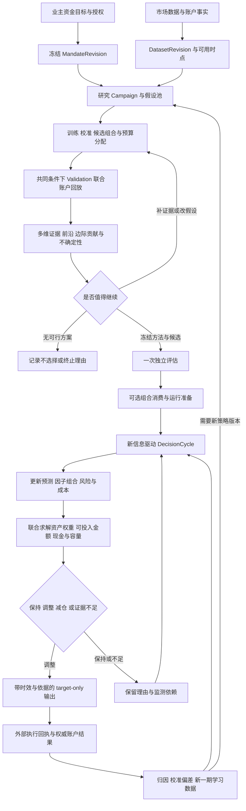
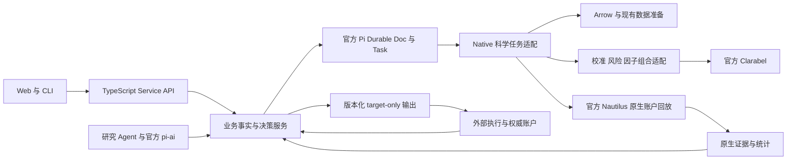
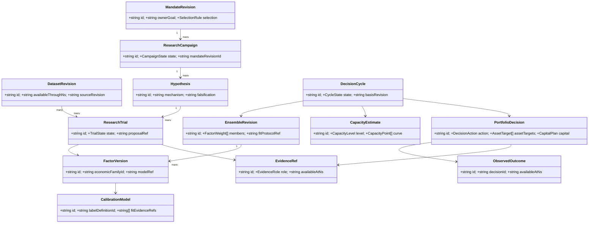
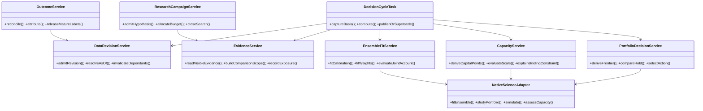
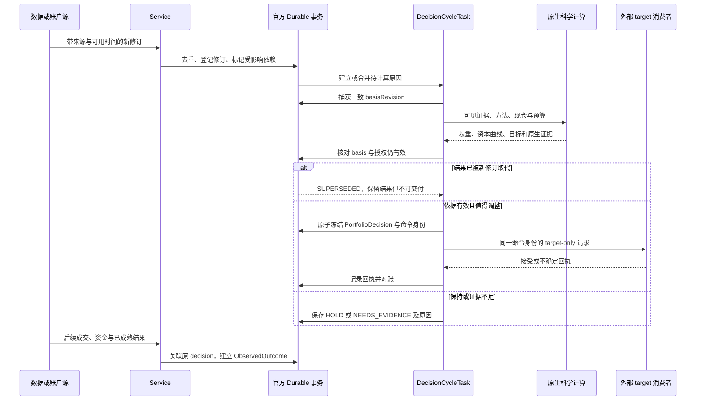

# QuaZonai：个人量化 PM 的自主研究与动态投资决策系统

> 状态：业务与技术设计，尚未实施。用户已明确要求先完成方案、暂停开发及合并。本方案不代表任何策略已盈利、任何经济容量已测得或任何实盘交易已获授权。
>
> 依据：本次对话的全部目标与两次业务纠偏；仓库远程 `dev` 的 `a233b966ca0f6210f3c9bf5db1872eb5c982bfdf`，并结合当前草稿分支 `19803c47aeb1d22775d594780b8417d7cf63c3ed` 的只读核查。已有 [PR #230](https://github.com/zhengui666/QuaZonai/pull/230) 保持草稿。后续重新获得开发指令时，应重新同步当时最新远程 `dev`；本轮不执行该开发流程。

## 阅读方式与规范优先级

这是一份设计包。本文定义业务目标、总架构、关键决策和实施顺序；[字段与接口合同](contracts.md)统一实体、单位、状态及引用规则。专题文件展开依据与算法。专题中的探索性类型是说明，不得覆盖字段合同；任何语义冲突必须先修订方案，不能由开发者自行猜测。

| 文件 | 回答的问题 |
| --- | --- |
| [业务设计](business.md) | 个人 PM 到底把什么判断交给系统，为什么做，如何衡量价值 |
| [通用策略平台与专业 pipeline](platform-pipeline.md) | 整个项目如何通用化、策略化、规范化，覆盖哪些策略与生命周期 |
| [字段与接口合同](contracts.md) | 每个对象的字段、类型、状态、来源、时钟、版本及空值 |
| [研究与决策](research-decision.md) | 研究什么、如何比较、如何停止、如何避免优化出虚假赢家 |
| [组合与容量](portfolio-capacity.md) | 因子如何组合、权重如何求、钱投多少、容量如何持续计算 |
| [持续业务流程](continuous-workflow.md) | 新数据与账户结果如何触发下一轮决策 |
| [技术架构与 API](architecture-api.md) | 官方运行时、数据与接口如何承载业务 |
| [业务验收](acceptance.md) | 怎样证明真的改善投资判断，而不是增加指标或按钮 |
| [独立设计审阅](review.md) | 设计中发现的问题、已修正项和仍未验证的前提 |
| [文档验证记录](verification.md) | 链接、20张图、规范类型、字段一致性与离线阅读产物的实际检查 |

## 1. 任务理解与交付边界

### 1.0 本次全部需求的追踪矩阵

这些要求同属本次任务，任何一项都不能被“智能指标已完成”替代。当前交付阶段统一为**方案设计**，不是收缩业务范围。

| ID | 用户原始要求 | 本方案必须给出的实物 | 后续实现的业务验收 |
| --- | --- | --- | --- |
| R01 | 项目更加通用化 | 市场/数据/策略能力矩阵、版本化接入合同、能力协商与不支持路径 | 新策略或市场按合同接入，复用核心流程；不复制一套 PM 主流程 |
| R02 | 项目更加策略化 | 经济假设→信号/决策规则→可交易策略→组合→运行的实体与状态 | 能解释策略赚钱机制、失效条件、交易/持仓/退出语义和迭代依据 |
| R03 | 项目更加规范化 | 统一字段、单位、时点、版本、研究记录、阶段输入输出和证据 | 任意选择/资金变动可追溯并重放，旧结果不被新规则篡改 |
| R04 | 核心流程严谨 | PIT、独立性、预算、共同账户、成本、退出、缺失值及回执合同 | 不允许偷看未来、重复使用资金或流动性、虚假晋级和伪造结果 |
| R05 | 核心流程智能 | 自主研究资源分配、候选生成/比较、学习/保留/淘汰、失效归因 | 系统随新证据自行选择下一项有价值的动作，含不行动 |
| R06 | 专业量化小自营基金 pipeline | 端到端业务阶段、轻量治理、资金/风险/执行/研究反馈责任 | 从原始数据到后续账户结果闭环；足以服务单人 PM 而非只跑回测 |
| R07 | 容量、组合、比例等指标尽量自动推导 | 方法、数据、字段、求解与不确定性合同 | 用户无需手配权重/容量；结果随证据变化，有真实计算依据 |
| R08 | 动态、实时、持续计算更新 | 数据修订、事件触发、更新分层、时效与依赖失效机制 | 新证据形成新判断；旧数据不续期；变化不值得换仓时能保持 |
| R09 | 多 agent、多调研、多验证、少猜测 | 分工稿、一手来源、当前代码证据、独立设计审阅和验收矩阵 | 每项重要能力区分事实/拟议/未知；后续实现需对应业务验证 |
| R10 | 最新远程 dev、新分支、最终合入 dev | 当前基线及未来开发/评审/合并路线 | 恢复开发后从届时最新 dev 开始，最终 Head 完整检查与 review |
| R11 | 先写极详尽业务+技术方案，不开始开发 | 完整方案、字段、类图、状态机、时序图、接口和分期 | 本轮仅新增设计文档，生产代码与合并暂停 |

### 1.0.1 通用化的边界

核心流程围绕 `StrategyVersion` 和其 `CapabilityDescriptor` 运作，不能只围绕某个 Wasm 因子或某个预测市场。最少要明确预测型 alpha、相对价值/套利、事件驱动、微观结构/执行敏感策略、独立因子研究和多策略组合的表达方式。当前能执行哪些由能力表如实声明，未实现类型只在方案中定义扩展合同。

市场适配器提供交易日历、合约/事件结构、价格与结算语义、费用、保证金、最小交易单位、可见流动性和可用时点。策略适配器提供状态、信号或目标生成、训练与更新方法、交易/持有/退出规则、所需数据与评价协议。核心 PM 流程负责研究预算、证据、选择、配置与反馈；三者分离，避免把某一个市场的规则硬编码成平台定义。

策略化并非把工程参数改名为 policy。完整策略要表达经济机制、可交易收益来源、假设失效条件、因子作用、组合/执行约束和运营方式；同一个预测模型可以服务多个策略，不能把模型文件等同于可运行策略。

### 1.1 用户要解决的业务问题

系统要成为个人量化 PM 的研究与配置助手：自动寻找有经济含义的机会，把候选变成可复核证据，决定哪些因子值得保留、怎样组合、配多少、能容纳多少资金、什么时候保持不动、什么时候减少风险，以及什么时候应该停止继续投入研究资源。

“更加通用化、策略化、规范化”的含义是：业务对象与投资决策有清晰合同，不依赖某一个市场、某一个策略故事、单一 IC 或 Sharpe；不同策略通过明确的数据能力和科学模型接入。不能把跨市场支持理解成忽略市场微观结构，也不能把规范化理解成增加审批表单。

“专业量化小自营基金 pipeline”的设计目标是研究、风险、资金、执行反馈的一致性与可追溯性。没有一个统一阈值列表能证明所有小型自营基金都合规或专业。本方案采用可验证的量化研究实践，不承诺收益、不声称取得机构认证。

### 1.2 本方案对之前偏差的修正

此前工程候选处理了恢复竞态、指标取值和数值求解边界；这些是基础可靠性，无法单独回答“什么值得买、买多少、为什么”。本方案把业务决策作为中心：每项新增能力必须改变或支持一个具体的 PM 判断，并能用新证据说明该判断为何更新。

本次明确暂停开发。本文中的类、字段、任务、API、算法适配和界面均为拟议设计，除标为“现有”的能力外，不得在产品说明中写成已实现。既有代码与测试结果仅证明其原范围，不是本方案验收证据。

### 1.3 用户输入与系统推导的分工

| 决策内容 | 归属 | 说明 |
| --- | --- | --- |
| 可动用资金、币种、提现安排、允许市场/杠杆/卖空、研究与运行授权 | 业主意愿或权威账户事实 | 系统无法从收益序列推断业主能承受多少亏损；有账户则读取事实，无账户才需提供资金意图 |
| 收益与稳定性偏好、不可接受的经济损失、资金可锁定期限 | 业主意愿 | 可自然语言表达并生成结构化解释；歧义只针对关键偏好澄清一次，不要求填写技术参数 |
| 因子数量、成员、组合比例、风险贡献、市场仓位、可用资金与现金 | 系统计算 | 依据可用数据、已验证方法及当前持仓自动计算，保留原始证据与更新原因 |
| 协方差、预测校准、衰减/训练窗口、相关性聚类、冲击与成交模型参数 | 系统估计与模型选择 | 在允许的训练数据内选择，登记版本、误差、适用范围；无证据时返回未知或条件结论 |
| 容量、最小经济规模、成本后收益、退出能力 | 系统估计 | 不要求业主填写容量上限、参与率、资本试验网格；数据不足不能自动补出一个“经验数” |
| 安全的停止条件、算法支持范围、预算上限与求解精度 | 业务合同/工程边界 | 有限计算与数值误差规范必须存在；它们不伪装成学习得到的市场结论 |

用户无需维护因子权重表、相关性阈值、固定调仓频率、手工资本档位或“神奇”参与率。专业模式可展示系统选出的值和理由；手工覆盖如将来支持，必须形成独立带来源的决策版本，不能覆盖历史自动结果。

### 1.4 三种权重必须分开

1. **因子/预测权重 `a`**：多个模型如何组合为一个统一口径的预测；归属 `EnsembleRevision`。
2. **资产权重 `w`**：在当前约束与持仓下，各市场资产承担多少风险或资金；归属 `PortfolioDecision.assetTargets`。
3. **可投入资本 `K`**：账户净值扣除预留、提现需求与现金安排后，实际承诺给策略多少；归属 `PortfolioDecision.capital`。

多策略平台还需要资本层中的**策略预算分配** `StrategyAllocation`：不同 `StrategyVersion` 各使用多少资本/风险预算。它不与因子预测系数混用。复合策略通过 `PORTFOLIO_OVERLAY` 版本引用原策略成员，最终共享资产净额化；套利、事件与状态型策略可以没有 `EnsembleRevision`，不被强行改写成预测因子模型。

成员的 IC 不是预期收益；因子权重不是市场仓位；资产权重乘总净值也不必等于可交易金额。仅按账户净值同比缩放旧权重，不等于完成动态组合优化。

## 2. 当前系统的事实与缺口

| 领域 | 现有能力，源码已核查 | 当前业务缺口 | 方案要求 |
| --- | --- | --- | --- |
| 研究合同 | 单因子 IC 或组合 Sharpe；冻结输入和试验账本 | 单标量难以表达账户收益路径及资金适用性 | 多维账户事实、比较边界、原目标与选择理由 |
| 账户统计 | 完整 UTC 日收益、最差日、负收益日、覆盖率、回撤、费用等原生统计 | 数据存在但未贯穿正式选择与持续决策 | 自动生成账户级 scorecard，不再造收益引擎 |
| 候选比较 | `validation_compare` 仅实现 legacy validation IC | 组合研究可能没有对应比较；无组合边际贡献判定 | 原目标一致的比较、前沿、基准与增量价值 |
| 终审 | 冻结原 COMPUTED trial，再执行一次所有者可见 HELDOUT | “计算完成”缺少对应的业务选择证据 | 冻结选择依据、方法版本和证据范围 |
| 因子组合 | Agent 提议正权重，原生账户验证完整 ensemble | 无确定的自动权重学习与更新服务 | 类型明确的训练/校准/组合学习与联合回放 |
| 资产优化 | Clarabel 原生风险、成本、现仓约束求解；离线滚动 study | TS 业务入口未接通完整自动流程；同步 BAR 限制 | 支持场景优先复用，异步市场单独适配 |
| 全目录策略 | 因果扫描、多市场共享一个账户 | 固定成员混合，不等于因子权重动态学习 | 统一时点可见信息与自动选择/组合 |
| 容量 | 条件历史 BAR 估计、独立退出约束、账户 size | 目录组合不可用；经济容量缺证据；依赖配置假设 | 分层容量、真实资本曲线、市场冲击/退出证据 |
| 自动账户调整 | 每轮刷新账户并用既有 target、weights、capacity 缩放 | 不是重新选因子、重求权重或刷新容量 | 事件→依赖失效→重估→再决策→目标及反馈 |
| 数据更新 | 注册静态配置与离线 forward 准备 | 新数据尚无完整自动注册与业务消费闭环 | 不可变数据修订、可用时点、质量审查与因果重算 |

关键源码：[研究合同](../../../../packages/contracts/src/research.ts)、[比较插件](../../../../apps/research/plugins/validation-compare.ts)、[组合终审](../../../../apps/research/plugins/strategy-portfolio.ts)、[日收益统计](../../../../apps/job/src/simulation/calendar_returns.rs)、[原生优化](../../../../apps/job/src/optimization.rs)、[滚动组合](../../../../apps/job/src/study.rs)、[容量](../../../../apps/job/src/capacity.rs)、[账户自动调整](../../../../apps/service/src/automatic.ts)、[服务路由](../../../../apps/service/src/service.ts)。Calendar 日统计当前并非所有 spot 路径都已接通，各路径必须单独核验支持状态。

## 3. 业务流程总图

因子研究本身仍可独立完成。组合、账户观察、外部 target 消费是可选下游，不强制所有研究都创建账户或组合。当前 QZ 不持有券商账户、不发送真实订单；方案延续这个边界。

## 4. 一次 PM 决策应该回答什么

每个 `PortfolioDecision` 至少回答：当前有哪些可用机会；哪些因子重复、互补或退化；推荐使用哪一版组合；资产配置与可投入资金是多少；相对继续持有的增益是否值得换仓成本；哪里是容量瓶颈；关键未知是什么；何时和因何需要重算。

决策不只允许“买”。合法结果包括保持旧仓、减少风险、保留现金、暂时不配置、采集缺失证据、结束无价值假设、继续等待标签成熟。收益更高但成本/退出/证据条件不成立，不能自动视为优胜。

### 4.1 多目标选择不能偷偷替业主定义效用

系统先计算真实指标、可行范围和收益—风险前沿；选择规则由冻结的业务目标决定。若业主强调日净收益且声明不可接受损失，则在其真实限制内优化成本后目标；若只说“好一点”且多个前沿点彼此权衡，系统应输出明确歧义并保留现状，而不是发明收益/回撤/亏损日各占 40/30/30 的综合分。

默认研究可以继续生成证据；允许自主 target 更新的运行配置则必须具备足够明确的选择规则。缺少不可推断的业主偏好属于意愿缺口，缺少行情/成交属于证据缺口，两者不能混成同一种“用户配置错误”。

### 4.2 与原组合、现金和简单基准一起比较

比较集必须保留当前已运行组合、现金/不交易、简单可解释基准以及候选组合。所有比较使用一致资金、可见时点、成本口径和共同覆盖区间。不同日历、币种、窗口或费用模型不能直接放入一个排序。

高独立收益因子未必值得新增；其对已有组合的边际收益、风险、换手、流动性消耗和退出负担才是配置依据。组合效果必须经过原生联合账户验证，不能把各因子净值简单相加后宣称是共享资金账户表现。

## 5. 自动研究与资源分配

研究从可证伪的经济假设出发，登记可观测变量、预测目标、可用数据、机制预期、失败解释及与已有因子的差异。Agent 负责提出假设、设计实验、解释失败和调用工具；数值权重、容量与绩效来自可复现计算。

候选按“便宜的可行性/因果检查→训练与校准→有限成本账户回放→完整对比→独立评估”逐层投入资源。资源分配依据已观察改进、不确定性、与现有候选的差异及计算成本，不写死每类策略相同配额。初期采用可解释的分层调度和保守证据规则；复杂 bandit/贝叶斯优化必须作为待验证的方法版本，不能直接拿累计最高 Sharpe 当 reward。

预算包含 native 计算量、模型成本、数据读取量、候选数量和最终结项资源。失败、无效科学假设与已执行的资本/权重搜索都计入真实账本；重复请求复用原试验，不能靠改名字重置搜索次数。预算耗尽停止新实验，但保留比较、形成结论、选择或不选择的收尾机会；不得自动丢掉最后一次产生的可行候选。

停止理由区分无经济优势、证据不足、数据不适用、预算耗尽、被同族更优候选替代、用户停止和基础设施失败。基础设施异常不等于经济假设被证伪；补齐数据后重开必须创建关联的后续研究版本。

## 6. 自动指标与证据体系

### 6.1 指标分层

| 层 | 自动计算内容 | 关键口径 |
| --- | --- | --- |
| 数据 | 完整日覆盖、事件/可用延迟、缺失、修订、标签成熟率、可交易覆盖 | 不把无数据当零收益或不交易 |
| 预测 | 校准误差、IC/排序能力、分布与漂移、预测误差协方差 | 相同目标、horizon、单位及因果样本 |
| 因子 | 条件表现、冗余、边际贡献、稳定性、贡献集中 | 单因子表现与账户贡献分别报告 |
| 组合 | 净收益、最差日、亏损日、回撤、尾部风险、风险贡献 | 单一共享资金账户；真实费用只扣一次 |
| 容量 | 最小可行资金、流动性边界、经济规模曲线、退出能力 | 可观测/条件/经济分开；不能重复分配共享流动性 |
| 运行 | 预测与实现差异、成本偏差、成交率、滑点、可用/预留资金 | 使用权威账户与原目标身份，不以 target 回执当成交 |
| 研究质量 | 试验总数、方法版本、选择偏差、估计不确定性、样本外连续表现 | DSR/PBO 等需满足定义与数据要求；不可贴标签代替计算 |

指标状态、覆盖率和置信区间与数值一起传递。新指标只有在有业务用途、来源定义和验证方法时加入注册表；展示全部指标不是目的。模型不能依据字段名臆造收益、容量或实时性。

### 6.2 日收益与现金盈亏

净账户收益来自原生账户权益和现金流调整。完整 UTC 日统计可直接复用已有原生实现。交易日历必须随市场明确，365 与 252 的年化不可混排；原生 `MaxDrawdown` 的负数表达如转换为正损失幅度，转换版本必须保留。

每日现金盈亏不能用日收益率乘当前本金回填整个历史。必须绑定当日资金、外部现金流与计价币种。缺净值、缺估值或资金流未对账时，相应现金/收益指标不可用；原始数值保留，不能删掉缺失日期缩小亏损日分母。

## 7. 因子组合、资产配置与资金求解

### 7.1 因子成员与比例自动求解

先将各因子输出校准到相同 horizon 的可比较预测单位，或声明只支持同口径排序策略。评分/IC 不能冒充预期收益。候选成员根据因果数据上的增量预测与组合价值选择；重复模型/相同经济暴露形成同族，避免复制一个因子获得额外权重。

拟议的初始可审计方法是：训练期内部按时间前推产生 out-of-fold 预测，校准器只用对应训练前缀；利用预测误差结构拟合非负组合，并对成员增删进行有预算的验证；通过原生同账户回放选择方法/成员及其参数。非负且和为1时L1范数恒为1，不能声称加入普通L1惩罚就会自动学出稀疏成员。已有 Clarabel 可复用作新的 typed convex adapter，但该接口必须叫预测组合拟合，不能伪造 instrument ID 把因子冒充资产。

对于不可校准的非线性策略或异构执行机制，采用有限、留痕的候选组合搜索与原生账户评估。其结果是“在实际测试候选中优选”，不能宣传为全局最优。验证用于方法/候选选择，最终独立样本不参与反向调权。

### 7.2 资产仓位自动求解

在统一的预测、风险估计、当前持仓、成本、资金及市场约束下，由原生优化器求解资产权重。现有 Clarabel adapter 处理支持的凸风险/成本模型；已支持场景先复用。持仓与现金使用权威事实，目标应考虑净交易量而非毛信号之和。

若资金规模、最小订单、冲击和离散成交使问题非凸，采用有限候选规模/离散修复与原生回放验证，并标注近似和最优性边界。求解器返回最优也只意味着所建模型内最优，不意味着未来收益最优。

### 7.3 资金与容量共同求解

可用预算从净值、预留、提现安排及已授权现金意图得出。系统自动以真实资金和最小交易单位构造资本试验点，并根据收益/成交/约束变化自适应细化，而非让用户手填 1 万、10 万、100 万的网格。外推范围必须明确。

规模变化后，成本占比、可交易市场、最小订单、机会分配与退出可能改变，因此需重新求解组合并回放，不应仅线性放大旧净值。找不到满足约束的资本规模时，建议可为零；“没有证据投入”与“最优现金 100%”必须分开描述。

## 8. 容量的三层含义

1. **观测层**：当前/历史可见 BAR、订单簿、成交、交易规则和实际执行数据。记录时间、来源、覆盖和代理假设。
2. **条件可执行层**：在明确成交窗口、可见流动性、净交易需求、最小单位和退出假设下，可容纳的资金范围。BAR 量不能自动当成可成交盘口；未来退出深度不能视为已知。
3. **经济容量层**：改变资金规模后，成本与冲击作用下的净经济价值和风险是否仍值得配置。需要匹配的资本规模回放、成交/冲击校准、成本与退出证据。当前目录数据路径不具备完整证据，必须明确待建设。

容量必须按共享市场—时间—执行窗口聚合净需求，同时覆盖加仓、再平衡和退出。不能把每个因子的独立容量相加，也不能把所有因子各占同一 BAR 的固定参与率而重复使用流动性。

历史回放曲线在固定 fill model 下变化，不能独立识别真实市场冲击。没有观测或可识别模型时只报告条件曲线；系统可自动提出补采盘口/成交的需求，但不能自主扩大数据授权或把未知容量当无限。

## 9. 持续更新：以信息变化驱动业务重算

### 9.1 触发源与最小重算范围

| 触发 | 必须重算 | 通常无需重跑 |
| --- | --- | --- |
| 新行情且达到可用 watermark | 新预测、机会集、流动性与仓位决策 | 已冻结历史独立评估 |
| 标签成熟/新的实现收益 | 误差、校准、漂移；到方法更新条件再拟合 | 所有历史 trial |
| 账户资金/预留/现仓变化 | 净需求、可用资本、最小订单和 target | 因子训练，除非规模改变策略有效域 |
| 费用/交易规则/可见盘口变化 | 成本、容量、净收益和 no-trade 判断 | 不受影响的数据特征 |
| 新因子证据 | 同族/冗余、增量价值、组合拟合及联合验证 | 全部无关假设 |
| 源修订/错误发现 | 依赖其结果的证据失效并重新评估 | 无依赖的版本 |
| 用户资金目标/授权改变 | 新 MandateRevision 与受影响决策 | 旧决策的历史事实 |

刷新频率由数据到达、策略 horizon、计算成本和证据时效共同决定。快路径更新状态、流动性和净交易需求；中路径更新风险、成本、预测与权重；慢路径启动新假设研究。完整全市场回测不放到每个 tick 的同步路径。

“实时”的承诺必须分别报告源事件到可用、可用到计算完成、计算到目标输出、目标到外部确认的延迟。没有实时源时只能持续处理新到达的批次，不把五秒轮询历史数据宣传为实时策略学习。

### 9.2 保持原仓也是计算结果

每次比较拟议调整与继续持有的成本后差异及不确定性。如果改善不足以覆盖换仓成本或证据误差，应保持；若风险或退出条件恶化，则可减仓或停止新增。触发计算不等于必须交易，权重更新也不等于每次必须发送新 target。

no-trade 区域来自成本、估计误差、业务风险限制和当前持仓，记录推导过程；不能写死“变化小于 5% 就不调仓”。证据过期时，旧结果不获自动续期；既有持仓的处置也需新的风险/退出依据，不能把 stale 简化成无条件清仓。

## 10. 研究、独立验证和线上学习的隔离

每一版方法与候选必须记录训练、选择、独立评估和后续观测的角色。选择完成后才允许消费独立样本，最终结果不反馈本轮搜索。已暴露的历史数据之后可以用于新版本训练，但永远不能再被称为该新版本的独立样本。

持续学习不是永久固定某一块历史 HELDOUT。新时间段按预登记协议先产生前瞻预测与决策，待标签成熟后形成 prequential 证据，再进入后续训练。整条自适应过程必须连同重拟合频率、窗口选择、暂停与资金调整一起做前推验证，不能只验证某一静态权重。

嵌套时间验证与重叠标签清除、必要 embargo、多个研究尝试的统计影响、样本量不足和非平稳性均需登记。PBO、DSR、置信区间只是有定义和前提的诊断；不满足输入条件时不输出虚假概率，也不把高置信分数变成盈利保证。

## 11. 总体技术架构

保持当前 TypeScript 负责业务事实、HTTP 与编排，Rust 负责必要科学计算和纯校验。复用官方 Pi Durable 的任务生命周期、事务、恢复与等待；不新增第二个调度器、任务数据库或自研撮合/记账引擎。新增业务类型使用当前 `packages/contracts`，不修改历史 generated 文件冒充新 API。

数据量大的时间序列与回放原件保留在原证据存储/分块对象，业务文档引用其身份；不能把全目录行情复制到每个 DecisionCycle。旧 PostgreSQL 历史与迁移保留。业务投影可以重建，原始账户/研究证据不得被投影覆盖。

### 11.1 领域类图

类图中的对象是领域合同，不要求在 TS 中实现成有继承关系的 class。计算服务无状态或仅引用版本化文档；数值科学状态由原生结果及明确模型版本管理。

### 11.2 服务职责图

## 12. 一次持续决策的时序与一致性

重放恢复原任务、原输入与原命令。传输不确定时先查询原命令回执，不能新建 target 重发。计算期间资金预留、源数据或授权变化，旧计算只能成为历史证据，不能覆盖新依据。`basisRevision` 是业务版本组合，不是重新实现官方任务状态。

## 13. 产品体验

首页以“当前资金在哪、为什么、什么在变化、哪里还缺证据”为中心。默认展示最新投资判断、与上一版差异、现金与可投入资本、容量限制、每日净收益路径和待处理的真实例外。

研究页展示假设池、已投入资源、淘汰/继续理由、候选前沿、独立评估状态。组合页展示因子成员及比例变化、边际贡献、资产仓位、成本后调整价值和容量曲线。用户可以展开原生证据与方法版本，但不需要填写协方差、权重或参与率。

自动建议解释应形如：“新成交数据显示市场 A 的有效流动性下降；原组合在当前资金下的退出约束成为瓶颈，系统比较保持、减仓和替代组合后选择减少 A 的净需求。具体比例来自所列求解与回放。”解释必须由结构化决策事实生成；语言模型不能补出未计算的因果关系。

没有数据或授权时，界面显示能继续做什么研究、需要什么可观测证据。缺省值不展示成已计算结果；历史结果显式标时点、范围和是否过期。

## 14. 兼容、迁移与上线分期

旧 `ResearchSpecification` v1 与已冻结 trial 不重解释：旧 `evaluation.target` 仍保持其原 HELDOUT 含义。新业务合同使用独立版本，旧研究可作为带边界的历史证据引用，不能自动补出缺失的训练划分、容量或独立资格。

| 阶段 | 可验收的业务交付 | 前置条件 | 明确不能冒充的能力 |
| --- | --- | --- | --- |
| D0 设计 | 本方案、字段合同、独立审阅、未决证据清单 | 当前只读调研 | 尚无新能力落地 |
| D1 研究决策 | 自动账户 scorecard、同口径比较、预算结项、可解释选择记录 | 现有原生统计与账本 | 不是动态最优权重/经济容量 |
| D2 自动组合 | 数据支持的因子成员与比例学习、原生联合回放、基准与贡献对比 | 因果预测面板、校准和内层验证 | 不是只拼独立净值或强选 top1 |
| D3 资金与容量 | 自动资本曲线、共享流动性/退出约束、资金变化重求解 | 可识别成本/成交与规模模型 | 缺冲击数据时不声称经济容量 |
| D4 持续闭环 | 数据修订自动接入、事件重算、版本化 target、归因与失效恢复 | 可持续数据源与账户协议 | 定时刷新旧数据不算完成 |
| D5 业务验证 | 完整自适应过程前推、真实源影子运行、资源与时延实测 | 数据/模型/外部消费可用且授权 | 合成夹具与 CI 不证明收益 |

分期是依赖顺序，不是将 D1 当作全部目标完成。可并行建设字段/数据、科学适配、编排、界面与独立验收；合同稳定后才交给各 agent 实现。未来每个代码增量仍应在最新远程 `dev` 新分支开发，完成最终 Head 适用 CI、独立 review 和 GitHub Codex 明确无问题后，按用户届时指令合入远程 `dev`。

## 15. 必须验证的假设与未决输入

| 问题 | 怎样解决 | 在解决前可以做什么 |
| --- | --- | --- |
| 真实数据能否支持全市场同 horizon 的因果预测面板 | 数据审计、样本标签和时钟验证 | 保持场景能力声明，支持已验证子路径 |
| 是否有足够成交/盘口识别冲击和退出模型 | 接入被授权源并做拟合/外部验证 | 条件容量与证据补齐计划 |
| 因子组合目标能否改善账户结果 | 内层前推与联合账户基准对比 | 不用预测 MSE 改善替代交易收益证据 |
| 自动更新策略是否比固定策略更好 | 对完整更新协议进行外层前推 | 保留固定/现金/保持基准 |
| 每轮数据与计算成本是多少 | 代表性数据规模的实测 | 预算字段与降级路径，不凭空承诺毫秒级 |
| 原生模型目录是否支持指定真实 Agent 评测 | 精确模型/推理级别与授权核实 | 确定性测试可独立执行，不冒充模型效果 |
| 业主偏好足不足以从前沿选一点 | 对结构化解释做一次有意义的确认 | 继续研究与前沿计算，保持运行状态 |

## 16. 方案完成标准

本轮完成标准是：形成可读的全链路业务与技术设计；所有关键自动推导量有输入、算法、输出、时效、失败方式和验证方法；所有核心实体有字段合同与关系图；研究、运行、容量与收益的证据边界一致；独立审阅中的阻断性设计问题得到修订或清晰标为实施前条件。

本轮不会将设计提交为已开发能力，不会继续扩大工程改动，不会合并草稿 PR。下一次进入开发时，以本方案的业务验收而不是代码行数、Agent 数量或测试数量衡量交付。
