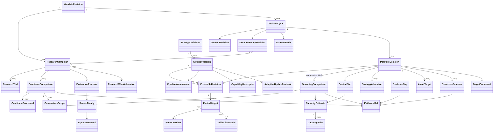

# QuaZonai 动态量化 PM：独立业务反例与验收设计

> 规范说明：本章展开设计依据与候选实现。实体与字段以 [规范字段合同](contracts.md) 为准；专题代码示意不是另一套 API，也不代表已经实现。
版本：设计审阅稿 3，2026-10-22。作者角色：独立 PM / 架构审阅。代码事实基于 `/workspace/QuaZonai`、HEAD `19803c47aeb1d22775d594780b8417d7cf63c3ed` 及当时可见文件。本文只定义业务与设计验收，不声称下述能力已实现、通过真实账户验证或产生收益。没有修改源码。实体与字段已改为统一合同映射；补充统计与审计需求通过版本化 EvidenceRef 产物承载，新增正式字段须先修订 contracts.md。

## 1. 要验收的目标

系统在授权的市场和账户范围内，依据持续到来的可用证据，自行维护候选因子、组合结构、比例、资金规模和投资决定。用户不负责填因子权重、参与率、容量金额、估计窗口或调仓间隔。系统应能解释：为什么保留、加入或移除某个因子；为什么今天投入这些资金；为什么此次换仓值得或不值得；哪些未知证据阻止了更积极的配置；后续结果是否支持原判断。

这是一条 `新证据 → 因子与机会估计 → 组合比较 → 联合容量与资金求解 → 投资决定 → 授权范围内的目标交付/观测 → 后续归因与再估计` 的业务循环。每个箭头都必须有实际承担者、输入版本、输出事实和可执行验收。展示更多指标、增加几个风控条件、定时重跑旧配置，均不足以证明闭环成立。

始终分开四种事实：

1. **计算事实**：数学或模拟计算完成，不表示值得投资。
2. **条件投资判断**：在指定收益目标、账户、成本、时间和证据下，某行动优于所比较替代方案。
3. **独立验证事实**：只在声明的未暴露样本/前瞻区间内成立，不能被新的配置版本继承。
4. **实际账户结果**：源于权威账户、成交和现金流。目标已提交、ACK 或测试服务返回成功均不能替代它。

动态系统不等于持续交易。规范动作 `HOLD`、`NEEDS_EVIDENCE`、`NO_FEASIBLE_SOLUTION` 都是正常结论；`CASH` 必须来自可行且有依据的选择。减仓/退出也不是零成本操作，必须考虑当前持仓及退出可行性。

## 2. 当前仓库可复用事实与尚缺连接

| 能力 | 已查证入口 | 真实范围 | 尚不能据此声称 |
|---|---|---|---|
| 单因子/组合研究输入 | `packages/contracts/src/research.ts:10` | 原结构 mandate、原数据与预算；criterion 仍为单 IC 或 Sharpe | 已有完整账户投资目标及多维取舍 |
| 原生账户统计 | `apps/job/src/simulation.rs`、`simulation/calendar_returns.rs` | 原生统计；当前工作树已有完整 UTC 日覆盖及若干补充统计 | 指标刷新已连接动态投资决定 |
| 候选比较 | `apps/research/plugins/validation-compare.ts:14` | 原 validation Pearson IC 排序 | 已实现 ensemble 账户级比较 |
| 终结与独立样本 | `strategy-portfolio.ts:43`、`native-exposure.ts:40` | 原候选绑定、暴露记录、最终结果不返模型 | 任意新权重/新本金/新模型自动拥有原独立证据 |
| 净值自动调整 | `apps/service/src/automatic.ts:77`、`:91`、`:100` | 原池/原权重/原目标/原容量，加新账户与流动性快照，调用 `size-account` | 自动发现/淘汰因子、学习因子比例、刷新源目标与容量 |
| 联合条件容量 | `apps/service/src/capacity.ts:41`、`apps/job/src/capacity.rs` | 已有共享预算、最小订单、流动性与资金计算；真实盘口/经济容量缺失明确不可用 | 所有策略和市场已具备经济容量估计 |
| 资产优化 | `apps/job/src/optimization.rs:122`、`portfolio.rs:316` | 原生 Clarabel、成本、风险、当前仓位及约束；具体目标由原输入决定 | 同一优化器已经学习了因子组合权重 |
| 滚动组合研究 | `apps/job/src/study.rs:71` | 离线滚动、同一原生账户、按 cutoff 重算 | 当前 TS 服务已调度持续实证循环 |
| 前瞻观测准备 | `apps/job/src/operator/preparation/polymarket_forward.rs:730` | 原始记录投影，产物 `PREPARED_UNREGISTERED` | 已自动登记、自动进入更新和交付链 |
| 实际账户观测 | `apps/service/src/downstream.ts`、`science.ts` | 原账户身份、权益、持仓、回执与来源时钟 | 自建券商/直接订单执行或已完成收益归因 |

特别注意：catalog ensemble 已支持根据新出现市场机会在一个账户内动态分配标的；这与跨研究因子入池、出池和因子权重的动态学习不同，方案不得混用概念。

## 3. 用户不该配置什么；哪些价值判断不能假装由数据发现

### 3.1 系统负责的技术决策

| 不要求用户填写 | 系统依据 | 必须保留的解释 |
|---|---|---|
| 因子列表和固定比例 | 可用因子证据、净边际贡献、互补性、估计不确定性、共同资产暴露 | 入池/保留/降配/退出原因、反事实组合比较 |
| 单策略/联合容量金额 | 当前可用市场与成交条件、账户状态、净交易需求、最小单位、退出需求 | 最紧约束、容量适用时点、物理/经济容量区别 |
| “默认 10%”一类参与率 | 已验证的执行/影响估计或明确、版本化的系统限制政策 | 数据来源；无法校准时的未知范围，不虚构可交易深度 |
| 估计窗口、协方差收缩、重估周期 | 可验证的算法、过去可用训练/验证数据、稳定性和计算成本 | 方法与参数版本、训练截止、选择偏差记录 |
| 资金场景网格 | 真实可用资金、最小可行金额、约束拐点、现有投入和求解精度 | 网格/求解点产生依据，不能拿网格端点充当自然容量 |
| 因子数上限作为业务偏好 | 冗余、可识别性、净边际贡献和运行成本 | 资源上限与经济选择分开；资源上限不能伪装为最佳因子数 |
| 每隔固定时间必须调仓 | 信息变化、现金流、估值/交易状态与预期净改善 | 重算触发与交易触发分开，微小变化可保持 |
| DSR/PBO/显著性方法或折数 | 研究方法注册与适用条件、试验家族、依赖结构 | 方法适用性与未知项，不由 PM 选到“能过”的方法 |

这些参数可以由系统内部政策/经验证算法决定，**不能只是从用户表单移到隐藏的魔法常量**。当数据不足以识别参数时，记录未知、开展补证据或降低行动范围，不把任意默认值宣传成动态推断。

### 3.2 不能从价格历史唯一推导的业务意图

收益与回撤的取舍、外部取款义务、禁止市场/行为、允许的账户授权范围，不是统计事实。系统应从已有用户意图、账户承诺、授权策略中继承这些信息；不重复索取已知输入，也不强迫填写技术数值。若确实存在两个不可比较的方案且意图无法消除歧义，保留 Pareto 候选及未决价值判断，避免编造效用系数。必要时提出简明业务选择，而非让用户调优化器。

“希望每天稳步增长”表达偏好，不等于确定性每日收益承诺。系统需暴露亏损日、连续亏损、尾部和资金需求，并承认不可能凭回测保证每天盈利。

## 4. 动态循环的业务分层与时间语义

### 4.1 六类触发

1. **新市场证据**：已完成 BAR/订单簿/成交/费用等有来源、事件与可用时钟的数据。
2. **新标签成熟**：预测期限已经结束且结果可得；未成熟结果不能进入训练/评价。
3. **账户变化**：权益、持仓、现金流、预留或交易义务发生变化。
4. **执行条件变化**：价格、最小订单、可用流动性、费用/交易规则有新有效版本。
5. **模型/证据变化**：因子更新、校准更新、数据修订或独立评价完成。
6. **有效性/观察窗口变化**：已有证据自然过期，或原定义的评价区间已经结束。

触发不是交易命令。先确定受影响的派生事实；用原样本版本重放同一输入不应生成额外投资变化。新增数据是否改变决策，由重估后的净比较决定。

### 4.2 每个周期必须固定的边界

`decisionAsOfNs`：本次决策的信息截止；`availableAtNs`：某输入实际上可读的时间；`eventAtNs`：市场事件时间；`labelMatureAtNs`：结果可用于学习的最早时点；`computedAtNs`：系统执行完成时间；`effectiveFromNs`：新策略允许影响目标的起点。它们不可互相替代。

每个周期对一个明确输入集合计算，由规范 `DecisionCycle`、其 `basisRevision` 和精确输入引用固定本次依据。新的证据生成下一周期，不能无痕修改先前周期。并行 worker 在不同快照上产生的指标、容量和权重不能混装到一份“最新”结果里。

### 4.3 权重必须分成三种

- `ensembleWeight`：模型预测融合中的因子贡献；随模型证据更新，不能解释为账户资金。
- `strategyCapitalWeight`：跨策略/子池的资金分配；必须以共享账户和净化后交易需求验证。
- `instrumentTargetWeight`：最终资产/现金目标；考虑持仓、交易成本、最小单位、流动性和真实账户金额。

改变任一种权重均产生新的配置修订。因子得分在没有校准和单位说明时不能直接归一化成任一种权重。资产协方差优化不自动等于因子权重学习；共同资产上的净额交易，也不消除因子经济敞口的相关性。

## 5. 规范字段映射与补充审计要求

本章不再定义候选 TypeScript DTO。实体、枚举、字段及单位均引用 [contracts.md](contracts.md)；下表明确业务验收读取哪些规范字段，以及哪些细粒度统计/审计资料应由其 `EvidenceRef` 引用的版本化产物保存。补充审计内容不是第二套顶层 API；如果尚无对应产物 schema，必须先登记其 `schemaId` 和生产/消费规则，不能用任意 JSON 或解释文本代替。

### 5.1 价值意图、系统方法与策略版本

| 验收所需语义 | 规范字段/对象 | 必须验证 |
|---|---|---|
| 业主真实目标、范围及未决取舍 | `MandateRevision.ownerGoal`、`interpretation`、`ownerBoundaries`、`selection`、`unresolvedIntent`、`operatingAuthority` | 系统解释不覆盖原话；不得把算法默认值伪装为业主意愿 |
| 业务偏好顺序或效用 | `SelectionRule.mode/objectives/utilityModelRef/establishedBy/rationale` | 顺序或效用来源清楚；看结果后改变偏好是新修订；真实权衡可保留前沿 |
| 可复现系统方法与训练来源 | `DecisionPolicyRevision.methodFamily/nativeImplementationVersion/learnedParametersRef/trainingProtocolRef/validationEvidenceRefs/validDomain` | 参数来自可用开发数据或登记政策；依赖、成本等可估计事实不能冒充学得的风险偏好 |
| 完整经济机制与失败条件 | `StrategyDefinition`、`StrategyVersion` | 模型、预测、组合、执行和退出规则有对应证据，因子分数不直接变仓位 |
| 一次拟合后的成员与比例 | `EnsembleRevision.members/fitProtocolRef/fitCutoffNs/trainingEvidenceRefs/jointValidationEvidenceRefs` | 运行期间重新拟合也产生不可变新修订；模型规则冻结不代表可以原位修改权重 |
| 候选与经济家族 | `FactorVersion.economicFamilyId`、`Hypothesis.economicFamilyId`、研究家族规范合同 | 重复因子或跨会话搜索不产生额外独立信念；方法选择也是搜索 |

### 5.2 指标、样本覆盖与不可用

| 验收所需语义 | 规范字段/对象 | 补充统计/审计资料 |
|---|---|---|
| 指标身份、单位、日历与年化 | `MetricObservation.definition` 中的 `MetricDefinition.id/horizonRef`、`Objective.metricDefinitionId` | 选择、LOSS 边界及排名绑定同一精确定义；保留定义版本、聚合规则、252/365 身份和适用条件，不仅按 key 匹配 |
| 实际数值与可用性 | `MetricObservation.status/value/reasonCodes/raw` | 非 AVAILABLE 数值保持 null；raw 保留原生异常/不可用证据，不能参与排序 |
| 数据角色与合法时点 | `MetricObservation.role/interval/asOfNs/availableAtNs/evidenceRefs` | 同一指标不可将 SELECTION、INDEPENDENT 或 PREQUENTIAL 混用 |
| 样本覆盖 | `sampleCount/expectedCount` 与覆盖类 `MetricObservation` | 产物需逐项保留预期周期、完整观测、确认零收益、缺失、部分周期、未定价周期及计数口径 |
| 原净账户收益定义 | `ComparisonScope.accountingPolicyRef`、`MetricObservation.evidenceRefs` | 原收益序列、外部现金流调整、费用是否已包含、估值规则及报告日历 |
| 区间/不确定性 | `MetricObservation.uncertainty`、`methodRef` | 依赖假设、有效样本估计、方法适用性；不能由 tick 数替代独立样本数 |
| 路径完整性 | 指向原序列与账户回放的 `EvidenceRef` | 日期顺序、日间缺口、最长亏损连续性、财富路径、修订和暴露关系 |

没有日期/定价覆盖时不计算“每日收益稳定”。确认未交易且完整估值的零收益日，与缺失日严格区别。区间估计缺失并不使原点估计变成零；某类指标不适用也不应永久阻止与之无关的所有研究。补充指标先注册 `MetricDefinition`，再产生 `MetricObservation`，不得新增一个同义的 `MeasuredValue` 接口。

### 5.3 容量、资本与三种权重

| 验收所需语义 | 规范字段/对象 | 必须验证 |
|---|---|---|
| 观测/条件/经济容量 | `CapacityEstimate.level/status/assumptions/missingEvidence` | 三层分别形成事实；观测量不能自动晋级经济容量 |
| 实际测试资本曲线 | `CapacityEstimate.curve`、`CapacityPoint` | 每点绑定策略、对应配置、回放、净表现、需求、费用、成交及限制原因 |
| 真正边界与测试范围 | `minimumTestedCapital/maximumTestedCapital/supportedCapitalUpperBound` | 最大已测试点不等于自然容量上限；未知边界保持 null |
| 当前资金可行性 | `CapacityEstimate.feasibleRegions` | TESTED_POINT 是实际验证点；VALIDATED_INTERVAL 需有对应配置和区间证据。低于摘要上界不能证明可行，不跨不连续区间插值；缺少覆盖时自动补该资本点回放并计预算 |
| 当前可分配预算与最终承诺 | `CapitalPlan.deployableBudget/committedCapital/uncommittedCash/projectedTradingCash` | 账户净值、预留、提现安排与策略现金分开；不能重复扣/算 |
| 资本与配置来源 | `PortfolioDecision.accountBasis/researchStartingStateRef/capital`、`CapacityEstimate.basisRevision` | 同时点的真实账户或明确研究起点；不能拼接不同快照 |
| 入场、换仓与退出可行性 | `CapacityPoint.entryDemand/exitDemand/estimatedCost`；容量的 execution/impact/exit model 引用 | 共享流动性预算、净交易和约束拐点记录到原生证据；未来退出未知不伪装已知 |
| 预测融合系数 | `FactorWeight.weight`、`EnsembleRevision.members` | 无量纲且预测单位/horizon 匹配，不能当账户资金比例 |
| 资产目标 | `AssetTarget.navWeight/targetQuantity/targetNotional/currentNotional/netTradeNotional` | NAV 分母、金额、数量规则、净交易与实际持仓一致 |
| 多子策略资金归属 | `PortfolioDecision.strategyAllocations`、`StrategyAllocation.committedCapital/capitalFraction/nettingGroupId/allocationEvidenceRef/riskContributionEvidenceRef` | 有资金计划的单策略保留恰一项根策略分配；复合策略才与其叶成员集相等且不重复计资。金额之和等于组合 committedCapital，零投入时 fraction=null；先共享账户净额化，再核验风险和资金，不能将预测系数当资金比例 |

容量曲线上的各点必须重算非线性费率、订单增量和共享预算，不能从一个小本金回测线性外推。缺乏市场影响证据时，允许保留条件物理估计，经济容量保持未知。本金变化如果改变最小订单、固定费占比或成员可行性，应触发联合配置重求解；只有登记有效域明确支持线性缩放时才可仅做 sizing。

### 5.4 决策快照、候选比较与运行归因

| 验收所需语义 | 规范字段/对象 | 必须验证 |
|---|---|---|
| 一次不可混装的决策依据 | `DecisionCycle.basisRevision/datasetRevisionIds/accountBasis/policyRevisionId/strategyVersionId/asOfNs/availableCutoffNs/dependencyRevisionRefs` | 使用统一 basis 修订合同解释版本集合；不新增第二个 DecisionInputSnapshot |
| 触发 | `DecisionCycle.triggerEventIds`、`BusinessEvent` | 重复输入可更新可用性，但不新增独立样本或假经济机会 |
| 研究候选比较 | `CandidateComparison`、`CandidateScorecard`、`ComparisonScope` | 同资金、日历、成本、可见范围；成员/权重是候选变量，不因不同而隔离成不能比较 |
| 原组合及过渡路径比较 | `PortfolioDecision.comparisonRef` → `OperatingComparison`，以及 `incumbentDecisionId/jointReplayEvidenceRef` | 运行候选使用配置身份；同 scope/basis 下保留净差异、下行差异、过渡成本和适用容量；不得硬冒充一个新 ResearchTrial |
| 当前投资动作 | `PortfolioDecision.action/status/capital/assetTargets/reasonCodes/explanationFacts` | 仅使用合同 DecisionAction；HOLD、CASH、NEEDS_EVIDENCE、NO_FEASIBLE_SOLUTION 含义不同 |
| 已采用的成员/方法 | `PortfolioDecision.strategyVersionId/ensembleRevisionId/policyRevisionId` | 能重建当时实际学得状态，不沿用旧权重引用解释新比例 |
| 后续账户与结果 | `ObservedOutcome.accountBasis/interval/realizedMetrics/attributionEvidenceRef/matureLabelEvidenceRef`、`OutcomeAttribution` | 回执不等于成交；归因保留现金流标准化、实际与反事实原件、未解释残差，精确记账与非加性影响分开 |
| 退役后敞口责任 | `RetirementDisposition.signalGeneration/positionDisposition/outstandingTargetCommandIds/exitDecisionId/reconciliationRequired/closureEvidenceRefs` | 停止新信号不等于撤回旧目标或已平仓；退出及外部交接有权威证据，未知结果保留原身份继续对账 |
| 证据不足的下一步 | `EvidenceGap.affectedEntityId/requiredCapability/reasonCode/permittedRemedy/dataAuthorizationRef/state/resolutionEvidenceRefs` | 明确影响范围、可继续行为、授权来源与解除条件 |

运行期的 `PortfolioDecision.comparisonRef` 必须解析为规范 `OperatingComparison`。其 `evaluationContext` 区分历史联合回放、前向模型估计和真实前向观测；候选配置、`transitionCost/netOutcome/downside/capacityEstimateIds`、配对差异证据及选择结论均可追溯。`CandidateComparison` 保持研究 trial 语义，不能伪造 `campaignId/trialId` 连接运行判断。`explanationFacts` 受 schema 约束，不能让 LLM 文字承担数值证据。

多目标支配只适用于明确可比较维度、同口径且可用的证据。`frontierMembership` 描述该 scope 下按冻结方法得到的经验点估计前沿，不自动证明统计显著性、未来优势或投资资格；不确定性与配对差异证据必须保留。若方法采用置信支配，另绑定其估计方法和适用前提，不将其与经验关系混称。`HOLD` 的比较对象是当前持仓继续运行的可执行路径；从有仓位出发达到全现金包含退出成本与时间，并非无成本基准。

### 5.5 不另建顶层实体的审计产物

| 产物内容 | 规范承载 | 详细内容要求 |
|---|---|---|
| 日期覆盖/收益口径 | MetricObservation 的证据与原 native 产物 | 原日期序列、缺口类别、零日证明、现金流、定价与费用口径 |
| 候选 pairwise/基线差异 | CandidateComparison.evidenceRefs、CandidateScorecard.baselineComparisonRef、OperatingComparison.pairedDifferenceEvidenceRefs | 共同 scope、原/新配置、过渡成本、净差异、路径差异及无法比较原因 |
| 搜索与选择记录 | `SearchFamily`、`EvaluationProtocol`、`ExposureRecord` 及其 EvidenceRef | 原始搜索范围、方法/权重/资本择优、跨会话 lineage、有效尝试数估计与不确定性 |
| 运行归因 | ObservedOutcome.attributionEvidenceRef → OutcomeAttribution | 原决定、目标、真实持仓/成交、费用、现金流、估值、预测误差及未解释差异；仅适用的ADDITIVE_ACCOUNTING可求和，反事实影响不强行完全分摊 |
| 资源重分配 | `ResearchWorkAllocation`、`BudgetMovement`、ResearchBudget.usageEvidenceRefs、ResearchTrial.resourceUsageRef、reservationForClosureRef | 各种资源单位、已用/未用/预留、被替代工作、信息价值估计或明确优先理由 |
| 缺口处理调度 | EvidenceGap + 官方 Task/runtime 关联事实 | 阻断/允许动作、待何种新证据、工作预算、耗尽/不支持原因；不复制 Task 状态机 |

以上产物各自注册 schema 版本，不能一律靠自由 `Json` 绕过字段规范。需要进入稳定业务 API 的新语义应先补到 `contracts.md`，本文不维护平行类型。

## 6. 规范实体关系与职责边界

关系表达的是规范引用的业务语义，不新增替代实体、持久化平台或调度器。协调与持久化复用官方 Durable；科学与精确资金运算复用 Rust/原生库；下游仍是已有授权 target 接口。LLM 可以提出假设、解释取舍及安排调查，不能用文字生成不存在的市场证据、统计量或容量。

## 7. 统计治理：动态学习不能扩大独立证据的含义

### 7.1 家族与搜索范围

搜索家族使用规范 `SearchFamily`、`EvaluationProtocol` 与 `ExposureRecord`，不另建 ResearchFamilyLedger。其统计审计证据必须涵盖经济假设与数据范围、父/兄弟研究关系、实际尝试、配置与方法选择、观察过的指标族、原始尝试数、可比已完成数、有效尝试数估计及其不确定性、最终选择事件。规范 countedAttempts/failedAttempts/effectiveTrialEstimate 与 trial/methodVariant/exposure 引用承担可核查来源；可比已完成数、参数变体详情和选择时点由这些引用的审计证据保存，不能由一个总试验数代替。

尝试次数不是工具调用次数；资源预算计数与统计搜索计数要分开。失败/取消/无结果仍属于尝试轨迹，但不能伪造一个零收益列放入统计模型。重放同一确定性计算不是新独立试验；改变特征、窗口、分割、权重、资本或筛选指标的择优过程则不能通过新会话隐藏。相近策略之间存在相关性，不能无依据断言所有尝试独立，也不能把有效尝试数设为 1。

DSR 研究指出多重搜索与非正态收益会使报告的 Sharpe 过于乐观；本文据此要求披露完整搜索范围及方法输入，不规定一个通用“DSR 过线即投资”的阈值。参见 [Bailey 与 López de Prado，2014](https://www.davidhbailey.com/dhbpapers/deflated-sharpe.pdf)。

### 7.2 依赖与样本边界

- 标签跨度重叠时，训练和测试的分界必须依据真实标签完成区间及 purge/embargo 语义；固定删几个样本不能代替边界证明。
- 时间自相关、共同市场暴露和重叠持有期意味着“10000 行”不等于“10000 个独立观测”。不确定性方法必须声明依赖假设。
- 不能把缺失日填零后提高样本量；不能通过排除亏损日、不可交易日或失败标的获得漂亮统计。
- 协方差正则化/估计窗口/块长度等方法选择只能使用当时可用的开发证据，方法选择本身也参与搜索记录。
- PBO/CSCV 需要完整、可比较的候选表现资料和清楚的选择规则；不能拿几个互不匹配的汇总 Sharpe 计算一个貌似科学的 PBO。相关研究讨论的是搜索后过拟合风险，并不自动解决全部因果或执行偏差。参见 [Bailey 等，2015/2017](https://www.davidhbailey.com/dhbpapers/backtest-prob.pdf)。

### 7.3 三条连续更新通道

| 通道 | 可以动态更新 | 不允许的操作 |
|---|---|---|
| 运行观测 | 当前账户、容量、费用、亏损路径和数据质量 | 把不断观察的描述性波动称为新的独立显著性 |
| 模型开发 | 已公开的历史/验证/到期前瞻结果；生成下一版候选 | 更新后回到同一旧 HELDOUT 宣称未见样本 |
| 统计晋级 | 原登记的未见区间；适用的固定区间或合法顺序方法 | 每天反复用固定样本检验，首次好看时停止并声称原置信度 |

连续观察可选择预先定义的评价窗口，或适用且验证过的顺序推断方法。Confidence sequence 文献提供跨时间有效的区间框架，但其概率/尾部/依赖前提必须满足；不能直接给金融厚尾、相关收益套一个公式并宣称 anytime-valid。参见 [Howard、Ramdas、McAuliffe、Sekhon，2021](https://arxiv.org/abs/1810.08240)。

### 7.4 旧结果可以用于学习，但不可重新密封

过去的独立结果被 PM、模型或开发者查看后，可以成为后续开发数据。新版本必须记录该暴露关系，并在未来新结果上评价。原版本在其原区间上的独立评价历史仍然存在；改变版本后不能继续沿用同一“独立通过”标签。滑动窗口中已看过的重叠部分不重新变独立。

动态更新采用规范 `AdaptiveUpdateProtocol`：eligibleTriggers、maturityRuleRef、updateMethodRef、trainingWindowRuleRef、modelSelectionProtocolRef、riskAndCostRefreshRuleRef、evidenceFreshnessRuleRef、resourceBudgetRef、allowedParameterDomain 与 outOfDomainAction 共同定义可自动更新范围；wholeProcessValidationRefs 保存整个过程的验证，不能由单个固定权重回测代替。

动态算法作为整体也需验证：测试时每个时点只使用当时可见信息，重现其学习、因子替换、容量和权重更新全过程，而不是事后拼接每个阶段最好的策略。真实收益归属于当时实际采用的配置；后见之明重算的最优权重仅属反事实研究。

## 8. 未知如何自动产生下一步工作

未知不是单个 `BLOCKED` 标签。每项未知要说明被阻断的主张、可继续的行为和系统下一步。

| 未知类型 | 自动补证据动作 | 补证据期间的业务结论 | 不可接受替代 |
|---|---|---|---|
| 缺完整日估值 | 核对原账户快照/价格/现金流并等待完整日闭合 | 不声称该日收益或路径稳定；其他完整时段仍可描述 | 填零、删日期、前向填价冒充交易估值 |
| 新因子样本不足 | 在既有预算内收集/计算开发证据，或安排前瞻观察 | 不授予独立可信度；可继续假设研究 | 复制样本、降低标准直到通过 |
| 候选依赖不清 | 对齐共同可用样本，计算依赖/暴露与敏感性 | 不声称新增因子带来分散化 | 将未测相关设为零 |
| 经济容量缺失 | 获取合规可读的实际执行/费用资料，校准模型或等待前瞻观测 | 条件物理上限与经济未知并列；不自动扩大配置 | 拿 BAR notional 或固定参与率当收益容量 |
| 费用规则存在矛盾 | 对齐规则有效期与实际成交来源，保留冲突 | 不能比较受影响候选净结果 | 取最便宜规则或默认为零 |
| 独立区间已暴露 | 登记暴露，等待未来符合范围的新结果 | 旧结果降为开发/历史重评；保留既有事实 | 新建会话/改 ID 重置独立性 |
| 资金/持仓不明 | 调原账户核对接口，保留未知提交的原身份 | 不增加新不确定敞口，继续核对 | 猜空仓、重新提交目标 |
| 方法不适用 | 查已验证方法注册；无匹配时生成方法验证工作 | 描述性结论与推断未知分开 | 自动换一组能显著的方法 |
| 外部来源不支持 | 记录能力缺口、尝试已有授权替代来源；无来源则待机会 | 明确无法完成的特定主张，不要求用户伪造参数 | 无限轮询或把用户估计当市场证据 |

同一未改变的缺口应共用工作项，状态改变才触发新判断。补证据任务消耗自己的可见资源预算；预算耗尽进入 `EXHAUSTED`，不得无限计算。不存在新信息时系统可以等待，不需要持续交易或持续生成解释。

## 9. 场景输入 → 决策 → 证据：业务验收集

以下数值仅用于可复现反例，均非产品默认阈值。每例应由一个固定的场景输入包、可重放事件顺序和实际决策输出证明。不得用 mock 返回某个预写结论替代科学计算。允许先以受控原生场景验证逻辑，再以已授权的真实数据验证适用性；二者证据等级不能互换。

### A01：同 Sharpe、不同亏损路径

**输入**：完整净日收益 A 为 `[.02,.02,.02,-.01,-.01,-.01]`，B 为 `[.02,-.01,.02,-.01,.02,-.01]`，同初始资本、零外部现金流、同口径。原业务意图偏好较平缓的亏损路径。

**决策**：两者 Sharpe、总收益和亏损日数相同不能导致系统声称等价。应显示最大回撤 A `2.9701%`、B `1%`，最长连续亏损 A `3`、B `1`；根据已记录偏好解释 B 的路径优势，同时承认六天不足以建立未来稳健性。

**证据**：原序列、完整日覆盖、指标方法、逐日财富路径、比较记录。若没有业务偏好，则保留可比较差异而不猜唯一最优。

### A02：相同比率不等于满足本金收益目的

**输入**：无风险基准为零时，将一组非退化净日收益全部乘以正数 `0.1`，算术 Sharpe 不变；两组应用于相同可用本金。另提供原业务收益与路径偏好。

**决策**：输出实际金额与回撤差异，不把同 Sharpe 解释为同等经济价值。不能直接乘十配杠杆：另行考虑成本非线性和授权。

**证据**：本金、收益单位、日净金额、风险与交易可行性、未用 Sharpe 替代效用的比较。

### A03：多数盈利日与一次巨大亏损

**输入**：A 多数日期小赚，但一个日期亏损显著；B 盈利日比例较低但尾部较轻。使用同区间、可比净成本与完整样本。

**决策**：高胜率不能自动晋级；比较累计与几何净增长、最坏日、损失幅度及回撤。若收益与尾部形成真实权衡，应输出 tradeoff，不伪造所有维度都占优。

**证据**：完整分布/原路径、尾部样本量、区间不确定性与业务优先序。

### A04：缺失日不是零收益日

**输入**：A 有十个预期完整日，其中两个无估值；B 同十日有八个交易日、两个被完整定价证明的持币/现金零收益日。

**决策**：A 的完整日路径统计不足并触发估值补证据；B 可以按真实零日计算。不能让 A 与 B 共享同样“完整覆盖”的结论。

**证据**：expected/observed/confirmedZero/missing/unpriced/partial counts；原估值状态与补证据任务。

### A05：本金流入不能成为策略收益

**输入**：账户权益从 `1000` 变 `1500`，期间外部入金 `500`，持仓价格不变且无成本。并有来源完整的现金流记录。

**决策**：账户策略收益为零，资金可用量增加可能触发新配置评估；不得记成 `50%` 回报并因此提高因子权重。

**证据**：现金流与权益来源、原收益口径、资金触发和收益触发的分离。

### A06：已含费用的净收益不得重复扣费

**输入**：原生结果明确净 P&L `8`、已计费用 `2`；独立费用明细也为 `2`。

**决策**：净结果保持 `8`，费用归因展示 `2`；不能计算成 `6`。只有来源说明允许时才导出毛值，不从不完整成本资料猜毛收益。

**证据**：收益口径、费用模型版本、实际计费位置与总额核对。后续成本情景另存为情景结果，不能覆盖原事实。

### A07：未平仓亏损不能藏在已实现收益后面

**输入**：若干平仓交易获利，同时一个未平仓仓位有可用公允估值且亏损更大。

**决策**：PM 以同一账户含未实现损益的净值路径判断；已实现胜率可作诊断，不得代替账户日净收益。估值缺失时明确未知。

**证据**：账户净值、已实现/未实现归因、估值时点与数据来源。

### A08：复制因子不能增加经济信念

**输入**：原有 F1，再加入预测/交易需求完全相同但换名的 F2；同一底层市场、账户和数据。

**决策**：系统识别冗余，不因成员数或“两个都优秀”而增加总经济暴露；可以保留一个代表、按等价类记录，或在相同总暴露下分配内部权重。

**证据**：因子版本、预测与目标对齐、相关/等价判断、共同资产风险、入池净增益。

### A09：较弱单因子可能改善组合，也可能被成本抵消

**输入**：F2 单独 Sharpe 低于 F1，但在 F1 亏损时期有互补收益。分别提供低换仓成本与高换仓成本两个相同信号场景。

**决策**：系统重新求解联合组合及过渡路径；在确有净改善的受控输入下可加入 F2，高成本下可不加入。不能硬写“低相关一定加入”或“只留最高 Sharpe”。

**证据**：同样本共同账户模拟、incumbent 比较、权重来源、费用和不确定性敏感性。

### A10：共享市场容量不能加总

**输入**：两因子同时要求买入同一低流动性标的，各自单独评估都使用同一份流动性。另给相反方向目标的可净额场景。

**决策**：同向合计需求共享一次流动性预算；相反方向在下游净额语义确实支持时按净交易评估成本。不能单纯相加独立容量，也不能把净交易相消解释成风险/相关性已经消失。

**证据**：共同账户净目标、当前持仓、共享预算分配、成本、风险敞口和执行适配语义。

### A11：容量变化应影响组合，而非只有总资金缩放

**输入**：原组合在市场 X/Y 上投资；新增真实流动性证据仅显示 X 收缩，Y 机会与条件不变。

**决策**：系统重估 X 的可行与经济贡献，再比较保留、减 X、转 Y、保留现金等方案；不得无条件同比缩小所有标的。若 Y 的风险/成本使转移不值得，保留现金是合法结果。

**证据**：新旧容量曲线、最紧约束、联合优化输入、资产目标及决策差异原因。

### A12：小本金与最小订单造成非线性

**输入**：候选组合需要多个最小交易单位，在较大本金可行；账户可用资金下降到无法实现该组合的金额，但某个简化组合可能可行。

**决策**：重算组合构成、离散交易需求及净表现；可选择简化组合或不配置。不得线性缩小后输出下游无法交易的碎额，也不要求用户手动删因子。

**证据**：真实最小单位、舍入后目标、剩余现金、替代组合比较、费用占比。

### A13：入金/取款和当前持仓改变可投资资金

**输入**：账户新增现金、资金退出预留或已持有头寸改变，信号证据保持不变。

**决策**：自动使用权威可用资金和净交易差额；资金新增不保证必须投满，取款也不能让系统假装持仓已卖出。原因子预测权重未必改变，资金与标的目标可以改变。

**证据**：资金控制修订、真实持仓、预算、退出义务、三种权重分别记录。

### A14：经济容量未知不能靠固定参与率补出

**输入**：有历史 BAR notional 和最小订单，但无可靠市场影响/真实费用或退出资料。

**决策**：保留有依据的条件物理估计，经济容量为未知；自动请求执行数据/校准或前瞻观察。不得要求用户猜一个容量金额才能继续，也不能默认为无限或零后统一解释为策略失效。

**证据**：物理与经济状态分离、缺失主张、可继续动作、EvidenceGap 和来源能力。

### A15：微小信号更新不应制造无效换仓

**输入**：现有持仓与新候选预测仅有很小差异；明确的过渡费用高于受控场景里的毛改善。再给毛改善大于成本且风险适用的对照。

**决策**：前者保留，后者可以调整；两者均由同一方法与输入计算，而非硬编码次数/差值。未知的预期改善需要反映不确定性。

**证据**：incumbent 可执行路径、候选路径、净增益、成本一次计入、持有/调整原因。

### A16：原目标过期后必须重算，不能续时间戳

**输入**：源目标和容量到期，但账户快照持续刷新；随后新市场证据到达。

**决策**：过期期间不能用新账户时间戳延长旧投资主张；系统自动补新数据并重建信号、组合和容量。新证据到达后生成新修订，不要求用户新建研究或重填比例。

**证据**：原/新目标与证据引用、as-of、有效期、自动补证据任务和新决策。

### A17：因子失效与执行失真应得到不同调查

**输入**：一组前瞻结果中，预测方向仍有信息但实际滑点上升；对照中执行符合假设但信号与结果关系衰减。

**决策**：前者优先更新执行成本/容量与是否值得继续，后者更新因子信念及候选研究；不能把两者都归因于“Sharpe 下跌”后随意换权重。若证据无法归因，输出未知并请求补证据。

**证据**：当时预测、持仓与订单/成交、价格基准、费用、可归因范围和剩余残差。

### A18：并行搜索不能重置多重比较

**输入**：同一经济假设/相同数据，两个 agent 或两个会话分别尝试一批相近模型，最终只提交最佳者。

**决策**：合并可识别研究家族、披露全部实际搜索，不得只按最后会话的一个候选评价可信度。不能靠删除失败记录缩减搜索范围。

**证据**：跨会话家族关系、方法/特征/权重尝试、结果暴露、原始与有效次数估计及其不确定性。

### A19：换优化目标也是搜索

**输入**：先按 Sharpe 不理想，随后依次尝试净收益、Sortino、某个日期子集，最后挑一个最好的叙事。

**决策**：新目标/子集记录为方法选择；不能事后修改原 mandate 把失败研究变成功。新目标可以成为新研究，但历史搜索及暴露仍保留。

**证据**：目标修订、理由、选择时间、数据暴露与原结果不变。

### A20：标签重叠导致的泄露

**输入**：标签期限跨越训练/测试边界，或某时点结果尚未成熟；提供精确 event/available/label-mature 时钟。

**决策**：训练与评估范围按原方法排除相交信息，未成熟标签不进入学习；无法构造足够有效样本时明确不足，而非缩短隔离到能跑。

**证据**：实际标签区间、每折范围、purge/embargo 推导依据、样本计数变化。

### A21：每天查看“独立样本”不能保持独立资格

**输入**：模型每天查看同一 HELDOUT 的新增汇总，并据此改变因子权重，直到指标达标。

**决策**：该区间被用于开发，不能继续标为同一个未见检验；新版本在未来未暴露区间评价，或使用事先注册且满足前提的顺序程序。不能重新命名样本恢复资格。

**证据**：访问/反馈暴露、版本变更时间、inferential method、未来区间登记。

### A22：连续监控描述可以刷新，显著性主张不自动刷新

**输入**：一个已冻结配置被每日观测，未改变配置；系统显示累计均值、亏损日等，同时用户可随时看。

**决策**：描述性指标可每日刷新；正式推断遵循预登记固定评价或适用的顺序方法。首次漂亮时停止不能继承单次检验置信度。

**证据**：monitoring 与 inference 两种输出、评价时点、停止规则、方法适用性。

### A23：新权重不能继承原策略独立通过

**输入**：两个因子各有独立历史结果，用户或系统看过后选择新组合比例和本金，再在原区间重算。

**决策**：可报告新组合的条件历史重评；新组合的独立资格未建立，需未来/新未暴露证据。不能把成员资格与原区间收益拼接成组合资格。

**证据**：配置版本、学习所用结果、样本暴露、原/新独立结论分别保存。

### A24：历史数据修订不能改写当时表现

**输入**：数据供应商在 t2 修正了 t1 已经使用的一条价格或费用记录。

**决策**：保存当时可见版本和原决策；修订触发新的纠错重算与当前判断，不将修订前策略换成“当时就知道”。如果原证据失效，应标明受影响结论。

**证据**：source revision、availableAt、旧/新计算、受影响 lineage 与纠错决定。

### A25：资源预算耗尽仍需要完成已有候选判断

**输入**：搜索计算预算刚好耗尽，已有可比较候选；另一个输入中所有尝试均失败或不可比较。

**决策**：前者关闭新候选计算但保留原证据读取、比较与结项，形成选择/不选择/不足结论；后者诚实结项为无可判断候选。不得为了结项增加新科学搜索预算，也不能因为预算事件丢弃已有决策机会。

**证据**：资源预算与科学尝试记录、closing 阶段允许的能力、实际最终比较。模型响应次数不是科学结论。

### A26：撤出候选池不等于仓位消失

**输入**：一个因子退出候选池，但其交易曾产生仍在账户中的头寸，且退出流动性有限。

**决策**：学习层停止给该因子新增信任/资金，与持仓层安排可执行的持有/减仓/退出分开。不能删除因子后遗漏已有持仓，也不能凭目标令历史归因断裂。

**证据**：因子状态、实际持仓、退出可行路径、资金占用和决策归属。

### A27：数据缺失恢复后自动回到有意义的研究

**输入**：最紧容量标的暂缺报价，随后相同来源恢复可用新报价；期间其他标的数据持续可用。

**决策**：系统对受影响判断产生补证据并限制相关行动；不将缺失当永久因子失败。恢复后自动重算相关组合，并根据实际净结果决定是否恢复配置。不得永久停在一个无人处理的 `BLOCKED` 状态。

**证据**：缺口工作项的状态转移、范围限定、恢复事件和新的投资决定。

### A28：因子单位不同不得直接拼权重

**输入**：一个模型输出标准化分数，另一个输出预测期收益率，第三个输出方向概率。

**决策**：有验证过且仅使用过去可用资料的校准映射才比较融合；否则维护不同接口或记录校准不足，不因都为浮点数而求和归一化。

**证据**：forecast unit、horizon、calibration version、训练截止和融合解释。

### A29：重复重算与信息变化的边界

**输入**：先重复接收相同数据/账户版本，再只改变报价可用时间但不改变经济内容，最后加入真正改变成本的新证据。

**决策**：可以更新证据有效性，但不得把重复输入当新增独立样本、投资增益或额外试验。只有足以影响判断的变化才产生新的投资行动；新证据即使触发重算，也可得 `HOLD`。

**证据**：语义输入身份、旧/新事实差异、样本新增计数、行动理由。

### A30：无法求解不应退回等权

**输入**：约束互相冲突、收益单位无法对齐或科学求解没有有效解。

**决策**：记录具体不可解原因，比较是否保持现有可行路径或暂停新增；产生需要修复的证据/业务矛盾。不能用等权、随机或上次权重伪装新最优解；沿用原持仓必须作为明确的 HOLD 决策单独说明有效性。

**证据**：原生求解状态、约束来源、当前持有可行性与补证据/纠错任务。

## 10. 五个闭环验收故事

单场景通过只说明局部语义。以下故事检验跨阶段是否确实连通。

### 故事 I：从未知机会到可解释配置

从既有可用市场目录与账户启动，用户不填权重/容量。系统提出并登记候选，保留失败尝试，形成可比较账户证据；发现成本缺口后自动补证据；比较 incumbent/候选/不新增投入；形成新配置与条件容量；在原授权范围内准备目标。审阅者从目标能够反查原候选和每个关键估计，而不是只有一段 LLM 推荐。

### 故事 II：市场变化后的自动重配置

注入新价格/流动性、资金变化及新成熟标签。系统重估机会、依赖、成本与容量，输出 HOLD 或实际变化。重配置不得假定原池/原比例永远有效，亦不要求用户重新创建研究。需要看到变更原因对净收益、路径与成本的贡献。

### 故事 III：亏损后的归因与有限学习

出现真实亏损路径。系统区分现金流、估值问题、执行差异与模型表现；不能简单“亏几天就删因子”。需要新的假设时登记新尝试，并保留旧结果。已暴露前瞻数据可以参与下一版开发，下一版晋级使用新独立机会。

### 故事 IV：未知、恢复与选择继续等待

重要输入缺失时系统发起补证据，限制受影响动作，保留不受影响工作。补证据恢复则自动重新判断；未恢复时给出真正的等待/不支持原因及下一触发。等待不应被解释成资金安全已获证明，也不应靠用户猜参数解除。

### 故事 V：连续算法整体的前瞻重放

冻结系统方法及当时信息访问规则，在一段未用于挑选该方法的时间序列上依次开放事件，完整重演因子/权重/容量/资金决策。输出是实际策略版本随时间串联的一条账户路径，同时记录未被选中的候选。不能拼各时段事后赢家；不能用一次未来全样本估计贯穿整个回放。

## 11. 必须纠正的设计陷阱

| 陷阱 | 为什么业务上错误 | 合格修正 |
|---|---|---|
| 将几个新指标加到详情页便宣布 PM 改造 | 没改变任何选择和资金决定 | 相同输入下证明比较/决策实际使用证据 |
| 用单个综合分数掩盖维度 | 效用权重和尺度会偷偷决定取舍 | 明确偏好来源、展示支配/权衡及反事实 |
| 新建一排用户阈值表单 | 把系统责任推回用户且易导致事后调阈值 | 技术估计自动化；价值冲突用业务语言表达 |
| 固定权重只随净值缩放称为动态组合 | 池、预测权重、资产风险分配未变化 | 区分三种权重并验证各自更新条件 |
| 物理容量等同盈利容量 | 能成交不表示成本后有收益 | 两种状态、资金曲线、经济未知分别保存 |
| 历史高容量永久作为上限 | 市场、策略和退出条件随时间变化 | 容量绑定配置、账户、时点和新证据 |
| 所有坏指标都触发卖出 | 无法区分噪声、执行问题与经济失效 | 比较保持、减仓、退出的净结果和不确定性 |
| 不调仓/现金视为无风险免费基准 | 现有仓位、现金利息/汇率、退出成本仍存在 | 构造同账户可执行的替代路径 |
| 所有零/缺失/不适用合并 | 直接扭曲收益、样本量与比较 | 明确 evidence status 及补证据路径 |
| DSR/PBO/CPCV 被当成通用认证章 | 方法前提、数据和搜索范围可能不成立 | 先验证适用性；结果不能替代经济判断 |
| 自动调参后继续用原 HELDOUT | 独立性已被消费 | 新版本显式暴露关系，后续新证据评价 |
| 并行 agent 新会话重置试验次数 | 选择偏差随全搜索家族累积 | 跨会话 lineage 与完整试验家族 |
| 将网络轮询频率当策略再平衡频率 | 计算活性不代表经济变化 | 重算与交易分别决策 |
| 未知全部冻结或默认放行 | 前者让系统失去自主性，后者伪造可行 | 限定受影响范围、自动补证据和恢复 |
| 测试服务 ACK 等于实盘赚钱 | 传输、执行、账户绩效不同 | 按证据层级分别报告 |
| 正确求解等于正确投资 | 输入预测、依赖和目标可能不成立 | 求解前后验证经济语义和样本外行为 |

## 12. 主方案审阅时的判定口径

主方案需要为每个对象给出字段定义、生产者、消费者、更新触发、与原系统的连接点和失败/未知后的业务去向。对于每个关键假设，至少绑定一个上述反例；若使用其他机制，需要说明如何产生同等可核验事实。

不按“新增多少接口/测试通过多少/用了多少 agent”判断达成。合格证据至少包含：

- 一个完整因果决策重放包，覆盖新数据、配置变化、资金/成本约束和后续结果；
- 一份候选真实比较记录，能说明为何选这个而非当时其他可行方案；
- 一段系统自行补证据并恢复判断的过程；
- 一次搜索家族/独立暴露/配置版本不能被绕过的反例；
- 对现阶段不支持的市场影响、数据接入或前瞻统计能力作准确边界声明，且保留可继续工作。

本文不要求每一轮必须更高收益，也不要求每个新增因子一定被采用。验收的是决定有真实依据、能够面对变化而更新、不会通过错误统计或隐藏假设制造信心，并能持续产生下一步有价值的研究与配置行动。

## 13. 通用化的验收：策略原型与能力边界

项目的通用性不能由多加几个 `strategy.kind` 字符串证明。不同策略可以共享研究账本、因果输入、资金、证据和决策合同，但其经济机制、预测含义、执行与损益语义必须保持明确。

### 13.1 策略原型不是强制支持列表

下面的原型是需求边界样本，**不是声称当前仓库已支持这些策略**。应先对现有 threshold、cross-market threshold、catalog ensemble 注册真实能力，再允许经过验证的适配扩展。当前 `StrategyPolicy` 的有限 union 和 `multi_currency_spot_cash_not_integrated` 拒绝路径已经证明，原生存在某类能力与当前服务已集成是两回事。

| 原型 | 核心经济对象 | 需要的特殊证据 | 不能共用的错误近似 | 未具备能力时可做什么 |
|---|---|---|---|---|
| 方向/趋势/均值回归 | 可交易资产上的因果预测或明确分数规则 | 调整后的价格、交易时段、执行费用、持仓路径 | 任意分数当收益率；信号即持仓 | 因子诊断/条件模拟，清楚标识能力 |
| 截面排序/轮动 | 同时可交易且具可比预测的资产集合 | 历史成分、退市/新上市、单位与行业/共同风险 | 用今天成分回测过去；缺标的填零 | 限定有完整时间点成员资料的范围 |
| 事件/预测市场 | 有截止、结算、支付函数的合同 | 事件时点、可得信息、条款、结算和费用规则 | 把最后成交价当确定兑付；忽略锁资 | 条件机会研究，不授予真实结算套利资格 |
| 跨市场价差/套利 | 多条腿共同构成的经济头寸 | 可同时成交报价、两腿容量、资金/币种、转移及结算时间 | 用两个历史收盘价之差当可兑现套利 | 描述性价差/前瞻采集；不得发布套利保证 |
| 流动性提供/做市 | 报价、队列、库存与不利选择 | L2/队列或有验证的成交模型、延迟、撤单、实际 fill | BAR 穿过报价即全部成交 | 模型能力研究/条件模拟；执行资格独立 |
| 衍生品/资金费策略 | 保证金、资金费、到期、基差及清算 | 合约乘数、历史费率、借贷/保证金、结算 | 用现货 long-only 账户代理全部风险 | 只支持已有明确合同和原生适配的子范围 |

选择一种不支持的原型应得到具体缺口和可继续任务，不应把它悄悄映射成某个支持的 threshold 模板。反过来，研究一个因子并不要求具备完整账户/执行能力；因素研究可独立交付有边界的证据。

### 13.2 能力不是一个“支持/不支持”布尔值

能力、证据质量、授权、当前可用状态分别建模：一个功能可以技术支持却缺数据；可以有完整历史模拟却没有运行数据；可以具备运行适配但未获目标交付授权。

| 验收维度 | 统一合同映射 | 边界要求 |
|---|---|---|
| 经济机制与失败条件 | `StrategyDefinition.archetype/economicMechanism/falsificationConditions/knownFailureModes` | 原型只是方法适用域，不保证其数据/执行能力已接通 |
| 预测与执行语义 | `StrategyVersion.signalContractRef/portfolioRuleRef/executionRuleRef/exitRuleRef` | 单位、horizon、因果状态和账户损益完整 |
| 技术能力 | `CapabilityDescriptor.strategyArchetypes/dataKinds/predictionUnits/accountingModels/executionModels/supportedOperations/boundaries` | 每项 operation 使用规范 SupportState；CONDITIONAL 必须给具体条件 |
| 当前证据 | `PipelineAssessment.outcome/evidenceRefs/reasonCodes/nextPermittedActions`、`EvidenceGap` | 技术支持不代表当前数据充分，阶段 READY 不代表永久投资资格 |
| 业务授权 | `MandateRevision.operatingAuthority/ownerBoundaries` 与原授权引用 | 历史模拟支持不自动允许目标交付；不能借补数据扩大授权 |
| 当前版本适用性 | `StrategyVersion.capabilityBindingIds/pipelineAssessmentId` | 对应具体策略版本、时间、市场与方法；其最新评估由规范版本/活动引用规则解释 |

这些维度组合形成能力结论，不另定义 `StrategyArchetypeDefinition` 或 `CapabilityAssessment` DTO。缺少某一维度时保留具体缺口和可继续动作，不用一个布尔“支持”覆盖全部意义。

规范 `SupportState.CONDITIONAL` 需要可读的具体条件，不能成为无限制放行的后门。自动获取数据必须在原授权及来源许可范围内；未知源不能由 LLM 自行编成“已接入”。扩展应只添加经济/科学适配和能力声明，避免把每种策略复制成一套独立 service、调度、账本、指标和 UI。

### 13.3 对“通用”的实际验收

用两个已支持但输入/执行语义不同的策略完成同一研究到决策过程，检查共同合同是否保持语义；再用一个不支持原型证明系统明确识别能力缺口并安排有价值的下一步。仅展示插件能注册或 JSON 能反序列化不算通过。

## 14. 完整生命周期：发现、研究、晋级、监测、退役、重开

### 14.1 不要用单一状态混合所有问题

`COMPUTED` 是一次计算结果，`ACTIVE` 是是否被当前组合使用，`INDEPENDENTLY_ASSESSED` 是证据属性，`CAPACITY_UNKNOWN` 是某项业务判断。四者不能折叠成一列 `GOOD/BAD`。

| 领域生命周期 | 规范状态/事实 | 状态转移依据 | 不应产生的副作用 |
|---|---|---|---|
| 假设/研究 campaign | `ResearchCampaign.state`：PLANNED、SEARCHING、CLOSING、EVALUATING_INDEPENDENT、CONCLUDED、PAUSED；证据等待由 EvidenceGap 表达 | 数据能力、资源分配、试验结果、conclusionReason | 结项不删除试验；基础设施失败不证伪假设 |
| 因子版本 | `FactorVersion.status`：RESEARCH、ELIGIBLE、DEGRADED、RETIRED；training/validation evidence 独立保存 | 原证据与适用范围；独立评价按规范 evidence role 与关联评估表达 | 有历史独立结果不自动永远可配置 |
| 假设处置 | `Hypothesis.state`：PROPOSED、TESTING、SUPPORTED、REFUTED、INCONCLUSIVE、RETIRED | 原经济问题与可核查证据 | 不能把暂缺数据自动当 REFUTED |
| 组合修订 | `EnsembleRevision.qualification`：CANDIDATE、SELECTED、INDEPENDENTLY_EVALUATED、RETIRED | 配置/方法的原比较与独立规则 | 后继版本不能继承独立资格；当前被采用关系由 PortfolioDecision 引用 |
| 策略阶段 | `PipelineAssessment.stage/outcome/nextPermittedActions` | IDEA 到 RETIRED 的适用能力与原证据 | READY 只针对原阶段/版本，不表示永远适用 |
| 运行决定 | `PortfolioDecision.action/status` 与 TargetCommand 原回执 | 原授权、回执、事实与有效性 | ACK 不变成盈利或持仓完成；过期目标不续时间戳 |
| 补证据 | `EvidenceGap.state`：OPEN、IN_PROGRESS、RESOLVED、UNRESOLVABLE | 来源/样本/方法能力及官方 Task 进展 | 资源耗尽、等待来源等原因在业务事实保存，缺口未满足不能 RESOLVED |

实际状态枚举只由 contracts.md 定义，本文不再另列 WATCH/INCLUDED/RETIRING 等候选 wire 状态。某因子当前被保留、降配或移出，由 EnsembleRevision/PortfolioDecision 的新旧比较说明；需要退出的持仓义务继续保留。转移审计需记录原/新事实引用、时点、理由、决定和证据；生命周期状态与官方 Task 状态不混用。

### 14.2 发现与淘汰需要保留经济解释

系统发现候选应有明确来源：已知机制与数据映射、新市场结构、已有因子解释不了的残差、执行/预测偏差、互补性缺口、系统性样本不足等。随机生成大量 Wasm 再挑回测赢家不等于专业研究。

淘汰原因应分开：经济假设不受支持、被已有因子替代、估计不稳定、成本后无增益、当前容量不实用、适配不支持、证据污染、运行暂不可用、资源竞争下优先级低。它们对应不同后续行动；不能统一记为“低 Sharpe”。

重开研究需要新的事实或不同的明确假设，并关联原失败、搜索家族与暴露历史。改名、重新发起 conversation 或换 agent 不能洗掉失败与研究预算。已归档但仍可解释过去决策的模型、条款、数据与账本不能物理删除。

### 14.3 退役包括持仓与归因尾部

因子退役可立即停止新研究/新增信任，但由它生成的持仓、延迟成交、结算与费用仍需追踪。运行层应该有明确 successor/exit plan；如果退出不可立即执行，保留持仓风险及资金占用。退役前后真实 P&L 依然归属于当时决策与实际仓位。归档不能重置本来应记录的后续亏损。

## 15. 自动研究预算与个人 PM 的轻量治理

### 15.1 研究预算是资源配置问题

系统应读取已有预算/授权和实际资源消耗，自己安排研究，不让用户逐个候选分配次数。至少区分模型调用成本、科学计算、数据读取/获取、前瞻等待、方法验证和最终结项所需资源。费用、CPU 时间、候选数不是同一单位，不能只给一个总计数字。

在本轮可用资源内，候选/方法的优先次序依据已知边际信息价值、经济问题的重要性、与现有机会的差异、证据可得性和预计计算成本。信息价值本身若未被估计，必须说明是可解释优先规则，不能伪造一个精确的预期利润数。

资源不足时优先保全已获得证据的解释与结项机会；不要将全部预算用于最后一个新候选而没有资源决定是否采用。阶段预算是系统内部计划，应能在原总上限内调整；每次重分配说明为何比继续原工作更有价值。原授权上限不能由 agent 自行扩大。

| 资源配置语义 | 统一合同/产物承载 | 验收需要的内容 |
|---|---|---|
| 已授权总资源 | `MandateRevision.researchBudgetRef`、`ResearchBudget` | 试验、nativeComputeSeconds、modelSpend、dataBytes 各按原单位，不自行扩大 |
| 本轮工作与问题 | `ResearchCampaign.hypothesisIds/trialIds`、`Hypothesis.incrementalQuestion/requiredDataCapabilities` | 每项工作要能回答一个有价值的未知，经济家族不因换会话重置 |
| 实际消耗 | `ResearchTrial.resourceUsageRef`、`ResearchBudget.usageEvidenceRefs` | 运行、失败与取消后已用资源仍留存，未启动预留才可释放 |
| 结项资源 | `ResearchBudget.reservationForClosureRef` | 足以读取、比较、形成结论；独立评价额度与暴露次数分别管理 |
| 优先级/再分配 | `ResearchWorkAllocation.consideredHypothesisIds/selectedHypothesisIds/nextExperimentPurpose/expectedInformationEvidenceRef/resourceEstimateRef/incumbentComparisonRef/reasonCodes/action` | 信息价值估计及前提，或明确的优先规则；原生消耗、前后余额、被替代工作与产生时点由关联证据保留 |

资源配置直接采用 contracts.md 的 `ResearchWorkAllocation`，本文不再定义同名候选类型。资源估计与预算余额的细节由已登记 schema 的证据保存，不能放任客户端借任意解释字段修改预算。

自动预算的验收应能观察到：一条便宜但已无新证据的假设停止消耗；一个可补齐的重要缺口获得资源；昂贵且缺来源的请求进入等待；已有候选得到结项。不能仅验证计数器没有超限。

### 15.2 个人 PM 不需要企业式审批戏剧

设计只保留一个业主身份与既有权限范围。系统可以在已授权研究/目标运行范围内自动行动，不因每次调权重新请求人工批准。无需新增四个虚构职位、双人签名、多租户角色管理或逐指标审批清单。

但轻量不等于没有治理。需要的是：

- 一个可读的意图/权限来源；
- 每个投资决定可回到当时输入和方法的简明决策记录；
- 与提议相独立的原生验证、证据投影及暴露检查；
- 用户可以暂停指定范围、查看未完成义务和恢复条件；
- 变更方法/数据后产生明确新版本，不覆盖过去；
- 对异常只报告业务影响和下一步，避免无意义告警淹没 PM。

多个 agent 提意见并不自动构成独立验证。若它们读了同一污染样本、使用同一错误口径，意见一致不增加证据。独立性来自可核验方法和访问边界，不来自角色名。

治理验收应证明“用户只表达一次目标与范围，系统能自主完成后续研究和合理调整；重要变化仍有解释和可恢复的暂停控制”，而不是证明每一步都弹了确认框。

## 16. 数据 PIT 与运行反馈：必须贯穿所有业务对象

### 16.1 数据不是一个不断增长的 CSV

每个输入至少记录 `sourceId`、`sourceRevision`、`instrumentTermsRevision`、`eventTimeNs`、`sourcePublishedAtNs|null`、`receivedAtNs|null`、`availableAtNs`、`availabilityBasis`、`universeMembershipRef`、`licenceScopeRef`、`qualityEvidenceRef`。其中 `availabilityBasis` 区分实际观测、经验证重建、条件代理及未知。供应商下载时间不能逆向证明历史可得时间。

修订必须追加版本并传播受影响 lineage：原历史事实保持，当期判断可受修订影响。历史成分、退市、新合约、结算和费用条款有自己的生效时间。当前可交易列表不能直接应用到全历史。

模型训练、因子比较、风险估计、容量、费用与目标生成全部使用同一决策快照的可用边界。PIT 检查若只加在特征读取处，却让当前费用规则、未来成分或未来容量进入优化，整体仍然泄露。

### 16.2 运行归因不是将所有差异归给模型

需要比较当时的预测/风险/成本估计与后来真实账户结果，至少区分：

| 差异来源 | 所需事实 | 能影响的后续判断 |
|---|---|---|
| 外部现金流/计价变化 | 权威现金流、汇率/报告币、权益 | 资金预算与收益口径；不是因子 alpha |
| 预测偏差 | 原预测、期限、成熟结果、适用市场 | 校准、因子研究与权重信念 |
| 配置差异 | 原目标、真实持仓、当时未成交状态 | 组合/资金模型和实现偏差 |
| 交易执行差异 | 原目标意图、成交/价格/费用/延迟 | 成本、容量、是否值得换仓 |
| 估值/数据异常 | 定价状态、修订、来源与缺失 | 补证据、暂停受影响统计 |
| 市场机制/条款变化 | 原/新规则有效时间、结算/费率 | 策略适用性、能力与退出需求 |

不能把目标与成交价之间的差全部称为“模型错误”；也不能没有订单/成交证据就精确拆出市场冲击和选择效应。无法分解时保留可观测总差异和未解释部分。归因方法变化产生新版本，不能事后挑最有利解释。

## 17. 新增业务反例：通用化与全生命周期

### A31：缺盘口的做市请求

**输入**：一个做市假设，当前来源只有完成 BAR 与历史成交汇总，无队列/盘口、撤单与延迟验证。

**决策**：识别原型需要的缺口；可进行条件研究并发起前瞻采集，不能转换成“BAR 触价全部成交”的可执行做市策略并宣称赚钱。

**证据**：archetype/capability assessment、允许/不允许的主张、补证据工作。无须 PM 手填一个虚构成交率才能继续。

### A32：看似套利的不同步价格

**输入**：两市场价格显示价差，但报价可用时点错位、第二腿无可成交深度；另提供真正同时可用的两腿资料作对照。

**决策**：第一组仅能描述价差或安排补证据，不宣称可锁定收益；第二组才可进入联合成本、资金与退出评估，也不保证投资选择一定成立。

**证据**：双腿 event/available clocks、共同执行窗口、资金与交割语义、联合容量。

### A33：因子研究独立于组合和账户

**输入**：有效的因子假设与开发数据，没有账户/组合请求。

**决策**：系统完成其范围内的预测/科学评价与结项，保留后续可消费的明确证据；不能强制要求资金、容量或券商配置才能研究。

**证据**：因子输出合同、证据级别、明确不包含账户收益资格的交付。

### A34：原生支持与服务支持不一致

**输入**：请求某种原生科学库支持、但服务尚未集成的账户模式或币种机制。

**决策**：能力评估报告具体集成缺口，允许既有支持范围内的独立任务；不静默降级为另一种账户模式。

**证据**：执行路径能力版本、请求语义与拒绝/条件范围。插件注册成功不能作为业务支持证明。

### A35：新市场存在退出/结算机制

**输入**：一个事件合同临近交易截止，账面仍有价格和流动性，但资金需要等结算后才可释放。

**决策**：将锁资、截止与结算不确定性计入资金和机会成本；不能把账面 mark 立即当可用现金投入另一策略。

**证据**：原条款、生效时点、资金占用、退出能力及结算来源。缺结算证据触发明确补证据。

### A36：当前成分导致幸存者偏差

**输入**：过去市场包含现已退市或终止合同，当前列表不包含它们；策略此前可能持有这些标的。

**决策**：历史评价使用当时已知成员与退出/结算事实；资料不足时限制主张，不能静默删去失败标的后报告组合优秀。

**证据**：历史 universe revision、成员有效期、删除/退市与后续损益处理。

### A37：资源分配面向信息价值

**输入**：假设 H1 多次产生重复无增量结果；H2 有可验证的互补机制且便宜数据可得；H3 潜在价值不明且当前缺必要来源。总资源有限。

**决策**：能够减少 H1 重复投入、给 H2 可解释工作预算、将 H3 转补证据/等待；不是按最高历史 Sharpe 或固定每策略次数分配。

**证据**：实际消耗、优先理由、替代工作机会、关闭/等待及结项资源预留。

### A38：基础设施失败不能证伪经济假设

**输入**：候选模拟因数据源不可读或 native 环境失败，尚无有效经济结果。

**决策**：记录执行失败、消耗和重开前提；不能将因子收益记为零/负、因此淘汰经济假设。修复后关联原尝试继续，不删除失败。

**证据**：失败分类、预算账本、原输入和续接关系。

### A39：退役后的亏损仍应出现

**输入**：因子被替代退役，但原头寸延迟退出并产生费用/亏损。

**决策**：停止新增配置不抹去持仓与后续 P&L；系统继续跟踪退出与资金占用，归因到实际决策。退役不允许把净值曲线在最好的一天截断。

**证据**：retirement decision、持仓与退出事实、延迟损益、原/后继配置关系。

### A40：新证据重开，不能新名字洗白

**输入**：原假设成本后无优势；新费用制度实际生效，可能改变经济性。另一个输入只是将同假设改名。

**决策**：前者允许关联旧研究开展新有效区间评估；后者复用既有事实、保留搜索家族，不当新独立发现。

**证据**：新制度来源/有效期、假设差异、研究 lineage、先前失败与暴露仍可读。

### A41：个人 PM 一次授权后的自主运行

**输入**：已明确的业务目标、账户和 target 授权范围，随后发生多次市场/资金变化，未超出范围。

**决策**：系统自动研究、比较并更新可交付目标，不要求每次确认比例。权限真正变化才区分为新增授权事项；不把每个算法更新都变审批表。

**证据**：原授权引用、每次行动适用范围、可读决策记录和暂停入口。

### A42：暂停研究与暂停目标的含义不同

**输入**：用户暂停新研究，已有组合仍有观察/回执待核对；另一个输入是暂停新增目标。

**决策**：前者停止新实验但保留必要账户事实与已有义务核对；后者不发布新目标但不声称下游已撤回。风险/持仓事实持续可见。

**证据**：暂停作用域、仍在进行的必要工作、原回执/持仓状态、恢复条件。

### A43：独立审查不等于多 agent 投票

**输入**：多个 agent 使用同一受污染数据、一致推荐候选；原生 exposure/口径检查不满足。

**决策**：意见数量不能覆盖事实不足；保留提议与独立检查差异，触发补证据或历史重评范围。

**证据**：真实源数据与访问边界、检查结果、为何没有把一致性当统计独立性。

### A44：迟到数据不得逆向进入原决策

**输入**：事件发生于 t1，直到 t3 才可获得；系统在 t2 已作出决策。

**决策**：t2 回放不能看到该数据；t3 可以触发新判断或修订调查。把 eventTime 当 availableTime 应导致可观测的验收失败。

**证据**：事件/发布/接收/可用时钟、原快照输入集合、后继决策。

### A45：费用/规则的未来信息也会泄露

**输入**：今天费率更低，但历史回放区间实际费率更高；特征读取本身完全 PIT 正确。

**决策**：使用历史有效成本与规则，不能因特征通过 PIT 就忽略优化/执行参数的前视偏差。

**证据**：费用规则版本、生效日期、成本和配置输入范围，历史回放与当前估计分开。

### A46：整个闭环的跨原型可迁移性

**输入**：在真实支持范围内，两个经济/数据语义不同的策略原型，各自完整运行发现、研究、比较、配置、观察、退役过程。

**决策**：共享相同决策/证据/预算/生命周期合同，通过特定适配处理差异；不用复制业务平台，也不将不适用指标强行计算。

**证据**：共用对象 lineage、原型特有能力与单位、输出主张边界、未新增无意义用户参数。

## 18. 主文档初审意见与后续审查入口

已只读查看主方案 `design/README.md` 当前稿，整体方向与本文一致：区分三种权重、自动计算容量/比例、完整因果循环、因子独立交付、target-only、预算耗尽保留结项。正式结论要等 `contracts.md` 和专题附件齐备后作交叉审查。

主稿必须进一步消除的潜在歧义：

1. “研究 Campaign → 独立评估 → 可选组合”不能成为唯一生命周期；因子本身可结项、不选择、历史重评、等待证据和退役都要有正式对象。
2. 能力注册须分实现、数据证据和授权，不能用一个 `SUPPORTED` 隐藏市场差异；原型扩展应证明复用边界。
3. 自动协方差/组合拟合只能学习事实与参数，不能偷偷学习业主风险偏好；Pareto 未决路径不能退化成总是保持或永久等待，应继续产生有价值的补证据。
4. 资本场景自适应细化须绑定真实账户与可行拐点，并标注近似/最优性边界；一个离散网格最优不能宣称全局经济容量。
5. 完整日统计仅适用于原实现支持的日历和定价口径。跨市场一般化时，UTC 完整日、交易时段、报告日历和持仓估值要明确映射，不能无条件普适化。
6. 前瞻结果对下一版开发开放后，不能继续把它当同一独立晋级池。更新算法整体需要前瞻重放与方法选择记录。
7. 自动停机/重开、资源配置、退役后持仓尾部和运行归因需要独立验收；仅实现自动 metrics、自动权重或自动容量中的一段，不能宣布总任务完成。

最终主方案验收应覆盖 §10 五个闭环故事，以及 §13–17 的策略能力、生命周期、个人治理、资源调度、PIT 与运营反馈。开发路线可以分阶段，但每阶段必须准确标注实际覆盖范围和仍缺环节。
