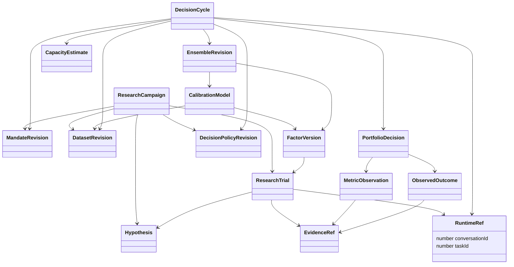
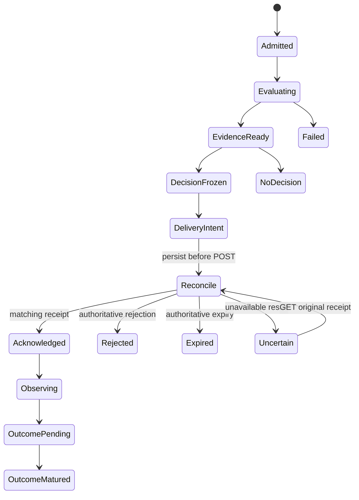

# PM 自营研究与决策系统：技术边界、持久化和业务验收设计

> 规范说明：本章展开设计依据与候选实现。实体与字段以 [规范字段合同](contracts.md) 为准；专题代码示意不是另一套 API，也不代表已经实现。
状态：**拟建方案，未实现**。本文为主方案的技术附件，字段与实体名服从主方案 `contracts.md`。记录基于当前 TypeScript service/research/Web/CLI 与官方 Pi Durable 1.1.0 架构；不延用已退役 Rust Server/Store/Mission 控制面。现有测试证明的能力与新增业务方案的验收严格分开。

## 1. 技术目标和不可混淆的责任

系统应能回答：在当时真正可用的资料、已知账户条件和原投资授权下，为什么选择这一组因子，怎样映射为资产目标，为什么投入这笔资金，哪些证据支持其容量，以及何时需要更新或保留原决策。回答必须由可重放的事实产生，而不是事后补写一段模型解释。

四个所有权边界：

1. QuaZonai 的 TypeScript 业务层定义研究、事实、比较、决策、资金建议和 API；新业务实体属于这一层。
2. 官方 Pi Durable 定义任务持久化、执行、所有权、等待、恢复和取消；业务状态不能冒充第二套任务运行时。
3. 官方 NautilusTrader、Clarabel、Arrow 与保留的 Rust 科学内核负责它们已支持的回放、数值计算、原生类型和校验。新增方法通过公开适配接入，不复制上游实现。
4. 下游执行端拥有真实账户、订单、撤单、成交、资金出入和原生控制状态。QZ 交付 target；接收 target 的回执不是成交，停止本地任务也不是撤销远端订单。

主方案统一实体链为 `MandateRevision → ResearchCampaign / DecisionCycle → PortfolioDecision → ObservedOutcome`，其依据通过 `DatasetRevision、ResearchTrial、EvidenceRef、MetricObservation、FactorVersion、CalibrationModel、EnsembleRevision、CapacityEstimate、DecisionPolicyRevision` 连接。因子权重、资产权重和账户资金占比有不同分母与计算作用，任何接口都不能共用一个无类型的 `weights` 字段。若同一账户容纳多个独立策略，规范 `PortfolioDecision.strategyAllocations` 记录各 StrategyVersion 的资金计划，并在共同账户净额与风险层验证；它不能被解释为因子权重。

跨策略生命周期另由主合同的 `StrategyDefinition、StrategyVersion、CapabilityDescriptor、PipelineAssessment` 明确表达。实体是业务语义，不要求每个草稿节点都有一对一数据库文档；只有需要稳定身份、独立修订或正式引用的事实才单独持久化。值对象可嵌入其所属冻结版本，避免无必要的实体拆分。

## 2. 现有能力：逐项源码证据与拟建边界

以下路径均相对于仓库根目录。实施时应把验收 Head、依赖锁文件摘要和科学二进制摘要写入验收清单；路径只负责定位，不能代替版本绑定。

| 能力 | 当前真实落点 | 当前能证明什么 | 新方案必须补足什么 |
| --- | --- | --- | --- |
| 公共 Wire 合同 | `packages/contracts/src/index.ts`、`research.ts` | 已有 ResearchSpecification、ResearchStart、PortfolioStart、FactorView、TargetReceipt、ObservationView；金额及多处权重为 decimal string | 新实体及一致状态、版本、时钟和血缘；不能把旧 DTO 的展示字段当完整领域模型 |
| HTTP 业务准入 | `apps/service/src/service.ts`、`workbench.ts` | `/api/v3` 路由；研究/组合/观测请求准入和原输入保留 | 将新 Mandate/Policy/Dataset 修订冻结到命令；对业务修订做并发冲突检查 |
| 官方宿主和原请求恢复 | `apps/research/src/host.ts` | 官方 SQLite/Harness；原 request ID 与原 body 绑定；原 admission/stop/resume 串行；重启补交未提交的原请求 | 新实体到 Pi IDs 的独立映射；业务命令与任务创建同一持久化提交 |
| 研究输入与账本 | `apps/research/src/documents.ts`、`trials.ts` | Study 保存原 input/trials/final；计算前写 STARTED；已提交 FAILED 不变成免费重试 | 新 Hypothesis/ResearchTrial 和批量比较快照；不能丢掉失败、拒绝和曝光成本 |
| 持续研究 | `apps/research/src/continuation.ts` | 原 GenerationTask.onYield 在原试验预算内续接；没有第二后台循环；宿主关闭后不承诺继续 | 根据业务信息价值与原预算决定下一实验；不是按工具调用次数停止 |
| 原生子任务 | `apps/research/plugins/native-factor-task.ts`、`native-portfolio-task.ts` | 官方 Task；父任务一次记录并等待原子任务；因子和共享账户策略分别有原始结果 | 新校准、组合学习与容量实验也必须绑定原子任务和明确计算方法 |
| 证据分块 | `apps/research/plugins/native-evidence.ts` | 原生 JSON gzip/base64 分块保存在同一官方 DocFamily；最终 task outcome 引用完整产物 | 可校验内容摘要、媒体类型、结构/行数、方法和来源血缘；百万行序列不能塞进 UI/模型摘要 |
| Sealed 曝光事实 | `apps/research/plugins/native-exposure.ts` | session 级窗口，按实际 BAR 身份和时间交集检查；复制目录/改名/开新根不能自动恢复独立性 | 支持新 DatasetRevision 的跨版本内容与样本关联；未知关联不能标为独立 |
| 多因子共享资金回放 | `apps/research/plugins/strategy-portfolio.ts`、`native-portfolio.ts` | 原成员与权重冻结，一次共享账户模拟；Validation 和最终 Heldout 隔离 | 校准、成员学习、资产优化、PM 关系/结算/成本的明确业务方法和原始数据 |
| 组合事实 | `apps/service/src/facts.ts`、`science.ts` | Application session Doc 保存 portfolios/observations；BuildPortfolio 为官方 Task | 新 PortfolioDecision 及其因果输入；大规模历史按 DocFamily 拆分，避免所有事实无限增长在一个对象里 |
| 自动账户调整 | `apps/service/src/automatic.ts` | `qz.account-adjustment` 官方 Task 的 snapshot/deliver/reconcile/wait 相位；绑定账户序号、原生时钟、控制修订、容量和有效期 | DecisionCycle 的业务更新规则、升级/降级解释与学习策略；现有 wait 间隔不等于业务 SLO |
| target 外部交付 | `apps/service/src/science.ts`、`downstream.ts` | unsafe POST 前把 checkpoint 转到 reconcile 并写 UNCERTAIN；重启查原回执，不盲目重发 | 新决策绑定 target/receipt 的审计链；下游不支持所需原子控制时明确不可交付 |
| 账户观测 | `apps/service/src/downstream.ts` | client/account/currency/mode、sequence/nativeClockNs 校验；同序号不同物理内容冲突；缺估值保留 null | ObservedOutcome 的结算/成熟度、收益归因及来源可信性；不把 ACK 计为成交结果 |
| 数据入口 | `apps/service/src/config.ts`、`dataset-export.ts`；`runtimes/data` | 配置式 catalog 与请求；原始工具可导入更多数据形式，但当前科学链主要消费 BAR | 真实不可变 DatasetRevision、可得时间证据、修订历史、市场/事件关系、结算/规则版本 |
| 模型与设置 | `apps/research/src/models.ts`、`settings.ts`、`credentials.ts` | 官方 provider；独立 app 凭据库；原会话模型保存在 pi.agent；宿主设置可动态变化 | 冻结影响科学解释的模型/提示/工具/方法版本；运维重试设置不能偷偷改变投资策略 |

当前明确缺口：没有完整 PM 业务实体闭环；没有通用的不可变数据修订与内容摘要链；没有可从 summary 反推出的配对因子收益矩阵；没有由一组 IC/Sharpe 自动证明的净成本最优权重；没有得到原始盘口和规则支持的全市场可执行容量。`catalog-ensemble` 路径缺少原始 book/receive clocks/真实制度时只提供有声明条件的 pUSD、long-only、1x margin 代理回放，不能宣称真实市场可执行套利。

## 3. 官方 Pi Durable 与 Chord 的公开 API 使用范围

本次核对版本为 `@earendil-works/pi-durable`、`pi-ai`、`chord` **1.1.0**，以 `apps/research/package.json` 与 lockfile 为准。

| 公开机制 | 方案中的使用方式 | 禁止误读 |
| --- | --- | --- |
| `defineDoc` / `defineDocFamily` | session 保存不可回卷的全局 admission、曝光、业务修订与索引；conversation 保存研究上下文；task 保存局部子任务关联 | conversation rewind/fork 不是删除已发生的预算消耗、曝光或外部交付 |
| `Harness.open` / `harness.commit` | 在同一官方持久化提交里检查业务版本、记录命令和创建官方任务 | 不直接写官方 SQLite 内部表，不并开多个宿主争用同一库 |
| `defineTask` / `tx.createTask` | 可恢复业务计算使用明确 phase；child 指定 task ownership | 不另建 cron、BullMQ、私有轮询队列或复制官方任务状态机 |
| `runtime.commit` | 同时提交领域事实和下一 checkpoint/terminal outcome | phase 返回前未取得持久化进展不算完成；内存对象改变不算保存 |
| `runtime.waitForTask` / waiting checkpoint | 等待原 owned child；崩溃后仍用原 ID | 每次重放新建 child 会重复计算、曝光和收费 |
| `runtime.memo` | 小型确定性原任务绑定可使用公开持久化 memo | memo 不能绕过业务命令冲突、证据鉴别或外部回执 |
| `runtime.signal`、Chord `Context` | 取消传播至进程与 I/O；清理与回收按官方环境语义处理 | 本地 abort 不证明 provider、下游或交易所已取消 |
| `runtime.sleep(until, context)` | 在官方任务已有 wait phase 内等待；checkpoint 保存 wakeAt | 不承诺硬实时唤醒，也不额外建立第二计划调度源 |
| Doc `version`、`migrate(value, fromVersion)` | 持久化形状演进；逐版本纯转换与兼容验证 | 升字段版本不是重新评价旧证据，也不能无依据补造历史数据 |
| Task `version`、`migrate(input, checkpoint, fromVersion)` | 兼容仍未终止的旧 input/checkpoint；公开声明支持的旧版本 | 不能只重命名 phase 就部署；不会自动证明旧外部副作用安全 |
| Chord services/facets/replicated state | 按需复用官方类型化服务组合与视图同步；当前 Fastify API 继续作为业务入口 | Chord 是组合/通信能力，不是第二持久化账本或恢复引擎 |

官方 Task runtime 在 phase 边界刷新 registry snapshot，宿主 settings 可动态读取。因此“输入没变”不自动等于“方法没变”：必须在业务输入固定 `DecisionPolicyRevision`、运行版本和所需方法；旧任务不能不留记录地用新模块解释旧 checkpoint。

官方 watch 是最新视图传递，不是完整审计事件流。消费端可能收到合并后的视图；重连必须重新读快照与其版本。若未来暴露 SSE/WebSocket，消息声明 `SNAPSHOT / UPDATE / RESET_REQUIRED`、绑定业务修订和游标，仍以持久化事实查询为准，不能承诺逐个 UI 消息无损重放。

官方来源：

- [Pi Durable 1.1.0 README](https://github.com/earendil-works/pi/blob/v1.1.0/packages/durable/README.md)
- [Pi Durable 公共类型](https://github.com/earendil-works/pi/blob/v1.1.0/packages/durable/src/types.ts)
- [Pi Durable 文档定义](https://github.com/earendil-works/pi/blob/v1.1.0/packages/durable/src/documents.ts)
- [Pi Durable Task 定义](https://github.com/earendil-works/pi/blob/v1.1.0/packages/durable/src/tasks.ts)
- [Chord 1.1.0 README](https://github.com/earendil-works/pi/blob/v1.1.0/packages/chord/README.md)
- [Chord 公共出口](https://github.com/earendil-works/pi/blob/v1.1.0/packages/chord/src/index.ts)

这里使用公开 API 的适配方案，不涉及上游 fork、源码复制、内部表协议或自制 scheduler。

## 4. 类关系与落点

下图是主合同实体之间的技术引用关系；箭头表示冻结引用，不表示把被引用对象内嵌复制。金额与权重类型由主合同统一，`RuntimeRef` 只是运行时绑定值对象。

`RuntimeRef` 按主合同保存 `conversationId:number` 与 `taskId:number|null`，均按官方 branded ID 校验安全整数；尚未建立完整会话的回执不能伪造数字0。新业务 ID 绝不通过 `Number(id)` 转成 Pi ID。跨运行库复制/导入需有迁移清单记录库身份和映射，避免不同 SQLite 库内相同数字 ID 被误认为同一任务；这不是本版 Wire 合同新增的运行时字段。业务修订引用不以当前 Pi task state 为存在前提；结束的任务不能让已冻结业务事实消失。

拟建源码落点应服从现有模块边界：

| 内容 | 建议落点 | 适配关系 |
| --- | --- | --- |
| 精确 Wire 类型、校验枚举、视图 | `packages/contracts/src/` 的专题文件，由 `index.ts` 受控导出 | 主 `contracts.md` 先定义语义；生成/校验的来源唯一 |
| Mandate、DatasetRevision、Policy、DecisionCycle 的业务服务 | `apps/service/src/` 的专题模块 | 复用 facts/host 的官方事务；HTTP handler 不直接跑模型或数值循环 |
| 研究提案、账本、验证反馈与搜索工具 | `apps/research/src/`、`apps/research/plugins/` | 保留原 Study、trial/exposure 的所有权，不建平行 research DB |
| 对齐面板、校准、成本/容量实验的科学适配 | `apps/research/plugins/` + 必需的 `apps/job` 入口 | 大数组走原生证据/Arrow；TS 保存引用和结果摘要 |
| 纯科学合同、约束与数值实现 | `crates/contracts`、`crates/domain`、`apps/job` | 只新增科学所必需内容；不恢复 retired store/runtime/server |
| 数据 manifest/规范化来源工具 | `runtimes/data`、`apps/service/src/dataset-export.ts` 附近 | 保留原始证据；目录不是业务修订身份 |
| 主人视图与解释 | `apps/web/src/`、`apps/cli/src/` | UI/CLI 复用同一决策视图，不能各自计算排名和“通过” |

### 4.1 策略插件、模板与能力绑定

当前 `apps/research/src/strategy.ts` 只有 `factor-threshold`、`cross-market-threshold` 与 `catalog-ensemble` 等明确联合类型；`forecastMode:'price-volume'` 也只是特定可支持输入路径。当前配置里载入官方 `defineExtension` 并不自动赋予所有策略类型、资产类别和市场制度的科学支持。新方案不能把“插件已启用”显示成“所有pipeline已就绪”。

`StrategyDefinition` 描述策略族及其专业处理阶段，例如信号/预测、事件关系、组合构造、执行假设、退出/结算及风险解释；`StrategyVersion` 冻结此策略某次可执行配置、template版本、参数/模型引用和所需能力。`CapabilityDescriptor` 描述适配器对实际数据/市场/工具合同的支持范围；`PipelineAssessment` 则对一个具体 StrategyVersion + DatasetRevision + MandateRevision + 执行目的进行检查。它不是一次安装时永远成立的布尔开关。

建议能力描述包含以下横切字段，具体字段名归入主合同：

| 维度 | 应冻结的内容 | 拒绝误判的例子 |
| --- | --- | --- |
| 适配器身份 | adapterId、版本、官方来源/依赖版本、模块内容摘要、toolSchemaVersion | 同名函数代码变更后仍声称原结果同方法 |
| 策略输入 | signal单位、horizon、featureSchema、label规则、允许成员/权重形式 | 将概率、raw score、IC直接当同周期收益 |
| 数据能力 | BAR/TRADE/BOOK、event/available/receive clocks、市场metadata/规则/关系、完整性 | 有BAR目录就宣称支持盘口套利或真实延迟回放 |
| 市场机制 | 支持资产类别、币种、保证金/现金、数量/最小订单、费用、结算/作废 | 用1x margin proxy声称cash-token settlement已验证 |
| 科学能力 | prediction/calibration/backtest/asset allocation/capacity/target、各自合同版本 | 因子可扫描便自动标为可组合、可交付 |
| 生命周期 | hypothesis/research/validation/sealed/shadow/target/observe可支持阶段 | 只有研究回放就跳到正式经营观察 |
| 数值约束 | PSD/PD需求、允许空/负权重、稀疏/异步支持、规模限制 | 数学solver能解不代表adapter接受或数据支持 |
| 交付能力 | target-only、下游控制修订/回执/撤销/观察合同、账户模式 | HTTP连通就宣称真实执行和现金退出可用 |
| 资源与兼容 | task/doc输入版本、所需binary版本、资源画像、migration支持 | 新template无法解释旧checkpoint仍自动恢复 |

模板是完整、可版本化的默认结构与允许搜索空间；它不是悄悄注入资金、费用或绩效阈值的装置。每次使用模板展开成冻结 StrategyVersion，保存templateId/version及实际effective参数。模板升级不会改变已经开始的ResearchTrial或已交付PortfolioDecision；新版本要产生新的策略修订和PipelineAssessment。

PipelineAssessment逐阶段输出“已支持/有条件支持/缺证据/不支持”的原因、所需证据、实际provider与能力版本绑定。具体状态枚举采用主合同，不再创建一套近义状态。检查必须以实际能力交集为准：策略需要的能力、数据确实提供的能力、科学adapter实现的能力、Mandate允许的范围、下游已确认的能力共同满足，才允许进入相应阶段。现有缺口不能由模型一句“可以做”覆盖。

新策略插件继续通过官方extension注册工具与Task，策略族不是新调度器；纯模板/能力校验可先独立验证，只有需要执行的步骤才创建官方任务。若新模板需要全新科学ABI、数据种类或市场机制，应明确列为新能力开发，不能将旧测试数量记作覆盖。

## 5. 与规范合同的技术映射

本章解释 [contracts.md](contracts.md) 中字段如何落到官方运行时，所有公开对象复用该规范。需要额外原始来源元数据时，放在有 `schemaId` 的 EvidenceRef 内容中；若将来成为公开 Wire 字段，先修改规范合同。

### 5.1 标量、身份与结构版本

| 规范字段/类型 | 持久化与校验语义 |
| --- | --- |
| `Id` | opaque string，非空；不从显示名称、可变目录或Pi数字强转生成 |
| `RuntimeRef` | 官方conversationId/taskId安全整数的明确引用；与新业务ID分开 |
| `Ns` | 非负整数字符串，无指数/小数，用BigInt比较；对接Rust时额外检查原接口范围 |
| `Decimal` / `Money` | 精确十进制字符串；金额绑定currency，权重明确分母；不经Number计算 |
| `VersionedFact.schemaVersion` | Wire/存储结构版本，不是业务内容、模型或任务版本 |
| `VersionedFact.revision` | 同一业务身份的单调状态修订；官方事务校验expectedRevision并推进 |
| `VersionedFact.id/supersedesId` | 不可变策略、方法、数据、正式证据等新内容产生新ID并链接前驱；不覆盖旧科学事实 |
| `VersionedFact.createdAtNs/producerVersion` | 原创建时间与生产者版本；源码版本不替代模型、二进制、依赖和提示证据 |

ResearchCampaign、ResearchTrial、DecisionCycle等活动聚合使用稳定ID，在官方事务内推进revision；保持原输入、原预算和状态转换历史。MandateRevision、DecisionPolicyRevision、StrategyVersion、EnsembleRevision等冻结对象发生语义改变时创建新ID。不可变对象的状态投影/活动指针可变化，但不改原科学正文。这些逻辑约束由业务服务实施，官方Doc不会天然禁止修改JSON。

旧 `ResearchReceipt.conversationId/submissionId` 与 `FactorReference.researchId/trialId/memberIndex` 保持原合同。新ResearchTrial通过规范 `runtime:RuntimeRef` 绑定原任务，不重新解释旧numeric trialId为新业务Id。

### 5.2 时钟字段与原始来源证据

| 规范字段 | 精确定义及来源 |
| --- | --- |
| `EvidenceRef.eventInterval` | 此证据描述的原事件区间；可能未知为null |
| `EvidenceRef.availableAtNs` | 证据在指定信息集真实可使用的时刻；必须有来源，不能用下载时间倒填历史 |
| `EvidenceRef.clockPrecision` | 源实际分辨率；不因字符串编码为ns就声称NANOSECOND |
| `DatasetRevision.availableThroughNs` | 声明的数据可用watermark，不自动证明此前无缺失 |
| `DatasetRevision.admittedAtNs` | 此数据修订完成准入的本机时刻，不冒充原历史可得时刻 |
| `PredictionRow.eventAtNs/decisionAtNs/featureAvailableAtNs` | 分别保留事件、预测决策与特征可得时间 |
| `PredictionRow.labelEndNs/labelAvailableAtNs` | 标签周期终点和真实成熟可用时间；未成熟保持null |
| `DecisionCycle.asOfNs/availableCutoffNs` | 本次决策描述时点与允许读取信息的截止；输入依赖版本同时冻结 |
| `PortfolioDecision.validUntilNs` | 由所有输入时效和策略规则共同约束；null不代表永久有效 |

采集器received/ingested、时钟来源/偏差/质量、原始规则公布时间等，保存到Dataset/Evidence原始内容，由schemaId解释，不在本附件新增另一套同义公开字段。若原可得时钟未知，不能创建声称历史PIT成立的证据；相应DatasetRevision质量状态和PipelineAssessment明确不足。

当前 `nowNs()` 为 `Date.now() × 1_000_000`，即毫秒精度编码为ns。延迟测量使用单调时钟；跨重启不直接比较单调原点。原event早于cutoff但available晚于cutoff的数据不能进入该次决策。后下载全历史文件也不会让后来修订的字段在历史时点可用。

### 5.3 EvidenceRef 的完整性、可见性与生产者

规范字段 `sourceKind/role/runtime/objectKey/contentDigest/mediaType/sourceRevision/eventInterval/availableAtNs/clockPrecision/schemaId/visibility` 是唯一公开结构。

- `objectKey` 为服务内受控引用，不允许客户端提供任意本机私有路径；读取服务按证据ID解析。
- `contentDigest` 按规范为 `string|null`。schemaId规定具体摘要算法/规范序列化版本；null保留旧源能力限制，不能宣称已校验字节不可变。
- 原生数据体积、行数、shape、编码、上游证据、app/lockfile/native binary/model/prompt/tool版本放在有schemaId的产物manifest；引用链可检索，不要求每项元数据都变成独立领域实体。
- `role` 区分TRAINING/INNER_VALIDATION/SELECTION/INDEPENDENT/PREQUENTIAL/OBSERVED/CONTROL；`visibility` 只用规范RESEARCH_VISIBLE/OWNER_ONLY。展示到其他页面不会改变原研究角色或允许Sealed调参。
- 缺块/摘要不符的产物不可作为可用科学证据。计算失败可留诊断产物，其业务状态必须明确失败，不能发布成功指标。
- 大型产物校验完成后才发布其引用。同库分块最后一笔提交发布完整引用；若未来外置不可变文件，明确临时写入→校验→rename→manifest发布和孤儿回收，不伪造文件与SQLite跨介质原子事务。

### 5.4 MetricObservation 的口径与排序

规范 `definition.valueEncoding` 决定value为finite number、Decimal或integer string；`status` 使用统一Availability，非AVAILABLE的value必须null。raw保留原nativeKey/value/unit/conversionVersion；规范回撤的非负损失与Nautilus原负回撤必须通过显式转换，不能在各页面各自取绝对值。

`role/interval/asOfNs/availableAtNs/origin/methodRef/evidenceRefs/sampleCount/expectedCount/uncertainty`共同解释指标。比较上下文还需冻结币种、费用、起始资金/现仓、收益类型、日历、年化天数和窗口；同名指标不代表可比较。sampleCount不等于独立事件数；有效样本量只在已验证uncertainty方法确实估计时给出。

本版MetricObservation作为有明确所属对象的值对象，不要求每条都新建独立ID/Doc。真正需要跨对象直接引用时，通过规范定义的EvidenceRef/MetricDefinition和所属业务版本检索，不能在附录私设另一套指标数据库。

### 5.5 命令回执、并发与错误

新命令采用规范 `requestId/expectedRevision`；浏览器重试复用原requestId和完整原body。异步回执至少为 `{requestId,entityId,runtime,state,viewPath}`。202只表示持久化准入，不表示计算、投资价值或可交付性成立。

服务内部可保存bodyDigest、admittedAtNs与完整原请求，以检查同key同内容；这些内部字段不构成另一个公开CommandReceipt合同。Digest需要版本化规范序列化，不能直接把现有canonical()函数等同哈希协议。

错误体统一为 `{code,category,entityId,reasonCodes,retryable,requiredEvidence,correlationId}`；category与HTTP状态采用规范API章节。旧Problem错误合同按兼容入口保留。provider限流、科学能力缺失、预算不足、证据不成熟与外部回执不确定是不同原因，不应统一显示“重试一下”。

## 6. 新 API 清单与兼容策略

### 6.1 当前已存在的主要路由

所有下列路径以 `/api/v3` 为前缀：

- `GET /datasets`、`GET /research/models`。
- `GET /research`、`GET /research/:id`、`GET /research/:id/diagnostics`、`POST /research`、`POST /research/:id/stop`、`POST /research/:id/resume`。
- `GET /factors`、`GET /factors/:id`、`GET|POST /factors/:id/capacity`。
- `GET /portfolios`、`GET /portfolios/:id`、`POST /portfolios`、`POST /portfolios/:id/capacity`。
- `GET /observations`、`POST /observations`、`POST /observations/:id/refresh`、`POST /observations/:id/stop`、`POST /observations/:id/automatic`。
- `GET /observations/:id/capital-exits`、`POST /observations/:id/capital-exits/preview`、`POST /observations/:id/capital-exits/commands`。
- `GET /usage`、`GET /workspace`、`GET /extensions`、`PATCH /extensions/:name`；模型/登录/设置路由另保持原合同。

当前 research path 中的 id 仍为原 numeric conversation 语义；新 campaign API 不应隐式替换这一点。

### 6.2 拟建路由：严格复用规范名称

完整API由 [contracts.md](contracts.md) 第5章维护，下表说明同一路由的技术责任，由同一规范统一命名与语义。

| 规范方法/路径 | 技术责任与持久化边界 |
| --- | --- |
| `GET /capabilities` | 只读能力及实际adapter绑定；不触发新的科学计算 |
| `POST /mandates`、`POST /mandates/:id/revisions` | 原意愿冻结为新修订，保留原话/解释；修改通过expectedRevision检查 |
| `POST /datasets/:id/revisions` | 原始引用与来源证明准入；完成数据质量/时钟检查后发布新DatasetRevision |
| `POST /campaigns` | 冻结mandate、strategyDefinition、dataset等原输入与预算；同事务创建官方任务和runtime引用 |
| `GET /campaigns/:id/decision` | 读取正式CandidateComparison及其输入集合；不临时再调用模型选赢家 |
| `POST /campaigns/:id/close` | 关闭新增实验并完成原收尾；保留失败、预算与Sealed曝光事实 |
| `GET /strategies/:id/versions`、`GET /strategies/:id/assessments` | 分页读取正式版本及阶段证据，不因当前插件enabled伪造历史支持 |
| `GET /mandates/:id/decision` | 当前正式PortfolioDecision及其时效；原版仍可审计 |
| `POST /mandates/:id/recompute` | 显式重算创建DecisionCycle；正常新事实事件无需主人手动调用 |
| `GET /cycles/:id` | 业务状态、依赖、耗时和原因；不暴露运行时凭据/私有上下文 |
| `GET /capacity-estimates/:id` | 原容量等级、资本曲线、条件/有效期和未知项 |
| `GET /decisions/:id/diff` | 两个正式版本的因子/资产/资金/成本/原因差异 |
| `GET /decisions/:id/evidence` | owner可见原证据分页；模型反馈仍受原角色隔离 |
| `GET /decisions/:id/outcomes` | 原target到权威账户/成熟结果链；ACK不转换为fill |
| `POST /strategies/:id/pause`、`POST /strategies/:id/retire` | 关闭新目标的业务准入；原未决target/持仓继续保留对账责任 |

规范API亦包含Campaign及Trial读取、Campaign暂停/续接、Mandate决策历史、Strategy恢复等闭环操作，沿用相同官方事务、原账本和回执绑定，本表不重复列举。其他新target交付入口必须先补充规范及授权/幂等合同。现有 `/research`、`/portfolios`、`/observations` 继续保留原兼容行为。原始available时钟、费用模型、市场关系缺失时明确未知，不为兼容补假默认值。

## 7. 持久化、版本、血缘与重放

### 7.1 四种版本必须独立

1. `schemaVersion`：字段结构如何解码。
2. 业务修订 ID/revision：谁的意愿、数据、成员、方法发生变化。
3. 方法/运行版本：这次结果由何种工具、提示、模型声明版本、native 二进制与依赖产生。
4. 观察序号/控制修订：外部账户或来源在什么时点给出的哪个事实。

schema migration 不得改变旧统计值、日期、现金、成交或评价分区。需要新口径时产生新的 EvidenceRef/MetricObservation 并引用原始证据，不覆盖原结论。技术 decode migration 和“使用新方法重新评价”是不同命令。

### 7.2 官方文档存储布局建议

- 一个 session DocFamily 成员对应一份不可变业务修订/正式证据 manifest；键使用 opaque业务ID，kind 保持稳定，版本明确。
- 单独的 session Doc/DocFamily 维护 command admission 与 current pointer，使用官方 `commit` 原子检查 expectedRevision 和写入。
- conversation Doc 仍承载原研究上下文与模型可见摘要；全局预算消耗/曝光/正式决策不能被 conversation rewind 撤销。
- task Doc 保存原子任务/产物暂存关联；task 结束后业务 manifest 仍可解析原结果。
- 读索引是派生视图，记录 `sourceRevision/cursor`，允许重建；不是第二业务真实来源。读取超大历史使用分页，不能靠一次复制全部 Application JSON。

正式业务记录不调用“删除后重建”制造新鲜感。原证据若失效，产生明确 invalidation/retirement 事实，保留原因与受影响决策；过去某时点已作出的决定保持原样。

### 7.3 新命令的原子准入

一次 `harness.commit` 里：检查 requestId 既有记录 → 同内容则返回原回执 → 不同内容则冲突 → 校验 expectedRevision 与所引用修订 → 校验本次预算保留是否允许 → 写规范命令回执/业务输入 → 创建 owned官方Task → 记 RuntimeRef/预算reservation。具体事务接口调用依实际官方类型实现，不能伪造跨库原子性。

`canonical()` 当前是键排序结构等价函数，并不是内容哈希协议。拟建 digest 需要单独版本化 canonicalization，规定 Decimal 字符串规范、对象键顺序、数组顺序、空值和禁止非JSON数值。原请求原文/原规范化版本仍保留；哈希冲突检查不能只比较一个用户可传 digest。

命令的 idempotency scope 明确为本地 runtimeInstance 与 command kind/requestId；是否跨导入库继承由迁移合同声明。错误响应丢失后客户端再次提交同 requestId，应返回同 command/resource，不增加 trial 或模型调用预算。改资金/数据/候选是新业务命令，不能偷偷沿用旧 key。

### 7.4 对外副作用的恢复状态机

这是业务恢复模型，实际执行仍由官方 Task checkpoint 驱动；不得再实现一个独立执行状态机。`Acknowledged` 仅表示 target 被接受；`OutcomeMatured` 需要相应账户/市场/结算证据。停止和失效作为单独控制事实，不能把已经发生的 DeliveryIntent/ACK 抹掉。

发布新 target 前重新验证原 target TTL、EvidenceRef 有效期、capacity、账户sequence、controlRevision与资金reservation；任何一个变更应回到新 DecisionCycle 或明确拒绝，不能将新事实拼进旧 PortfolioDecision 并保留旧ID。无法证明未发出的错误保持 UNCERTAIN；只有明确 pretransport rejection 才可记 NOT_OFFERED。

### 7.5 重放的三个不同承诺

- **事实重读**：读取同一原结果和解释，不重新运行模型，不重复消费试验预算。
- **计算复验**：在冻结数据/工具/方法下重新跑确定性内核，记录新复验结果及差异容忍规则；不重写原结果。浮点容忍按数值方法与量纲规定，不能统一拍一个 epsilon。
- **重新研究**：新模型调用、新方法或新可得数据均产生新 ResearchTrial/DecisionCycle，计入相应原预算/新授权预算；不能伪称“原样恢复”。

LLM provider 的后端版本可能不可固定。应保存原输入、模型声明、响应和工具轨迹以实现事实重读；除非实际取得可重现的后端与随机源证据，不承诺逐 token 重现。随机数 seed、线程/数值库差异与 deterministic 能力写入 producer 证据。

## 8. 线上更新分层与时效

原则：新事实进入时，先判断它会改变哪个业务结论；只失效相应依赖和开启必要的新周期。每个更新都保留原决策及新版本的原因，不能一边展示原依据一边运行新权重。

| 层 | 触发来源 | 工作内容 | 需要冻结的依据 | 未就绪时行为 |
| --- | --- | --- | --- | --- |
| 元数据/制度 | 新市场、规则/费用/结算变更 | 更新市场关系、可交易状态与 DatasetRevision | 原规则文本/时间、关系证据、版本 | 受影响市场标为不支持/待核实；不自动猜制度 |
| 行情/特征 | 原始事件或可用 BAR 到达 | PIT校验、增量特征、有效性/缺值 | 数据版本、availableAtNs、特征/校准版本 | 保留明确陈旧状态；是否减仓由原 Mandate/Policy 与执行能力决定 |
| 确定性决策 | 新可用特征、账户/控制变化 | 资产目标、成本/容量、资金约束、解释 | EnsembleRevision、Policy、账户sequence、时点 | 若原目标仍有效可保持；不能把未观察到的现金当已释放 |
| 目标交付/对账 | 新正式决策或未决回执 | target admission、原receipt查询、账户观测 | 决策ID、account/control、validUntil | 不重发未知POST；UNCERTAIN 明示并限制冲突命令 |
| 研究/学习 | 新成熟结果、结构漂移、信息缺口 | 新 Hypothesis/Trial、校准/组合/方法比较 | 训练与独立样本边界、预算、完整试验账本 | 在线使用已批准的原版本或无新决策；研究未完成不替换线上方法 |
| 主人视图 | 持久化事实/投影更新 | 展示依据、缺口、风险与新旧变化 | projection source revision | 重连读快照；stale提示，不伪造“实时” |

### 8.1 SLO 必须先测量再冻结

不预写“毫秒级全市场更新”“每秒最优组合”或“24小时无间断”的承诺。先建立实际工作负载档案：市场/事件数、BAR/盘口频率、活跃因子数、持仓数、数据体积、设备CPU/RAM/I/O、provider限速、观察端延迟、算法复杂度和并发研究数量。

每层记录：输入可得至接收延迟、接收至校验延迟、排队时长、计算时长、持久化耗时、决定至offer耗时、offer至ACK/不确定耗时、账户观测年龄、视图年龄。分别统计 p50/p95/p99、最差样本、超时/失败/未知比例和样本量；端到端延迟不能由各层p99简单相加推算。

SLO清单拟建字段：`profileId`、`workloadDigest`、`hardwareRef`、`methodRevisionId`、`measurementWindow`、`metric`、`sampleCount`、`quantiles`、`failureRate`、`approvedTarget`、`measurementEvidenceRefId`。`approvedTarget` 在未测/未确定前为 null；这是诚实的未定合同，不是0。

业务 freshness budget 来自可接受信息年龄、市场机制和账户约束，系统处理SLO来自实际性能；二者不能互相替代。若处理速度达不到原业务有效期，应返回过期/不支持而不是延长TTL伪造可执行性。提供原期望有效期与实际耗时能让主人理解为何错过机会。

### 8.2 更新一致性和部署

- 新 Mandate 影响后续决策；已交付目标是否替换/撤销必须经过下游能力和新明确命令，不因编辑表单就认为生效。
- 新 DecisionPolicyRevision 先用历史可得/独立数据验证，冻结版本后以新 DecisionCycle 生效；线上依据不得在后台无版本热替换。
- Registry/extension更新不自动升级旧科学语义；兼容旧Task的migrate须具备未完成phase、取消、重启和未知外部效果矩阵证据。
- 部署前暂停新的业务准入、在官方边界关闭/恢复宿主并保存一致备份；不能热拷贝若干SQLite/WAL文件就宣称一致备份。沿现有部署/备份流程验证恢复。
- 主SQLite与app拥有的`${database}.auth/credentials.sqlite`按原部署规则保存；凭据不进入计划、结果、模型上下文或普通日志。
- 旧方法仍有未决target时保留其执行/对账兼容路径。回滚程序不能回滚已发生的外部副作用、预算和曝光账本。

## 9. 资源、研究与执行预算

### 9.1 当前真实语义

现有原试验预算 `max_trials` 在计算前记账；FAILED消耗一次原尝试，REJECTED不等于成功。续接不会重置账本。原生Wasm fuel可选，省略/null为未计量；显式fuel上限按原合同执行。当前QZ没有额外process timeout、memory ulimit或adapter output cap；官方Pi Durable1.1.0没有公开全局numeric concurrency参数。不能把“每轮串行工具”写成全系统并发限制。

当前自动账户调整已有资金reserve/cashBuffer/capacity/controlRevision等检查；这不等于对所有研究计算、token、历史下载和全市场内存有统一预算系统。下面是拟建业务计量与准入策略，不是现状。

### 9.2 预算维度必须独立

| 预算 | 单位/绑定 | 预留与消费规则 | 未知时语义 |
| --- | --- | --- | --- |
| 科学尝试 | ResearchCampaign/Trial count | 首次准入消费；原任务恢复不再加一次；新提案是新尝试 | 缺required预算则不能声称无限自动研究获授权 |
| 最终曝光 | 实际数据/事件/窗口集合 | 暴露前reserve；失败也可能已曝光；不能退款成未见样本 | 不能证明未曝光则保持已用/未知，禁止重新标独立 |
| 模型花费 | currency Decimal、tokens integer | provider请求前可保留可估上界；完成按真实usage核对；不确定费用单列 | usage为null，不冒充免费；无可保证费用上界时不能声称硬cap |
| 原生计算 | fuel、CPU time、rows、bytes | 由可执行原合同/OS能力强制并记录；恢复按原计算计量约定 | 没有enforcement就仅称监测，不说硬限制 |
| 并发资源 | admission permits/类别 | 通过原子业务reservation控制哪些任务被准入；实际调度交官方 | 不借此重建worker队列；需先测资源画像 |
| 存储 | bytes、retention、artifact count | 写入前检查容量/预算；发布完整产物后记录占用 | 不能自动删正式证据来制造空间 |
| 投资资金 | account/currency Decimal | 按权威可支配资金、退出reserve、cashBuffer与目标交付绑定 | 估值/可用现金/控制状态未知则不能新增无法证明的风险 |
| 执行容量 | instrument、event、capital、horizon | 根据费用/参与率/深度/有效期/冲击条件生成CapacityEstimate | 不支持即UNAVAILABLE；不以历史成交量直接等同可用资金 |

技术预算记录建议保存 `policyRevisionId`、`scopeId`、`dimension`、`unit`、`limit`、`reserved`、`consumed`、`uncertain`、`remaining`、`updatedAtNs`、`sourceEvidenceRefIds`。Decimal与count按各自单位定义；未计量用null+status，不用超大数字假装无上限。一个失败任务可能花了token、计算和曝光，但没有创建有效FactorVersion；不同维度的费用不得只由“trial失败”统一退款。

若超限，需要原生可取消时取消本地工作，并记录已消耗与未确定成本；若远端执行不能证明停止，不释放全部reservation。严格费用预算若提供方不支持可确定上界，应在该维度说明best-effort/unsupported，或只准入可证明上界的任务；不能以事后usage统计伪装硬预算。

### 9.3 预算不应变成任意研究质量阈值

主人不应被迫为每个指标填一组Sharpe/IC门槛来替代系统研究判断。Mandate表达资金、风险边界与偏好；DecisionPolicy表达统计方法和学习规则；资源预算表达可以花多少成本。三者分开：资源耗尽可以导致STOPPED/证据不足，不自动宣判策略失败；数学最优也不能覆盖主人不允许的杠杆或市场。

## 10. 从演示测试到业务可验证验收

### 10.1 证据等级与通过条件

| 等级 | 输入/执行 | 必须断言的业务结果 | 不能宣称 |
| --- | --- | --- | --- |
| A 合同/纯规则 | 小型人工可解样本 | 字段单位、null/status、身份、时钟、费用口径、约束一致；人工oracle计算正确 | 真实市场有效性 |
| B 协议/恢复 | 官方Durable/Faux、SQLite、受控下游 | 同命令只准入一次；重启保留原账本；未知交付不重发；旧状态不漂移 | 模型质量、真实成交或收益 |
| C 原生连通 | 匹配Head真实科学binary与合成catalog | 真实内核完成因子→共享资金组合→目标；独立复算原统计/约束；已成交手续费进入正确净收益 | PM真实PIT、完整盘口、套利可执行性 |
| D 原始历史业务 | 已声明来源/许可/版本/可得时点的PM真实样本 | 决策只读当时可得；事件关系、费用、结算、市场停止/作废、资金占用按规则；跨修订可追溯 | 未见未来表现、实盘成交能力 |
| E 研究独立性 | 注册训练/验证/Sealed边界，完整试验与曝光ledger | 每次候选含全成员/权重/成本假设；最终冻结再看Sealed；不足/失效不补零 | 多次查看同窗后的“独立”显著性 |
| F Shadow/Paper | 实际线上时钟/数据/设备，target-only或经授权paper | 按预先定义业务时间运行并采样SLO；陈旧/断连/重启/制度变更下安全且解释一致 | 真实资金盈利或滑点已得到证明 |
| G 外部结果观察 | 经原授权下游提供原账户/成交/结算事实 | target↔receipt↔account↔outcome链闭合，成熟/未成熟分开；成本/资金归因可核对 | QZ自身下单、ACK即fill、尚未成熟即已赚取收益 |

现有工程检查仅作为A/B/C中的部分回归。新增设计没有实现，不能把已有592项science或42项core等通过数量当成Mandate/DecisionCycle/PM业务闭环已完成。现有合成catalog与Faux结果也不应成为“基金pipeline已经专业合规”的替代证据。

### 10.2 PM业务验收场景与预测市场示例

这里PM指投资组合经理；预测市场只是已有资料的一类具体市场示例，不是项目唯一市场。每项由业务oracle、冻结输入、预期决策/禁止行为、真实输出差异、证据链接五部分组成。不是只看HTTP200。其他市场按CapabilityDescriptor补齐相应交易、融资、结算与退出场景。

1. **同事件多个outcome**：原关系证据表明哪些结果互斥/穷尽、哪些不是；系统不得把同事件多个token当独立样本或独立风险来源；关系未知时仍可做合法因子观察，但不得宣称互斥套利。
2. **当时可得信息**：一条event早于cutoff但available晚于cutoff的消息不能影响原决策；后补规则/标签形成新DatasetRevision，旧因果重放不变。
3. **原始缺值**：缺盘口/费用/账户估值/label时保留null和原因；不填0使容量、回撤、净收益或可用现金变好。
4. **候选比较**：A收益高但尾部风险也高，B稳定且收益较低；系统给出真实tradeoff、缺失偏好/证据和后续实验，不能伪称Pareto唯一最优；全亏损前沿不能标为值得投入。
5. **组合增量价值**：新增因子单独IC更高但与原组合高度重合或增加成本；同账户原生实验识别其真实边际贡献，而不是按IC比例加权。
6. **权重分层**：改变factor member weight会改变信号组合；asset target变化由映射/约束产生；capital变化包含现金、reserve和容量。三者不能相等或归一化后被静默互换。
7. **资金规模**：同一策略在小资金/大资金场景的费用、最小订单、深度/参与率和净效应不同；无冲击证据时容量状态为有条件或不可用，不按历史Sharpe线性外推收益。
8. **账户变化**：决策计算中出现退出reservation或controlRevision变化，原target不得交付；需保留计算结果并给出失效原因/新周期，而不是重新签名旧ID。
9. **不确定交付**：POST已出但响应丢失；重启只查询原receipt。ACK后账户仍无成交时只显示已接受，Outcome保持待观察。
10. **市场生命周期**：交易停止不等于已结算，resolution时间不等于现金可提现时间；无效/争议/延期/退回费用用原规则和状态处理，不能以close价格或1/0默认代替。
11. **漂移与学习**：新可得成熟样本进入训练，未成熟结果和Sealed不进入调参；新方法版本要记录相对incumbent的结果与代价，无证据则保持原策略或明确无新决定。
12. **恢复/并发/停止**：同requestId双发、stop与start竞争、父任务关闭、child结束前崩溃、提交结果后回执丢失均不产生双trial、重复曝光、双target或凭空退款。
13. **版本更新**：停在每个旧Task phase的真实SQLite副本在新版本打开，旧任务或兼容恢复或明确拒绝；不能以迁移成功就声称业务语义保持。
14. **线上时效不足**：回放负载与数据规模增加导致决策晚于TTL，系统拒绝过期目标并呈现原因，不能悄悄延长期限使测试“通过”。

### 10.3 验收包的最小结构

每次候选发布的验收包记录：`acceptanceId`、`headCommit`、`dirtyPatchDigest`（若有）、`contractVersion`、`runtimeVersions`、`binaryDigests`、`dataRevisionIds`、`workloadProfileId`、`caseIds`、`expectedBusinessOutcomes`、`actualDecisionIds`、`evidenceRefIds`、`knownLimitations`、`unexecutedChecks`、`reviewOutcome`。

每条case写“业务断言 + 为什么 + 原始oracle + 实际值”，同时保留不允许通过的反例。统计通过数仅是辅助摘要，不能掩盖单个资金/曝光/未来数据断言失败。没有原始真实数据/模型许可或下游能力时，对应等级明确NOT_RUN，不凭模拟补成功。

最终CI与独立Codex review只证明所审Head的适用工程变更；业务方案批准、市场证据、paper时效和实盘授权各有自己的证据，不相互替代。当前用户要求先设计，因此本阶段交付是经验证的设计文档，不推进部署、真实账户操作或合并。

## 11. 实施前需要测量/确定的清单

以下不以猜测填数；主方案为每项标注来源与决策责任：

- 可得目标市场原始数据的实际字段、频率、缺口、修订/结算历史、费用/制度版本与许可；BAR数据不能自动回答盘口执行问题。
- 账户与下游的实际能力：receipt幂等scope、控制修订绑定、目标替换/过期、资金reservation、成交/结算原始事实、撤销语义。
- 当前硬件与catalog规模下的时延、内存、磁盘、吞吐与provider配额；形成SLO后再选择增量/缓存/并发方法。
- 主人已有投资意愿能确定的资本/风险/市场范围，和需要由方法学学习的参数边界；不可将研究质量偏好伪装成固定收益保证。
- 校准/相关性/容量的原始训练面板是否可得；尚无配对面板则先建可比较证据，不能直接输出“学习后的最优权重”。
- 现有数字Pi身份与新业务实体的只读历史映射；缺证据旧记录是否仅保留legacy view，不强行回填。
- 大证据产物规模下，继续官方同库分块还是增加受控不可变文件仓；先测再选，官方任务数据库仍唯一。
- 具体旧Task/Doc版本支持范围与升级恢复矩阵；不兼容的能力明确暂停，而不是伪造迁移成功。

## 12. 文档与合同自身的独立验证

设计完成后，在临时目录抽取并验证：

1. Markdown本地链接可解析，仓库源码定位真实存在；官方文档URL固定版本。
2. Mermaid类图/状态图用正式parser渲染，长标签、关系和实体命名与主合同一致；提供可离线查看产物，不要求主人联网才能读图。
3. TypeScript完整合同snippet以临时tsconfig进行strict/noEmit校验；示意伪码明确标注，不冒充可编译代码。
4. 字段名/枚举/ID类型/金额单位/时间单位交叉核对；所有主体用统一实体名，旧PiID单独字段。
5. API按“现有/拟建”核查；主文档、字段合同、附录和单文件导出的目录锚点一致。
6. 无生产源码新增，无设计阶段承诺冒充已实现；现有回归结果有版本与局限，新增业务验收全部列明待执行。

这些是文档一致性与可读性验证，不是新业务系统已经实现的证明。
