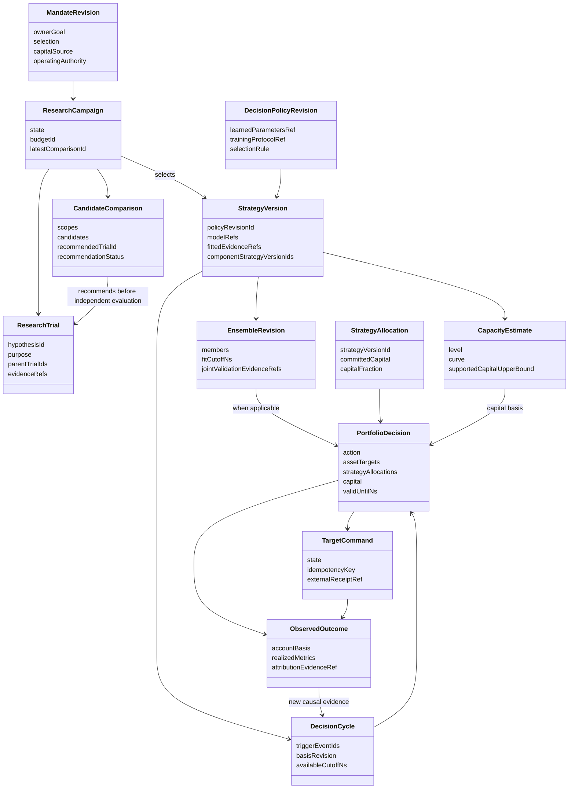

# QuaZonai：个人量化 PM 的自动投资决策设计

> 合同：本章直接使用 [规范字段合同](contracts.md) 的实体、字段与状态，不定义平行 DTO。全平台策略范式和专业生命周期见 [平台流程](platform-pipeline.md)。本章保留投资决策及算法依据，所有新增能力仍为设计。
> 状态：只读研究与方案，未实现，未进行本方案的业务验证。2026-10-22。
> 当前代码参考工作区 `/workspace/QuaZonai`。工作区含本轮工程修复；这些修复与 PR #230 不等于下述业务目标完成。
> 本文用【事实】标识已读源码或原始来源支持的结论，用【设计】标识建议，用【开放】标识尚需取证或产品决策的问题。这里的“专业”指可复现、可解释、约束一致的投资决策过程，不是行业认证或监管合规结论。

## 1. 要解决的投资问题

【事实】用户在相关研究上下文表达过约 3000 pUSD、全市场动态组合、每日净收益、稳定性、亏损日和回撤等目标。约 3000 pUSD 仅为现有研究上下文中的一个例子，不限定本次平台设计，也不是可自动认定的实时券商权益或未来固定本金。用户明确希望指标、容量、因子组合与比例尽可能由系统推导并持续更新，而非手工配置。

【设计】QZ 应当回答六个连续问题：

1. 现在的数据里，哪些经济假设值得继续研究？
2. 哪些因子提供互补且能覆盖成本的信息，哪些只是重复或噪声？
3. 在当前市场、持仓和账户资金下，应持有哪些资产、各占多少、留多少现金？
4. 这一规模下真实做过哪些回放、受什么成交或退出约束、增加本金是否仍有收益价值？
5. 新证据到来时该维持、增配、替换、减配还是退出？
6. 下一笔研究计算预算应花在哪里，什么时候继续研究已不值得？

交付物应是一条持续维护的投资决策链及其实际目标输出。指标页面只是观察决策的入口。因子数量、Sharpe、IC、回测次数和“完成”状态都不能替代账户结果。因子研究仍可独立存在；只有以投资组合为目标的程序才进入完整资金决策流程。

### 1.1 可以自动推导与不能伪装成推导的内容

| 内容 | 处理方式 |
| --- | --- |
| 可用本金、已预留资金、持仓、现有费用与最小订单 | 从已绑定的权威账户和原始交易规则读取；研究模式用明确标注的初始场景 |
| 市场集合、可用特征、因子候选、样本覆盖 | 从当前可得数据与版本化研究记录发现，按证据筛选 |
| 因子权重、资产比例、资金使用量、现金比例 | 科学计算的输出，保存计算输入与方法版本；不要求用户逐项填写 |
| 风险、相关性、成本、预测误差与流动性变化 | 从有来源的数据估计；未知项保持未知，不能以零或默认“安全”替代 |
| 窗口、正则强度、风险惩罚、更新频率 | 作为待学习策略参数，用训练期内部的时序验证选择；不能从 Sealed 结果倒推 |
| 投资偏好与使用授权 | 系统可把已有自然语言意愿转换为可解释政策；不能从市场价格推断个人愿意损失多少钱、是否允许借贷或是否授权真实执行 |

【设计】常规使用不出现长配置表。已有明确偏好可解释为 `MandateRevision.selection`；若收益与稳定性取舍仍有关键歧义，写入 `unresolvedIntent`，允许继续合法研究并用 `FRONTIER_ONLY` 返回前沿，不能暗中生成新的业主风险偏好。只有不可从数据得知的授权、资金用途或相互冲突的目标才需要澄清。政策版本必须承认风险取舍是产品选择，不包装成市场唯一正确答案。

## 2. 当前真实能力与断点

| 环节 | 已存在的事实 | 业务断点 |
| --- | --- | --- |
| 研究意图 | `ResearchSpecification` 记录问题、依据、单一评价指标、成员界限 | 仅支持 Pearson IC 或 252/365 日 Sharpe；不能表达并执行账户净收益与稳定性取舍 |
| 日历证据 | `apps/job/src/simulation/calendar_returns.rs` 已给出完整日几何收益、最差/最好日、最大绝对偏差、负收益日、零收益日和覆盖率；未定价或缺完整日时绩效不可用 | 这些证据尚未主导选池、资金选择及后续研究 |
| 试验 | 官方 Durable Study 留下尝试、失败、结果及原始输入 | `max_trials` 只是资源上限；当前 `noProgress` 看有没有新增试验，不看投资价值是否进步 |
| 比较 | `validation-compare.ts` 仅比较 `validation.pearson_ic` | 不支持全市场策略在共同本金、成本和期限下的组合取舍 |
| 停止 | `continuation.ts:25–32` 在预算耗尽时写 `STOPPED`、`trialId:null` | 预算用完直接终结，不保证先形成最佳已知组合或解释“无可行机会” |
| 全市场策略 | `catalog_ensemble_policy.rs` 在因果流上计算成员固定权重加权 score，并把当前正分数归一化到市场；同一 Nautilus 账户执行 | 市场份额会动态变化，但因子成员及成员比例不是系统估计的；score 不是预期收益或风险预算 |
| 原生优化 | `optimization.rs::allocate` 已用 Clarabel 求资产权重；有方差/CVaR、现仓、成本、现金、参与率和暴露约束 | `AlphaForecastV1.ensemble_weight` 仍是输入；现成求解器不会自动选择因子。需要同期限收益预测，不能直接填 IC 或任意 score |
| 时序回放 | `study.rs::evaluate` 已按决策时点构造输入，在一个原生账户内求解与回放 | 当前 TS 主研究路径尚未把它接成全市场自动 PM；其完整对齐的资产历史合同不能直接视为支持稀疏、异步的全部市场 |
| 容量 | `capacity.rs::assess` 有历史 BAR 参与率容量、最小实用本金、净换仓/全退出约束和资金情景 | 参与率为显式模型假设，经济容量明确不可用；`catalog-ensemble` 在 service 中直接返回容量不可用 |
| 自动调整 | `automatic.ts::AdjustAccount` 每约 5 秒读账户并调用 `size-account`，保留预留、费用、最小订单和回执 | 源组合、因子权重、目标与容量仍来自固定 portfolio；主要按资金缩放，过期则阻止，并不会自动重新选池或生成新策略 |
| 数据更新 | 配置登记数据集，离线准备/导入原数据 | 未发现 service 内完整的新市场数据登记和持续刷新任务；“持续求解”不能被写成已经拥有实时数据 |

【事实】当前目录全市场场景是长仓、1 倍保证金、pUSD 代理，使用记录成交、完成 BAR、记录费用及声明的延迟模型。它不建立真实历史盘口、原始接收时钟、物理现金账户、市场冲击或未来退出深度证据。其他科学入口有各自能力，不能借其存在替目录场景宣称支持。

## 3. 能力分层与自动决策职责

【设计】保持官方 Pi Durable 负责执行/恢复，Nautilus 负责共享账户回放，Clarabel 负责优化。新增的是自动投资决策语义，不能再造任务数据库、交易所或权益引擎。

| 层 | 自动职责 | 必须输出的事实 |
| --- | --- | --- |
| 数据与能力层 | 发现当前市场、可得特征、费用/成交/退出支持；形成带时钟的数据修订 | 当前确实能计算什么、依据来自哪里、哪些未知 |
| 研究层 | 按经济假设生成候选，判断新增候选的边际价值，分配探索计算 | 假设谱系、所有试验、已证伪内容、剩余资源与下一步理由 |
| 预测与组合层 | 校准信号，学习因子组合，估计风险，计算资产与现金比例 | 因子权重与资产权重分别列出，禁止互相混淆 |
| 资金与执行可行性层 | 根据权益、持仓、成本、成交限制、退出需求推导可用资金 | 资金曲线、条件容量、最小实用规模、未投入资金、约束来源 |
| 运营层 | 随新行情、账户或已成熟证据更新，决定维持/换仓/降风险/退出 | 每次决定的输入修订、变动原因、目标、期限与回执；ACK 不表示成交 |
| 学习与检验层 | 比较预期和实际、检测失效、形成新研究问题 | 模型误差与执行误差分开；不能用同一段最终验证反复挑赢家 |

## 4. 从研究到运营的完整流程

### 4.1 从 idea 生成可计算研究计划

【设计】模型将原始意图解释为 `MandateRevision`，建立 `StrategyDefinition`，再生成绑定原数据和预算的 `ResearchCampaign`。系统识别投资研究、纯预测因子研究或执行研究，避免所有任务强制走同一模板。对于本目标，研究单元是“全市场动态策略在一个账户内的净结果”。它自动绑定当前研究本金、币种、数据修订、原生费用和模型可支持的交易规则。研究原型由 `StrategyDefinition.archetype` 区分；预测 alpha 并非平台唯一入口。

假设必须解释预期收益来自何处、何种观察可证伪、依赖什么数据。例如成交方向与短期价格响应的假设可使用已有 ABI；盘口做市、真实跨市场套利或资金费套利必须先具备相应数据及原生结算能力。系统不能为了填满搜索空间生成不可验证策略。

### 4.2 搜索预算由信息增益驱动

【设计】沿用原 Study 全量账本：`Hypothesis.economicFamilyId` 与 `incrementalQuestion` 表达假设族和新增问题，`ResearchTrial.parentTrialIds / purpose / proposalRef` 记录试验血缘、用途和原方案；资源由 `ResearchBudget` 与用量证据约束；`ResearchWorkAllocation` 保存本轮选哪些假设、预计信息收益证据和继续/等待/收尾动作，跨相关研究的搜索规模由 `SearchFamily` 保留。基线、不同经济假设及改良候选共同竞争资源；不以试验数多代表进步。

初期采用可解释的分批探索：先测实际可运行的低复杂度基线，再扩展有成本后增益或不确定性值得减少的候选；对高度相似的参数变体减少重复投入。昂贵的多本金回放只给有潜力的组合。失败仍消费真实资源，不能通过换研究 ID 免费重置。

资源耗尽先执行确定性结项：保存最佳已知候选、未解决的取舍、无机会或证据不足原因。资源上限只约束工作量，不证明统计显著性。若要进一步用 bandit/贝叶斯优化分配预算，必须将强相关试验与不断变化的搜索空间纳入假设，不能把独立臂理论直接套到重复回测。

### 4.3 自动学习因子组合，再求资产比例

【设计】本节细化预测型策略的因子权重与资产权重。跨多个完整策略时还要区分 `StrategyAllocation` 的策略预算；它不属于以下因子拟合系数。状态/事件策略可以没有 `EnsembleRevision`，不能为了进入通用流程而伪造预测因子。

第一层从授权训练窗内生成同一目标期限的因子预测矩阵 `F` 和成熟标签 `y`。复用 `ScoreCalibration::fit` 的真实拟合思想，将任意 score 校准为同期限收益预测；新科学适配可用已有 Clarabel 解非负、和为 1 的正则组合：

`a* = argmin ||y - F a||² + λ ||a||², a >= 0, sum(a) = 1`。

这是一项设计，不是当前已实现的因子学习器。正则强度、训练窗口与必要的成员筛除从训练期内部的连续时序验证确定；记录所有参数尝试。线性误差最小不等于赚钱，必须再由完整共享账户回放决定该组合的投资价值。不能把一个成员的独立账户收益直接加权当成联合资金结果，也不能用因子 IC 排名直接分配资金。

第二层把组合预测、同期资产风险、现仓、现金和交易成本交给原生 `allocate`：

`max_w μ_t' w - λ_r Risk_t(w) - TradingCost_t(w - w_prev) - HoldingCost_t(w)`。

其中当前原生已实现的成本/风险项按真实合同使用；上式的完整持有成本项不是对现有全部支持的声明。每次用最新可得数据更新预测、协方差与现仓，现金是可选择结果。费用后机会不足时，系统可以减少投资而不是把全部正 score 强制分完。

【开放】跨期限信号不能直接混合；高维、稀疏、异步市场不适合将不存在的共同收益补零。第一版需先建立共同可观测风险面板或经验证的结构风险模型。样本协方差可合法半正定不表示估计可靠。互斥预测市场的共同条件风险也需要真实条件关系，不能把市场数量当分散化程度。

### 4.4 自动选择资金规模和识别容量边界

【设计】系统从账户权益扣真实预留取得当前可分配范围，从原生最小订单得到下界，自动提出资金测试点并逐步细化。每个点必须用相同原模型、同一费用/成交假设和同一时期重新运行共享账户。输出资金—净收益—风险—成交覆盖曲线，找出在当前意图下有证据支持的投入规模，剩余为现金。

不能将同一条收益曲线乘以 10 当成 10 倍本金效果；费用阶梯、最小订单、可成交量和持仓路径都可能改变。

现有历史流动性上界可复用：

`Cmax = min_(instrument,BAR) [p × observedNotional / max(累计绝对净目标变动权重, 保留仓位全退出权重)]`。

其中 `p` 不是从 BAR 自然推导的真理。若没有有来源且已验证的参与率/冲击模型，不能暗中塞入 1% 并称为自动容量。此时系统仍可以计算实际测试本金下的参与率、成交、最小订单和条件收益曲线，但 `CapacityEstimate.level=ECONOMIC` 对应的证据状态维持 `UNAVAILABLE`，`supportedCapitalUpperBound=null`。

目录全市场路径需要将每次真实目标变化与当时可得 BAR 量送入需求聚合器，形成联合换仓和退出需求；不能加总成员容量。实时经济容量进一步要求当前盘口/可执行报价、费用规则、冲击标定与退出证据。数据不存在时，明确区分“研究场景下测试到的资金范围”和“当前可执行资金”。

### 4.5 Validation 的选择对象是一个完整策略政策

【设计】对比对象包含成员、权重学习规则、资产分配规则、成本模型、资金规模和在线更新规则，而不是一个最好看的标量。保持共同币种、本金、时间、数据与费用口径。先判断计算可用性，再比较账户收益与稳定性；缺日不能少算分母，原生已扣费用不能再扣一次。

主证据复用完整日几何收益、负收益日、最差日、回撤、零收益日、完整日覆盖以及账户实际 PnL。几何日收益是复合增长率，不是算术日均现金收入。若需要“每天赚多少 pUSD”，应由权威权益和现金流算每日净 PnL，并独立显示提取/入金；不能简单把百分比乘初始 3000 冒充实际收入。

用户不必提供数值技术阈值；系统先形成收益—下行风险前沿，只有 `SelectionRule` 已由明确用户目标或已接受偏好建立时才给出唯一推荐。若关键取舍未明确，则使用 `FRONTIER_ONLY` 与 `unresolvedIntent`，不默选所谓“稳定增长”默认值。推荐政策应能和现金/不调整基线比较，显示为何愿意牺牲部分收益换取更少亏损日或更浅回撤。不能声称数据本身唯一确定这种偏好，也不应把所有数值留给用户手填。

### 4.6 Sealed 验证与后续更新

【设计】仅在 Validation 选定完整政策后调用一次最终评价。评价使用相同账户口径；失败是失败，不能读最终指标继续调参。最终结果可决定该政策是否进入 Forward 观察，但不能反向选择它的参数。

需要区分两种适应：冻结政策按照预先声明的因果在线规则更新状态，是被评价的策略行为；研究模型看到 Sealed 汇总成绩后换规则，是对测试集调参。前者必须在原生模拟里实现并保存状态时钟，后者不能发生。

【事实】当前 exposure 检查禁止新 iteration 范围和既有 FINAL 区间重叠。不能声称只加定时器就能把此前 Sealed 自动转为下一期训练集。第一版持续研究可使用明确新到达、未暴露的时间段；更一般的滚动阶段迁移需要显式定义 as-of、历史角色和暴露继承，并单独验证。

### 4.7 运营中的两种更新速度

【设计】快环由新已完成 BAR、可执行流动性、持仓/权益/预留或费用修订触发。使用当前已生效策略政策重新求资产与现金目标；收益很小且不足以覆盖换仓成本时输出“不调整”。快环不会每 5 秒重新训练模型，也不会反复消耗同一历史数据挑策略。

慢环由新成熟标签、新研究结果、持久预测误差变化或新市场覆盖触发。它重新评估成员边际贡献、校准、相关性、资金效率与策略替代，形成新候选政策并走相应独立检验。新政策只在其信息已可得的未来时点生效。

退出同样是投资决策：机会衰减、组合边际收益转差、原数据不可用或资金被预留时，重新求解可减少目标或回到现金。实际平仓/资金退出仍走既有 target-only 和下游能力合同。目标零仓位、下游 ACK、真实仓位归零是三件事；没有可执行行情时不能宣称已经退出。

## 5. 业务判断与规范字段映射

本章不再声明候选类型。以下所有对象、枚举和字段均在 [规范字段合同](contracts.md) 中定义；精确金额与权重使用 `Decimal`，时钟使用 `Ns`，大对象使用 `EvidenceRef`。推导参数不能只留一个值：方法通过 `DecisionPolicyRevision` 和其引用的拟合证据保存，观测指标使用 `MetricObservation` 的来源、角色、区间与不确定性。

| PM 问题 | 规范对象/字段 | 业务规则 |
| --- | --- | --- |
| 用户到底要什么 | `MandateRevision.ownerGoal / interpretation / selection / unresolvedIntent` | 原话不覆盖；选择规则先于结果；关键偏好未知时返回前沿 |
| 用什么钱研究或运行 | `capitalSource`、`AccountBasis`、`PortfolioDecision.researchStartingStateRef` | 原研究场景和实际账户互斥；不能把约 3000 pUSD 当成实时权益 |
| 当前研究在做什么 | `ResearchCampaign.state / evaluationProtocolRef / budgetId / latestComparisonId` | `SEARCHING` 与 `CLOSING` 分开，预算耗尽仍保留结项 |
| 下一实验为什么有价值 | `Hypothesis.incrementalQuestion / economicFamilyId`、`ResearchTrial.purpose / parentTrialIds` | 新问题与重复变体可区分；失败保留原资源消耗 |
| 候选策略是什么 | `StrategyDefinition`、`StrategyVersion`、`DecisionPolicyRevision` | 完整经济/模型/配置/执行/退出规则与方法引用，不能仅存模型文件 |
| 因子比例如何得来 | `EnsembleRevision.members` 中的 `FactorWeight`、`CalibrationModel` | 因子权重与资产权重分开；训练/联合回放证据绑定原版本 |
| 多个完整策略如何分配预算 | `StrategyVersion.componentStrategyVersionIds`、`PortfolioDecision.strategyAllocations` | 外层版本采用 `PORTFOLIO_OVERLAY`；`StrategyAllocation.capitalFraction` 分母是组合承诺资金，零资金时为 null；不是预测系数 |
| 状态型策略如何运行 | `StrategyVersion.stateSchemaRef / entryRuleRef / holdingRuleRef / invalidationRuleRef`、`StrategyStateContract` | 保留库存/多腿和退出语义；不需要预测组合时 `ensembleRevisionId=null` |
| 候选为何可比较 | `CandidateComparison.scopes`、`CandidateScorecard.metrics / frontierMembership` | 相同资金、日历、原状态与成本；前沿成员不自动具备投资价值 |
| 日收益与稳定性 | `MetricObservation.definition / value / status / raw / sampleCount / expectedCount` | 正式 key 使用规范指标目录；原生键保留在 raw，不建立第二组 API 字段 |
| 容量及本金曲线 | `CapacityEstimate.level / curve / minimumTestedCapital / maximumTestedCapital / supportedCapitalUpperBound` | 流动性、条件可行性和经济容量分开；最大测试本金不等于容量 |
| 某档本金的实际结果 | `CapacityPoint.capital / netPerformance / fillRatio / replayEvidenceRef` | 费用后账户指标来自该档原生回放，不能线性缩放 |
| 配多少资产、留多少现金 | `PortfolioDecision.assetTargets`、`CapitalPlan` | `AssetTarget.navWeight` 分母是同一 NAV；`committedCapital` 与两类现金分开 |
| 当前基于什么事实 | `DecisionCycle.basisRevision / datasetRevisionIds / availableCutoffNs / dependencyRevisionRefs` | 所有输入先于可用截止；发布前核对修订，迟到计算不覆盖新事实 |
| 为什么本轮更新 | `BusinessEvent.kind`、`DecisionCycle.triggerEventIds` | 账户、成本、标签、新研究等使用规范事件枚举，不另设 cause 枚举 |
| 保持、调整还是缺证据 | `PortfolioDecision.action / status / reasonCodes` | `HOLD`、`CASH`、`NEEDS_EVIDENCE` 不混同；版本过期也不等于科学失败 |
| 已经交付或实现了吗 | `TargetCommand.state`、`ObservedOutcome.reconciliationStatus / realizedMetrics` | 目标 ACK 与真实成交/收益分开，部分对账不发布完整归因 |

指标目录中的账户净收益、亏损日比例、最大回撤等都遵循共同 `MetricObservation`。规范最大回撤为非负损失幅度，原生负值须显式转换并记录 `raw.conversionVersion`；不得在比较时混用正负方向。缺日、未定价或缺标签时，正式不可用值为 `null`，不会产生假现金收益。

拟合产生的零权重在 `EnsembleRevision.members` 中保留，和不可用数据不同。当前原生成员合同要求正权重时，仅在调用适配中剔除零权重，并保留原拟合结果及原因；不能给被淘汰成员补 epsilon。目录入口至少两个成员，最佳结果为单成员时须明确扩展原生能力或返回能力缺口，不能复制同一模型凑数。

科学接口统一使用根合同中的 `fit-ensemble`、`derive-risk`、`study-portfolio`、`evaluate-capital-curve` 和 `derive-portfolio-decision` 语义。前几项提供 `EnsembleRevision`、风险模型和 `CapacityEstimate` 所需原生证据；最后一项组成 `PortfolioDecision` 所需仓位、金额及保持/调整比较。它们不接收用户手写的最终因子比例或推荐本金，也不意味着一个万能命令已经实现。

## 6. 领域关系图

以下类名和字段来自规范合同，没有独立的候选 DTO 或运行状态枚举。

## 7. 算法取舍及不能跳过的验证

| 问题 | 建议初始方法 | 替代与边界 |
| --- | --- | --- |
| 因子组合 | 同期限校准后的非负正则组合，时序验证学习参数 | 简单平均可作真实基线；黑盒全局搜索成本更高且扩大选择偏差；IC 加权不保证成本后收益 |
| 资产比例 | 复用 MaxUtility + 成本 + 当前仓位；先按已支持风险模型计算 | CVaR 适合尾部损失但小样本尾部估计不稳定；方差不等于最大回撤；复杂模型必须赢过基线 |
| 风险估计 | 可观测共同期限样本、明确估计区间 | 收缩/因子风险模型可能改善高维估计，但当前只提供样本协方差，不能宣称已经支持 |
| 资金规模 | 自动本金网格与边界细化，每档原生共享账户回放 | 不能以线性缩放或 BAR 量替代市场冲击；缺实时证据保留条件结论 |
| 更新频率 | 按实际新信息与预测期限触发，比较交易前后净价值 | 高频重新求解不等于高频应该交易；应有由成本和不确定性推导的“不交易区域” |
| 研究停止 | 边际信息价值、可执行候选、资源上限分别记录 | 不以次数或单指标达标替代结项；没有机会时保留现金是合法结果 |
| 选择偏差 | 全试验账本、内部时序验证、外部 Validation、一次 Sealed | DSR/PBO 需要对应原始样本和完整试验分布；拥有 CPCV 或次数计数不等于已计算这些统计量 |

下列业务验证比单纯接口通过更重要：重复因子加入后不能凭数量增加资金；高 Sharpe 但成本后亏钱的候选不能占优；缺一天估值不能提高稳定性；可用本金增加不能自动假设净收益同比增长；无新信息不能反复换仓；新信息只能影响其可得时间之后；新真实预留必须减少可分配资金；预测失败与成交失败必须在归因中分开。

## 8. 完整场景

1. **首次约 3000 pUSD 研究。** 系统读真实可用市场与费用，生成不同经济假设，学习成员比例，在同一共享账户比较策略与现金基线。自动测试相关资金规模，给出推荐投入和条件限制。若仅代理数据可用，结论明确属于代理研究，不宣称可以实盘交付。
2. **新增高相关因子。** 单因子 IC 很高，但其预测和已有成员高度重复。系统比较加入前后成本后账户结果及预测残差，可能给零权重或很小权重；因子库保留研究成果，组合不因“新增成功”机械扩容。
3. **新市场突然活跃。** 全市场扫描发现新数据。只有足够的历史、规则与风险估计可用时才参与分配；缺风险关系不自动假定独立。已持仓市场即使暂时无新 BAR，仍保留真实持仓与未知可交易状态。
4. **费用上升或流动性下降。** 更新成本/流动性输入重新求解；目标可能不变、降仓或留现金。容量曲线按新修订重算，旧容量到期不续签。不能凭回测历史量声称当前退出顺畅。
5. **账户权益增加或发生提取预留。** 读取权威快照，先扣预留，再重新计算资金和资产目标。新增本金可能成为现金；成员组合也可因规模改变而变化，不能仅按原比例放大。
6. **长期有收益但偶发大亏损。** 系统展示净增长、亏损日与回撤的权衡，自动研究降低尾部暴露或替代组合；不能通过只统计交易日或隐藏未定价日期改善曲线。
7. **全部候选都不足以覆盖成本。** 输出现金/不调整建议与下一条最有价值研究问题，而非为了交付组合强行选 top 1。预算到期也保留已完成比较结果。
8. **Sealed 不通过。** 保留完整失败和曝露记录；研究模型不能看其详细成绩继续调当前策略。新研究使用允许的新数据角色，不重置旧测试集。
9. **策略目标要求退出，但市场无报价。** 输出退出目标意图与不可执行原因；保留真实风险敞口。下游确认接收后仍等待真实账户证据，不把 ACK 记为平仓。
10. **新数据未接入或服务离线。** 系统显示最后可得截止时间与当前证据状态，保持旧决策不可延长的期限；不能把定时任务运行次数当成持续实时学习。

## 9. 原始来源及适用范围

1. [QuantConnect Research Guide](https://www.quantconnect.com/docs/v2/writing-algorithms/key-concepts/research-guide)：支持经济假设驱动研究、避免反复调参、时序样本外检验、动态 universe 与 PIT。不能证明本项目某个策略盈利，也不规定所有基金必须采用相同流程或试验时长。
2. [QuantConnect Algorithm Framework](https://www.quantconnect.com/docs/v2/writing-algorithms/algorithm-framework/overview)：区分 universe、alpha、资产目标、风险和执行，并指出信号变化可能带来集中度及换手成本。支持分开“因子组合”和“资产配置”。不能证明其默认等权或全投资方式符合本用户目标。
3. [QuantConnect Backtest Report](https://www.quantconnect.com/docs/v2/cloud-platform/backtesting/report)：同时报告每日正负收益、回撤、换手、暴露与容量；其容量定义涉及流动性和市场冲击。支持账户多维决策证据，不能把我们的历史 BAR 上界自动等同其经济容量定义。
4. [Nautilus Portfolio](https://nautilustrader.io/docs/latest/concepts/portfolio/)：区分逐仓实现回报和账户逐日盯市收益，解释每日快照、货币转换与统计可用性。QZ 应继续使用明确的 portfolio returns。页面的 latest 行为需与锁定的 0.63.0 源码/测试核对，不能仅凭最新文档断言固定版本行为；原生可能回填估值，因此还需要本项目 fully_priced 与完整日检查。
5. [Nautilus Backtesting](https://nautilustrader.io/docs/latest/concepts/backtesting/)：支持依照数据粒度及明示费用、撮合和延迟模型做一致回放。使用成熟引擎不意味着缺失盘口、PIT 或冲击模型会自动获得补足。
6. [Boyd 等，Multi-Period Trading via Convex Optimization](https://web.stanford.edu/~boyd/papers/cvx_portfolio.html)：支持用预测收益、风险、交易/持有成本共同决定每期交易，以及滚动执行首期动作。作者明确不解决预测如何产生；因此求解器成功不能替代预测证据和独立评价。
7. [Cvxportfolio Manual](https://www.cvxportfolio.com/en/stable/manual.html)：支持按每个时点历史数据更新均值/协方差、变化 universe、现金账户与成本约束，说明风险惩罚是超参数。可借鉴自动估计与滚动求解的结构；不建议新增平行的 Python 投资引擎，也不把文档示例风险参数复制为本项目标准。
8. [Bailey 与 López de Prado，Deflated Sharpe Ratio](https://www.davidhbailey.com/dhbpapers/deflated-sharpe.pdf)：支持保留所有尝试并审视择优造成的表现膨胀与非正态回报。`max_trials` 不是修正本身；没有相应样本长度、试验分布与回报矩信息不能宣称已做 DSR。
9. [Bailey 等，Probability of Backtest Overfitting](https://www.davidhbailey.com/dhbpapers/backtest-prob.pdf)：讨论以候选表现集合评估择优过拟合。不能把普通 heldout、walk-forward 或 CPCV 字样当作已经计算 PBO。
10. [scikit-learn Common Pitfalls](https://scikit-learn.org/stable/common_pitfalls.html)：支持训练/测试分离与仅在训练集拟合变换，适用于校准、标准化及权重学习。普通随机切分建议不能直接替代有标签期限重叠的金融时序切分。

## 10. 开放问题与建议交付顺序

【开放】仍需精确解决：新数据源如何持续登记及证明 available time；如何在不改变曝露事实的前提下推进研究周期；稀疏全市场风险面板；原始条件/市场相关结构；目录资金需求追踪；现金日收益及入金/提取口径；真实经济容量必需的报价/冲击/退出来源；自然语言稳定性意图对应的默认推荐政策。

【设计】先完成一条有业务结果的研究闭环：自动生成候选组合与比例、原生共享账户比较、自动本金曲线、推荐/不推荐与一次独立评价。随后接新数据修订和实际账户，建立快环目标更新及慢环再研究。最后在确实有执行数据时逐步增加实时经济容量和执行误差学习。每阶段都必须产生可观察的投资决策变化，不以增加字段、看板、定时器或配置页充当完成。

整个方案当前是设计。没有在本文工作中改动项目代码、完成新算法测试、连接实时行情或发出目标/真实订单。
