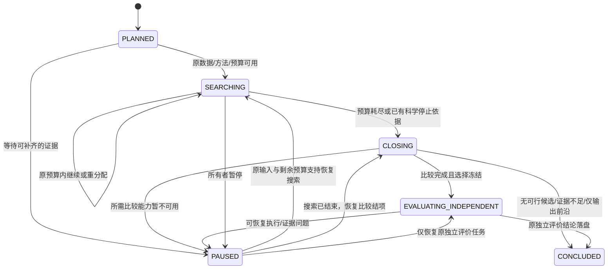
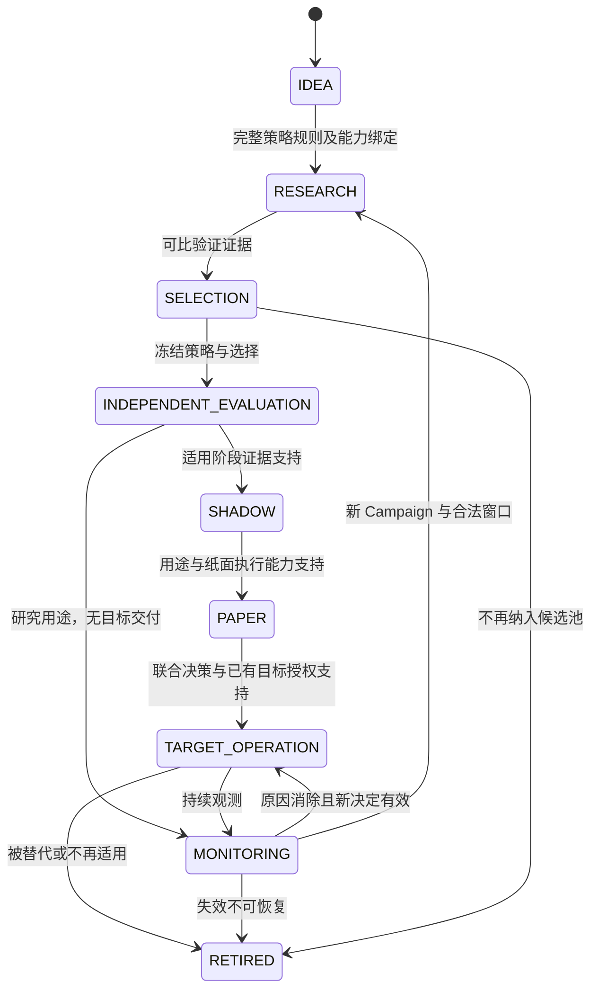
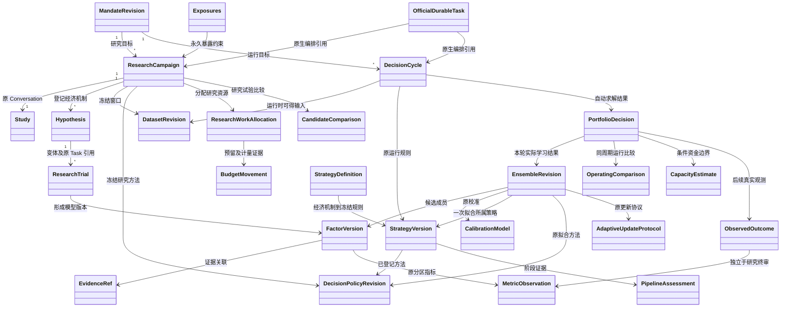
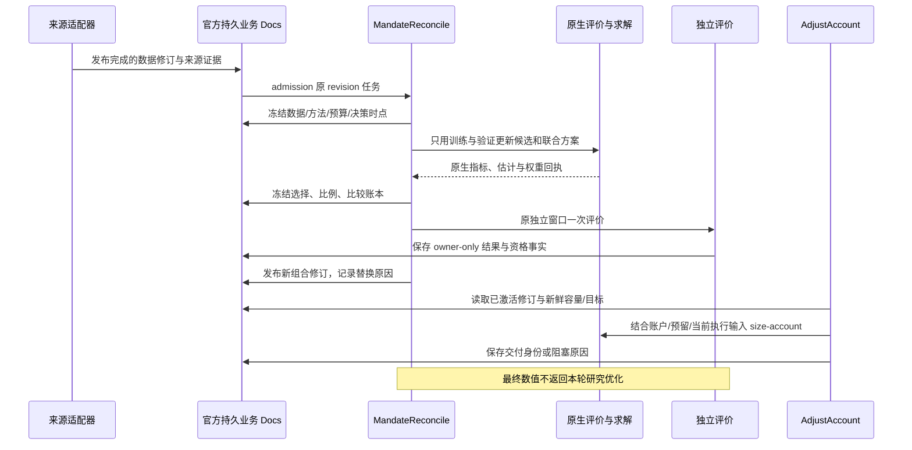
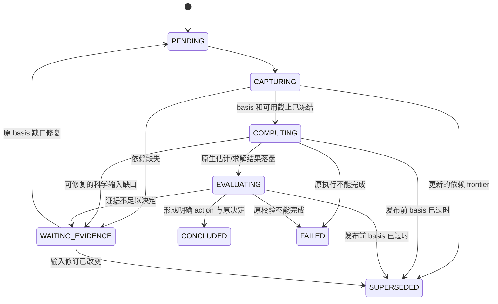

# 个人量化 PM：研究、组合与持续更新闭环设计

> 规范说明：本章展开设计依据与候选实现。实体、字段、状态及 API 均以 [规范字段合同](contracts.md) 为准；本章只解释其工作流映射，不重复定义 DTO，也不代表已经实现。
状态：设计稿，未修改生产代码或测试。依据当前工作区 `19803c47aeb1d22775d594780b8417d7cf63c3ed` 的实际实现；本稿中的新增类型、接口、任务名称均为拟建合同，不表示已经存在。研究计算仍交给原生内核，运行与恢复仍交给官方 Pi Durable，不增加第二套调度器。

## 1. 业务目标与现状

用户应表达“用这笔资金，在这些市场寻找更好的收益、稳定性和可承担的回撤，并持续更新”。系统承担数据选择、经济假设拆解、试验分配、候选淘汰、组合选择、权重求解、条件容量估计、更新和解释。指标、容量、因子数量及比例主要是系统计算的结果，不能变成要求用户逐个填写的参数表。

自动推导不代表可以从行情中推导个人损失承受力、账户授权、数据许可或缺失盘口。沿用已授权的账户/市场/资金边界；系统内部方法、默认偏好、估计误差和条件假设全部版本化并可查看。未给定明确风险偏好时，可以输出多目标有效候选及系统推荐依据，不能声称存在唯一客观最优组合。不要将自然语言中的“稳定”静默等同于单一 Sharpe 或波动率。

已存在的能力及其边界：

| 现有入口 | 已实现 | 尚未形成的业务闭环 |
| --- | --- | --- |
| `apps/research/src/trials.ts` | 原 Task 身份、失败留痕、全局 `max_trials` | 没有经济假设族、阶段配额、信息价值与淘汰决策 |
| `apps/research/plugins/research.ts` | 读取原目标/账本/验证结果、显式结项 | 结构化研究未耗尽预算且不选择候选时，不能按“证据不足”等业务原因结束 |
| `apps/research/src/continuation.ts` | 官方 generation 续作、预算不重置 | 耗尽后直接 `STOPPED/trialId:null`，没有独立结项比较阶段 |
| `validation-compare.ts` | 可选的验证 IC 排序 | 不读取结构化研究的账户目标，不能做组合/风险/容量权衡 |
| `apps/service/src/native.ts` | 原模型、明确权重、同一资金账户回测 | 权重来自请求或原提案；此路径没有调用 `allocate` 自动选池求解 |
| `apps/service/src/automatic.ts` | Durable 常驻任务，读取账户、`size-account`、交付/对账 | 固定旧 `portfolioId`、成员/权重、目标和容量；只按账户变化调整金额，过期后阻止交付，不生成新信号 |
| `apps/service/src/service.ts` | GET 数据集、研究/组合/容量/观测 API | 数据集来自启动配置，无在线数据修订发布和刷新任务；容量 POST 返回报告，不更新自动任务所引用的旧事实 |
| `runtimes/data`、`dataset-export.ts` | 来源获取、转换、离线 DatasetConfig 导出 | 未接通“新有效数据 → 重评候选 → 新组合修订” |

现有账户自动任务中的 5 秒等待只是当前实现的轮询间隔，不是实时性承诺，也不是拟建产品的刷新标准。

## 2. 持续业务对象：一个研究计划，多轮不可改写研究

持续目标由不可变 **MandateRevision** 表达，活动修订指针及官方根 Task 引用保存在现有 Application 业务事实中。**ResearchCampaign** 管理一轮冻结研究并引用现有 Study/Conversation；**DecisionCycle** 管理运行期一次数据、模型、账户条件下的决定。不能不断清空同一个 Study 的终态、预算和 Sealed 暴露记录来制造“持续”。每轮 ResearchCampaign 绑定数据版本、方法版本、决策时点和原预算，由新的 Study 执行。研究产出 Hypothesis、ResearchTrial 与 StrategyVersion；适用因子预测链时还产出 FactorVersion、CalibrationModel、EnsembleRevision；运行期形成 PortfolioDecision、CapacityEstimate 和 ObservedOutcome。两条链可相互触发工作，但不共享可修改的证据终态。

生命周期为：目标解释 → 数据可研究性检查 → 登记可证伪经济假设 → 基线与候选探索 → 验证比较和预算重分配 → 冻结候选、组合与权重 → 一次独立评价 → 形成可激活组合修订 → 新数据/新候选/账户变化触发后续工作。

研究完成不强制交付目标。允许长期研究计划保持活动，而本轮明确结束为“有可用方案”“没有可行候选”“证据不足”或“业务条件失效”。数据或执行能力缺失时进入等待/阻塞，不把它解释为经济假设失败。

本图严格使用 `CampaignState`。是否支持策略由 `CandidateComparison`、`PipelineAssessment.outcome` 与 `ResearchCampaign.conclusionReason` 表达，不增加独立的成功/失败 Campaign 状态。不可恢复的执行失败可结项并保留原错误证据；PAUSED 恢复到哪个业务阶段依据已落盘的原任务检查点及原事实，不能重开终态试验。CONCLUDED 不表示盈利、成交或永久资格。全部 Campaign 状态与 Durable Task 的 running/terminal 分离。

## 2.1 策略全生命周期：从经济机制到退出使用

研究阶段完成只是策略生命周期中的一段。**可交易策略版本**由 `StrategyDefinition` 与 `StrategyVersion` 表达：经济机制及失效条件属于前者；后者通过 `modelRefs`、`signalContractRef`、`portfolioRuleRef`、`executionRuleRef`、`exitRuleRef`、`capabilityBindingIds` 和 `policyRevisionId` 绑定完整规则及其证据。市场/日历/费用/容量等嵌套规则由这些引用对应的版本合同描述，EnsembleRevision 只保存一次组合拟合及其证据。单因子也可形成一个成员的完整策略。FactorVersion 的任意打分仍不是预期收益、仓位或可交付目标。

| 阶段 | 原始输入 → 必须产出 | 自动晋级依据 | 降级/退出与回滚 |
| --- | --- | --- | --- |
| IDEA | 目标/现象/已有失败 → Hypothesis 经济机制、反例、研究范围 | 有可证伪问题、可研究数据与支持的测量方法 | 数据不可得则等待；不可证伪则保留为待澄清想法，不烧计算预算 |
| IDEA（策略草案） | 因子版本、校准、市场机制 → StrategyVersion 与规则引用 | 信号/收益单位、时钟、交易规则和资金映射完整；不依赖未来数据 | 原生接口不支持则明确能力缺口；不伪造订单/收益 |
| RESEARCH | 原冻结数据/预算 → 全部 ResearchTrial、验证比较、联合回放 | 候选在可比验证证据与经济可行性上有支持 | 被否证则淘汰，依赖缺失则暂缓，不把二者混为失败 |
| INDEPENDENT_EVALUATION | 冻结模型、组合及自适应规则 → 不可修改独立评价 | 原方法与完整策略均支持；仅 COMPUTED 不够 | 不支持则本轮结束；新假设进入新 Campaign，旧终审不可循环调参 |
| SHADOW | 已冻结策略、当时可得数据 → 带时钟的未发送目标与前向观测 | 目标生成、数据时效、信号稳定及可实施性符合原更新方法 | 异常转观察/暂停；没有成交事实时收益只能标模拟/反事实 |
| PAPER | 明确 PAPER 来源、共享模拟资金 → 外部纸面账户回执及实际模拟观测 | 身份/资金/费用/回执完整，前向偏差能解释，方法判断支持 | 延迟/拒单/费用异常单独归因；paper 不能改标真实资金表现 |
| SELECTION（组合消费资格） | 研究与适用的前向证据 → 可消费 FactorVersion/EnsembleRevision | 与其他成员共同资金、相关性、净风险、净成本和容量可合并 | 不能因单体最好而必配资金；系统可保留零资金候选 |
| TARGET_OPERATION | 合格策略池、账户及当前可得数据 → PortfolioDecision | 自动求解和目标有效，当前方法与账户边界匹配 | 信号或容量变差可降权/保持现金；数据未知时阻止新增目标 |
| MONITORING | ObservedOutcome、外部执行/账户证据 → 归因、漂移与健康状态 | 定期/事件驱动复核；支持不变则保持，不为“更新”而换模型 | 区分研究失效、源数据异常、账户问题、执行偏差，进入对应恢复路径 |
| RESEARCH（再研究） | 监测解释、未决问题 → 新 Hypothesis/Campaign | 新研究有改变决定的价值，且有合法新数据/资源 | 生产旧版本不会因新研究开始而被原位修改 |
| RETIRED | 持续不适用、被替代、市场终止或所有者退出 → 退役决定与证据 | 停止新增消费并完成原目标/外部未知结果对账 | 留存模型、证据、失败和归因；重新启用须新版本与新有效依据 |

路径不是所有策略都必须顺序经过每个消费环节：纯研究可止于独立评价；SHADOW/PAPER 是否需要及如何累计证据由已登记的部署用途与方法决定。QZ 不以“运行满固定 N 天”自动认定合格；采用实际有效观测、覆盖的市场条件及证据不确定性。不存在用演示 paper、历史回测或单一协议测试冒充真实前向运行的捷径。

本图只使用 `PipelineStage`；每次晋级、降级、暂停或退役追加 `PipelineAssessment`，其 outcome 是 READY、NOT_READY、NEEDS_EVIDENCE、SUPERSEDED 或 RETIRED。活动/观察中/可消费是阶段与资格的业务说明，不形成另一套持久状态枚举。纯研究可停在 MONITORING；阶段是否需要 shadow/paper 取决于已登记用途与能力，图中的典型路径不扩大操作授权。

## 2.2 阶段角色合同与执行权界

这里的“角色”是代码组件和方法的责任，不要求一个人扮演多名审批员，也不增设多用户权限系统。达到已登记证据条件后自动推进；只有缺少必要的目标含义/授权边界时才形成具体待解决事项。

| 角色/组件 | 能读/能写 | 必须禁止 |
| --- | --- | --- |
| 研究提案者 | 合法训练/验证反馈；写假设、提案及解释 | 读取未暴露终审、修改预算和历史结果、宣布自己的方案已经独立通过 |
| 数据适配/质量组件 | 来源收据、可得时钟、历史元数据；发布不可变修订 | 原位改旧目录、补造缺失历史规则、把当前快照当过去可得 |
| 独立评价组件 | 冻结提案及独立窗口；写原生结果/资格事实 | 根据终审结果修改该提案、给本轮研究员返回调参反馈 |
| PM 比较/组合组件 | 合法训练/验证估计、资格和运行时可得信息；写选择/比例与资金决定 | 用 HELDOUT 选最优权重、混淆单体与联合容量、自己伪造科学统计 |
| 账户 sizing/交付组件 | 已激活决定、原权威账户与执行能力；写带身份的目标回执 | 未对账即重发、续期过期证据、推断 ACK 就是成交 |
| 观测/归因组件 | 外部账户与执行事实、版本历史；写 ObservedOutcome/归因 | 改写原独立结果、把外部故障直接归因模型、把缺收益补零 |
| 所有者 | 表达目标、账户/资金范围及启停；查看决定与修改目标修订 | 系统不要求其手填所有指标/容量/因子比例；自动化不能反向扩大其已授权范围 |

QZ 的终点是可核验的 target-only 目标和观测；券商/交易所订单、成交、撤单及实际仓位属于外部执行系统。QZ 停止任务、暂停目标或退役策略都不等于外部清仓。需要减风险时，系统可在有效能力范围生成新的降风险目标并跟踪回执；在外部结果未知时保留旧身份对账，不能声称已解除敞口。

**回滚合同：** 回滚的是策略/构建规则到有证据支持的旧版本，不是复用旧目标包。系统用当前数据、持仓、资金预留、费用与流动性重新产生 PortfolioDecision，拥有新修订和新回执。旧版本当前也不可行时保持阻塞或现金目标所支持的可行状态，不自动选任意备用模型。新旧版本切换和退役均保留替换原因、未决交付与原账户范围。

## 2.3 数据与资金的日常运营

日常检查由数据水位、交易日历、来源更新和账户事件触发并汇总成一个可行动的健康视图，不是每天人工打勾的审批清单：

* 数据：最新可得水位、完整性、源修订/许可适用、交易规则变更、PIT、同资产不同来源的一致性。只有受影响结果重算；故障数据不会流入新目标。
* 资金：权威净值/现金/持仓、未决目标、外部资金预留、币种、可部署容量、当前流动性与费用。账户未知时阻止扩仓；资金变化不必重做因子发现。
* 研究：已花/预留预算、候选信息价值、被重复追逐的假设族、尚未解决的证据缺口。预算耗尽自动结项，不要求人来清理循环。
* 运行：目标是否过期、外部回执是否需要对账、实际执行偏离、数据或模型退化、当前/前一策略版本。无变化时不制造重算或通知噪声。

## 3. 研究预算：分配给能改变决定的试验

总预算来自授权范围和系统资源，内部比例由系统根据候选与实际成本调整，不固定“探索 20%、确认 60%”。一次完整组合是一次原生评价；不能拆分成员绕过预算。失败、无效、取消后已消耗的计算仍保留，只有尚未启动的预留可以释放。

预算分配有四步：

1. 先登记基线及假设族。每个候选写清经济机制、预测方向、相对基线的改动和可否证结果。参数变体归属同一族，不能通过换描述掩盖搜索次数。
2. 依据支持的输入和成本历史预留一次独立评价所需资源，再分配搜索资源。旧 `max_trials` 仍只按原语义执行；新预算合同显式分开搜索、验证和独立评价，不能偷偷改变老研究计数。
3. 优先处理能够区分现有候选的试验。若有经过验证的误差/成本估计，比较“预期决策改善或信息增益 / 预计成本”；没有合格估计时使用明确记录的公平探索与逐阶段筛选方法，不编造概率、货币成本或信息增益。
4. 每次反馈后用 `ResearchWorkAllocation` 保存考虑/选择的假设、下一实验用途、信息价值证据和资源估计；用 `BudgetMovement` 的 RESERVE/CONSUME/RELEASE/TRANSFER 保存资源流向。TRANSFER 只移动未消耗预留，不增加总额；TRIAL、NATIVE_SECONDS、MODEL_COST、DATA_BYTES 不跨单位冲抵。未知实际成本保持未计量，不能填 0。新预算只能成为新的明确授权修订，不能由模型在续作中自行补充。

淘汰与继续的业务含义：

| 决策 | 必要依据 | 后续 |
| --- | --- | --- |
| 继续探索 | 经济机制未被现有证据否定，下一试验能回答具体未决问题 | 分配剩余预算，写明预期区分点 |
| 暂缓 | 依赖数据或执行能力不足 | 等待对应依赖变化，禁止同输入盲目重算 |
| 淘汰 | 在本轮已声明比较方法下，被基线/可行候选支配或假设被否证 | 保留候选与全部变体，不再分配该轮预算 |
| 晋级验证 | 具备可比样本和经济意义，有进一步确认价值 | 冻结该阶段提案，验证失败不能删档 |
| 冻结终审 | 所有比较只用了允许的训练/验证证据，组合及比例已确定 | 独立评价，不再用最终结果修改本轮 |

**预算耗尽关闭新增实验，不关闭决策。** 现有 `trialFeedback` 与 `onYield` 应触发官方 `qz.research-close` 任务，保留读账本、比较和一次已登记的独立终审。若有候选，由确定性比较器按冻结 SelectionRule 形成可比排序/非支配集及推荐；缺少必要偏好时输出 FRONTIER_ONLY，不自行替用户选择；若比较器不支持，以 `EvidenceGap` 记录原因并将 Campaign 置为 PAUSED，或以 NEEDS_EVIDENCE 比较结果结束本轮，不能无限提示模型“继续”。模型可以解释结果，但不是结项是否发生的唯一依赖。

不采用“再给一次 generation”或“连续 N 次 yield”作为没有好候选的科学证明。第三方工具需登记业务能力：`READ_VALIDATION`、`SEARCH_EVALUATE`、`COMPARE_VALIDATION`、`FINALIZE_INDEPENDENT`、`CLOSE_RESEARCH`。宿主在结项阶段通过官方工具配置收窄能力；未知工具不自动被视为只读。原生试验入口仍独立检查预算，防止并发或旧调用绕过。技术重试耗尽记执行故障，不记经济假设失败。

## 4. 目标评价、自动选池和比例推导

系统把自然语言目标转成版本化的多目标比较策略，而不是向用户索要一组数字阈值。收益、日际稳定性、回撤、交易成本、容量及证据质量各保留原生单位与来源。已有 `Calendar Geometric Daily Return`、日收益极值、`Calendar Maximum Absolute Deviation`、负收益/零收益日数、完整日覆盖、原生 Max Drawdown 等可复用；缺指标不补零，252/365 年化身份不互换。

研究期 CandidateComparison 先区分“可评价”和“不可评价”，再比较经济效果及不确定性。运行期 OperatingComparison 比较保持当前、现金、重配和减风险方案，绑定同一 cycleId/basisRevision 和共同现仓/资本/成本口径；HISTORICAL_JOINT_REPLAY、FORWARD_MODEL_ESTIMATE、OBSERVED_FORWARD 分开，不能将预测差异冒充实际收益改善，也不能为了填 trialId 伪造运行期 ResearchTrial。候选数、成员数和权重由验证期联合效果、相关性、成本与容量约束推导；不能只把最好的若干单因子拼起来，也不能把 IC 当作收益预测。具体估计与优化方法由原生计算合同实现，TS 只冻结输入、调用和保存结果。

容量输出至少分开：历史成交量条件下的可行资金、执行数据支持的当前可部署资金、扣除费用/冲击后仍有效的经济容量。现有 `assess-capacity` 主要支持第一类；`catalog-ensemble` 当前明确不支持容量/可交付目标。未知经济容量不能冒充无限，也不能取单因子容量之和作为组合容量。

自动选择需要保留 `candidateSet → estimates → constraints → solver → jointReplay → selectedRevision` 的证据链。只在相同合法窗口与共同账户假设下比较方案；资金规模会改变交易最小单位、流动性与费用，不能简单把小资金收益率乘上新本金。

## 5. 新事件驱动持续更新

新增事件是业务事实及其修订引用，不是另建消息队列。任务 admission 与待处理修订在同一官方事务落盘。已完成事件合并处理；同一输入修订不重复求解。进程重开时对账 Application 中对应 mandate 的待处理/已处理修订，而不是依赖内存回调曾经运行。

| 事件 | 重算范围 | 禁止行为 |
| --- | --- | --- |
| `DATA_REVISION` | 验证来源/可得时钟后形成新周期；重算受影响候选、相关性、容量、组合 | 原位覆盖旧目录或仅改标签重置独立性 |
| `RESEARCH_EVIDENCE`（原试验落盘） | 本轮验证比较、候选状态、剩余额度分配、必要的联合验证求解 | 把当前未终审 trial 直接送往账户 |
| `RESEARCH_EVIDENCE`（本轮研究结项） | 更新候选资格与计划进度，提出下一组合修订 | 用本轮 HELDOUT 数值优化其权重再声称同样独立 |
| `ACCOUNT_CHANGED` | 按方法适用域重新评估资本、容量与可行配置；必要时联合重求因子/资产比例，只有经验证线性区间内才能只 sizing | 仅因净值变化重跑全部因子发现 |
| `COST_OR_RULE_CHANGED` / `EVIDENCE_INVALIDATED` | 重新估计流动性/费用适用性/容量，必要时缩减资金或保留现金 | 用已过期目标和旧容量续期 |
| `MANDATE_CHANGED` / `RESEARCH_EVIDENCE`（方法修订） | 新方法修订与受影响计算；保留旧结果 | 将旧结果修改成新方法计算 |

成熟标签通过 `LABEL_MATURED` 触发后续合法拟合；`FRESHNESS_DEADLINE` 只使依赖重新核实，不自动延长证据有效期。以上全部使用规范 `BusinessEvent.kind`，具体发生类型通过 `sourceRevisionRef` 所指原事实区分。

数据源监视复用现有来源适配器，输出完成的不可变修订及 import-report。刷新时机来自来源更新节律、最后水位、数据实际到达和下一决策期限；在官方 Durable 中用 `runtime.sleep(nextWakeAt)` 或公开的文档观察能力等待。不是每隔固定秒数强行重算。

实时性必须分别记录 source event、available、ingested、decision、publish、downstream ACK 时钟。只有完整链路延迟和源能力支持时才能宣称满足目标时效。

## 6. 规范字段在工作流中的映射

本章不复制 TypeScript DTO。以下全部指向 [规范合同第 2 节](contracts.md#2-可校验的核心类型) 已定义字段；原生 Task/Conversation ID 独立保存在 `runtime`，新业务 ID 为 opaque string，金额/权重遵循 Decimal，时钟遵循 Ns。表中的证据产物使用已有 `EvidenceRef` 引用，不增加另一套身份或任务账本。

| 业务问题/步骤 | 唯一规范实体及字段 | 写入责任与不变量 |
| --- | --- | --- |
| 原始目标与解释 | `MandateRevision.ownerGoal/interpretation/selection/unresolvedIntent` | 原话不覆盖；未解决的关键取舍输出前沿或仅研究 |
| 账户资金与授权 | `MandateRevision.capitalSource/ownerBoundaries/operatingAuthority/researchBudgetRef` | 用户边界与估计分开；不从行情推导授权 |
| 策略经济机制 | `StrategyDefinition.economicMechanism/falsificationConditions/knownFailureModes/intendedHoldingHorizonRef` | 研究者提出，方法组件核对是否可证伪 |
| 可交易规则冻结 | `StrategyVersion.definitionId/modelRefs/featureSchemaRef/signalContractRef/portfolioRuleRef/executionRuleRef/exitRuleRef/capabilityBindingIds` | 明确分数→预测→目标及退出边界；规则归 StrategyVersion 及其版本引用 |
| 方法及在线更新规则 | `DecisionPolicyRevision.methodFamily/learnedParametersRef/trainingProtocolRef/validDomain/selectionRule`；`AdaptiveUpdateProtocol.eligibleTriggers/maturityRuleRef/updateMethodRef/trainingWindowRuleRef/wholeProcessValidationRefs/allowedParameterDomain/outOfDomainAction` | 整个更新过程必须有验证，成熟标签及训练窗规则明确；越域按原策略保持、减风险或等待 |
| 阶段晋级/降级 | `PipelineAssessment.strategyVersionId/stage/outcome/requirementsVersion/evidenceRefs/reasonCodes/nextPermittedActions` | 追加阶段事实；不以计算成功代替 READY |
| 数据修订与有效窗口 | `DatasetRevision.contentRef/eventInterval/availableThroughNs/admittedAtNs/qualityStatus/revisionKind` | APPEND/CORRECTION/RETRACTION 分开；available 不等于 event |
| 研究身份与状态 | `ResearchCampaign.runtime/state/datasetRevisionIds/evaluationProtocolRef/budgetId` | 状态仅 PLANNED/SEARCHING/CLOSING/EVALUATING_INDEPENDENT/CONCLUDED/PAUSED |
| 假设族及下一试验问题 | `Hypothesis.economicFamilyId/parentHypothesisId/incrementalQuestion/state/evidenceRefs` | 同经济机制的变体不因换名逃离搜索账本 |
| 实际试验与计账 | `ResearchTrial.parentTrialIds/runtime/state/purpose/countedAttempt/resourceUsageRef` | 与原 Task 绑定；失败继续保留；不复写官方执行状态 |
| 研究总额及结项预留 | `ResearchBudget.maximumTrials/reservationForClosureRef/usageEvidenceRefs` | 结项预留解析到 BudgetMovement；预留不是追加额度 |
| 假设与下一实验分配 | `ResearchWorkAllocation.consideredHypothesisIds/selectedHypothesisIds/nextExperimentPurpose/expectedInformationEvidenceRef/resourceEstimateRef/action` | 记录为何实验、等待数据、关闭搜索或淘汰假设；没有有效信息价值估计则保留 null |
| 预算预留/消耗/转移 | `BudgetMovement.kind/resource/amount/currency/fromReservationId/toReservationId/measurementEvidenceRef` | TRIAL/DATA_BYTES 为整数，MODEL_COST 必有币种；释放仅限未消耗预留，转移不增加总预算 |
| 可比范围 | `CandidateComparison.scopes` 下的 `ComparisonScope` | 固定时段/日历/成本/资本/账户起点；候选仓位和成员数仍是搜索变量 |
| 候选评价与选择 | `CandidateComparison.candidates/objectiveRankings/recommendedTrialId/recommendationStatus` | NEEDS_EVIDENCE/FRONTIER_ONLY 不自动变 SELECTED |
| 研究结项 | `ResearchCampaign.latestComparisonId/selectedStrategyVersionId/conclusionReason` | 本轮选择与终审可追溯 |
| 因子和校准 | `FactorVersion`、`CalibrationModel.trainingCutoffNs/fitProtocolRef/fitEvidenceRefs/modelRef` | 标签必须在 cutoff 前成熟；任意得分不当收益预测 |
| 因子比例及学习状态 | `EnsembleRevision.members/fitProtocolRef/fitCutoffNs/trainingEvidenceRefs/jointValidationEvidenceRefs` | 每次成员或因子权重变化创建新不可变 revision；权重属于 FactorWeight，不写入 AssetTarget |
| 运行期输入冻结 | `DecisionCycle.triggerEventIds/basisRevision/datasetRevisionIds/accountBasis/policyRevisionId/strategyVersionId/asOfNs/availableCutoffNs/dependencyRevisionRefs` | 所有取数与可用截止一致；输入变化新周期 |
| 运行期状态及输出 | `DecisionCycle.state/outputDecisionId/supersededByCycleId/reasonCodes` | 仅采用规范 CycleState，旧结果不覆盖较新 basis |
| 联合投资决定 | `PortfolioDecision.ensembleRevisionId/strategyAllocations/assetTargets/capital/action/status/comparisonRef/solverEvidenceRef/jointReplayEvidenceRef` | 因子权重、策略资金比例、资产 NAV 权重各自归位；无需因子的策略可保留 ensembleRevisionId=null |
| 运行期候选比较 | `OperatingComparison.cycleId/basisRevision/scope/evaluationContext/candidates/pairedDifferenceEvidenceRefs/selectedCandidateId/conclusion` | PortfolioDecision.comparisonRef 必须指向同 cycle/basis 的 OperatingComparison；研究比较仍独立使用 CandidateComparison |
| 容量与规模依赖 | `CapacityEstimate.level/curve/supportedCapitalUpperBound/maximumTestedCapital/validUntilNs` | 最大测试本金不是容量上限；每个资本点可关联重求解的 PortfolioDecision |
| 交付身份及对账 | `PortfolioDecision.targetCommandId` → `TargetCommand.idempotencyKey/basisRevision/controlRevision/state` | 不确定仅查原命令；新决定不得覆盖原未知结果 |
| 观测与再学习 | `ObservedOutcome.realizedMetrics/attributionEvidenceRef/matureLabelEvidenceRef/reconciliationStatus` | ACK 不构造收益；成熟标签只进入以后合法学习 |
| 可恢复的证据缺口 | `EvidenceGap.affectedEntityId/permittedRemedy/state/resolutionEvidenceRefs` | 解决具体依赖；不会扩大数据/账户授权 |

活动指针、待处理事件 frontier、根 Task 引用继续保存在现有 Application 业务事实中，遵循 [规范合同第 7 节](contracts.md#7-事件存储与恢复映射)。它们是内部控制映射，不构成第二套业务实体或运行状态 DTO。

若已验证的 `AdaptiveUpdateProtocol` 在其 `allowedParameterDomain` 内根据新成熟标签学得因子权重，必须保存新的 `EnsembleRevision`；`PortfolioDecision.ensembleRevisionId` 指向这次实际使用的学习结果，训练 cutoff、校准模型和方法引用完整保留。新权重可标 SELECTED，并通过 PipelineAssessment 说明其来自已验证的更新过程；不能据此标为该组新权重自身已经完成独立 HELDOUT，也不能自动标为 INDEPENDENTLY_EVALUATED。整个更新算法的验证与单次拟合的独立评价是不同事实。不能只新增 PortfolioDecision 却沿用旧权重 artifact；超出更新协议的模型/方法、准入机制或允许范围变化时，产生新研究候选并重新评价。

## 7. 官方 Durable Doc、Task 与 API

拟建 session family Docs：`qz.mandate-revision`、`qz.research-campaign`、`qz.dataset-revision`、`qz.ensemble-revision`、`qz.decision-cycle`、`qz.portfolio-decision`。它们保存业务事实；Task 的重试/运行/取消状态只在官方 TaskRecord，不复制到自己的任务表。候选及预算初期可嵌入 ResearchCampaign，达到实际规模后才拆 family Doc。每轮计算使用原 Task 身份和确定的输入修订重放。

拟建 Task：

| Task | 输入 | 业务阶段 | 输出 |
| --- | --- | --- | --- |
| `qz.pm-reconcile` | mandateRevisionId、triggerEventIds | collect → plan → join → publish → wait | 已处理修订与下一待办 |
| `qz.dataset-refresh` | sourceBindingRef、previousRevision | discover → acquire → verify → publish | 新 DatasetRevision 或 unchanged |
| `qz.research-close` | campaignId、原试验/协议/预算引用 | compare → choose → freeze/close | CandidateComparison + Campaign 原结论字段；必要时原独立评价子任务 |
| `qz.portfolio-recompute` | campaignId、frozen validation input refs | estimate → solve → jointReplay → freeze | 研究期不可变 EnsembleRevision |
| `qz.decision-cycle` | StrategyVersion、适用时 EnsembleRevision、运行期可得数据与账户 refs | estimate → solve → assessCapacity → decide | PortfolioDecision；不自行修改研究算法 |
| 现有 `qz.account-adjustment` | observationId 等 | 原有 snapshot/deliver/reconcile/wait | 扩展读取已激活修订，继续负责下游未知结果对账 |

同一 mandate 的 Application 活动指针同时只发布一个 CURRENT 决定。计算过程中新 BusinessEvent 推进依赖 frontier；旧输入算出的结果保留，通过 basisRevision 核对后置为 SUPERSEDED 而不覆盖较新决定，随后处理新周期。`subscribeCommits` 可用于低延迟唤醒提示，不能成为唯一触发事实。新建任务必须在保存 revision/receipt 的同一 `tx.createTask` 事务中 admission。

工作流只使用 [规范合同第 5 节](contracts.md#5-api-规范拟议增量沿用现有-api-前缀与认证) 的增量 API；以下路径均位于现有 `/api/v3` 前缀下：

| 业务动作 | 规范 API | 工作流用途 |
| --- | --- | --- |
| 建立/修改目标 | `POST /mandates`、`POST /mandates/:id/revisions` | 保存原话、解释、资金来源与明确授权；不要求用户技术配置 |
| 接收已验证数据来源产物 | `POST /datasets/:id/revisions` | 验证任务确认质量及可得时点后才使 DATA_REVISION 生效 |
| 启动研究 | `POST /campaigns` | 引用 mandate、strategyDefinition、dataset 修订，开始原预算内研究 |
| 暂停/恢复原研究 | `POST /campaigns/:id/pause`、`POST /campaigns/:id/resume` | 保留预算/暴露；恢复绑定 predecessorReceiptId 与原检查点，不重算已结算失败 |
| 查看比较/关闭新增实验 | `GET /campaigns/:id/decision`、`POST /campaigns/:id/close` | 只读原事实比较不增加尝试；新联合回放/终审按原预留计账 |
| 当前/历史投资决定及重算 | `GET /mandates/:id/decision`、`GET /mandates/:id/decisions`、`POST /mandates/:id/recompute` | 正常事件自动走同一业务入口；人工重算保持原 requestId 与 expectedRevision |
| 周期状态与容量 | `GET /cycles/:id`、`GET /capacity-estimates/:id` | 展示依赖、原因、测试范围及真实容量未知项 |
| 策略版本/阶段 | `GET /strategies/:id/versions`、`GET /strategies/:id/assessments` | 展示可交易规则及晋级降级历史 |
| 决策解释与反馈 | `GET /decisions/:id/diff`、`GET /decisions/:id/evidence`、`GET /decisions/:id/outcomes` | 关联旧新决定、所有者证据与后续真实观测 |
| 暂停/恢复/退役策略 | `POST /strategies/:id/pause`、`POST /strategies/:id/resume`、`POST /strategies/:id/retire` | 暂停不代表外部撤回；恢复重验时效/账户/能力并绑定 predecessorReceiptId，不重发旧目标；退役仍对账 |

请求字段、202 回执及 409/422/503 等错误语义直接引用规范合同，不在专题添加另一套请求。旧数字 `/research`、`/portfolios`、`/observations` 及 request replay 保持兼容。数据适配器内部发布调用同一已登记来源/证据校验路径，不接受模型指定任意宿主路径或命令。

## 8. 依赖失效与 Sealed 隔离

每个结果记录直接依赖的修订引用，不能只用“最新”指针。新数据不会自动判旧结果错误，而是使其对新决策时点过时；原历史结论保留。费用/交易规则变化使受影响回放与容量失效；账户净值变化由依赖图和方法适用域判定：仅在线性且原配置仍适用的范围内可只 sizing；最小订单、固定费占比、经济容量或可行成员改变时，重新执行联合资本—配置求解；持仓/预留变化使当前交付提案失效，并依账户预算与交易成本条件决定是否重求配置；模型/权重变化按 EvaluationProtocol 或已验证 AdaptiveUpdateProtocol 生成新拟合与相应联合验证/运行比较证据，不把每次合法在线更新一律当作重新使用 HELDOUT。未知依赖变化进入明确阻塞。

研究器的读取层只提供 TRAIN/VALIDATION 及其合法汇总；终审数值仅向所有者/独立资格流程披露。用于选池、相关性和权重求解的输入必须带 EvidenceRole、asOfNs 与 availableAtNs，且遵守 DecisionCycle.availableCutoffNs。独立结果可以改变“是否有资格激活”的事实，不能成为本轮再次调参输入。

**现有暴露合同是实施关键约束。** `native-exposure.ts:75-86` 对新迭代范围与旧 FINAL 的重叠采取严格拒绝；复制目录、改 revision 不解决。因此首个可交付闭环采用合法的新周期窗口，并保留暴露账本。不宣称当前实现已支持训练窗滚动包含旧 Sealed。设计中的 walk-forward/as-of 更新以规范 `AdaptiveUpdateProtocol.maturityRuleRef/trainingWindowRuleRef/modelSelectionProtocolRef`、`EvaluationProtocol`、`ExposureRecord` 和 `SearchFamily` 为依据：过去终审证据保留永久暴露身份；只有协议允许且标签真正成熟的历史输入才可参与后续拟合，新终审必须未暴露，旧独立结论与跨周期搜索记录不得重写。实施须用独立测试证明这些规则后才能改变当前严格拒绝；本设计合同已经给出归属，不表示现代码已支持。

## 9. 持续反馈归因与用户可见结果

每次变更回答：新增了什么信息、哪项旧判断改变、为什么增加/降低某成员、组合改善来自何处、剩余不确定性是什么。通过 `PortfolioDecision.incumbentDecisionId`、本次决定 ID、`DecisionCycle.triggerEventIds/asOfNs` 及 `explanationFacts`、关联 EvidenceRef 保存变更依据。

归因分别报告模型信号变化、成员及权重变化、账户资金变化、费用/流动性变化、执行偏差、数据或方法修订。进行反事实对照时，必须在相同合法窗口和账户假设下回放；没有原生支持就标 unavailable，不能把净值差全部归为模型 alpha。Forward 观测能够触发重新研究或降低部署，但不能回写已冻结的历史独立评价。

界面核心是“当前推荐组合、比例、可用资金区间、依据、上次变化与下一动作”，附候选淘汰/继续原因。研究总览的成功不得由请求 202、Task 完成或单一 Sharpe 达标推断。

运行期严格采用规范 `CycleState`：

CONCLUDED 的具体经济动作由 PortfolioDecision.action 表达；NEEDS_EVIDENCE、NO_FEASIBLE_SOLUTION 与 CASH 不混用。相同 basis 的可恢复执行沿原 Task 继续；输入改变则建立新 DecisionCycle，旧周期通过 supersededByCycleId 指向后继。已登记自适应规则可产生新的学习结果和决定，但不得原位修改 EnsembleRevision；更换方法回到适用研究/评价阶段。交付与对账继续由现有官方账户任务负责，DecisionCycle 不复制其完整任务状态。

## 10. 分阶段文件规划与验收

第一阶段交付完整的“耗尽预算后仍形成候选决策”闭环：`apps/research/src/trials.ts`、`continuation.ts`、拟建 `decision.ts`、研究插件业务能力登记、现有终审入口、`packages/contracts/src/research.ts`。新增明确结项结果，保持现有 Task/请求/试验身份；不修改之前已修复的 start/stop 串行边界。

第二阶段交付真正的自动选池/比例与联合验证：拟建 `apps/service/src/mandate-workflow.ts`、`workflow-facts.ts`、`portfolio-recompute.ts`；接入原生估计/求解合同，复用 `native.ts`、`capacity.ts`、`science.ts`。现有 `computePortfolio` 是最终证据的消费者，不能直接把它当 Validation 优化器；要新增明确带验证分区的输入路径。

第三阶段接通数据与账户持续更新：`config.ts`、拟建 `dataset-refresh.ts`、`dataset-export.ts`、`runtimes/data` 的已登记来源适配、`service.ts` 新持续计划 API；`automatic.ts` 读取已激活组合修订和新鲜依赖，未对账旧交付不得被新修订覆盖。Web 展示系统决定及原因，用户不需要填写计算内部参数。

必须通过的业务验收：

1. 最后一次合法试验产生最佳候选后，即使模型先结束回答，仍完成比较及原终审；没有新增搜索次数。
2. 全部失败、全部不可比、全部不可行分别产生正确结项；缺数据不变成收益零、无候选不自动满仓。
3. 同一经济假设换参数、失败、恢复均正确计账；重分配不能超过原总额；不因循环次数推断科学失败。
4. 新数据只使依赖它的结果重算；相同修订重复事件不重复计算；计算中新事件不会被旧结果覆盖；重启不丢待办。
5. 同一共享资金与合法验证窗口中，候选/比例由实际原生估计和求解得出；求解无解不返回备用等权。
6. 当前目标/容量过期能产生新的研究/执行依赖处理或明确等待，而不靠延长旧回执期限假装更新。
7. 所有选池和权重输入均拒绝未授权 HELDOUT；旧暴露跨目录/标签/周期保持；独立失败不会自动调参再测同一窗口。
8. 新组合激活与旧未知交付并发时先对账；账户资金变动只调整其必要依赖；新比例和归因可从原事实重建。
9. 从 IDEA 到退役能完整追踪同一假设及版本；shadow 不伪称成交，paper 不改标真实，因子没有策略映射不能直接成为仓位。
10. 降级能区分数据、模型、执行和资金原因；回滚使用旧规则加当前输入产生新决定，不能复用过期目标；QZ 停止不被展示为外部清仓。
11. ResearchWorkAllocation 与 BudgetMovement 能重建每个假设族的预留/消耗/释放/转移；资源不能跨单位抵扣，未知成本不按零计。
12. PortfolioDecision.comparisonRef 解析为同周期/basis的 OperatingComparison；新自适应权重有独立 EnsembleRevision，SELECTED 不被展示为该组权重已独立验证；暂停/恢复不重发旧目标或重算原失败。
13. 用官方 Durable/Faux/SQLite 验证编排与恢复，用真实原生内核验证数值和分区，用真实来源独立检查数据质量；三类证据不互相替代。付费模型决策质量、实盘表现和运行时长单独报告。

调研依据：经济假设与独立验证见 QuantConnect research guide；多重尝试与赢家膨胀见 Bailey 等 Deflated Sharpe Ratio 原文 https://www.davidhbailey.com/dhbpapers/deflated-sharpe.pdf；收益、回撤、换手、容量联合报告见 https://www.quantconnect.com/docs/v2/cloud-platform/backtesting/report 。这些来源不规定本产品的固定预算比例，也不证明当前数据/模型已具备盈利能力。
