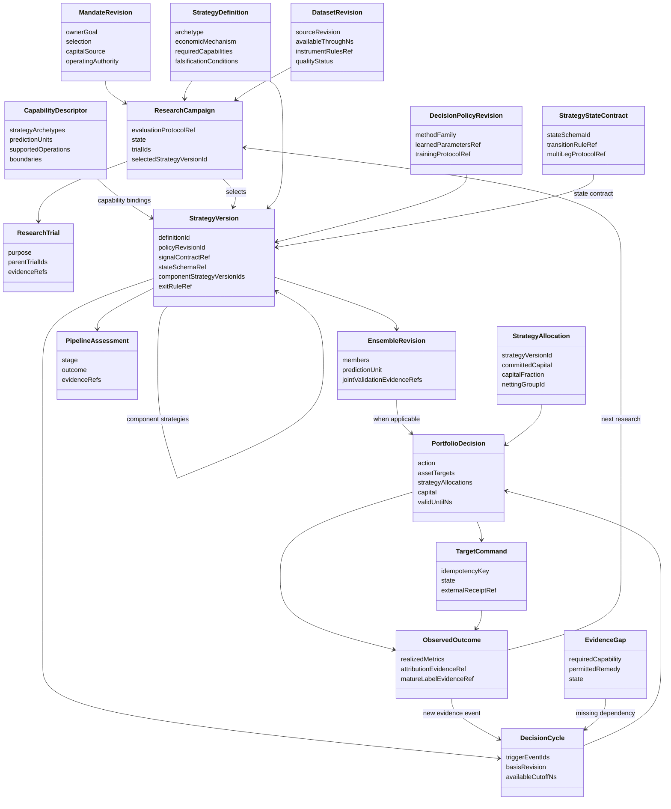
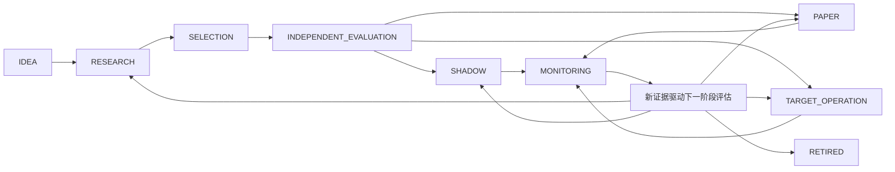

# QuaZonai 总架构业务章：通用量化研究、策略、组合与持续运营

> 设计状态：2026-10-22，方案文档，尚未实现或验证。本文件补足全项目总架构，不能用此前工程修复或单一“自动组合”功能替代本次总任务。
> 【事实】来自当前 `/workspace/QuaZonai` 源码、架构和已核验原始来源；【设计】是拟议目标；【待验证】是不得默认为已具备的能力。
> 合同：本章直接使用 [规范字段合同](contracts.md) 的实体、字段与状态，不再定义第二套 DTO。自动因子权重、资产配置、资金曲线与双速更新见 [业务设计](business.md)；全任务范围和需求编号见 [设计总览](README.md)。

## 1. 原始任务与成功定义

本次目标是**整个项目更加通用化、策略化、规范化，核心流程严谨且智能，满足专业量化小自营基金的实际 pipeline 需要**。自动指标、容量、因子组合和比例是其中的决策能力，而非全部范围。当前按用户要求只设计，不开发。

【设计】平台的成功表现应是：用户提出一个投资想法，系统能识别策略范式与所需证据，自动找到可用市场和数据，组织研究，分配试验资源，把可信结果转为明确策略，组合资金、风险和退出需求，持续产生有根据的目标，观察账户与执行反馈，归因并改良或淘汰策略。系统能说明每一步为何可做、为何不做和缺少什么。

“专业 pipeline”在这里是业务质量定义：研究可证伪、证据可追溯、选择偏差可见、模拟与执行假设一致、资金共享、风险和退出有依据、运营结果能反哺研究。它不是某套法规的全行业强制模板，也不要求单人 PM 模拟投委会、合规部、交易台和多层审批。

### 1.1 原始需求追踪

编号与 [总览需求表](README.md) 一致，本章不另建需求编号体系。

| ID | 总任务要求 | 本章架构响应 | 后续可验证结果 |
| --- | --- | --- | --- |
| R01 | 项目通用化 | 策略范式、跨市场能力矩阵与能力匹配 | 新市场/策略复用主流程，未知能力不能伪装支持 |
| R02 | 项目策略化 | 经济机制、信号、持有/退出与政策版本 | 模型与完整可运行策略有明确区别 |
| R03 | 项目规范化 | 统一合同、单位、时钟与阶段证据 | 任一决策可追溯，专题不另定义冲突字段 |
| R04 | 核心流程严谨 | PIT、隔离、共同账户、成本、退出、回执 | 不漏费、不重用本金、不伪造独立评价 |
| R05 | 核心流程智能 | 自主研究、选池、配置、反馈与淘汰 | 新证据实际改变下一步动作，含保持不动 |
| R06 | 专业小自营基金 pipeline | 完整阶段合同与单人轻量治理 | 从原数据到后续账户归因闭环 |
| R07 | 容量、组合、比例自动推导 | 分层推导责任及原始计算证据 | 业主不手配技术权重、容量与资金档位 |
| R08 | 动态、实时、持续更新 | 行情/账户快环、研究慢环与异常事件 | 新证据形成新判断，旧数据不续期 |
| R09 | 多 agent、调研与验证 | 共享试验/暴露、原始来源与场景验证 | 并行不形成隐形试验或互相矛盾的事实 |
| R10 | 最新 dev、新分支、最终合入 dev | 本章保留设计/实施边界，开发路线由总览统一 | 恢复开发后以届时最新 dev 和最终 Head 验收 |
| R11 | 先详尽设计，不开发 | 阶段/字段映射、类图与能力边界 | 本轮仅文档，不把方案宣称为已实现 |

约 3000 pUSD、全市场动态组合和每日稳定净收益是已知业务场景，用于检验架构是否有投资价值；不能把平台永久写死为此本金、Polymarket、特定七个特征或单一日频目标。

## 2. 统一领域语言与三条路径

【设计】统一领域对象，允许三种自然结束点：

1. **研究资产路径**：idea → 假设 → 数据/实验 → 可复用预测、因子、估计器或被否定的知识。无需强制生成组合。
2. **策略路径**：idea/研究资产 → 入场、持有、退出和状态更新规则 → 成本后共享账户评价 → 可投入或待验证策略。
3. **组合与运营路径**：一个或多个策略 → 联合资金与风险分配 → 目标交付/观察 → 归因 → 更新、暂停或淘汰。

下列对象不能合并：

| 对象 | 业务含义 | 不意味着什么 |
| --- | --- | --- |
| 数据观察 | 某来源在某时刻可得的观察 | 下载时间不证明历史时点已知 |
| 特征 | 对观察做了明确因果变换 | 特征不自动是 alpha |
| 信号/预测 | 对某标的、事件或价差的看法，带单位/期限 | score 不等于收益、概率或仓位 |
| 策略 | 消费观察/信号并更新持有或目标的规则 | 单一模型分数不包含完整退出逻辑 |
| 组合 | 同一资金约束下的策略/资产联合决策 | 不等于各自回测净值相加 |
| 目标 | 某时点希望达到的暴露 | 不是订单、成交或当前持仓 |
| 回执 | 下游对原目标的处理事实 | ACK 不证明成交 |
| 账户观察 | 已绑定来源提供的权益/持仓/预留/成交 | 未连接、过期或缺估值不能作零处理 |
| 归因 | 对实际与反事实结果差异的解释 | 单因子曲线不自动等于其组合边际贡献 |

## 3. 策略范式：共用流程，保留不同经济语义

`StrategyDefinition.archetype` 使用规范 `StrategyArchetype` 标识主范式；`CapabilityDescriptor.strategyArchetypes` 声明某适配支持的多个范式。事件策略可以消费预测 alpha，相对价值策略可以消费微观结构信号，但不能为同一字段另加标签数组。复合组合由 `PORTFOLIO_OVERLAY` 主范式和 `StrategyVersion.componentStrategyVersionIds` 表达，成员可以采用不同范式，见第 7 节。

| 范式 | 研究的经济问题 | 必需输入与输出 | 评价及退出要点 | 当前平台边界 |
| --- | --- | --- | --- | --- |
| 预测 alpha | 哪些可得信息预测未来同期限收益/概率？ | 带期限与可得时钟的特征、成熟标签；输出 `RANK_SCORE`、`RETURN_FORECAST` 或 `EVENT_PROBABILITY` | 校准、分期稳定性、成本后映射；信号失效和期限结束 | 因子/Wasm 评价、原生校准部分基础存在；TS 默认仍偏 IC/Sharpe |
| 相对价值 | 两个或多个可交易权益之间的差异是否可收敛？ | 原始腿关系、共同币种/换汇、借贷或融资、可同时观察的报价；输出带 hedge ratio 的组合意图 | 净价差、腿风险、基差、融资、退出不对称；不能只评单腿IC | 无证据证明当前 TS 已有通用多腿相对价值生命周期；不能用 cross-market-threshold 名称替代 |
| 事件驱动 | 新公布信息、状态变化、到期/结算如何改变价值？ | event_at/published_at/available_at、原事件身份、状态与修订、合约事件关系；输出概率/状态或持有意图 | 事件簇隔离、反应延迟、到期结算、撤销/修订；不能用事后标签当事前输入 | 有部分原生结算合同和来源数据能力，不等于已接通通用事件研究与运行 |
| 微观结构 | 订单流、价差、深度与队列如何影响短期成交/价格？ | 逐笔、盘口增量/快照、序列与接收时钟、费用/延迟；输出短期预测或报价研究意图 | 成交概率、逆向选择、库存、撤单/队列、交易后成本 | 目录入口有记录成交方向及完成 BAR 特征；没有原盘口时不能宣称支持队列做市或真实盘口套利 |
| 组合/资产配置 | 如何将多个机会转换成更好的共同账户结果？ | 可比较收益预测/策略暴露、风险、成本、现仓、资金；输出资产及现金目标 | 联合容量、相关性、尾部风险、换手、资本效率、全部退出 | 原生 Clarabel、共享账户、容量/size-account 存在；自动成员学习与持续选池尚需接通 |

【设计】策略不是一律“score > threshold 后投资固定比例”。每个范式注册自己的状态、经济输入和决策输出，同时共用证据、执行、比较与运行合同。

需要区分两类策略适配：

- **组合型适配**：消费可比较预测，由组合器求仓位；适合排名、多因子及再平衡。
- **状态型适配**：策略本身定义进入、持有、退出和状态依赖；适合事件和多腿逻辑。组合器管理其总预算和暴露边界，不破坏内部经济关系。

Nautilus 的策略类可支持多种事件型逻辑，LEAN 也明确指出某些紧耦合入场/退出策略不适合默认 alpha→等权框架。因此通用化不应把所有策略压成同一个数值分数。[Nautilus Strategies](https://nautilustrader.io/docs/latest/concepts/strategies/)，[LEAN Framework](https://www.quantconnect.com/docs/v2/writing-algorithms/algorithm-framework/overview)。

## 4. 跨市场能力矩阵：按事实组合，不能按市场名字打勾

### 4.1 必需能力维度

【设计】每个市场/数据修订必须报告下面的能力，并给出 规范 `SupportState`：`SUPPORTED / CONDITIONAL / UNSUPPORTED`。证据未核验用 `CONDITIONAL` 加 `requiredEvidence` 和原因表达；具体数据/指标是否可用则使用独立的 `Availability`，不把两组状态混成一个枚举。

| 维度 | 需要明确的语义 | 影响的业务 |
| --- | --- | --- |
| 身份与合约历史 | instrument、venue、币种、tick/lot、有效区间、历史变更 | 目标是否代表同一可交易权益，最小本金 |
| 时钟与可得性 | event、publication、receive、available、decision；真实或 modeled | 能否声称因果预测、可模拟延迟 |
| 观察类型 | BAR、trade、quote、L1/L2/L3、event、fundamental、settlement | 哪类策略可以研究、哪种撮合可信 |
| 交易与持有规则 | 交易日历、期限、停牌、借贷、保证金、资金费、交割/结算 | 真实成本、风险与退出 |
| 账户语义 | 单币现金、多币现货、保证金、代理账户、换汇/资金转移 | 共享资金、可用余额和权益口径 |
| 费用与执行 | 历史费率、可执行报价、撮合/队列、延迟、冲击 | 净收益及容量是否有依据 |
| 宇宙与关系 | 历史上市/退市、可观察集合、跨腿/共同条件/行业关系 | 存活偏差、分散化与多腿管理 |
| 下游与观察 | target 接收、权威账户、预留、对账、退出接口 | 目标能否进入运行及持续评估 |

### 4.2 典型市场需求与本项目当前结论

| 市场/场景 | 可复用统一能力 | 额外必需能力 | 当前证据结论 |
| --- | --- | --- | --- |
| Polymarket v2 全市场目录代理 | 因果特征、共享账户、记录费用、动态市场扫描 | 原始接收/PIT、真实盘口/结算/现金语义、条件风险、目录容量 | 当前已支持有明确限制的长仓 1x pUSD 代理研究；不能声称全部真实场内能力 |
| 有原始定义的普通 BAR 市场 | 特征/标签、原生回放、阈值策略、费用设置 | 原数据时钟、历史规则、账户和交易日历 | 是否可跑由具体输入与原生接受结果决定，不由“股票/币/外汇”标签保证 |
| 现货多币种 | 相同预测/组合流程 | 实物币库存、余额限制、FX、跨币费用/转换 | 原生存在专用科学类型，但当前 TS `validateNativeSimulationSettings` 明确拒绝 `multi_currency_spot_cash`，不能宣称端到端集成 |
| 永续/期货 | 相同假设/试验/组合语义 | 资金费/结算、合约乘数、保证金/清算、换月 | 数据导入能力不等于持有收益结算；当前完整业务链未证实 |
| 股票/ETF | 相同研究/目标合同 | 公司行动、停牌/退市、PIT universe、借券/融资、交易日历 | 不因底层引擎支持相关 instrument 就宣称 QZ 已具备完整研究/运营支持 |
| 期权/组合合约 | 相同阶段/证据合同 | 合约链、行权/指派、希腊风险、波动率、保证金、腿关系 | 应经能力注册后逐项接入；当前没有足够端到端证据 |

【事实】仓库已有 `runtimes/data/source_plugins.py` 的 capability-oriented registry，支持 plan/download/verify/convert/prepare 等不同组合。不同来源没有的操作直接不提供；下载、转换与研究数据可用性彼此分开。这是总平台注册设计的可复用模式。

【设计】市场选择自动化意味着遍历有来源且当时可得的市场，再按能力、数据充分性与投资价值筛选。它不意味着提前写死几个市场，也不意味着所有未知市场必须立刻交易。新市场缺少估值、风险或规则时，系统应自动留下待补证据的工作项。

## 5. 专业阶段合同与轻量推进规则

阶段是一个决策与产物合同，不是一张审批单。大多数转换由证据自动完成；单人所有者只决定目标、资本意图与已授权的运行范围。

| 业务步骤 | 规范阶段/状态落点 | 输入与自动工作 | 正式产物与推进含义 |
| --- | --- | --- | --- |
| 机会/意图 | `PipelineStage.IDEA` | 用户原话、经济机制、能力匹配与重复研究发现 | `MandateRevision`、`StrategyDefinition`、`CapabilityDescriptor`；未知用 `EvidenceGap`，不补造能力 |
| 数据准备 | `IDEA` 或 `RESEARCH` 内的工作，不另设阶段枚举 | 原来源、时钟、instrument 历史、质量、分区 | `DatasetRevision` 和 `EvidenceRef`；技术可读与研究可用分别记录 |
| 研究计划 | `RESEARCH`；`CampaignState.PLANNED` | 假设、基线、标签、内部时序验证、资源分配 | `Hypothesis`、`LabelDefinition`、`ResearchBudget`、`ResearchCampaign.evaluationProtocolRef` |
| 实验/学习 | `RESEARCH`；`CampaignState.SEARCHING` | 校准、模型/策略搜索、全部尝试计账 | `ResearchTrial`、`FactorVersion`、`CalibrationModel`、`EnsembleRevision`；允许因子研究在这里形成结论 |
| 策略构造 | `RESEARCH` 到 `SELECTION` | 绑定经济定义、模型、配置、执行/退出规则 | `StrategyVersion` 与 `DecisionPolicyRevision`，不将模型文件等同完整策略 |
| 联合 Validation | `SELECTION` | 同一资金/成本/时期下回放、资金曲线与候选比较 | `CandidateComparison`、`CapacityEstimate`；推荐、前沿、无可行候选或缺证据分别表达 |
| 独立最终评价 | `INDEPENDENT_EVALUATION`；campaign 为 `EVALUATING_INDEPENDENT` | 预选完整版本的一次 Sealed 评价 | `PipelineAssessment` 引用 `EvidenceRole.INDEPENDENT`；不反馈研究继续调参 |
| 运行准备 | 对应拟进入的 `SHADOW`、`PAPER` 或 `TARGET_OPERATION` | 核对策略、账户、资本、当前执行能力 | `PipelineAssessment` 只回答该阶段是否 READY；历史独立评价不自动建立实时能力 |
| 持续运行 | `SHADOW` / `PAPER` / `TARGET_OPERATION`；更新进展用 `CycleState` | 新数据/账户驱动快环求解、交付和核对 | `DecisionCycle`、`PortfolioDecision`、`TargetCommand`、`ObservedOutcome` |
| 归因与复盘 | `MONITORING` | 对齐实际与反事实，分离预测/组合/成本/资金/执行差异 | `ObservedOutcome.attributionEvidenceRef`、`MetricObservation` 与原始 `EvidenceRef` |
| 更新/淘汰 | 新版本重入适用阶段；退休为 `RETIRED` | 重学、替换、减配、暂停或结束，保留未完成处置 | 新 `StrategyVersion`/`PipelineAssessment` 与下一 `ResearchCampaign`；暂停不等于平仓 |

业务步骤不是另一套状态机。`PipelineAssessment.stage`、`outcome`、`evaluatedAtNs`、`requirementsVersion`、`evidenceRefs`、`reasonCodes` 与 `nextPermittedActions` 统一表达阶段判断。`TrialState.COMPUTED` 只证明计算完成；`PipelineAssessment.outcome=READY` 仅对当前阶段成立；`PortfolioDecision.status=CURRENT` 表示当前消费版本，三者不能合并为同一“成功”。

研究阶段中的资源上限不能直接替代业务结束条件。预算耗尽必须形成结论：最佳已知结果、缺口、下一项研究收益预期与停止理由，而非仅 `trialId:null`。

## 6. 插件类型与 capability registry

### 6.1 插件职责

【设计】注册表应连接现有官方 Pi Extension registry、来源插件和原生科学适配，维护业务匹配元数据，而不另建执行引擎。

| 插件角色 | 输入→输出 | 例子 |
| --- | --- | --- |
| `DATA_SOURCE` | 来源选择→原始观察/修订 | 已有来源下载/准备插件 |
| `NORMALIZER` | 原观察/定义→统一有单位观察 | 原生 BAR/逐笔转换，不补造数据 |
| `FEATURE` | 因果观察→特征 | 流量、趋势、价差、事件状态 |
| `FORECAST` | 特征/状态→有类型信号 | 分数、收益预测、概率、价差 |
| `CALIBRATOR` | 训练信号/成熟标签→可重放映射 | score→return；仅训练窗拟合 |
| `STRATEGY` | 观察/信号/状态→目标或研究意图 | 多腿、事件、阈值、配置策略 |
| `ENSEMBLER` | 同语义预测/策略→组合规则 | 学习因子权重；不得混单位 |
| `ALLOCATOR` | 预测/风险/成本/现仓→资产/现金 | 原生 Clarabel |
| `RISK_MODEL` | 历史/关系/现仓→风险估计 | 协方差、尾部、条件关系风险 |
| `COST_MODEL` | 规则/报价/成交→成本估计 | 费用、滑点、融资、冲击 |
| `CAPACITY_MODEL` | 联合需求/流动性/规模回放→容量证据 | BAR 上界、资金曲线、实时执行约束 |
| `EVALUATOR` | 原生结果/预声明规则→评估 | 因子、策略、稳定性、执行比较 |
| `TARGET_TRANSPORT` | 原目标→回执/状态 | 现有下游目标桥接，不直接发券商订单 |
| `ACCOUNT_OBSERVER` | 绑定账户→权威观察 | 权益、持仓、预留、真实成交 |
| `ATTRIBUTOR` | 观察/反事实→可解释差异 | 成本、资金、预测、执行贡献 |

### 6.2 能力不是一个 `enabled` 布尔值

【事实】当前 service 的 `ExtensionConfig` 只有 name/module/enabled/version?/kind?，装载插件不证明业务能力。原生输入还约束上游类、版本、账户、币种和模型组合。

【设计】前表是职责分工，不新增 `PluginRole` 枚举或第二套插件 DTO。业务匹配统一使用 `CapabilityDescriptor`；实际装载和执行继续使用已有 Extension/来源插件注册表。匹配结果通过对应 `PipelineAssessment` 与 `EvidenceGap` 记录，不增加平行能力状态机。

| 业务匹配问题 | 规范字段 | 规则与边界 |
| --- | --- | --- |
| 谁提供什么版本 | `CapabilityDescriptor.provider / providerVersion / producerVersion` | 分清上游能力版本与产生本业务事实的适配版本 |
| 支持什么策略 | `strategyArchetypes` | 只声明已说明的范式；底层库支持不等于已接通当前产品路径 |
| 观察与信号语义 | `dataKinds / predictionUnits / nativeSchemaIds` | 不把 `RANK_SCORE` 当 `RETURN_FORECAST`，也不静默改变单位/期限 |
| 账户与执行可兼容性 | `accountingModels / executionModels` | 代理账户、单币现金、多币现货、保证金分开 |
| 可以执行哪一步 | `supportedOperations / boundaries.operation` | 同一来源可以支持导入而不支持某类撮合或目标运行 |
| 当前支持结论 | `boundaries.state / requiredEvidence / reasonCodes` | 只用 `SupportState`；条件未满足不能视为已支持 |
| 策略实际采用哪些能力 | `StrategyVersion.capabilityBindingIds` 与 `DecisionPolicyRevision.applicableCapabilityIds` | 绑定具体已登记修订，不能只存当前插件名称 |
| 缺口怎么办 | `EvidenceGap.requiredCapability / permittedRemedy / state` | 明确等待、刷新、重算或不支持；不扩大数据或执行授权 |

能力匹配是“策略所需能力 ∩ 已验证适配 ∩ 当前数据证据 ∩ 当前账户/下游能力”。缺盘口时可以研究分钟订单流信号，不能转而宣称排队做市可行。registry 发现和匹配能力；原科学合同仍验证输入合法性，不能用自由 JSON 绕过数值校验。

通用插件调用使用规范`OperationContract`绑定input/output schema、effect、replayPolicy和不兼容能力集合；它必须与实际官方插件注册相符，不构建另一套执行运行时。`nativeSchemaIds`、`FeatureSchema`、`SignalContract`、`StrategyStateContract`及`MarketAdapterContract`承载数据/信号/状态/市场语义。阶段所需能力证据继续由PipelineAssessment与EvidenceGap表达。

## 7. 策略、方法与政策版本化

【设计】直接使用 `StrategyDefinition → StrategyVersion → DecisionPolicyRevision`，并通过 `MandateRevision` 保留所有者意愿。业务与方法版本分开，不新增同义政策 DTO。

| 业务含义 | 规范字段落点 | 不能混淆的边界 |
| --- | --- | --- |
| 想解决什么投资问题 | `MandateRevision.ownerGoal / interpretation / selection / operatingAuthority` | 原话与解释分开；不从市场数据推断运行授权 |
| 策略经济机制与失效 | `StrategyDefinition.economicMechanism / falsificationConditions / knownFailureModes` | 单模型代码不能替代完整经济定义 |
| 范式、机会集合与期限 | `StrategyDefinition.archetype / opportunityUniverseRef / intendedHoldingHorizonRef` | 一种输出单位或一个日历不能覆盖所有策略 |
| 冻结可评估策略版本 | `StrategyVersion.definitionId / mandateRevisionId / policyRevisionId / modelRefs` | 语义改变产生新版本，旧结果不改写 |
| 特征和信号接口 | `StrategyVersion.featureSchemaRef / signalContractRef` → `FeatureSchema` / `SignalContract` | 信号合同明确 kind、单位、期限、值 schema 和有效性；状态型策略可按规范不依赖预测信号 |
| 状态、入场、持有与失效 | `stateSchemaRef / entryRuleRef / holdingRuleRef / invalidationRuleRef` → `StrategyStateContract` | 状态型策略绑定初始状态、事件 schema 和转移规则；纯因子研究可不具有交易状态 |
| 多策略成员 | `componentStrategyVersionIds` 与 `PortfolioDecision.strategyAllocations` | 外层策略为 `PORTFOLIO_OVERLAY`；成员身份与策略预算单独表达，不借用因子成员权重 |
| 配置、执行与退出 | `portfolioRuleRef / executionRuleRef / exitRuleRef` | 适配不支持时不补造规则；因子研究可合法没有交易规则 |
| 学习和更新方法 | `DecisionPolicyRevision.methodFamily / learnedParametersRef / trainingProtocolRef / validDomain` | 学习系数不是用户偏好；有效域与训练截止保留在被引用科学证据 |
| 拟合和阶段资格 | `StrategyVersion.fittedEvidenceRefs / pipelineAssessmentId` | 模型拟合、最终评价和运行可行性分别记录 |
| 事实与工作聚合修订 | `VersionedFact.id / revision / supersedesId / createdAtNs / producerVersion` | 科学内容版本不可覆盖；campaign/cycle 等工作聚合保持稳定 ID 与递增 revision，保留历史转换 |
| 原生执行与运行状态 | `RuntimeRef`、`DecisionCycle` 及原官方 task/checkpoint | 不新增第二套执行状态机 |

| 变化 | 规范记录方式 | 相应研究/评价 |
| --- | --- | --- |
| 新行情、现仓、权益或预留 | `BusinessEvent` → 新 `DecisionCycle` / `PortfolioDecision` | 原政策下更新；事件无新证据时不能刷新事实有效期 |
| 原冻结在线算法取得成熟标签 | `LABEL_MATURED`，新拟合结果/`EnsembleRevision` 与原 policy 关联 | 在冻结因果规则内发生；旧成员和权重不可原位改写 |
| 改校准方法、特征含义、风险或退出规则 | 新 `DecisionPolicyRevision` 和 `StrategyVersion` | 对改变的经济行为形成新证据及适用阶段评估 |
| 因子成员/权重变化 | 新 `EnsembleRevision`、联合回放证据与策略关联 | 不用成员单独绩效替代新的联合结果 |
| 多策略成员或预算变化 | `PORTFOLIO_OVERLAY` 策略版本、`strategyAllocations` 与联合证据 | 成员变化产生相应版本；预算按原规则动态更新时是新决策，不能建立多份独立本金 |
| 科学 bug 修复改变输出 | 新 `producerVersion`、新证据和受影响对象修订 | 明确影响范围，不能以新二进制给旧结论追授资格 |
| 非语义文案变化 | 展示修改 | 不制造不必要的科学重评 |

状态型策略和多策略组合均按正式字段表达：`StrategyStateContract` 绑定入场/持有/退出、库存、多腿协议和失效规则；`StrategyAllocation` 记录独立策略预算。其 `capitalFraction` 为该策略承诺资金/组合承诺资金，组合承诺资金为零时为 `null`，不是因子系数或资产 NAV 权重。`capital`可用时，非复合策略的`strategyAllocations`恰有一项指向根策略版本；只有复合策略才要求其成员集合与`componentStrategyVersionIds`一致。初始合同先扁平化/去重叶策略，禁止递归重复计资；所有策略承诺资金之和等于组合承诺资金。

非预测型策略不强制配一个因子 ensemble。仅适用单一预测组合时才填写 `ensembleRevisionId`；多策略组合或不依赖预测组合时按根合同使用 `null`。运行策略仍需要其所消费数据和所需交易规则的能力证据。

新版本消费时须同时满足 `EvidenceRef.availableAtNs`、`DecisionCycle.availableCutoffNs`、原运行授权和决策有效期。具体在线更新规则由 `AdaptiveUpdateProtocol` 的触发、成熟度、训练窗、方法和越界动作定义；不能用新文案追认过去的生效时间。

## 8. 组合、资本与持续自动推导在全架构中的位置

【设计】系统估计器将每个推导值记录为“来源数据+算法版本+训练窗口+不确定性+使用范围”。因子权重、策略预算、资产比例、现金、建议规模与运行频率都是计算输出。用户提供投资意愿，不逐项充当优化器。

组合至少要处理三个不同问题：

1. **预测组合**：同期限、同单位的预测如何合并；研究重复性、校准误差与边际信息。
2. **策略预算**：用 `PortfolioDecision.strategyAllocations` 表达状态型策略、不同期限和不同风险来源如何共享总资金；保持腿关系、`nettingGroupId` 与资本预留。
3. **净资产目标**：同一市场上的需求如何净额化，如何在真实现仓/流动性/成本下形成最终目标。

仓位净额化可以减少真实交易，但不意味着两个策略互相抵消后都没有研究价值；归因同时保留策略意图和实际账户净交易。虚拟贡献记录不能建立多个独立本金。

容量用 `CapacityEstimate.level` 区分 `OBSERVED_LIQUIDITY`、`CONDITIONAL_FEASIBILITY`、`ECONOMIC`，相应估计可分别存在。当前账户/报价下的可用规模还须结合 `AccountBasis`、模型有效域及 `CapitalPlan.sizingEvidenceRef`；它不是凭空新增的第四个容量级别。退出需计算联合全部需求；不能将成员容量相加。

持续更新包含行情/账户快环、成熟标签/新研究慢环与异常事件环。真实新信息、费用变化、资金预留和政策失效决定是否重算。没有新数据时定时醒来不是“实时智能”。在缺实时源或目录容量支持的环境，输出的是明确时点的研究决策，不能伪装成当前可执行组合。

## 9. 运行、归因、迭代与淘汰

【设计】“预期—目标—下游—实际”的正式链是 `PortfolioDecision → TargetCommand → ObservedOutcome`。实际账户基准用 `AccountBasis`。归因作为 `ObservedOutcome.attributionEvidenceRef` 引用的证据对象，汇总指标使用 `MetricObservation`；本章只解释其业务语义与证据内容。

| 业务问题 | 规范字段/操作 | 语义 |
| --- | --- | --- |
| 本轮希望调整什么 | `PortfolioDecision.action / assetTargets / capital / reasonCodes` | `HOLD`、`REDUCE`、`CASH` 与 `NEEDS_EVIDENCE` 有不同含义 |
| 下游是否收到原目标 | `TargetCommand.state / externalReceiptRef / idempotencyKey` | `ACKNOWLEDGED` 仅证明接收；不确定只核对原命令 |
| 实际发生什么 | `ObservedOutcome.accountBasis / interval / realizedMetrics` | 原账户权益、持仓、现金流与成交，不能用目标反推 |
| 是否能归因 | `reconciliationStatus / attributionEvidenceRef / reasonCodes` | 部分匹配只发布其证据支持的归因；保留未解释差异 |
| 哪些反馈可用于未来学习 | `matureLabelEvidenceRef / availableAtNs` | 成熟与可得之后释放，不把已发生但未知的标签回填过去 |
| 暂停或淘汰 | 规范 pause/retire API、`PipelineAssessment` 与实际未完成命令 | 退休可记录 `stage=RETIRED`，但不能推断已经平仓 |
| 如何继续研究 | 新 `ResearchCampaign`、`Hypothesis` 与原证据关联 | 不把改名或新 agent 当作独立新发现 |

费用可来自原生明确事实；预测、配置和规模贡献可能需要移除成员等反事实回放，存在交互作用。归因证据必须说明所用方法、原策略/目标、对比期间与未解释残差。不能默认把所有贡献加总成精确因果解释。

归因证据由规范`OutcomeAttribution`定义，区分确定记账与非加性反事实、未识别原因和剩余误差；退休处置由`RetirementDisposition`定义，记录剩余持仓、未完成目标及权威闭环证据。通过`EvidenceRef.schemaId`与既有账户/命令衔接，不新建平行运行时。

淘汰依据是边际价值、稳定性、风险/成本、数据可用性与资源机会成本。因子暂不入组合不等于删除；暂停不等于账户空仓；永久退役保留原模型、证据和原因。

【事实】既有 target-only 架构、权威账户/预留读取、独立回执和不确定状态对账可以复用。QZ 不持有券商账户、不发送真实订单。微观结构研究需要报价/撤单级语义时，当前 target-weight 下游没有支持则保持研究用途，不能以设计文字扩大执行权限。

## 10. 单人 PM 的轻量治理

【设计】治理围绕事实与决策，不围绕人员和审批层级：

- **一个意图记录**：保留用户目标、账户范围和已授权自动化边界；已有授权不反复确认。
- **一个完整试验账本**：全部尝试及选择过程留存，失败不免费、改名不重置。
- **一个政策版本链**：知道当前运行什么、为何换成它、何时生效。
- **一个独立检验事实**：研究反馈与最终评价隔离；计算成功和投资证据分别呈现。
- **一个账户级资金事实**：共享预算、真实预留和退出需求，不多算本金。
- **一个归因与下一步结论**：每轮研究或运营观察都改变知识或下一决策，不能只留下任务日志。

多 agent 的角色是研究员、策略构造、科学验证、组合分析和独立审阅等可并行职责；不是互相批示的虚拟部门。它们使用同一冻结输入与合同，不各自定义净收益或“通过”。并行探索共享预算与暴露记录，不能通过不同 agent 形成隐形多重试验。

## 11. 总类图与阶段图

图中的类名和字段均直接取自 [规范字段合同](contracts.md)。科学大对象通过 `EvidenceRef` 关联；图不表示每个类都必须建立独立数据库表。

此图表达可评估的路径，不表示自动晋级顺序：`SHADOW`、`PAPER`、`TARGET_OPERATION` 由实际能力与 `operatingAuthority` 决定。纯因子研究可在 `RESEARCH`/`SELECTION` 形成结论，不被强制进入交易阶段。每次推进都保存原 `PipelineAssessment`，不能改标签追授旧事实。

## 12. 验证场景：检查整个架构，而非单项指标

| 场景 | 必须观察到的行为 |
| --- | --- |
| 同一预测因子分别用于现货与保证金研究 | 复用模型和证据语义，分别匹配账户/融资/执行；不能复制一个账户假设 |
| 相对价值策略缺第二腿借贷或同时报价 | 保留可做的研究结论，运行能力不成立；不能静默变单边投机 |
| 事件公告事后修订 | 训练与运行按原可得版本，后修订形成新事件事实，不改写过去 |
| 仅有分钟成交却请求盘口做市 | 注册表解释缺盘口/队列/延迟证据，允许研究已有订单流信号，不伪造做市成功 |
| 同一策略换入场阈值或退出逻辑 | 形成新政策及相应试验，不能复用旧最终验证资格 |
| 三个高相关因子组合 | 自动边际价值比较，可能降权/排除，不按数量增加本金 |
| 两个策略在同一资产上相反需求 | 账户净交易正确，策略意图与归因仍保留，费用不重复计算 |
| 权益增长但流动性下降 | 资金和组合联合重算，可能多留现金，不按权益机械同比放大 |
| 资金预留/退出在运行中出现 | 所有策略共享扣减，目标与下游实况分别记录 |
| 新 agent 重试曾失败的模型 | 继承试验/暴露谱系与资源消耗，不当成独立新证据 |
| 旧 Sealed 想用于新一轮自动训练 | 遵循明确的阶段与曝露政策；当前禁止重叠不能靠换标签绕过 |
| 原策略无新数据，但定时任务仍运行 | 不宣称实时学习或刷新证据时效；保留具体截止时点 |
| 某插件升级改变输出单位 | 能力匹配拒绝旧接线，要求明确新适配与新政策，不能数值兼容即自动通过 |
| 策略退出目标已ACK但持仓仍在 | 状态为未完成退出，继续对账与风险观察，不显示已清仓 |

## 13. 来源及工程映射

原始来源支持设计原则，不为本项目缺失的数据、集成或盈利背书：

- [LEAN Framework](https://www.quantconnect.com/docs/v2/writing-algorithms/algorithm-framework/overview)：支持 universe/alpha/portfolio/risk/execution 分离，且明确并非所有入场/退出策略适合默认框架。对应策略范式与语义端口设计。
- [Nautilus Strategies](https://nautilustrader.io/docs/latest/concepts/strategies/)：支持事件型策略、状态回调和共同策略代码；同时指出 live 与 backtest 仍有运输、时序、外部活动与对账差异。对应 policy/runtime 分离，不构成 QZ 已集成全部策略的证明。
- [Nautilus Backtesting](https://nautilustrader.io/docs/latest/concepts/backtesting/)：支持原数据及明示费用/撮合/延迟下的共享模拟。对应不同市场能力和真实模拟输入。
- [Nautilus Portfolio](https://nautilustrader.io/docs/latest/concepts/portfolio/)：区分账户权益与逐仓收益等事实。对应账户层与归因，latest 文档仍须与固定依赖版本核对。
- [QuantConnect Research Guide](https://www.quantconnect.com/docs/v2/writing-algorithms/key-concepts/research-guide)：支持经济假设、动态 universe、PIT、样本外与过拟合控制。对应研究计划和阶段合同。
- [Boyd 等，Multi-Period Trading via Convex Optimization](https://web.stanford.edu/~boyd/papers/cvx_portfolio.html)：支持预期收益、风险、成本与滚动交易决策；明确预测来源仍需另行解决。对应组合层而非万能策略生成器。
- [Deflated Sharpe Ratio](https://www.davidhbailey.com/dhbpapers/deflated-sharpe.pdf)：支持显式考虑搜索规模与选择偏差。对应跨 agent、跨策略族全试验谱系；次数上限本身不是统计修正。
- [QuantConnect Live Reconciliation](https://www.quantconnect.com/docs/v2/research-environment/meta-analysis/live-reconciliation)：支持对齐初始权益、时段与参数后比较 live 和对应回放。对应运营归因；不直接采纳其特定阈值作为本平台硬规则。

当前代码映射：[strategy.ts](../../../../apps/research/src/strategy.ts) 定义策略类型与语义限制；[feedback.ts](../../../../apps/research/src/feedback.ts) 定义研究可见反馈与目录假设；[config.ts](../../../../apps/service/src/config.ts) 保存 Extension/Dataset 配置；[来源插件](../../../../runtimes/data/source_plugins.py) 是实际能力注册范例；[校准](../../../../apps/job/src/validation.rs)、[优化](../../../../apps/job/src/optimization.rs)、[滚动回放](../../../../apps/job/src/study.rs)、[共享模拟](../../../../apps/job/src/simulation.rs)、[容量](../../../../apps/job/src/capacity.rs) 提供必要科学计算；[自动账户调整](../../../../apps/service/src/automatic.ts) 和 [账户传输合同](../../../../apps/service/account-transport.md) 提供既有 target-only 运营基础。

【设计】后续详细技术方案应围绕这些边界扩展现有实现，统一 TS 业务合同与原生科学合同。不恢复已经退役的 Rust Store/Mission 控制面，不复制官方组件源码，不另做同功能框架。

## 14. 总体完成标准

完整目标不能由一个最小切片宣告完成。可以分阶段实施，但必须同时保留总需求映射和未完成能力：

1. 多种策略范式通过同一生命周期，且保留正确的信号、交易和账户语义。
2. 跨市场支持由实际数据/原生/下游证据匹配，不依靠市场名或插件 installed 状态。
3. 自动研究、组合、资金和持续更新真实改变决策；用户不承担算法参数配置工作。
4. 所有策略共享同一证据、试验、资金和运行事实；可重放、可归因、可退出。
5. 原始需求 R01–R11 均有已验收行为或明确未完成项；科学能力和实时能力没有被工程检查通过掩盖。

本章仅完成架构设计材料。项目开发、算法验收、数据接通、实时运营和最终交付均未在本文件工作中完成。
