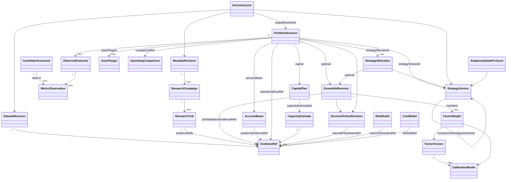
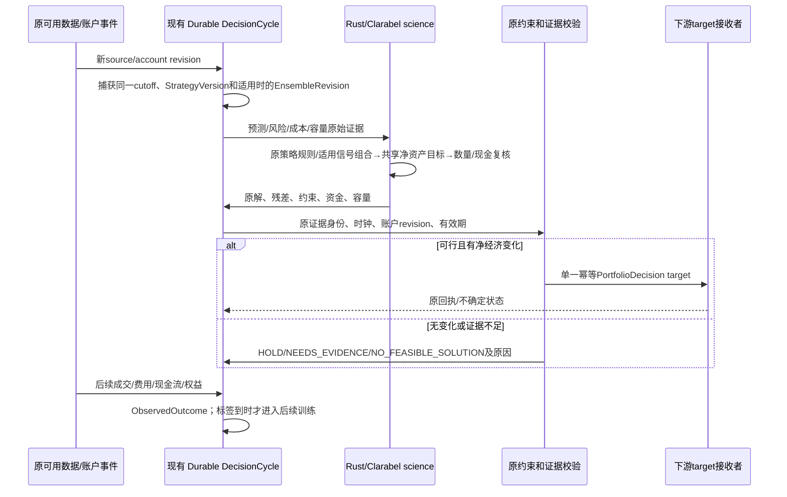

# 自动组合、资产配置与动态容量：个人量化 PM 业务及技术设计

> 规范说明：本章展开设计依据与候选实现。实体与字段以 [规范字段合同](contracts.md) 为准；专题代码示意不是另一套 API，也不代表已经实现。
文档性质：2026-10-22 的只读设计建议；没有据此修改实现、重跑真实研究、部署或提交目标。基于 `/workspace/QuaZonai` 当前 dev 架构及本轮 draft 改动。实体名称与主方案统一；下面的新字段、算法适配器和状态均是拟议合同，不是已上线能力。

## 1. 真正要自动化的业务决策

3000 pUSD 是一次原始账户场景，而不是写进代码的常量。系统应持续回答：现在有哪些因子值得共同使用；它们对同一个市场的预测怎样组合；真实账户在当前价格、成本、持仓和流动性下应该持有什么；有多少资金值得投入、多少应该保留；新组合相对原组合是否带来增量净收益；证据不足时应停止哪些动作。

必须分清预测因子比例、策略预算比例、资产持仓比例，以及账户总资金计划：

| 层 | 结果 | 分母、单位 | 系统如何产生 | 不能冒充的东西 |
|---|---|---|---|---|
| 信号层 | `EnsembleRevision.members[].weight` | 无量纲，归一化的预测组合系数 | 同周期、同标签单位的因子训练与验证；可包含零系数并记录淘汰 | 不是各因子的独立资金账户，也不是资产仓位 |
| 多策略预算 | `PortfolioDecision.strategyAllocations` | 每个策略committedCapital / 组合committedCapital；组合投入为0时capitalFraction=null | 原多策略联合回放、增量价值、现金/风险和共享容量约束 | 不是FactorWeight，不是策略各占完整账户；不能相加各策略单独容量 |
| 资产层 | `PortfolioDecision.assetTargets` | 资产市值 / 同一真实账户 NAV；同时保留原生数量 | 合成预测、联合风险、净交易成本、持仓及约束输入现有 Clarabel | 不是把因子权重直接乘资本；不能把 factorId 伪装成 instrumentId |
| 资金层 | `PortfolioDecision.capital` | 原始币种金额；可用、拟投入、闲置、保留分别记录 | 权威账户、已占用现金、费用、经济机会和动态容量共同限制 | 不是固定 80% 投入，也不是看到 3000 就必须全部用满 |

一个因子可以影响许多市场；多个因子可以同时解释同一资产。它们应先在信号层组合，再在同一个账户中对同一资产净额化。交易成本和风险只对最终净持仓/净交易计算。单因子各自使用完整 3000 回测后相加，会虚增资本、重复计算流动性，不能成为组合结果。

因子模型不是所有策略的必经形式。相对价值、事件驱动、执行/微结构和组合覆盖策略可以按自身StrategyVersion的entry/holding/invalidation/exit规则输出原生机会与持仓意图；不需要为它们伪造IC、收益预测或EnsembleRevision。单一预测策略可绑定其ensemble；非预测策略或多策略复合决策的`ensembleRevisionId=null`。多策略复合版本通过`StrategyVersion.componentStrategyVersionIds`列出原组件，在同一账户生成`StrategyAllocation[]`并由`nettingGroupId`协调共享资产和流动性。本文第3节的stacking只适用于具备合格可比预测的能力分支，不是通用策略门槛。

“自动”意味着资金、比例、机会集合和更新时点由原始事实与已验证方法计算，不要求用户填每个因子权重或容量。它不意味着没有方法假设。目标排序、估计器、缺失值政策、候选方法集合、模型复杂度约束和预算规则必须作为 `DecisionPolicyRevision` 冻结、验证、留版本。风险承受意愿和已承诺提款属于账户/业务事实，不能从行情里“学习”出来。

## 2. 当前已经存在、尚未接通的能力

1. 原生 `allocate` 已经使用 Clarabel 0.11.1，支持 `MIN_RISK / MAX_UTILITY / RISK_BUDGETING`、`VARIANCE / CVAR`、现金、资产/分组上下限、总净敞口、换手、参与率与风险上限；`AllocationInputV1` 每项资产必须有当前权重、交易成本率及同周期共同收益窗口。见 `apps/job/src/optimization.rs:122`、`crates/contracts/src/portfolio.rs:149,434,449,471`。
2. 原生 `study-portfolio` 已经逐 cutoff 准备新预测、风险样本和滚动 BAR 流动性，并在一个 Nautilus 账户里根据真实模拟持仓重新求解资产目标。它复用现有求解器，不需要新数学引擎。见 `apps/job/src/study.rs:71-165`。但 `members[].ensemble_weight` 原封不动进入预测混合，**它不学习因子组合比例**；prepare 还要求资产 BAR 完全同钟、同长度，不能直接拿来驱动几百万异步市场。见 `apps/job/src/portfolio.rs:148-156,245-257`。
3. 当前全市场 catalog 模式逐市场计算成员固定加权分数，正分数减阈值后归一化分配风险预算。它会动态改变资产份额，但没有校准到可比预期收益的保证，也没有统一的联合风险/交易成本最优化。只有一个正机会时，该机会可能承接全部既定风险敞口。见 `apps/job/src/catalog_ensemble_policy.rs:384-448`、`apps/job/src/catalog_ensemble.rs:728-738`。
4. 当前 TS `computePortfolio` 主要接收原始研究或用户给定的 weights，调用 `blend-targets` 后联合回放。catalog 模式只接受一个原 ensemble，并返回 `target: null`、容量 `UNAVAILABLE`。见 `apps/service/src/native.ts:30-36,51-57,86-94`。
5. 当前 `AdjustAccount` 每轮读取新的账户/提款事实，但使用已保存的原 target、原成员比例和原 capacity，再调用 `size-account`。其 5 秒循环是原目标缩放/交付协调，不是动态训练、自动因子选择或容量重新估计。见 `apps/service/src/automatic.ts:77-104,152,220-222`。
6. 每日账户统计已存在：完整 UTC 日覆盖、几何日均、最低日收益、日收益最大绝对偏差、亏损日、零收益日。缺失完整日或权益未定价时表现统计不可用。见 `apps/job/src/simulation/calendar_returns.rs:6-12,50-105`。当前catalog所走非spot路径已接入，不能据此宣称spot分支也自动具备Calendar统计。官方 Nautilus Max Drawdown 与准确的原始费用合计也已存在。应复用，不重写收益率/Sharpe 引擎。
7. 当前 research specification 和准入只支持一个 IC/Sharpe 标量。原生有的每日净收益信息尚未成为完整自动选择标准。`strategy_portfolio_finalize` 仍由模型提供 trialId；它验证该候选曾计算，并不自动比较所有真实账户候选。见 `packages/contracts/src/index.ts:30`、`apps/research/plugins/strategy-portfolio.ts:38-56`。

## 3. 信号层：真正计算因子组合比例

### 3.1 输入和预测单位

每个 `FactorVersion` 必须绑定不可变模型、特征版本、时点语义、预测周期、原始训练样本及输出单位。只有“未来同一 H 周期、相同价格基准、交易成本前的简单资产收益率”可以与相同定义的另一预测直接组合。任意 score、概率、IC、Sharpe、资产价格与年化收益不能互换；已扣费账户收益不能再作为未扣费资产μ混入。raw score 必须先经 `CalibrationModel` 映射到该周期收益；已有 `linregress` 训练/冻结校准可复用。概率预测则需要真实事件标签及相应专业校准，不应套收益率 OLS。原始BAR为成交价格时必须如实绑定TRADE价格，不得称为MID。

训练记录 `(instrumentId, eventEndNs, availableAtNs, labelEndNs, labelAvailableAtNs, factorVersionId, prediction, realizedReturn)` 中，`availableAtNs` 和 `labelAvailableAtNs` 均须不晚于训练 cutoff。延迟公开的结算/标签不能按照事件日提前使用。完整同一市场/时间/周期的记录才构成一行联合样本；不能零填新市场、用前值构造未出现 BAR，也不能把缺预测解释为零 alpha。

### 3.2 训练、拟合与选择

建议第一种新增方法是可解释的非负凸组合 stacking：对训练集内的 out-of-fold 校准预测矩阵 X 和真实未来收益 y，求 `min_a Σ q_t (y_t - X_t a)^2`，约束 `a >= 0, Σa = 1`。`q_t` 的样本平衡方式由版本化方法规定并记录；不能让每条成交当独立样本而掩盖同一事件/同一天的强相关。该问题是标准凸 QP，新增一个**信号专用 typed adapter**调用现有 Clarabel；不复用伪造 instrument 的资产 DTO，不新写优化器。这里是带simplex约束的convex stacking，不简称普通NNLS，因为普通NNLS没有系数和为1的约束。每一折的特征预处理、校准模型和超参选择都须仅使用该折训练数据fit，再预测对应验证折；先在全训练集校准后拼OOF预测仍会泄漏。

训练损失只是学习候选系数的方法，**不是盈利资格**。训练得到的系数冻结后，在 VALIDATION 上执行完整共享账户回放，用净日收益、亏损日、回撤、费用、资金利用率等业务表现选择方法/候选。最终只把冻结胜者带入 HELDOUT；最终结果不返回模型调参。若收益标签不足，不能仅凭 IC 大小生成资金比例。

至少保留原 ensemble 作为可比较基线；可比较新拟合组合、原组合、训练阶段自动识别的去除冗余因子组合。所有新的真实回放均进入原预算/尝试 ledger。线性组合训练允许系数为零；零系数因子的退出有明确原因和原拟合证据。不要为了满足“至少两个成员”的旧技术边界，强行给无效成员极小正权重。只剩一个有效因子或全体没有可验证增量时，应成为明确结果，必要时保持现金。

若新方法要加入 ridge、稀疏惩罚、近期衰减或误差协方差估计，其参数只能从训练折/内部验证得出，原估计值及选取过程进入 `DecisionPolicyRevision`。不能在求解奇异时偷偷加 diagonal jitter。普通 QP 可接受 PSD；目前风险预算/显式方差锥分解路径需 PD，达不到则精确报告限制。

### 3.3 多目标与增量价值

不把所有业务目标塞进随意加权的“综合分”。先计算完整证据矩阵和 Pareto 支配关系，再按冻结的业务决策政策选择：实际可行性与约束满足优先，其后比较经费用的账户增长与下行表现。选择政策必须说明怎样处理收益更高但亏损日更多的冲突；市场数据不能唯一推出人的这种偏好。系统可自动比较已获授权的政策族并在验证集选择，但不能借此暗改已有业务边界。

增量检验必须在相同数据、时钟、起始资本、交易成本、退出方式和原持仓条件下，对 challenger 与 incumbent 各跑一个独立共享账户。消融某因子后重新拟合/重新求解并联合回放，才有“加入此因子的增量净收益/回撤变化”。消融结果通常非加性，不应当作各因子独立资金 PnL。重复使用 VALIDATION 选择会增加过拟合；记录所有尝试、模型版本、数据暴露和方法数量，不以一次高 Sharpe 宣称稳健。

### 3.4 PM逐日结果的精确口径

| 业务问题 | 原始来源/单位 | 缺证据时的处理 |
|---|---|---|
| 每日净值赚亏多少 | 同一币种原生UTC日边界权益及现金流，金额为精确decimal | 现金流缺失时不能用权益差声称策略PnL |
| 每日收益率与几何日均 | 原生账户daily returns；Calendar Geometric Daily Return；比例 | 不把初始3000乘每一天收益当每日金额；复利分母每天不同 |
| 稳定、亏损日 | Calendar Minimum Daily Return / Maximum Absolute Deviation / Negative Days / Zero Days | 只对完整、充分定价UTC日；缺失日不当零 |
| 最大回撤 | 官方原收益复合曲线Max Drawdown，保留实际区间及转换版本 | 不能改叫盘中回撤；与UI权益曲线投影不同口径分开 |
| 费用、换手 | 原fee replay逐笔实际commission及quantity×price；金额/累计成交名义额 | 原净值已含费用；累计成交名义额不是持仓金额，也不默认是年换手 |
| 已实现现金利润 | 原成交/结算/现金账本中的realized PnL | 不能把含浮盈的NAV增长当可提现利润 |

完整日数、部分日数、日序列起止和未定价覆盖必须在PM结果旁边显示。前瞻经营存在入金/提款时，应复用能正确处理外部现金流的原生收益计算；原流水不完整则收益归因不可用，不自写补零或把提款当亏损。

## 4. 资产层：持仓、现金、成本与风险一起求解

首个正式实现应复用 `AllocationInputV1` 和原 Clarabel，在支持的共同窗口资产集合上执行：

`max_w μᵀw − λ Risk(w) − Σ_i c_i |w_i − h_i|`

其中 μ 为冻结信号组合输出的同周期预期资产收益；h 为当期**真实已有持仓**按同一账户 NAV 折算的权重；c 为同一交易方向/有效时点的原成本计划；Risk 使用现成方差或经验 CVaR。现金作为显式变量满足资金守恒。λ 是方法/业务政策的版本化参数，只能在已冻结SelectionRule、效用模型及owner boundaries明确许可的参数域内拟合和验证，以检验参数是否实现既定偏好；不能通过挑回测收益最高的λ重新定义业主风险偏好。缺少成立的偏好时输出可行前沿或保持仍有效原决策，不声称数据能唯一学出风险厌恶。原资产目标、原因子比例与资金金额不相互覆盖。

单位也属于合同：VARIANCE 是每周期收益率平方，CVaR 是每周期损失比例，二者的上限和λ不得直接复用。方差目标中的λ具有相对于收益率的尺度，CVaR目标中的λ为相同收益尺度的相对权衡；参数证据必须记录risk measure、horizon和归一化方式。年化波动率、日内风险与每日收益目标都不能无转换地塞入同一个`max_ex_ante_risk`。

需要同时考虑：当前不可立即卖出的库存、已在途目标、净交易量、最低订单和数量步长、退出费用、已保留现金、事件/发行方敞口、保证金/交割规则。真实事件分组应来自登记的 condition/market/underlying 元数据；不能从 token 字符串猜 YES/NO 互补或独立事件。

信号增加不足以覆盖确定成本/已验证不确定成本时，解可以是不动；没有可信正机会时，解可以是现金。手续费被计入原生权益后，报告不能再从净收益中扣一次。目标求解使用成本估计，最终业务评估使用原生实际模拟费用，两者必须并列展示偏差。

方差风险贡献采用 `RC_i = w_i(Σw)_i / σ`，仅在 σ>0 且输入有效时提供；和为组合 σ。相对贡献再除以 σ，不能与方差贡献混称。负贡献允许存在，反映对冲而不是坏数据。CVaR 贡献使用原经验场景与已验证的 tail witness，尾部分位并列时记录非唯一性；不能任意挑一组尾部。每日最大回撤是路径依赖统计，不能假装作为现有 QP 的简单线性约束直接放进去；通过联合情景回放及已冻结的在线风险预算状态控制。

### 多策略预算与统一账户

上述μ/协方差求解针对预测型资产配置；非预测策略按其已验证的原生规则产生经济意图，不被强制改写成alpha。多策略总组合根据原共享账户、成熟策略净收益场景、资金尺度回放、现金需求与成本/退出约束提出`StrategyAllocation`，再对兼容的同账户、同币种、同真实instrument净额化。不同账户、结算/抵押品或不同经济合约不能仅因同名字就相互抵销。

现有资产`allocate`不能把strategyVersionId伪装成instrumentId求策略预算。若以后需要数值策略预算适配器，应以真实可验证的策略资金/联合情景合同另建typed adapter并复用官方solver；暂不把它记作当前能力。对于可缩放线性策略，线性/二次近似只能生成候选预算；存在共享持仓、最小订单、费用台阶或相互冲击时，不能直接加独立策略净收益。每个候选预算须经过原统一账户联合回放后才进入比较，资本曲线和增量风险也按最终净敞口验证。

有资本计划的单策略决策，其strategyAllocations必须恰有一项，strategyVersionId就是根策略版本；不能因componentStrategyVersionIds为空而输出空预算明细。只有复合策略才以其componentStrategyVersionIds逐项匹配预算成员。初始合同禁止嵌套复合成员，先去重并扁平化叶策略再登记，不把复合总预算和其子策略预算同时相加。所有明细committedCapital之和必须等于组合CapitalPlan.committedCapital；组合投入非零时capitalFraction按该共同分母计算，零时为null。纯覆盖/风险控制策略可有零独立资金承诺，不能据此推断零风险贡献。缺少配对净场景、共同账户行为或退出证据时，输出明确缺口/前沿或保留仍有效原决策，不制造“系统最优预算”。

### 全市场规模与异步数据

全市场扫描继续覆盖原登记 universe；“有资格进入当期风险求解”由新鲜预测、成本、历史/风险覆盖和实际可交易性自动决定，并逐市场记录排除原因。它不是用户固定名单或按未来收益选出来的 shortlist。当前同步 dense 样本协方差不适合几百万异步市场；不能填零/前值把全量矩阵拼出来。

分期上，先证明当前支持的真实共同窗口模式，再建立完整因果风险覆盖：可使用登记的低秩风险暴露/分组因子及原生矩阵运算构造可扩展模型，但需要原训练样本、残差覆盖和模型验证。不能用未经验证的独立性假设把所有协方差置零。若任何需保留的持仓没有可靠估值/风险覆盖，应冻结增加风险；新机会不足资料时保持观测资格但不投资。计算时间耗尽时不发布半个 universe 的“全局最优”，记录 `COMPUTE_BUDGET_EXHAUSTED`。

## 5. 资金层与容量：三种不同证据

### 5.1 可观测上限

原始输入包括：当前订单簿可执行价格档与数量、原始 event/receive clocks、venue 订单最小值/步长、账户自由/锁定余额、未完成订单、费用资格及退出路径。每个原 book/BAR/成交池只允许消耗一次；多个因子/重复决策共享净订单预算。买入和退出分别评估，两个方向不能凭同一个总成交量对称推断。

报告 `CapacityEstimate.level=OBSERVED_LIQUIDITY` 的意思是“在这批可观察事实、该执行时窗及适用规则下测得的上限”，不是未来保证。原账户资金可用数与退出能力必须同时可行。全市场没有新鲜连续 book 时不能输出这一等级。

### 5.2 条件容量

当前原生 `assess-capacity` 的历史公式为：每个原 instrument/BAR 的可用参与金额，除以重复决策累计的绝对净目标变化与单独全退出所需份额中的较大者，再取跨约束最小值。它是静态资本/目标权重近似，不重建真实成交和持仓漂移，也不估净收益。源代码 `apps/job/src/capacity.rs:45-66` 已明确这些限制。

未来 catalog 直接从实际原生 replay 的持仓、源池剩余额度、成交、费用与目标事件生成条件容量证据，避免把之前只支持显式 BAR 的方法硬接上。参与率、延迟和历史定义若不是观测而是情景假设，应记录方法来源；不能声称系统从当前成交池“测得”一个任意 1% 限制。没有可校准执行资料时，可做原授权条件研究，但 `level=ECONOMIC` 的CapacityEstimate保持UNAVAILABLE。

### 5.3 经济容量与自动资金配置

经济容量回答的是：增加资本后，边际净收益是否仍有验证支持，以及退出/下行是否仍可承受。必须对候选资本规模运行同账户、同成本、同执行情景的原生回放，得到资金—净收益—风险—成本曲线。资金测试点由权威账户可用资本、真实最小订单、可观测流动性断点与已发现的约束变化自动产生；用户不用填 1000/3000/5000 的表。可以使用版本化的上游优化/搜索方法安排后续测试点；因为阶梯费用/最小订单/仓位变化可能非单调，不能默认二分搜索必然有效。

运行使用`CapacityEstimate.feasibleRegions`确认实际资本的证据覆盖。TESTED_POINT的lower=upper，只支持该原测试金额；VALIDATED_INTERVAL仅在原方法确实验证了该区间时成立，且逐项绑定configurationEvidenceRef与evidenceRef。supportedCapitalUpperBound只是摘要边界，capital≤该上界不代表可行，不能跨不连续区间插值。新账户资本或新配置不匹配任何仍有效的点/区间时，系统自动登记并完成对应原生规模回放、计入原预算，再作运行结论；原预算/数据不支持补验则NEEDS_EVIDENCE，不给假通过。

系统选择本账户可投入金额时，以真实 NAV 为风险分母，以实际可用现金/保证金为资金约束，并保留退出成本和已承诺现金流。`reserved`、锁单现金、提款预留、已扣提款不得重复扣除；它们通过权威控制 revision 对账。现金缓冲应由已知费用、最小面额、待执行现金流及经验证的压力退出成本计算，无法估计的部分为未知，不作为零。

经济容量是组合属性；不能把因子各自的上限相加。当前 catalog capacity 明确 `UNAVAILABLE`，不能仅因 3000 看起来很小就声称可执行。当前历史源包含成交、方向、费用；缺原始连续订单簿、接收钟和历史执行定义。现有 margin1x pUSD proxy 不等于真实 cash-token 交割账户。这些限制由 `apps/job/src/catalog_ensemble.rs:855-864` 明文输出。

## 6. 动态持续更新与独立验证的关系

系统维护两个不同速率的闭环。

**经营循环**：新的可用市场批次、账户持仓/余额变更、订单状态、费用/规则 revision 或容量证据失效触发 `DecisionCycle`。在一个不可变 source/account cutoff 上刷新预测、容量、成本和风险，复用已冻结的 EnsembleRevision 求解资产/现金。没有经济变化则PortfolioDecision.action=HOLD；证据不足则action=NEEDS_EVIDENCE，周期进入WAITING_EVIDENCE；目标期限届满则该决策status=EXPIRED。目标期限取各输入的有效期限最小值；在实际发送 target 前重新核对账户和控制 revision。不得因为 wall-clock 轮询发生就人为给旧数据新的 asof。

**学习循环**：只有新标签真正可用、训练覆盖达到已验证条件、原登记训练计划到点或可验证漂移事件发生，才训练新 CalibrationModel/EnsembleRevision；成员或系数任何改变都创建新EnsembleRevision，绝不原位更新members。所有训练/验证 cut 都使用 available clock。新模型在新验证样本/受控回放胜出后换版；处理状态不影响原账户执行状态。数据因子模型不应在每个 tick 全量重新训练。

HELDOUT 是封存评估，不是经营循环的数据缓存。它一旦用于方法选择，就必须改记 exposed/history reassessment，不能对同一历史重复声称独立。未来前瞻观测可成为后续训练资料，但其当时的预测/目标/结果须先作为原 `ObservedOutcome` 留存。新一轮是新数据/政策绑定，不覆盖旧研究历史，不重新补足试验额度。

QZ 持续输出仍为 target-only；下游负责交易执行。计划中须保留现有不确定回执协调、账户 revision 栅栏和幂等目标身份。一个新模型产生胜者，不等于自动突破尚未具备的交易/数据能力。

## 7. 与规范合同的逐字段映射及算法证据

本节只解释[规范字段合同](contracts.md)的既有字段如何承载组合与容量事实，不再定义第二组 TS 实体。原始 Pi task/conversation ID 留在 `RuntimeRef`；业务 ID、精确十进制、时钟、指标状态和方法版本全部使用规范合同。下表中数值的来源、分母与缺失语义也是校验要求。

### 7.1 因子、校准与不可变组合

| 规范字段 | 来源与单位 | 组合侧约束 |
|---|---|---|
| `FactorVersion.modelRef / featureSchemaRef / labelDefinitionId` | 原模型、特征与标签定义 evidence | 模型名称相似不能证明预测可组合；label/horizon/价格口径一致才可混合 |
| `FactorVersion.outputUnit` | 原生模型实际输出单位 | RAW_SCORE不能直接当RETURN_PER_HORIZON；同收益单位还须核查成本前/后口径 |
| `FactorVersion.status` | RESEARCH / ELIGIBLE / DEGRADED / RETIRED | 这是研究/业务资格，不新增ACTIVE/ZEROED状态；某拟合权重为零不等于该因子永久退役 |
| `CalibrationModel.inputUnit / outputUnit / labelDefinitionId` | 原校准模型输入输出与标签 | 本文收益stacking要求输出绑定成本前同周期资产收益；概率校准须另有真实标签与方法 |
| `CalibrationModel.trainingInterval / trainingCutoffNs / fitProtocolRef` | 原折内训练窗口、可用截止、协议 | 特征变换、校准和超参选择均在该折训练数据内完成，再预测其验证折 |
| `CalibrationModel.modelRef / fitEvidenceRefs` | 原拟合产物和训练、残差、fold evidence | 原样本/模型不可因新标签到来原位更新；训练输入应能独立重建 |
| `EnsembleRevision.members: FactorWeight[]` | 一个冻结拟合结果，成员顺序与原矩阵列一一绑定 | 系数更新或成员改变必建新EnsembleRevision，以supersedesId关联旧版 |
| `FactorWeight.weight` | 非负、精确十进制、无量纲信号系数 | 全部成员权重精确合计1，零系数保留；不得用epsilon补无效成员；不代表成员资金 |
| `FactorWeight.calibrationModelId` | 原校准模型ID；仅经证明确为同口径预测才可null | 不能把null解释成自动校准；有校准时必须绑定当时冻结版本 |
| `FactorWeight.economicFamilyId / contributionEvidenceRef` | 原经济家族及消融/增量检验引用 | 家族不能靠同一模型名字推断；贡献为诊断，不必可加 |
| `EnsembleRevision.predictionUnit / labelDefinitionId` | 组合后预测单位及同一标签定义 | 对所有成员严格一致；不把daily net account return与asset μ混在一起 |
| `EnsembleRevision.fitCutoffNs / fitProtocolRef / trainingEvidenceRefs` | 原拟合截止、方法与样本 | 截止依据available clock；因子训练、校准、预处理与权重拟合链均可追溯 |
| `EnsembleRevision.jointValidationEvidenceRefs / qualification` | 真正单账户回放及CANDIDATE/SELECTED等阶段 | 求解成功不是SELECTED；独立评价也不是永久可运行资格 |

`DecisionPolicyRevision.learnedParametersRef` 存放原训练产生的参数 evidence；`trainingProtocolRef` 冻结拆分、purge/embargo、候选方法与调参规则；`selectionRule` 是已经成立的业务选择规则，不能看完结果再换目标顺序。信号拟合的正则项、样本平衡、数值容差和选取依据作为受版本schema约束的方法证据，不能塞进每个FactorWeight变成用户配置。

规范 `LabelDefinition.returnBasis / priceBasis / priceAndCashflowRuleRef` 已明确成本前后、TRADE/BID/ASK/MID/SETTLEMENT价格口径及原来源/现金流规则。本信号分支绑定`GROSS_PRICE_RETURN`；`NET_ACCOUNT_RETURN`不能拿来当未扣成本资产μ，事件或非收益标签按原定义使用NOT_APPLICABLE。以上语义只在LabelDefinition维护，不再复制成FactorVersion/CalibrationModel/EnsembleRevision的平行顶层字段。

### 7.2 方法、风险、成本与自动更新协议

| 规范字段 | 原始依据与使用要求 |
|---|---|
| `RiskModel.method / labelDefinitionId / assetUniverseRef` | SAMPLE_COVARIANCE、SCENARIO_CVAR或明确验证的扩展；同一收益周期、允许资产集合和价格口径 |
| `RiskModel.matrixOrScenarioRef / sampleCoverageRef / numericalDiagnosticsRef` | 原矩阵/场景、完整覆盖、PSD/秩/残差诊断；新因子或新市场缺样本不可填零 |
| `RiskModel.trainingInterval / cutoffNs / validationEvidenceRefs / status` | 原因果拟合区间及验证能力；不能借当时未知数据改善过去风险估计 |
| `CostModel.currency / horizonRef / basis / feeRuleRef` | 原币种、持有/执行周期、VENUE_RULES/OBSERVED_EXECUTION/CONDITIONAL_SIMULATION及真实费率规则 |
| `CostModel.spreadModelRef / impactModelRef / latencyModelRef / exitModelRef` | 各成本组成的原方法；缺失保持null并列入missingComponents，不能隐式零成本 |
| `CostModel.applicableScale / calibrationEvidenceRefs / validationEvidenceRefs` | 原资本尺度、拟合和验证范围；规模外推不是已有经济容量 |
| `AdaptiveUpdateProtocol.eligibleTriggers / maturityRuleRef / trainingWindowRuleRef` | 哪些新事件/成熟标签触发更新及真实训练窗口；wall-clock轮询不制造新事实 |
| `updateMethodRef / modelSelectionProtocolRef / allowedParameterDomain` | 冻结更新方法、模型比较与可更新参数域；成员/系数更新产生新ensemble |
| `riskAndCostRefreshRuleRef / evidenceFreshnessRuleRef / resourceBudgetRef` | 风险/成本刷新、失效和原资源预算；证据到期不续写旧asof |
| `wholeProcessValidationRefs / outOfDomainAction` | 整套连续学习过程的前滚验证；越域按KEEP_VALID_INCUMBENT、REDUCE_WITH_EVIDENCE或WAIT_EVIDENCE处理 |

原生请求证据与basisRevision要绑定本次实际使用的RiskModel、CostModel和更新协议版本；不能只给一个方法族名字后运行时换估计器。方法版本、预测模型、实际持仓三类变化分别留证。新方法不能通过“实时学习”绕过研究预算或独立评价。

### 7.3 容量三层是一组事实，不是一个嵌套新DTO

同一组合、数据/账户basis可以有多个 `CapacityEstimate`，每个对象只有一个规范 `level`：OBSERVED_LIQUIDITY、CONDITIONAL_FEASIBILITY或ECONOMIC。`CapitalPlan.capacityEstimateIds` 引用实际被资金计划使用的那些原事实；三层可以分别为AVAILABLE或UNAVAILABLE，不能把“条件”塞进Availability状态，也不能因为有第一层就自动生出第三层。

| 规范字段 | 来源与单位 | 必须区分的结论 |
|---|---|---|
| `CapacityEstimate.strategyVersionId / ensembleRevisionId / basisRevision` | 原策略、适用时的因子系数及本次数据/账户/方法basis | 非预测/复合场景ensembleRevisionId=null；新组合不能复用旧组合容量却不标明条件 |
| `level / status` | 容量种类与证据可用性 | OBSERVED_LIQUIDITY有值不证明ECONOMIC有值；未知不当无限容量 |
| `observedInterval / asOfNs / validUntilNs` | 所测事实区间、决策时点、实际依据下的期限 | validUntilNs=null不是永久有效；不可用于需已知期限的运行交付 |
| `minimumTestedCapital / maximumTestedCapital` | 原实际测试点最小/最大金额 | 不是最低可交易资本/经济上限，不能改名复用 |
| `supportedCapitalUpperBound` | 原约束与模型支持的摘要上界，Money或null | 没测到瓶颈与不知道上界均保留null并在missingEvidence/assumptions解释；capital≤上界不能作为运行可行证明 |
| `feasibleRegions[].lower / upper / kind` | 原实际测试点或经方法验证的资金区间，Money | TESTED_POINT上下界相等；VALIDATED_INTERVAL仅覆盖真实验证区间，禁止跨不连续区域插值 |
| `feasibleRegions[].configurationEvidenceRef / evidenceRef` | 该点/区间所对应的原配置与验证证据 | 当前资本、配置和有效basis必须匹配；未覆盖时自动补回放并计预算，不能拿摘要upper放行 |
| `curve: CapacityPoint[]` | 每个实际资金测试点和原重放结果 | 不用拟合曲线补造未测试的point；展示插值须明确另属模型 |
| `CapacityPoint.capital / strategyVersionId / portfolioDecisionRef` | 本点起始金额、策略及实际重求解目标 | 每个规模是否重新优化必须可查；不把小资金同权重缩放冒充大资金最优 |
| `CapacityPoint.netPerformance / entryDemand / exitDemand / estimatedCost` | 原账户净指标、分方向需求和成本金额 | 净收益与成本诊断不重复扣；退出需求不能漏掉原留仓 |
| `CapacityPoint.fillRatio` | 指定执行窗口中的原成交满足率 | 不是BAR参与率，也不是未来成交概率 |
| `liquidityModelRef / impactModelRef / executionModelRef / exitModelRef` | 原模型evidence | 缺冲击/退出模型导致ECONOMIC缺证据；不放虚构零成本模型 |
| `evidenceRefs / assumptions / missingEvidence` | 原结果、情景和缺项 | 当前catalog的历史proxy与source-pool限制必须仍可见 |

当前legacy报告的`economicCapacity`、`maximumCapital`等字段只作为原native证据保留，经有版本的adapter映射到以上对象；新业务合同不再另加同名嵌套CapacityBound。

### 7.4 策略预算、账户、资产目标和资金计划

| 规范字段 | 来源与单位 | 不变量 |
|---|---|---|
| `PortfolioDecision.strategyVersionId / strategyAllocations` | 单策略版本或复合PORTFOLIO_OVERLAY，以及原策略预算明细 | 单策略有capital时恰一项根策略；复合才与去重扁平化components一致；禁止嵌套重复计资 |
| `StrategyAllocation.strategyVersionId / ensembleRevisionId` | 原策略与适用时的ensemble | 不同策略可用不同原生方法；无预测ensemble时为null |
| `StrategyAllocation.committedCapital / capitalFraction` | 策略承诺金额与其占组合承诺资本比例 | 金额非负且明细和=CapitalPlan.committedCapital；组合投入为0则fraction=null，不能除零或补均分 |
| `allocationEvidenceRef / riskContributionEvidenceRef / nettingGroupId` | 原资金求解、风险贡献与净额组证据 | 先合并共享资产净需求再评估风险/成本/容量，风险贡献不按预算比例假算 |
| `PortfolioDecision.accountBasis` | 当前权威账户一致快照 | 有真实账户则researchStartingStateRef=null；离线研究使用原starting state，不能混用 |
| `AccountBasis.equity / reserved / controlRevision` | 原币种NAV、已保留金额、控制版本 | NAV不是free cash；锁单/提款各项目以原账户schema对账，不能重复扣 |
| `AccountBasis.positionsEvidenceRef / outstandingCommandsRef` | 真实持仓及未完成目标/订单证据 | 上次target不能替代当前holding；未完成订单不能视为已消失 |
| `AssetTarget.navWeight` | targetNotional / 同一account NAV，精确decimal | 分母不是committedCapital或deployableBudget；符号遵循实际short/leverage能力 |
| `targetNotional / currentNotional / netTradeNotional` | 同结算币种目标、当前市值、净差额 | netTrade=target−current；多个因子共同需求在此净额化 |
| `targetQuantity / quantityRuleRef` | 原venue规则下的可交付数量与规则evidence | 步长/lot处理后重验预算、费用与风险；需数量的交付不接受null |
| `riskContribution: MetricObservation` | 原风险模型与实际目标下的Euler/场景诊断 | 单位/period/methodRef明确；不能把模型系数当风险贡献；未知为null |
| `CapitalPlan.equity / reserved / ownerLiquidityReserve` | 权威账事实及已成立业主流动性安排 | 不能从当前行情推断业主提款意愿；已扣提款不再重复保留 |
| `deployableBudget / committedCapital / uncommittedCash` | 可分配预算、实际承诺资本、未承诺现金 | committed不超过deployable；uncommitted=deployable−committed，不等于可立即提现余额 |
| `projectedTradingCash` | 原生配置预计留在策略内部的现金 | 不与uncommitted重复加为第二份闲置现金；不等于gross exposure的补数 |
| `sizingEvidenceRef / capacityEstimateIds` | 原资金分解、费用/lot复核及容量引用 | 细分free/locked cash、退出成本等保留在原证据，不从展示摘要反猜 |
| `solverEvidenceRef / jointReplayEvidenceRef / comparisonRef` | 原求解、联合回放，以及同cycleId/basisRevision的OperatingComparison | 运行保持/现金/重配比较不能伪造ResearchTrial；求解状态/残差从solverEvidenceRef读取，不另加solveStatus字段 |
| `action / status / validUntilNs` | 经济动作、版本可消费状态和期限 | HOLD/REBALANCE/REDUCE/CASH与NEEDS_EVIDENCE/NO_FEASIBLE_SOLUTION分离；EXPIRED是版本状态，不是求解失败 |

只有真实可行、资本/成本完整、时效确定且运行能力支持时才生成 `TargetCommand`。`action=NEEDS_EVIDENCE/NO_FEASIBLE_SOLUTION` 时不给可执行目标；按规范 `assetTargets=[]`、`capital=null`或已被证据支持的诊断值保存，`targetCommandId=null`。空目标数组单独不说明全现金；只有`action=CASH`及真实退出/资金证据才能代表可执行退现金。若权威NAV本身未知，`DecisionCycle.state=WAITING_EVIDENCE`且`outputDecisionId=null`，保存EvidenceGap而不制造金额。

**账户细分建议：**规范AccountBasis目前仅直接包含equity/reserved；free、order-locked、withdrawal-reserved与已执行现金流需由其权威账户证据和CapitalPlan.sizingEvidenceRef提供可校验分解。若以后API要独立消费这些值，建议主合同扩展有原schema语义的账户现金明细，而不是本分册私增freeCash/orderLockedCash字段。

### 7.5 指标、逐日反馈与原生转换

所有指标使用 `MetricObservation.definition`、`role`、`interval`、`asOfNs`、`availableAtNs`、`status/value/reasonCodes`。内嵌definition必须与不可变注册`MetricDefinition.id`的原定义完全一致；Objective通过`metricDefinitionId`绑定精确定义，不仅匹配metricKey。LOSS边界、排名及比较同样核对定义身份、单位、horizon与日历。不要新增partition/valueType平行DTO。原native TRAIN/VALIDATION/HELDOUT标签按明确evaluation protocol映射为TRAINING/INNER_VALIDATION/SELECTION/INDEPENDENT等EvidenceRole；不能只看名字把内层validation与用于最终选择的validation混成一类。

- 原生几何日均映射`account.daily_geometric_net_return`，单位RETURN_RATIO；负收益日比例映射`account.negative_day_fraction`并保留原分子/分母。完整日、部分日和未定价coverage仍绑定原evidence。
- 原生`Max Drawdown`负比例映射`account.maximum_drawdown`非负LOSS_RATIO时，`raw.nativeKey/value/unit`保留原负值，`raw.conversionVersion`登记`native_max_drawdown_sign_v1`，`methodRef/evidenceRefs`指向转换依据。不混用最大化负值与最小化正损失。
- 原生Sharpe252/365都映射`account.sharpe`但各有不同的不可变MetricDefinition.id，`definition.annualizationDays`保持原值。Objective.metricDefinitionId必须选中原对应定义；相同key不允许换周期。不同annualization不得混排、自动换算或fallback。
- 金额型日损益/费用使用CURRENCY、DECIMAL和currency；数量/计数按定义使用NATIVE_QUANTITY/COUNT及相应编码。不得经JS Number再转十进制。
- `ObservedOutcome.realizedMetrics`保存原权益/现金流支持的真实指标，`attributionEvidenceRef`承载日开闭权益、外部现金流、费用、已实现PnL及原完整日序列。不要把这些大数组新内联进ObservedOutcome。
- `ObservedOutcome.receiptState=ACKNOWLEDGED`不证明成交或收益；归因只覆盖`reconciliationStatus`真正支持的范围。原现金流缺失时日PnL/return不可用，不能用日收益×初始3000回填。
- 成熟标签仅通过`matureLabelEvidenceRef`在实际available时点进入下一轮训练；原最终评估不会因后续成熟而被追溯改成当时可用于训练。

### 7.6 原生拟合证据的算法特有内容

下节新Rust适配器的matrix/sample/labels/weights引用分别解析为原EvidenceRef，原输出系数与factor列顺序映射到新 `EnsembleRevision.members[].weight`。拟合evidence必须保留：原样本keys、factor/calibration版本、label定义、折内生成路径、fit cutoff、样本平衡方法、目标函数、求解状态、原浮点系数、精确decimal转换版本、约束残差和独立目标复算。这是算法输入/结果证据内容，不是另一组业务实体字段。

一个新学习事件生成新模型/组合对象，旧EnsembleRevision的members不变。仅资产价格/账户变化而原信号系数不变时，可以沿用原ensemble并生成新PortfolioDecision；新的风险/成本方法参数则先形成新的DecisionPolicyRevision并绑定新basis。任何重拟合、量化系数或换成员操作都不能以“自动更新”为名覆盖旧事实。

## 8. Rust science 合同与现有接口复用

下述是拟议新 DTO；复用现有 `DecimalValue`、`DbCounter`、有限浮点序列化与 `EvidenceRef` 对应的原 artifact。实际 DTO 仍由 Rust 官方 exporter 生成 schema，TS 不手写另一份 numerical contract。

```rust
// 新的信号层适配器；绝不能别名到 AllocationInputV1。
pub struct NativeSignalBlendFitRequestV1 {
    pub schema_version: SchemaV1,
    pub factor_version_ids: Vec<String>,
    pub calibration_model_ids: Vec<Option<String>>,
    pub dataset_revision_ids: Vec<String>,
    pub label_definition_id: String,
    pub policy_revision_id: String,
    pub fit_available_through_ns: DbCounter,
    pub horizon: NativeHorizonV1,
    pub sample_keys_artifact_id: String,
    pub prediction_matrix_artifact_id: String,
    pub labels_artifact_id: String,
    pub sample_weights_artifact_id: String,
    pub optimizer: NativeModelRefV1,
}
pub struct NativeSignalBlendFitResultV1 {
    pub schema_version: SchemaV1,
    pub solver_status: SolverStatus,
    pub reason_code: Option<String>,
    pub signal_weights: Option<Vec<DecimalValue>>,
    pub sample_count: DbCounter,
    pub objective_value: Option<f64>,
    pub primal_residual: Option<f64>,
    pub dual_residual: Option<f64>,
    pub native_input_artifact_id: String,
    pub native_result_artifact_id: String,
}
```

`NativeHorizonV1` 是对现有 HorizonKind/value/bar specification 的结构化引用，须与label_definition_id解析出的规范LabelDefinition一致，不发明新交易周期。calibration_model_ids与factor_version_ids逐项等长绑定；None仅表示该原预测已具备直接可比的单位/标签证据，不是默认经过校准。矩阵 artifact 每行附原 sample key；服务不能仅传一块无来源数字矩阵。训练数据可以 streaming 汇总正规方程，但原样本证据和独立重算路径必须保留；规模过大时官方稀疏矩阵/求解器适配优先，不引入近似后仍声称精确结果。系数转 DecimalValue 必须按明确 converter 量化并重验 simplex/目标差异；失败不能造等权。

资产求解继续复用 `AllocationInputV1`；离线滚动优先 `NativePortfolioStudyRequestV1`。新增工作是提供实际合格输入以及全 catalog 的因果风险适配，不能只改 TS 路由。现有原生 `NativeAccountSizingRequestV1` 保留最终账户/费用/步长检查用途，但其 members.capital 仅是现行比例展示，不能解释为信号因子真实独立资本。新界面应显示资产目标和组合资本，因子贡献单列证据型诊断。

catalog 原生结果的原目标、持仓、source pool、费用和退出事件可汇入 `CapacityEstimate` 证据；不要把全部订单/成交直接塞进模型上下文。模型只能接收允许 partition 的紧凑标量和引用，完整证据保留在现有 restricted artifact。服务层使用现有 Chord/Pi Durable ownership/commit，不建新调度器/数据库。

## 9. 类图与时序建议





## 10. 不确定性、无解和坏数据的业务处理

不确定性必须注明来源：样本有限、源缺失、模型误差、执行冲击未知、事件相关性未知、时钟不可观察是不同问题。只有经过验证的统计方法才能给区间；用0.5倍量做情景不叫50%置信区间。新不确定性估计依赖应先研究上游实现与序列相关适用性，未实现前明确 `INSUFFICIENT`，不能写“保守95%”数字占位。

| 事件 | 新风险动作 | 已有持仓 | 系统结论 |
|---|---|---|---|
| 某新因子缺可用校准或标签 | 不赋予有效组合系数 | 原有效ensemble可继续 | 记录排除原因，绝不补权 |
| 某资产缺新鲜价格/规则/风险 | 不增加该资产风险 | 保留原持仓事实，退出也需可执行报价 | action=NEEDS_EVIDENCE或证据支持的REDUCE |
| 费用/经济容量未知 | 条件研究可运行，不能声称经济可部署 | 不以未知=0做扩大 | 容量层分别显示缺项 |
| 新QP无解/超时/不可接受残差 | 不发布伪目标/等权/归一化修复 | 不自动认为保持原仓已安全；重新检查已有敞口 | 原因、冲突约束、最早过期证据 |
| 下游回执不确定 | 暂停替代目标 | 保留原身份协调结果 | 原有UNCERTAIN流程 |
| 实际持仓偏离目标 | 从实际数量重新估值求解 | 不用上次target替换真实仓位 | 新DecisionCycle |
| 最低订单/费用使小资金不可行 | 资金不强制投入 | 正确保留现金/既有不能卖的小额持仓 | action=NO_FEASIBLE_SOLUTION，reason=TOO_SMALL及具体binding |
| 源数据修订或范围缩小 | 新revision重新检查 | 不静默沿用旧模型合格声明 | 历史结果不重写 |

“退回现金”是只有当实际可交易退出成立时才能执行的目标；缺报价时把账面权益标为现金是造假。无法求解与已求解全现金是两个不同状态。

## 11. 验收矩阵与实施分期

### A. 首个真实业务闭环：自动选择与账户目标评分

复用现有研究 ledger、VALIDATION 原生账户 statistics、原 candidate weights；系统在每个完成的候选结果后更新组合比较结论，若冻结业务政策确有明确胜者则finalize使用该原候选；多目标各有优劣或并列时保留前沿/原incumbent，不能按taskId伪造优胜者。这个阶段可以去掉用户/模型任意挑trial的业务断点，但必须注明“在已验证候选内自动选择”，不能称连续数值权重最优。对应 `research/src/trials.ts`、`plugins/strategy-portfolio.ts`、contracts评价合同、service projection及界面。不要改 Rust 引擎。

### B. 自动信号比例学习

引入上述 signal-fit 原生适配器、因果样本/校准绑定和 nested train/validation 回放；冻结胜者 `EnsembleRevision`。验证相同因子/退化因子不会伪造权重、零系数合法、未来标签绝不能改变过去模型、固定模型同输入可重现、原拟合可被独立数值 oracle 复算。对角/相关构造可检查可行域与目标；真实市场测试检验的是联合账户业务表现而不是数学最优就等于赚钱。

### C. 自动资产比例与资金缩放

先将原生 `study-portfolio` 接入有真实共同窗口/合格预测的服务入口，并使用原模拟持仓、动态BAR证据和原成本。验证价格/协方差/成本/已持仓变化会改变原生解；净edge低于成本会不交易/保留现金；容量下降、提款保留增加会减小可用规模；NAV增长不等于强制同比加仓。这个阶段还不能冒称已支持全异步catalog。

### D. 全市场连续经营与经济容量

接通连续源、真实接收时钟、历史规则/当前venue规则、共同风险覆盖及source-pool容量证据；事件驱动更新DecisionCycle。全catalog模式从比例归一化迁移到具备证据的资产求解。需要实际全源性能测试证明覆盖、时钟、内存与时限，不能用8个instrument probe代替全市场采集。经济容量必须有资本规模回放曲线、校准成本/退出证据后才升级状态。

### E. 专业验收必须实际观察的结果

1. 同一账户，两个信号指向同一资产时，订单和手续费按净交易计；原共享源量不被双花。
2. challenger 的单因子IC/Sharpe更高但联合净收益更差，系统不能因此替换原组合；独立持仓反事实给出明确依据。
3. 完整日缺一日、仅有部分日或未定价权益，亏损日/几何收益不被填零；真实零收益日保留。
4. 同一真实账户资本改变，目标数量、费用、最低lot、现金残留和退出约束一起重算。
5. 开始已有资产A，新的信号只有B时，A不能从预算/风险/退出中消失。
6. 所有数值结果附原币种、周期、partition、数据revision、时钟和方法版本；252/365 Sharpe绝不混用。
7. 新source revision/新账户revision触发一次可恢复循环；重放不重复发目标、不重复计科研预算；无变化不制造交易。
8. 目标发布前任一关键证据过期，旧目标不得通过改时间续命；回执不确定不得新发覆盖。
9. 滚动训练不读取未来label/HELDOUT；最终测试结果不回流模型；对修订数据/暴露历史有审计。
10. 所有新方法需在原实际3000pUSD场景与至少另一真实资本场景验证；合成测试通过不等于取得每日正收益。
11. 构造资金可行区间不连续的案例：低于摘要上界但落在未验证缺口的金额不会获得可行结论，自动补回放且计预算；配置不同的测试点不互相复用。
12. 单策略预算恰一项根策略、复合预算只含去重扁平叶策略，明细和与组合承诺资本精确相等；零总资本不产生除零比例。
13. λ变化只能在原SelectionRule许可域内作为方法拟合；高回测收益不能扩大owner边界或把未定义风险偏好补成系统默认。

目前本云workspace未挂载用户原完整catalog或当前研究账户结果。仓库历史任务记录证明源数据/准备流程曾在用户主机存在，但本次没有读取它们的实际当前状态。不能在本方案中声称已有合格策略、稳定每日2%、无亏损日、经济容量或实时可执行目标。

## 12. 官方来源与可核查依据

- Clarabel 0.11.1 官方 README：<https://github.com/oxfordcontrol/Clarabel.rs/blob/v0.11.1/README.md>，本次实际下载核对支持 convex QP/conic programs。现有项目已固定版本；复用它的求解、状态和残差，不另写数值算法。
- Clarabel 官方问题标准形式：<https://clarabel.org/stable/>。本方案引用标准凸QP形式；拟议signal adapter仍须对自身输入矩阵PSD、约束及求解结果做独立验证，不能只凭“使用官方solver”证明业务正确。
- NautilusTrader 0.63.0 官方包源码，本次实际读取本地锁定包 `nautilus-analysis-0.63.0/src/analyzer.rs`、`statistics/max_drawdown.rs`、`statistics/sharpe_ratio.rs`；可核查版本来源 <https://docs.rs/nautilus-analysis/0.63.0/>。`MaxDrawdown`原实现返回负值，Sharpe原period默认252；项目Polymarket路径显式365。
- linregress 官方仓库：<https://github.com/n1m3/linregress>，本次下载README核对其OLS定位；锁定使用0.5.4，不把OLS包装成概率校准/因果效应证明。
- ndarray-stats 0.7.0 `CorrelationExt::cov`：<https://docs.rs/ndarray-stats/0.7.0/ndarray_stats/trait.CorrelationExt.html>；现有 `crates/domain/src/portfolio/covariance.rs:6-28` 明确同步样本、ddof=1、无填补/缩减/年化。新风险估计器如有需要必须独立承认和验证，不能偷改此合同。
- 原业务与源限制：`.opensdlc/tasks/astra-full-data-recovery/task.md:14-34` 明确原3000pUSD、全登记市场、动态选择、目标是假设、现有proxy和数据缺项。本方案遵循这些事实，不以旧任务历史状态替代当前安装状态检查。

以上来源支持工具/算法性质和已读实现事实，不支持任何未来盈利承诺。信号stacking、经济容量搜索、低秩全市场风险适配是拟议新增科学工作，需分别验证后才可成为正式能力。
