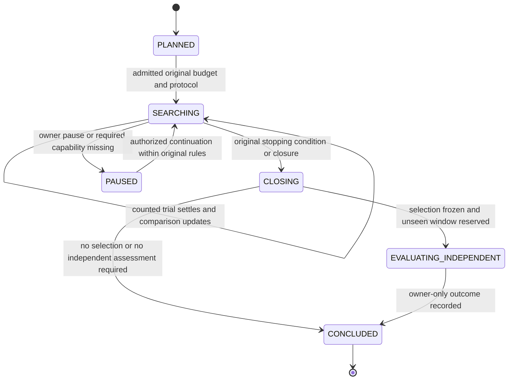
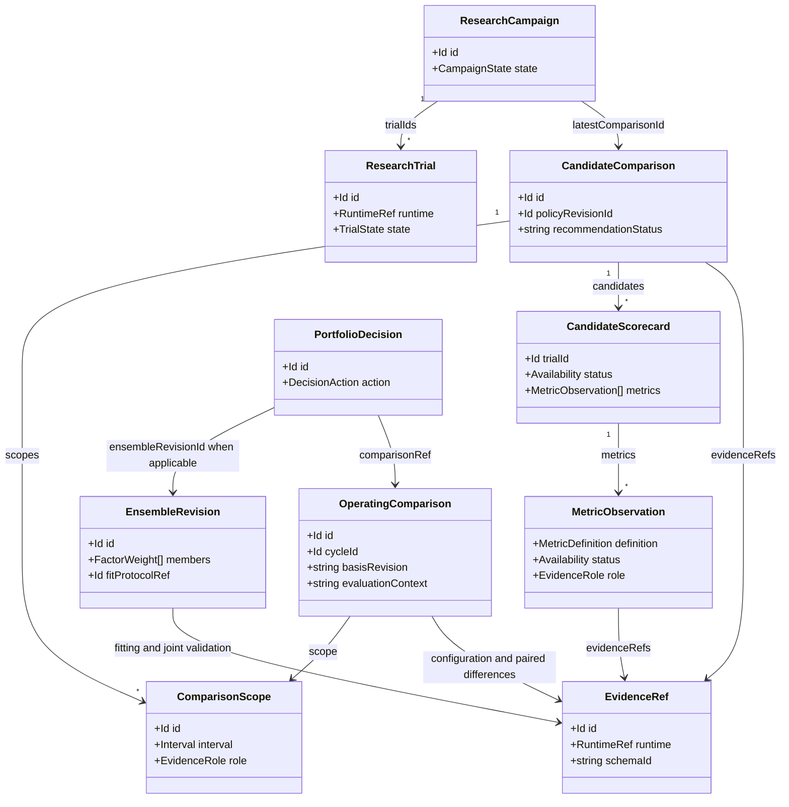

# 自动科学评价、候选比较与权重学习设计草稿

> 本章逐项映射 [规范字段合同](contracts.md)，不另定义顶层实体；局部算法说明用于解释科学口径，不代表已经实现。

状态：设计候选，未实现。本文不要求用户填写新的绩效阈值，也不把历史最优 Sharpe 直接变成组合权重。目标是每次新试验、新可用行情或账户状态到达后，系统自动刷新可比较证据，找到有数据支持的候选组合和资金权重建议；证据不足时保留未知及原组合，不伪造最优解。本稿是父级完整方案的“研究决策与科学证据”章节。

## 1. 当前能力与真正缺口

现有 TypeScript ResearchSpecification 只支持一个评价指标及可选 target。`researchCriterion` 的默认分区是 HELDOUT；这个 target 不能在本次设计中被默默改成 Validation 准入阈值。当前 `validation_compare` 只读 legacy `validation.pearson_ic`，排序并返回首个 trial；组合结果的 `partitions` 可能只是第一个成员的诊断，账户表现位于 `portfolio.statistics`。因此从成员 IC 排名不能推出最好的共享资金账户组合。

原生已有比单一 Sharpe 丰富的材料：完整 UTC 日几何平均收益、最差日、最好日、相对日几何收益的最大绝对偏差、负收益日、零收益日、预期/已观测完整日数、覆盖率，以及 Nautilus 的账户 Sharpe、Sortino、Max Drawdown 等。Calendar 性能统计在缺日、非法序列或未定价权益时为空，不能把缺失补成零。完整日统计适用于当前已接通的非 spot 路径；`simulate` 的 spot 分支没有接这组 Calendar 指标，不能假定所有策略天然可用。

费用：catalog 结果已有原始成交手续费、成交名义量及币种的精确字符串；这不是完整市场冲击模型。容量：当前有条件历史 BAR 流动性容量，catalog 容量不可用，经济容量依然缺少成本/冲击/不同资金规模净收益证据。当前 summary 没有因子配对收益矩阵，不能从 IC、Sharpe 和几个日统计反推出相关性、风险贡献或最优权重。

## 2. 业务闭环与自动化边界

自动闭环为：原始试验结算 → 生成可比较的证据卡 → 更新目标排名和候选前沿 → 找到最有信息价值的组合/权重实验 → 原生同账户 Validation 重放 → 更新前沿、边际改善和 incumbent 比较 → 冻结决策 → 独立评价。动态持续更新是新事实驱动的新决策版本，不是不断重算同一窗口直至通过。

首阶段完全不需要新增用户阈值：系统自动展示多目标关系、识别被全面改善的候选、比较新旧完整组合、解释缺失证据。第二阶段在时间对齐的样本外收益/预测和真实成本条件下学习权重。自动权重需要合法投资边界，如可投资账户资金、允许杠杆、原生最小订单和可用流动性；这些来自已有账户/市场事实及既有投资授权，不用新增一页“调 Sharpe 阈值”的表单代替智能计算。

Pareto 前沿通常不唯一，也不能识别“好策略”：所有亏损候选中仍然存在数学前沿。系统必须分别输出“有无可比较证据”“是否在前沿”“相对原目标排名”“是否优于有匹配证据的原组合/现金基准”，不能合并成一个 PASS。若偏好未定义且候选各有所长，系统仍可自动安排辨别性实验，但不能伪称存在唯一科学最优组合。

## 3. 规范合同的研究决策映射

本章使用 [规范字段合同](contracts.md) 的 `ResearchTrial`、`ComparisonScope`、`MetricObservation`、`CandidateScorecard` 和 `CandidateComparison`，不定义第二套顶层 DTO。业务试验身份为不透明字符串 `ResearchTrial.id`；官方 Pi 数字任务身份单独保存在 `ResearchTrial.runtime.taskId`。旧试验迁移建立可追溯的身份映射，不能把数字转成字符串就称为新的业务 ID，也不改写原 Task。

下列为局部纯函数签名示意，参数及返回字段均引用规范合同；不是新增 API 或独立的实体定义：

```text
compareCandidates(
  policy: DecisionPolicyRevision,
  trials: readonly ResearchTrial[],
  scopes: readonly ComparisonScope[],
  metricsByTrial: ReadonlyMap<Id, readonly MetricObservation[]>
) -> Pick<CandidateComparison,
  'scopes' | 'candidates' | 'objectiveRankings' |
  'recommendedTrialId' | 'recommendationStatus' | 'reasonCodes'>
```

函数只读取冻结的方法、原试验、已解析证据及比较范围，不读 `Study.final`、独立样本原日序列、实时行情或系统时钟，不执行科学进程、不改变旧 target。宿主为正式 `CandidateComparison` 补充规范的 `VersionedFact` 元数据、campaign/policy 引用和 `evidenceRefs`，沿官方 Durable 保存不可变结果。不同试验结算产生新的比较事实；旧比较继续可以按其原证据重放。

### 3.1 ComparisonScope：同一条件下比较什么

| 规范字段 | 类型 | 本章具体语义与原始来源 |
| --- | --- | --- |
| `id` | Id | 比较范围的 opaque 身份；不是 Pi taskId，也不是来源市场代码。 |
| `allowedUniverseRef` | Id | 原允许市场/目录 scope；持仓、因子数量、成员权重属于搜索变量，不因变化就分成孤立组。 |
| `datasetRevisionIds` | Id[] | 原 source/revision 对应的 DatasetRevision；不能仅凭目录路径判断数据相同。 |
| `interval` | Interval | 原比较窗口 `[startNs,endExclusiveNs)`；当前 native train/validation 边界由适配器精确映射，不改变端点。 |
| `role` | EvidenceRole | 用于训练、内层择模或最终候选选择的用途；由冻结 protocol 指定，不能只凭 native 字符串 `VALIDATION` 猜测。 |
| `calendarId` | Id | 完整 UTC 日或其他已登记日历；年化周期另外保存在指标定义。不同日历不混比。 |
| `labelDefinitionId` | Id 或 null | 纯因子/预测比较绑定原 horizon、标签单位及成熟规则；账户绩效无对应预测标签时为 null。 |
| `accountingPolicyRef` | Id 或 null | 原共享账户币种、现金/保证金、权益和收益计算规则；纯因子不建立账户时可为 null。 |
| `costModelRef` | Id 或 null | 原费用、成交、延迟、冲击模型依据；缺失为 null，并保留能力缺口，不解释为零费用。 |
| `startingStateRef` | Id 或 null | 相同初始资金/仓位/未完成需求的原证据；纯因子可不适用。重放比较不能各自采用有利起点。 |
| `capital` | Money 或 null | 同一总账户资本及币种；纯因子不适用时为 null。不同资本规模属于容量曲线不同点，不能冒充同资本比较。 |

`ComparisonScope` 不重复内联 request、nativeVersion、返回数据和策略 JSON。完整原请求、source/revision、runtime、收益种类及能力说明保存在 `EvidenceRef`、`DatasetRevision`、`StrategyVersion`、`DecisionPolicyRevision` 中，由规范引用解析。指标的决策时点和可得时点分别使用 `MetricObservation.asOfNs/availableAtNs`；上层周期的可用截止使用 `DecisionCycle.availableCutoffNs`。这些时钟不能用 comparison 的生成时间替代。

冻结输入相同只是必要条件。实际 native 返回的窗口、资金、费用、角色和日历还需与原协议吻合；矛盾记录 `INCOMPARABLE`。搜索变量由协议明确定义，其余上下文必须相同。没有真实可得时钟时保留原证据及缺口，不能通过制造时间戳将它包装成 PIT 合格材料。

### 3.2 MetricObservation：保留原值并显式规范化

| 规范字段 | 类型/单位 | 映射及空值规则 |
| --- | --- | --- |
| `definition` | MetricDefinition | 绑定不可变 `id`，并校验内嵌定义与注册原件一致；包含key、definitionVersion、单位、编码、方向、aggregation、calendarId、annualizationDays、horizonRef，不能只凭同名key替代定义。 |
| `status/value/reasonCodes` | Availability / number或Decimal或null / string[] | AVAILABLE 必须有合法值；其余状态值必须 null。计算失败属于 ResearchTrial.state=FAILED，指标使用 UNAVAILABLE/INVALID 等状态并保留原因，不新增 metric FAILED 枚举。 |
| `currency` | Currency 或 null | 金额必须有原币种；收益比例不伪造币种转换。 |
| `role/interval` | EvidenceRole / Interval | 与实际评估用途及原窗口一致；角色不从展示名称推断。 |
| `asOfNs/availableAtNs` | Ns / Ns | 指标描述的决策时点与系统实际可使用证据的时间，必须分别保留；源时钟精度在 EvidenceRef 中记录。 |
| `origin/methodRef` | FactOrigin / Id或null | 原生汇总/派生比例属于 DERIVED 等相应来源，方法可追溯；用户目标及产品默认方法不冒充来源事实。 |
| `evidenceRefs` | Id[] | 指向完整 native 结果、数据、费用和转换输入；私有路径不进入模型接口。 |
| `sampleCount/expectedCount` | string或null | 定义对应的样本与完整日分母；不是 tick 数等价于独立样本数。 |
| `uncertainty` | EstimateInterval或null | 有校验方法才提供；无法估计保留 null，不以零宽区间冒充确定性。 |
| `raw` | 规范 raw 对象或null | 保存 nativeKey、原始值、单位及 conversionVersion；规范值和原证据可逐项对照。 |

首批规范指标与本章科学口径对应如下：

| 规范 key | 原生来源、规范单位及方向 | 具体限制 |
| --- | --- | --- |
| `factor.pearson_ic` | 原纯因子Validation Pearson IC；DIMENSIONLESS / MAXIMIZE | 绑定原标签与horizon，显式AVAILABLE且唯一；组件诊断不代替账户证据。 |
| `data.expected_days` / `data.observed_days` | Calendar Expected Days / Observed Return Days；COUNT / DIAGNOSTIC | INTEGER_STRING编码；同一日历/窗口，原数值必须先验证整数及可精确转换。 |
| `account.negative_days` / `account.zero_days` | Calendar Negative Days / Zero Days；COUNT / DIAGNOSTIC | 保留实际分母，零收益不自动视为好/坏；不跨不同天数排序原计数。 |
| `account.daily_geometric_net_return` | Calendar Geometric Daily Return；RETURN_RATIO / MAXIMIZE | 0.01 表示日收益1%；不自行年化。只有原费用已正确进入权益时称 net；完整日缺口不补零。 |
| `account.worst_daily_net_return` | Calendar Minimum Daily Return；RETURN_RATIO / MAXIMIZE | -0.01 优于 -0.10，不绝对值化负收益。 |
| `account.daily_maximum_deviation` | Calendar Maximum Absolute Deviation；RETURN_RATIO / MINIMIZE | 相对原日几何收益的最大绝对偏差，不是标准差或置信界。 |
| `account.maximum_drawdown` | Max Drawdown；LOSS_RATIO / MINIMIZE | native `raw.value=-0.20` 经登记转换得到规范 `value=0.20`；保留 conversionVersion。比较规范正损失，不再按原负数 direction 排名。 |
| `account.negative_day_fraction` | 原 negativeDays/expectedDays；RATIO / MINIMIZE | 完整覆盖且分母>0才导出；原分子分母保存在源证据，样本数按指标定义记录。 |
| `data.complete_day_coverage` | 原完整日计数；RATIO / DIAGNOSTIC | 计数必须一致；coverage=1不能覆盖未定价权益。 |
| `account.sharpe` | 原生 exact Sharpe key；DIMENSIONLESS / MAXIMIZE | 252与365对应不同MetricDefinition.id，annualizationDays明确记录，raw.nativeKey保留完整原键；两者不混排、不换算替代。 |
| `cost.recorded_commission` | recorded_fee_totals.commission_total；CURRENCY / DIAGNOSTIC | DECIMAL编码与原币种；缺失不当免手续费，净账户收益不重复减费。 |
| `execution.gross_fill_notional` | recorded_fee_totals.gross_fill_notional；CURRENCY / DIAGNOSTIC | 原币种与DECIMAL编码；毛成交名义量不是净换手或经济容量。 |
| `execution.fill_count` | recorded_fee_totals.fills；COUNT / DIAGNOSTIC | INTEGER_STRING编码；成交笔数不是独立统计样本数。 |

最好日、部分日计数及原零收益日比例等尚未登记的派生展示，继续保留在 `EvidenceRef` 的native诊断中，不在本章另造canonical key。以后需要独立排序或统一展示，先登记规范MetricDefinition。原ResearchSpecification的IC或指定252/365天Sharpe，经版本化的精确native key映射进入Objective.metricDefinitionId，保持旧目标语义及原始键可追溯。原证据无法确定的日历、期限或年化周期保持缺口，不自动填默认值。

Objective、objectiveRankings及OwnerBoundary中LOSS子schema都绑定metricDefinitionId；metricKey仅协助语义检查和展示，不能单独充当消费身份。引用的单位、horizonRef及日历必须与注册定义及ComparisonScope相容；定义改变产生新身份，不原位改变历史比较的含义。

原 `gross_fill_notional` 是毛成交名义量，不等于净换手或容量。手续费除以毛成交名义量只能在同币种且分母为正时以精确十进制派生；它仍不是完整成本率，不能重复惩罚已在净收益中计入的费用。未登记该派生指标前，作为证据说明保留。

读取只接受唯一匹配的原角色、原主体及不可变定义。同一ComparisonScope、metricDefinitionId和主体出现重复或矛盾观察时判AMBIGUOUS，不选第一条或最有利值；跨scope/定义的观察保留分组，不因key相同而合并。其他上下文不兼容或定义原件不一致分别报告INCOMPARABLE或INVALID。显式不可用状态/reason_code优先于携带的有限数。旧无状态账户标量仅在原合同允许时兼容；原trial失败和全部缺口始终可查。

### 3.3 样本用途与 native 分区的映射

| 规范 EvidenceRole | 用途 | 与当前 native 分区的关系 |
| --- | --- | --- |
| `TRAINING` | 参数拟合、预测映射、成本/风险模型训练 | 原 TRAIN 是证据来源之一；仍需检验标签成熟及可得时钟。 |
| `INNER_VALIDATION` | 内层学习器、超参数和方法比较 | 必须来自冻结的内层时间切分；不能将完整原 Validation 复制命名后声称新独立折。 |
| `SELECTION` | 比较冻结候选、完整组合重放与最终择优 | 当前用于候选比较的原 VALIDATION 映射到此角色；不是 INDEPENDENT。 |
| `INDEPENDENT` | 选择冻结后的独立评价 | 原 HELDOUT 仅在既有暴露规则证明未使用时可映射；始终 owner-only，不给搜索模型反馈。 |
| `PREQUENTIAL` | 先冻结预测/权重，再到达结果的前滚评价 | 使用真实决策历史与后续成熟结果，不能回填未来修订。 |
| `OBSERVED` / `CONTROL` | 实际账户观测 / 配对基准及干预对照 | 各自保留真实来源；ACK、目标权重不能生成 OBSERVED 收益。 |

历史重评不能被升级为 INDEPENDENT。角色由 protocol 和实际暴露事实决定，`EvidenceRef.visibility` 还需单独校验；角色标签不能授权读取 owner-only 证据。

## 4. 自动前沿、目标排名与选择解释

规范 `CandidateScorecard` 只使用 `trialId`、`comparisonScopeId`、`status`、`metrics`、`frontierMembership`、`dominatedByTrialIds`、`missingEvidence` 和 `baselineComparisonRef`。原试验状态从ResearchTrial.state读取，不再复制成另一份trialStatus。frontierMembership表达同scope及登记维度上的经验点估计Pareto关系，不是统计显著性或投资资格；UNDETERMINED表示证据不足或不可比较，不能降格为DOMINATED。

首版方法候选的账户比较向量为规范日几何收益 MAXIMIZE、最差日 MAXIMIZE、规范正回撤 MINIMIZE、日偏差 MINIMIZE、负收益日比例 MINIMIZE。向量由 DecisionPolicyRevision 的冻结方法决定；这是一项可校验的方法选择，不是天然最优投资偏好。原目标另有 objectiveRankings，不暗中重复加权收益/风险。成本、覆盖率及样本数用于诊断和可比较性判断，不拼成任意总分。

A 的经验点估计在全部登记维度不差于B且至少一维严格改善才构成此处的支配。比较同一ComparisonScope及同组metricDefinitionId的完整向量；数值容差/tie规则引用policy.numericalToleranceRef，该数值容差不是统计显著性阈值。全部未被支配的候选为MEMBER，被支配者为DOMINATED。缺少任一必要维度则UNDETERMINED，不靠少报风险进入前沿；不在不同pair中随意删维度。完全相同的向量全部保留并列，不能用业务ID、Pi taskId或时间先后伪造优劣。纯因子只消费适用的预测证据，不冒称账户多目标前沿。

若方法启用置信支配或配对改善判断，须另记录方法版本、样本配对/时间依赖处理及相应不确定性证据，通过研究comparison.evidenceRefs或运行OperatingComparison.pairedDifferenceEvidenceRefs引用。该结论不覆盖frontierMembership，也不能把单项指标区间或试验预算自动解释为多目标统计显著性。

逐对支配/权衡解释是由 `CandidateComparison.evidenceRefs` 引用的版本化派生证据，不再另定义同名顶层CandidateComparison。局部证据记录双方ResearchTrial.id、ComparisonScope.id、关系、改善/恶化/相同/不可用的metricDefinitionId及对应key、原数值和原因；关系可表述为支配、被支配、相同、权衡、不可比较。差值只对相同定义及可比口径计算，也不能直接称为因子经济边际贡献。`dominatedByTrialIds`提供经验点估计关系的卡片摘要，解释原件可按证据引用读取。

目标排名使用规范 `objectiveRankings[{scopeId,metricKey,metricDefinitionId,ties}]`；ties按从好到坏的并列集合保存。每个排名只消费目标绑定的精确定义；相同key但不同定义、年化、日历、horizon的观察不混排，也不回退到默认定义。缺失/失败不排成某个最差数字。

选择状态严格使用规范合同：

| recommendationStatus | recommendedTrialId | 决策含义 |
| --- | --- | --- |
| `SELECTED` | 受原选择规则支持的 ResearchTrial.id | 原 LEXICOGRAPHIC 顺序或有来源的 EXPECTED_UTILITY 能确定推荐，基准及适用条件同时成立；不能默认取排序第一。 |
| `FRONTIER_ONLY` | null | 已有可比较前沿，但冻结规则只要求前沿或当前证据不能唯一排序；保留权衡、继续合法研究。 |
| `NO_VIABLE_CANDIDATE` | null | 证据足以判断当前候选在适用业务规则/基准下均不可选；“有数学前沿”不改变该结论。 |
| `NEEDS_EVIDENCE` | null | 缺失、矛盾或不可比证据影响选择；不能称为亏损已证实，也不能变成零风险/现金成功。 |

SelectionRule来自OWNER_GOAL或ACCEPTED_PROFILE；LEXICOGRAPHIC顺序不能看完结果重排，EXPECTED_UTILITY要求有utilityModelRef，FRONTIER_ONLY不强选一个。旧ResearchSpecification.target继续原HELDOUT意义，不自动变为新SELECTION门槛。搜索反馈可以自动指出被全面改善的候选、前沿权衡及下一次应补的证据；新组合实验仍按原预算记账，读取旧结果不重复算一次试验。

## 5. 权重学习与边际贡献的规范引用

summary只能生成比较证据。自动学权重需要时间对齐的预测/成熟标签及收益面板；大型面板作为有schemaId的EvidenceRef产物保存，不新增一套顶层Panel实体。其行采用规范PredictionRow，额外的矩阵布局、币种、收益horizon、市场ID和缺失掩码写入该科学产物schema及原protocol。不得把未观察收益补零，一个因子没有暴露也不等于市场收益没有观察到。

| 学习所需信息 | 规范承载位置 | 语义 |
| --- | --- | --- |
| 源试验、模型及参数来源 | ResearchTrial.parentTrialIds/evidenceRefs；FactorVersion.modelRef/trainingEvidenceRefs | 业务引用为opaque ID，实际科学Task由EvidenceRef.runtime绑定。 |
| 时点、可得性、标签成熟 | PredictionRow.eventAtNs/decisionAtNs/featureAvailableAtNs/labelEndNs/labelAvailableAtNs | 决策前不可得特征及训练截止后成熟标签不能进入相应拟合。 |
| 内外层折与面板引用 | PredictionRow.foldId；ResearchTrial.protocolRef；EvaluationProtocol；EvidenceRef | 折协议明确TRAINING/INNER_VALIDATION/SELECTION；不把同批选择结果反复当独立评价。 |
| 校准和因子系数 | CalibrationModel；EnsembleRevision.members:FactorWeight[] | 系数作用于同label/unit的可比较预测，不是资金仓位。 |
| 拟合方法/截止/版本 | EnsembleRevision.fitProtocolRef/fitCutoffNs；policyRevisionId | 新权重产生新revision，线上方法也需保留截止和输入证据。 |
| 拟合与联合验证证据 | EnsembleRevision.trainingEvidenceRefs/jointValidationEvidenceRefs | 拟合优度不充当同账户实证结果；qualification按CANDIDATE/SELECTED/INDEPENDENTLY_EVALUATED/RETIRED表达。 |
| 多策略预算 | PortfolioDecision.strategyAllocations:StrategyAllocation[] | capitalFraction是该策略承诺资金占组合承诺资金的比例，分母为零时null；共享资产按原nettingGroup净额化，不与因子预测系数混用。 |
| 资产仓位、资金与费用约束 | PortfolioDecision.assetTargets/capital/accountBasis/researchStartingStateRef | navWeight以同一NAV为分母；与因子系数及承诺资本分开。 |
| 风险/成本/容量及求解 | RiskModel；CostModel；CapacityEstimate；PortfolioDecision.solverEvidenceRef | RiskModel保留matrixOrScenarioRef、cutoffNs和数值诊断；CostModel保留可识别组成及适用资金范围，不从几个汇总绩效数值倒推出协方差、冲击或容量。 |
| 真实重放和建议状态 | ResearchTrial.state；PortfolioDecision.jointReplayEvidenceRef/status/action | 无解、缺证据、拟议和实际可消费状态按对应实体表达，不另造WeightProposal状态机。 |
| 研究候选比较 | CandidateComparison.campaignId/candidates/recommendedTrialId | 比较原ResearchTrial；候选身份、研究账本和选择用途保留在研究域。 |
| 运行保持/现金/重配比较 | PortfolioDecision.comparisonRef → OperatingComparison | 必须属于同一cycleId/basisRevision；scope固定现仓、资金、成本及评价时点，candidates的configurationEvidenceRef定义候选配置，不为运行候选伪造ResearchTrial。 |

当前ensemble入口只接受严格正系数；新拟合合同初始为非负凸组合，允许精确零。拟合结果的零系数保留在EnsembleRevision，执行适配时只将正系数组成现有入口可接受的成员集，并由native做精确归一化/舍入及成员能力校验。不能给零系数补epsilon；也不能把资产优化器支持的负navWeight塞入不支持signed因子系数的ABI。若正系数成员数不满足现有catalog至少两个成员等能力，报告能力缺口，不能伪造成员。

方法采用时间内层训练估计校准、协方差和可识别成本，内层验证选择学习器，外层前滚样本评价冻结规则。因子系数拟合按规范拟议fit-ensemble typed Clarabel适配；现有allocate/study-portfolio用于其支持的资产预测、约束和账户重放，不替代因子拟合。现有sample covariance可以复用，shrinkage等是待实现能力，不能只换方法名。MaxUtility的风险厌恶不是数据能唯一识别的业主偏好；缺少原SelectionRule所需意愿时保留前沿或incumbent，不虚构唯一最优。

边际贡献通过同ComparisonScope的配对原生重放建立：incumbent、加候选的组合、移除候选的组合。干预来源使用ResearchTrial.purpose=ABLATION及parentTrialIds记录；派生解释通过FactorWeight.contributionEvidenceRef、CandidateScorecard.baselineComparisonRef及comparison.evidenceRefs引用。规范`factor.incremental_net_value`只描述相应干预下的非加性净改善；回撤、费用、换手及不确定性分别保留原定义和证据。保持其余权重留现金与重新拟合剩余权重是不同消融，不能把重优化全部收益归给被移除因子，更不能相加独立单因子净值。

上述研究消融仍属于CandidateComparison。运行周期使用OperatingComparison比较HOLD_CURRENT、CASH、REBALANCE、REDUCE配置，并分别记录transitionCost、netOutcome、downside和capacityEstimateIds。evaluationContext明确区分HISTORICAL_JOINT_REPLAY、FORWARD_MODEL_ESTIMATE和OBSERVED_FORWARD，不能将估计改善写成已实现增益。配对差值及不确定性保存在pairedDifferenceEvidenceRefs；保持和现金也计入真实持有/退出成本。selectedCandidateId只指向该运行比较内的候选；引用研究证据不自动继承其独立资格。

## 6. 滚动学习、污染与规范状态机

SELECTION用于候选比较；INDEPENDENT不进入该比较或学习。候选/权重/方法在独立评价前冻结，最终结果不返回搜索模型继续调参。历史重评不能改标成独立证据；同一独立窗口看过后不因重启、复制目录、换版本/conversation重新获得资格。现有session Exposures按资产原身份和时间重叠检查，继续作为原事实边界。

新增成熟Forward数据通过OBSERVED/PREQUENTIAL事实进入后续版本；记录当时模型、权重、可得输入、成本与容量依据。labelAvailableAtNs晚于训练截止的标签不可用；purge覆盖标签重叠、embargo按冻结protocol记录。现有Rust切分能力不等于当前TS研究已接通。不同折新注资的收益不能拼接连续净值，不平均Sharpe；连续账户路径和折级诊断分别解释。

连续学习及自适应搜索的科学约束直接引用下列规范对象，不以本章另设状态或方法参数替代：

| 规范对象/字段 | 研究决策用途 |
| --- | --- |
| `EvaluationProtocol.folds/methodSelectionRuleRef/stoppingRuleRef` | 冻结时间折、purge/embargo、方法选择及停止规则；内层具体划分作为methodSelectionRuleRef所指协议的内容，不能虚构字段或独立样本。 |
| `SearchFamily.trialIds/methodVariantRefs/countedAttempts/failedAttempts` | 跨campaign保持完整假设/方法搜索账本；failedAttempts仍计入研究成本。effectiveTrialEstimate有统计依据才填，不等于简单maxTrials。 |
| `ExposureRecord.roleAtExposure/consumer/allowedUse/resultingEvidenceRefs` | 记录谁在何时将证据用于拟合、选择、一次评价或观察；与既有session暴露事实对应，不借新对象重置原暴露。 |
| `AdaptiveUpdateProtocol.maturityRuleRef/trainingWindowRuleRef/modelSelectionProtocolRef` | 明确标签成熟、滚动窗口与再选择规则；allowedParameterDomain限定可自动更新范围。 |
| `AdaptiveUpdateProtocol.wholeProcessValidationRefs/outOfDomainAction` | 评价完整更新过程；越出有效域时使用KEEP_VALID_INCUMBENT、REDUCE_WITH_EVIDENCE或WAIT_EVIDENCE，不能重新拟合直到有利。 |
| `ResearchWorkAllocation.expectedInformationEvidenceRef/resourceEstimateRef/action` | 自动决定下一实验、等待、关闭搜索或退役假设；信息增益未知时引用为空并解释，不假装存在可靠评分。 |

下图只展开规范ResearchCampaign.state，不新增另一套业务状态枚举。证据不足/前沿/推荐等子结论由CandidateComparison表达；实际操作持续更新由DecisionCycle承接。



CONCLUDED不是“证据通过”。独立评价是否达到相应阶段条件由PipelineAssessment.outcome和原指标表达。新的成熟数据启动新DecisionCycle，不能原位重新开放已结束Campaign并重置试验/暴露。NEEDS_EVIDENCE与NO_VIABLE_CANDIDATE使用规范comparison状态及reasonCodes；预算尚余且仍有合法实验可继续研究，到原停止条件则结论落账。



类图引用规范实体及部分字段，仅说明依赖，不复写完整类型。TS负责事实适配、确定性投影和决策编排；拟合、原生收益、求解与共享账户评价留在native科学边界。自动研究建议不等于授权交付，PortfolioDecision和TargetCommand仍遵循原账户、能力、期限及授权合同。

## 7. 验收与分期

第一期验证“自动读证据并解释”：每次结算增量刷新；较低目标值但更小下行风险的候选仍可在前沿；全等候选并列；全亏损仍不能称达标；缺项不填零；252/365绑定不同metricDefinitionId且不默认回退；同scope/定义/主体重复或矛盾值为AMBIGUOUS；经验点估计Pareto不被展示成统计显著，置信结论另有方法与配对证据；原生负号回撤显式转换为规范正损失、保留raw与conversionVersion，方向为MINIMIZE；成员IC不充当账户指标；部分日不充完整日；完整覆盖但未定价不获得稳定性成绩；成本 Decimal 不丢精度、不重复扣费；同样证据、policyRevisionId及登记方法得到相同结果；SELECTION比较绝不读取INDEPENDENT证据；opaque业务ID与numeric runtime.taskId映射可追溯。

第二期验证“权重由真实数据学习”：PIT时间违规/未成熟标签被排除；缺失矩阵不补零；训练选择与外层评价分离；缺成本或容量时返回具体未知；Clarabel 无解不退回假成功等权；拟议权重只在原生重放后成为实证候选；加因子后相关性变化可改变建议，单因子IC排序不能预定结果；incumbent与新组合共用同一总资本/市场输入；不确定的改善不覆盖 incumbent。

第三期验证“动态持续更新”：原决策可按当时数据重放；新修订不污染旧独立结论；未来数据无法影响较早权重；费用/容量/账户状态过期时建议失效而非续期；新增真实 Forward 足迹可触发新一轮学习，已有 exposed window 不被再次认作独立验证。

每期分别报告协议正确性、科学数值正确性和真实市场绩效。自动 scorecard 通过测试不等于已发现 alpha，历史组合改善不等于实盘收益或经济容量成立。

## 8. 证据来源

仓库：

- `packages/contracts/src/index.ts:28`：当前 ResearchSpecification；`packages/contracts/src/research.ts:41`：原 criterion 分区和目标语义。
- `apps/research/plugins/validation-compare.ts:14`：legacy IC/top1；`apps/research/plugins/native-portfolio.ts:101`：component诊断与账户统计边界；同文件 `:146`、`:172`：catalog统计、费用和独立日序列范围。
- `apps/job/src/simulation/calendar_returns.rs:28`：完整日范围、覆盖、有效性、可用状态及现有测试；`apps/job/src/simulation.rs:1244`、`:2117`：实际接入点与spot边界。
- `crates/contracts/src/science.rs:204`：NativeStatisticV1 的 group/native_key/currency/value/reason_code。
- `apps/research/plugins/native-exposure.ts:40`：暴露账本；`apps/research/src/trials.ts:8`：试验身份、失败、预算与结算；`apps/research/plugins/heldout-group.ts:21`：先冻结全组、后暴露。
- `apps/service/src/capacity.ts:17`、`:71`：经济容量未建立与现有factorCapacity依赖最终独立结果。
- `crates/contracts/src/portfolio.rs:120`、`:434`、`:471`：原生目标/约束/收益历史/AllocationInput；`crates/domain/src/portfolio.rs:588`：现有sample covariance方法边界；`crates/domain/src/execution/validation.rs:74`：原生purge/embargo。
- 已安装官方 `nautilus-analysis-0.63.0/src/statistics/max_drawdown.rs:24`：Max Drawdown 为负比例；本稿已核对实际依赖源码而非猜测符号。

原始外部来源（原则支持，不作为项目已实现能力）：

- QuantConnect Framework：<https://www.quantconnect.com/docs/v2/writing-algorithms/algorithm-framework/overview>，区分Alpha、组合目标、风险、执行，信号强度不等于可投资账户价值。
- QuantConnect Backtest Report：<https://www.quantconnect.com/docs/v2/cloud-platform/backtesting/report>，共同报告收益、回撤、换手、容量及账户证据。
- Bailey / López de Prado，Deflated Sharpe Ratio：<https://www.davidhbailey.com/dhbpapers/deflated-sharpe.pdf>，多次试验及只报告赢家导致膨胀；本稿不声称当前已实现DSR，也不把有限试验预算称为统计显著性。

以上自动向量、前沿和学习接口属于明确的产品/方法设计候选，不是某篇论文规定所有基金必须采用的唯一规范。
